# MedApp architecture handbook

**Status:** describes MedApp as it is on `main` after pull request #53 (a generated first password for new accounts), which followed #51 (the SSR security fixes) and #52 (the Azure setup and the deploy fixes). Written 15 November 2026, and checked against that `main` the same day. Updated on 16 November 2026 for staff calendars and appointments (`feature/staff-calendars`), from their design (`docs/calendar-plan.md`): sections 1.1, 1.2, 3.3, 5.4 to 5.8, 6.3, 8.1, 8.2, 8.8, ADR-23, "Features worth adding" (scheduling), the glossary and the document map.

**For:** a new senior engineer, an architect, a security assessor, or someone assessing the product for purchase (technical due diligence). It's the one document to read for the whole picture, end to end. It links to the detailed documents rather than repeating them.

## About this document

- **Structure.** It follows arc42, a widely used template for describing software architecture, with its twelve sections in their usual order. Two parts sit outside that numbering: the roadmap (after the risks) and two appendices (after the glossary).
- **What it describes.** `main` at `eef92dd` (the merge of #53, on 15 November 2026), which includes #51 and #52 with their review fixes. Line numbers refer to that state.
- **How it was checked.** The code was read, not just the docs. Where the two disagree, the code wins, and [Appendix A](#appendix-a-where-the-docs-and-the-code-disagree) lists the differences. Repository settings (branch rules) were read through the GitHub API on 15 November 2026. Nothing was run against Azure, Docker, a cluster or a database.
- **Inference.** Some decisions were never written down with their reasons. Where this handbook gives a reason that isn't recorded anywhere, it says **(inferred)**.
- **Paths** are relative to the repository root.

## Contents

1. [Introduction and goals](#1-introduction-and-goals)
2. [Constraints](#2-constraints)
3. [Context and scope](#3-context-and-scope)
4. [Solution strategy](#4-solution-strategy), including the [technology inventory](#43-technology-inventory)
5. [Building block view](#5-building-block-view)
6. [Runtime view](#6-runtime-view)
7. [Deployment view](#7-deployment-view), including [how to run it](#78-how-to-run-it)
8. [Cross-cutting concepts](#8-cross-cutting-concepts)
9. [Architecture decisions](#9-architecture-decisions)
10. [Quality requirements](#10-quality-requirements)
11. [Risks and technical debt](#11-risks-and-technical-debt)
- [Roadmap: the next 10 steps](#roadmap-the-next-10-steps)
12. [Glossary](#12-glossary)
- [Appendix A: where the docs and the code disagree](#appendix-a-where-the-docs-and-the-code-disagree)
- [Appendix B: document map](#appendix-b-document-map)

---

## 1. Introduction and goals

### 1.1 What MedApp does

MedApp is a patient and procedure management app for clinical staff. It records patients, and tracks the procedures done for them through a fixed sequence of stages, with a full audit trail. Each member of staff has a calendar, on which staff book appointments with patients.

| Area | What people can do |
|---|---|
| **Patients** | List, search, sort and page through patients; add, view, edit and delete them. A patient record is deliberately small: first name, last name, date of birth and email (`MedApp.Domain/Patients/Patient.cs`). A patient who has procedures can't be deleted. |
| **Procedures** | Start a procedure for a patient from a **template**. The template's stages are copied onto the procedure, so later edits to the template don't rewrite history. Each procedure has a title, notes, a due date (a whole day, UK time), a priority and a status. |
| **Stages** | Work the stages strictly in order: start the current stage, write its notes (rich text), then **finish** it, which locks it. An admin can **unlock** a finished stage to correct it. |
| **Status workflow** | The status moves by itself (assigned, in progress, in review) and by hand (complete, block or cancel with a reason, archive). The rules are in one place, `ProcedureWorkflow` ([section 5.6](#56-the-domain-model)). |
| **Assignment** | Admins assign staff to procedures. Assignment decides whose task list a procedure appears on; it doesn't limit who may work on it. Changing a procedure that isn't yours asks for confirmation first, once per visit. |
| **Task list** | My Tasks (`/tasks`) shows the open procedures assigned to you, in two lists: Not started and Started. |
| **Templates and stage definitions** | Admins maintain reusable **stage definitions** (name, description, instructions, and whether the stage involves a visit: none, suggested or required) and **templates** (ordered lists of definitions, where a stage may repeat). Ones in use are archived, not deleted. |
| **Calendars** | Each member of staff has a **calendar**: an 08:00 to 18:00 working day, UK time, Monday to Friday, in day and week views, with weekends greyed. Staff **block off time** on it for activities from an admin-managed list (Lunch, Training, Annual leave, ...). Admins write **day and week templates** that fill each week with its usual blocks, applied when the calendar is read; a person's default week can be changed for one day. Nothing may overlap, and past days don't change. Everyone can see everyone's calendar; blocks and templates on a calendar are changed by its owner or an admin. |
| **Appointments** | Staff book an **appointment** for a patient with a member of staff, optionally for a procedure and stage, in a free slot. It goes from **Requested** (needs booking) to **Booked**, then **Attended** or **Did not attend**, or **Cancelled** with a reason; every change is kept in its history. When a stage that involves a visit becomes current, the app requests an appointment for it, and a stage whose visit is **required** can't be finished until the appointment is Attended, unless an admin finishes it with a reason. A **Needs booking** list shows the requested ones. The member of staff is notified when someone else books, moves or cancels their appointment. |
| **Audit log** | Every change to a procedure writes an audit entry: who, when, what, and the old and new values. Admins read the whole log on its own page, searchable and filtered by procedure. The patient page's timeline shows one patient's history across their procedures: all of it for admins, deleted procedures included; for staff, only procedures that still exist and never the log's free text (notes, titles, reasons). |
| **Notifications** | Being assigned a procedure, or having an appointment booked, moved or cancelled (by someone else), sends a notification. It's stored, then pushed live to every page that person has open. A bell shows the unread count. |
| **Users and roles** | Admins create users (the server generates each new account's first password and shows it once), reset passwords, delete users (confirming with their own password) and set roles. Everyone can change their own password. Five wrong passwords lock an account for five minutes. |
| **Account settings** | Light or dark mode, colour themes or custom colours, text size, navigation and list preferences, saved searches ("favourites"), and eleven accessibility switches. They're stored with the account, so they follow a person between browsers. |
| **Accessibility** | The target is WCAG 2.2 level AA (the Web Content Accessibility Guidelines). There's an accessibility statement at `/accessibility`, keyboard shortcuts, screen reader announcements, and an automated audit. |
| **Half views** | Any two pages side by side, opened from the side navigation. |

There are two roles. **Staff** (role `User`) can do nearly everything: patients, creating and working on procedures, booking and changing any appointment, and blocking time on their own calendar. **Admins** (role `Admin`) can also manage users and roles, stage definitions and templates, activity types and calendar templates, anyone's calendar, assign staff, unlock stages, finish a stage whose visit is required without one, delete cancelled or archived procedures, and read the audit log. An admin account normally holds both roles.

### 1.2 Who uses it

- **Clinical and administrative staff** use it every day: they find patients, start procedures from templates, work stages, book appointments, and follow their task list and their day's calendar.
- **Admins** set up the templates and stages, activity types and calendar templates, manage accounts, assign work and review the audit log.
- **The maintainer** develops and operates it, mostly through AI coding agents that follow `AGENTS.md` ([section 2.2](#22-organisational-constraints)).

### 1.3 Quality goals

In priority order. [Section 10](#10-quality-requirements) says how each is met and measured.

| # | Goal | What it means here |
|---|---|---|
| 1 | **Confidentiality and integrity of patient data** | Only signed-in staff see patient data; only admins change structure. Data is protected in transit and in the cluster, secrets never live in git, and the platform is locked down. |
| 2 | **Traceability** | Every change to a procedure can be traced to a person and a time, and the trail survives deletes. |
| 3 | **Accessibility** | WCAG 2.2 AA on every screen, in light, dark and colour themes. |
| 4 | **Maintainability and testability** | A new feature follows one known pattern; tests cover all behaviour worth testing; conventions are written down and enforced in CI. |
| 5 | **Deployability and graceful degradation** | One image, deployed the same way everywhere from git; optional parts (server rendering, live notifications) fail soft rather than taking the app down. |

### 1.4 Stakeholders

| Stakeholder | Interest |
|---|---|
| Staff users | A fast, accessible app that doesn't lose their work. |
| Admin users | Control over templates, accounts and assignments; an audit trail. |
| The maintainer | One owner for code, deployment and operations. |
| AI coding agents | Follow `AGENTS.md` and `MedApp.Web/AGENTS.md`, which are written for them. They write most of the code. |
| Security assessor | How patient data is protected, and where the gaps are. |
| Data protection officer (prospective) | Lawful handling of special category health data. Nothing has been assessed yet ([section 2.3](#23-regulatory-and-legal-constraints)). |
| Due diligence reviewer | Maturity, risk, cost and the effort to take it to production. |

### 1.5 Status and maturity

Read this before anything else if you're assessing the product.

- **It has never run in production, and has never held real patient data.** Every environment uses synthetic data only.
- **Azure is written and checked, but not deployed** (`deploy/azure/README.md`). The local Kubernetes cluster (kind) is the only cluster it has run on.
- **It's young, and moved fast.** The backend and the original Blazor UI were built from January to February 2026 (PRs #1 to #21). The rest happened from 13 to 15 November 2026 (PRs #22 to #53): the React rewrite, the procedures workflow, accessibility, notifications, server-side rendering, Kubernetes, GitOps and Azure. From #24 onwards, every pull request description is marked as generated by Claude Code, an AI coding tool, and every commit since 13 November, apart from GitHub's merge commits, carries a Claude co-author line.
- **One maintainer.** There's no team; the bus factor is one.
- **It's a portfolio project in a public repository** (`docs/react-migration-plan.md`, Q5b). The source, the container image and this handbook are all public.
- **Tests:** 815 .NET unit tests and 713 web tests, with web coverage gated at 99% of lines. 185 integration tests run the real API against SQL Server in Docker, and 11 Playwright end-to-end tests run the main journeys against the production image; both run on every pull request and are required checks on `main`.
- **Reviews:** an adversarial review of everything from server-side rendering onwards found 31 issues (4 high, 14 medium, 13 low; `docs/reviews/flaws-review.md`). #51 and #52 fix the high ones and most of the mediums. Each of #51, #52 and #53 also has its own review under `docs/reviews/`:
  - #51's found six more, all low; four were fixed before it merged, and two were documented.
  - #52's found one high, fixed before it merged, three medium and five low.
  - #53's found two medium and nine low.

  [Section 11](#11-risks-and-technical-debt) lists what's left.

---

## 2. Constraints

### 2.1 Technical constraints

| Constraint | Detail |
|---|---|
| **.NET 10** | `global.json` asks for SDK 10.0.100 or a later 10.x (`rollForward: latestMinor`). Every project targets `net10.0`, the current long-term support release. .NET 8 support ended on 10 November 2026 (`docs/react-migration-plan.md`, Q1b). |
| **SQL Server** | The data model, migrations and EF Core provider are SQL Server's: SQL Server 2022 in development and in kind, Azure SQL on Azure. |
| **React 19 and Astryx** | The UI is built only from Astryx, Meta's open-source React design system. Astryx needs React 19. It's in beta (0.7.x), so every `@astryxdesign/*` package is pinned to an exact version (0.7.15) and upgraded deliberately. |
| **Node.js for server rendering** | Pages are rendered by a Node process the API starts. The image carries Node 22's binary. Without Node, pages still work, rendered in the browser. |
| **Same origin** | The React app, the API (`/api`) and the live notifications WebSocket share one origin. The session cookie depends on it, and there is no CORS (cross-origin resource sharing) configuration. |
| **Linux on amd64** | The image is built for `linux/amd64` only. The migrations bundle inside it is architecture-specific. |
| **Kubernetes** | Deployed environments run on Kubernetes with the Helm chart in `deploy/helm/medapp`. The chart expects an ingress controller, a network plugin that enforces NetworkPolicies, cert-manager and External Secrets Operator. |
| **Desktop first** | Mobile layouts were out of scope for the React migration (`docs/react-migration-plan.md`). Narrow windows get narrow layouts, and tables turn into cards, but nothing is tested on phones. |
| **Locale** | `en-GB` throughout. Due dates are whole days in UK time (`Europe/London`). |

### 2.2 Organisational constraints

- **One maintainer, AI-assisted.** `AGENTS.md` is the binding set of conventions, written for AI coding agents. It requires a build with no new warnings, passing tests, and for web changes `npm run lint`, `npm run typecheck` and `npm test`, before a change is called done.
- **Three stages for every real change** (`AGENTS.md`, "Effort for each stage of a change"): planning and design at the highest reasoning effort, implementation by a separate agent at high effort, then an adversarial review by a fresh agent that isn't told the author's conclusions. Each merge writes a review document under `docs/reviews/`, and a high or critical finding blocks the merge. See [ADR-19](#9-architecture-decisions).
- **Pull requests only.** `main` changes only through pull requests. As of 15 November 2026 its ruleset (`Protect`) requires the `web`, `image`, `helm` and `unit-tests` checks to pass, and needs no approvals. The `env/*` branches have their own ruleset (`Environment branches`) that blocks deletion and force-pushes.
- **Cost.** Azure would cost roughly £150 to £200 a month (`deploy/azure/README.md`, Cost), so it stays undeployed until the owner chooses.
- **Synthetic data only**, in code, tests, seeds, fixtures and screenshots (`AGENTS.md`, Testing conventions).
- **Docker Desktop** must run on the developer's machine. Its licence is free only for personal use and for organisations under 250 employees and $10M revenue (`docs/react-migration-plan.md`, Q2).

### 2.3 Regulatory and legal constraints

MedApp is designed to hold **special category data**: health data, under Article 9 of the UK General Data Protection Regulation (UK GDPR) and the Data Protection Act 2018. The default Azure region is UK South, and the locale is British.

None of the following has been assessed, and nothing in the repository claims compliance with any of them. Anyone taking MedApp towards real use would have to:
- **carry out a data protection impact assessment (DPIA)**, which UK GDPR requires for large-scale processing of health data;
- **decide retention periods** for patient records, procedures, audit entries, notifications and sessions (there are none today: nothing is ever purged);
- **check the NHS standards** if it's used for NHS patients in England: the Data Security and Protection Toolkit, and the clinical risk management standards DCB0129 (for the manufacturer) and DCB0160 (for the deploying organisation);
- **decide whether it's a medical device.** It manages workflow and doesn't make clinical decisions, which usually puts software outside medical device regulation, but that's a judgement for a qualified person, not this handbook;
- **meet the accessibility regulations** if a public sector body runs it (the Public Sector Bodies Accessibility Regulations 2018 point to WCAG 2.2 AA, which is MedApp's target already).

**Licences that matter for production:**

| Component | Licence position |
|---|---|
| MediatR 14 | Commercial (Lucky Penny Software). It logs "If you are running in production you are required to have a licensed version" at startup. A licence (a free community one may apply) or a replacement is needed before production (`docs/todo.md`). |
| SQL Server 2022 in the chart | The chart's in-cluster SQL Server defaults to the **Developer** edition (`deploy/helm/medapp/values.yaml`, `sql.edition`), which is licensed for development and testing only. Azure uses Azure SQL instead. |
| Remix Icon | Remix Icon License 1.0: free for commercial use, but not MIT. |
| Astryx, React, TanStack, Valkey, Traefik, Argo CD, cert-manager, External Secrets | Permissive open-source licences (MIT, BSD or Apache 2.0). |
| Docker Desktop | See [2.2](#22-organisational-constraints). |

### 2.4 Conventions

The conventions are part of the architecture, because the code relies on them being followed:
- `AGENTS.md`: backend feature slices, validation and errors, lists and paging, mapping, data access, procedures, notifications, migrations, auth, testing, CI and the git workflow.
- `MedApp.Web/AGENTS.md`: Astryx only, shared composites, routes and pages, server rendering rules, list pages, colours, forms, tests and accessibility.
- `MedApp.Web/README.md`, `deploy/*/README.md` and `tools/*/README.md`: how each part is run.

---

## 3. Context and scope

### 3.1 Business context

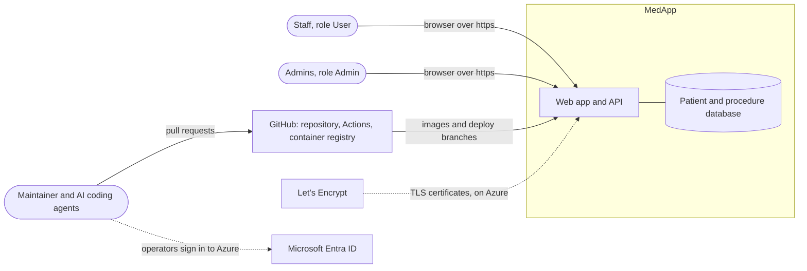

| Partner | What passes between them and MedApp |
|---|---|
| Staff and admins | Everything, through a browser: pages, `/api` calls (JSON), and one WebSocket for live notifications. They sign in with a username and password. |
| GitHub | The source, the CI and Publish workflows, and the container registry (GHCR). Argo CD in each cluster reads the deploy branches from GitHub. |
| Let's Encrypt | Issues the TLS certificate on Azure (HTTP-01 challenge through Traefik). kind uses a self-signed certificate instead. |
| Microsoft Entra ID | Signs operators in to Azure, to AKS (the cluster has no local accounts) and as Azure SQL's Entra admin group. Not used for app users. |

### 3.2 Technical context

| Channel | Protocol | Notes |
|---|---|---|
| Browser to MedApp | HTTPS (TLS ends at the ingress, Traefik), then plain HTTP to the API on port 8080 | Pages, static files, `/api` JSON, and the SignalR WebSocket at `/api/notifications/hub`. |
| API to its Node page server | HTTP on `127.0.0.1`, a random port, inside the pod | Page requests one way, `/api` calls back with the user's cookie and a per-process key. |
| API to the database | TDS (SQL Server's protocol) on 1433 | In-cluster SQL Server on kind; Azure SQL through a private endpoint on Azure, encrypted (`Encrypt=True`). |
| API to Valkey | Redis protocol on 6379, password, not encrypted | The SignalR backplane, inside the cluster. |
| Kubernetes to the API | HTTP on 8081 | Health probes only; neither the Service nor the ingress exposes this port. |
| GitHub Actions to Azure | OpenID Connect (OIDC) federation | No stored cloud secret. Only `main` can sign in, and only to push images. |
| External Secrets to Key Vault | HTTPS, workload identity | Reads the three secrets. |

### 3.3 Scope: what MedApp doesn't do

These are outside the system today, and nothing in the code integrates with them:
- **No single sign-on** for app users (no OpenID Connect or SAML); accounts are local, with passwords.
- **No email or SMS.** "Forgot password?" on the sign-in page is a stand-in that says a link was sent but sends nothing (`MedApp.Web/src/pages/login/ForgotPasswordDialog.tsx`). Notifications are in-app only.
- **No clinical integrations:** no HL7 or FHIR, no electronic health record, no lab or imaging systems, no NHS number lookup.
- **No billing or patient portal.**
- **Scheduling is for staff only.** Staff book appointments on staff calendars ([1.1](#11-what-medapp-does)). There's no patient self-booking, no reminders to patients, no rooms or resources, no recurring appointments, no bank holidays, and no link to another organisation's scheduling or patient administration system (`docs/calendar-plan.md`, section 8). Appointments are administrative: MedApp doesn't decide whether, when or with whom a patient is seen.
- **No structured clinical data.** Notes are free text (Markdown).
- **No file uploads.**

---

## 4. Solution strategy

### 4.1 Key choices

| Quality goal or need | Approach |
|---|---|
| Maintainability | **Clean Architecture** (dependencies point inward to the domain) with **CQRS**: each use case is its own command or query, handler and validator, dispatched by **MediatR**. One folder per use case. |
| Correct procedure rules | All workflow rules live in two classes, `ProcedureWorkflow` and `ProcedureChange`. Handlers ask them, rather than setting statuses themselves. |
| Traceability | Every procedure change goes through `ProcedureChange`, which writes audit entries that are saved in the same database save as the change. The audit table has no foreign keys, so it outlives deletes. |
| Confidentiality | A server-side session per sign-in, in an HttpOnly cookie on the app's own origin; role-based policies on every endpoint; a locked-down Kubernetes deployment; secrets from a secret store. |
| One UI, one origin | The API serves the built React app from its `wwwroot`, so pages, API and WebSocket share one origin, and the cookie stays first-party. |
| Fast, accessible first paint | **Server-side rendering (SSR):** a Node page server, started and fronted by the API, renders each page with its data; the browser then hydrates it. If Node fails, the browser renders the page instead. |
| One source of truth for types | The React app's API types are generated from the API's OpenAPI (Swagger) document. |
| Accessibility | Only Astryx components, which carry accessible behaviour; theme tokens for every colour; an axe audit across every screen in three colour schemes. |
| Deploy the same thing everywhere | **One container image** holds the API, the React app, Node and the EF Core migrations bundle. One Helm chart deploys it to kind and Azure with different values. |
| Git decides what runs | **GitOps:** each merge builds the image and records a deploy commit on an environment branch; Argo CD in the cluster applies it. |
| Several copies of the API | A **Valkey** backplane for SignalR, and WebSocket-only connections that skip negotiation, so no sticky sessions are needed. |
| Infrastructure as code | **Bicep** for Azure, with a what-if before each deploy. |

### 4.2 The shape of the system

MedApp is a **modular monolith**: one deployable unit, the API, which serves the UI, the API and the live connection. Inside, it's layered by Clean Architecture and sliced by use case. The only other process is the Node page server, which runs inside the same container and only ever talks to the API. State lives in SQL Server; Valkey only relays messages and stores nothing.

### 4.3 Technology inventory

Versions come from the `.csproj` files, `MedApp.Web/package.json`, `tools/ui-parity/package.json`, `deploy/versions.sh`, `deploy/helm/medapp/values.yaml`, `MedApp.API/Dockerfile` and the workflows. A caret (`^`) means npm may install a newer minor version; others are exact.

**Backend (.NET)**

| Technology | Version | What it's for | Why it was chosen |
|---|---|---|---|
| .NET SDK and runtime | 10.0.100 SDK (`global.json`), `net10.0` | Everything .NET | Long-term support; .NET 8 support had ended (plan Q1b). |
| ASP.NET Core | 10.0.15 | Web API, static files, Kestrel web server | The standard .NET web stack. |
| Entity Framework Core (SqlServer, Design) | 10.0.15 | Object-relational mapping, migrations, the migrations bundle | LINQ that runs in SQL and in unit tests alike; migrations kept in code. |
| `dotnet-ef` | 10.0.15 (Dockerfile) | Builds the migrations bundle in the image | Must match EF Core's version. |
| ASP.NET Core Identity (EntityFrameworkCore) | 10.0.15 | Users, roles, password hashing, lockout | Built in, well tested (inferred). |
| MediatR | 14.0.0 | Dispatching commands and queries, the validation pipeline | CQRS with pipeline behaviours (predates the written history; inferred). Commercial licence needed for production. |
| FluentValidation (+ DependencyInjectionExtensions) | 12.1.1 | Validating commands in the MediatR pipeline | Declarative rules, unit-testable. |
| FluentValidation.AspNetCore | 11.3.1 | Registered auto-validation in the API | Legacy; has nothing to validate (see [11.4](#114-code-and-architecture-debt)). |
| SignalR, with StackExchangeRedis backplane | 10.0.15 | Live notifications; the backplane across copies | Built in; the Redis backplane is Microsoft's own. |
| Swashbuckle.AspNetCore, Microsoft.AspNetCore.OpenApi | 10.3.1, 10.0.15 | The OpenAPI document and Swagger UI (Development only) | Feeds the generated TypeScript types. |
| OpenTelemetry (Hosting, OTLP exporter, ASP.NET Core, HTTP, Runtime instrumentation) | 1.17.0 | Logs, metrics and traces | Comes with Aspire's service defaults. |
| Microsoft.Extensions.Http.Resilience, ServiceDiscovery | 10.10.0 | HTTP client resilience and discovery (service defaults) | Aspire's defaults; removed from the SSR client in #51. |
| .NET Aspire (AppHost SDK, Hosting.JavaScript, Hosting.SqlServer) | 13.6.5 | Local orchestration: SQL container, API, React dev server, dashboard | One command for the whole dev stack (plan Q1, Q2). |
| ModelContextProtocol | 2.3.0 | The `medapp-dev` MCP server | Lets AI agents manage local state through the app's own code. |
| Blazor WebAssembly | 10.0.15 | The deprecated UI, kept compiling | Kept for reference only (plan Q5b). |

**Frontend**

| Technology | Version | What it's for | Why it was chosen |
|---|---|---|---|
| React, React DOM | ^19.3.1 | The UI | Required by Astryx. |
| TypeScript | ~5.9.3 | Types | 5.x because `openapi-typescript` 7 supports only TypeScript 5 (plan, phase 3). |
| Astryx (`core`, `richtext`, `theme-stone`, `cli`) | 0.7.15, exact | Every UI component, the theme, rich text | A fixed decision of the React migration (plan section 1). Beta, so pinned (Q14). |
| TanStack Router, Router plugin, SSR Query integration | ^1.170.46, ^1.169.0, 1.167.3 | Typed file-based routes, guards, loaders, server rendering | Typed routes and `beforeLoad` guards (Q7); SSR support without owning the server. |
| TanStack Query | ^5.107.1 | Server-state cache: queries and mutations | Caching, invalidation, and dehydration into server-rendered pages (Q7). |
| openapi-typescript, openapi-fetch | ^7.13.0, ^0.17.0 | Types generated from the API's Swagger document; a typed client | One source of truth; NSwag and hand-written types were rejected (Q6). |
| Vite, @vitejs/plugin-react | ^8.3.8, ^6.3.0 | Dev server, builds (client and SSR bundle) | Fast, the React ecosystem's default. |
| @microsoft/signalr | 10.0.11 | The live notifications client | Matches the server's SignalR. |
| Lexical (via `@astryxdesign/richtext`) | 0.52.0, exact | Rich text editing for notes and instructions | Astryx's rich text editor is built on it (#41). |
| @remixicon/react | ^4.9.0 | Icons, through `AppIcon` | One icon set across the app and Astryx (Q8). |
| @fontsource/atkinson-hyperlegible | 5.2.8 | The "easy-to-read font" accessibility option | A typeface designed for low vision (inferred). |
| @stylexjs/stylex | ^0.19.2 | Astryx's styling runtime | Needed by Astryx. |
| Vitest, @vitest/coverage-v8, jsdom, Testing Library | ^5.1.0, ^5.1.0, ^31.0.1, React ^16.3.3 | Unit tests and coverage | Vite-native test runner (Q13b). |
| ESLint, typescript-eslint, react-hooks plugin | ^10.15.0, ^8.72.2, ^7.1.1 | Linting | Standard. |
| Node.js | 22 in the image (`node:22-bookworm-slim`), 24 in CI | The page server; builds | Long-term support versions; the two differ (see [11.3](#113-delivery-and-supply-chain)). |

**Data, runtime and platform**

| Technology | Version | What it's for | Why it was chosen |
|---|---|---|---|
| SQL Server | 2022 (`mcr.microsoft.com/mssql/server:2022-latest`, Developer edition in the chart) | The database in development and kind | Matches Azure SQL; containerised. |
| Azure SQL Database | Serverless General Purpose, `GP_S_Gen5_1` (1 vCore, pauses after 60 idle minutes) | The database on Azure | Managed backups and patching; cheap while idle. |
| Valkey | `valkey/valkey:8.1-alpine` | SignalR backplane | BSD-licensed Redis fork; stores nothing (#50). |
| Container base images | `mcr.microsoft.com/dotnet/sdk:10.0`, `mcr.microsoft.com/dotnet/aspnet:10.0`, `node:22-bookworm-slim` | Building and running the image | Official images; Node's binary copied onto the .NET runtime. |
| kind (Kubernetes in Docker) | Kubernetes 1.37 (per `docs/reviews/kubernetes.md`) | A local cluster | Free, close to production. |
| Azure Kubernetes Service (AKS) | Free tier; Azure CNI Overlay with Cilium | The cluster on Azure | Managed control plane; Cilium enforces NetworkPolicies. |
| Helm, and the `medapp` chart | Chart 0.1.0, app 1.0.0 | Packaging MedApp for Kubernetes | One chart for kind and Azure, with real options (#47). |
| Traefik | Chart 42.3.2 (Traefik v3) | Ingress controller | ingress-nginx, the long-standing alternative, has been retired (`docs/reviews/overview.md`). |
| cert-manager | v1.21.2 | TLS certificates | The standard for Kubernetes. |
| External Secrets Operator | Chart 2.14.0 | Secrets from a store (Key Vault, or a local stand-in) | No passwords in git; same path on kind and Azure. |
| Argo CD | Chart 10.17.2 (Argo CD v3.6.1) | GitOps: the cluster follows an environment branch | Self-healing, pruning, sync waves. |
| Bicep | Built and linted with the Azure CLI's Bicep in CI | Azure infrastructure as code | See [ADR-16](#9-architecture-decisions). |
| GitHub Container Registry (GHCR) | n/a | The public image, for kind | Free with GitHub; no pull secrets while public. |
| Azure Container Registry (ACR) | Basic | The image on Azure | AKS pulls with its own identity ([ADR-17](#9-architecture-decisions)). |
| Azure Key Vault | Standard, RBAC, purge protection | The secret store on Azure | Managed; read with workload identity. |
| GitHub Actions | `actions/checkout@v4`, `setup-node@v4`, `setup-dotnet@v4`, `docker/build-push-action@v6`, `azure/login@v2` and others, by tag; ReportGenerator 5.6.0 by commit SHA | CI and Publish | Next to the code. |

**Testing and tools**

| Technology | Version | What it's for |
|---|---|---|
| NUnit, NUnit3TestAdapter, NUnit.Analyzers | 3.14.0, 4.5.0, 3.9.0 | .NET test framework |
| FluentAssertions | 8.8.0 | Assertions (prints a licence banner; expected) |
| Moq, AutoFixture (+ AutoMoq, NUnit3) | 4.20.72, 4.18.1 | Mocks and test data |
| coverlet.collector, ReportGenerator | 6.0.0, 5.6.0 | .NET coverage and the PR report |
| Microsoft.Playwright.NUnit | 1.64.1 | The end-to-end tests |
| Microsoft.AspNetCore.Mvc.Testing, Testcontainers.MsSql, Respawn | 10.0.15, 4.16.0, 7.0.0 | The integration tests: the API in memory, SQL Server in Docker, the data reset between tests |
| @playwright/test, @axe-core/playwright | 1.64.1, 4.14.0 | UI parity screenshots and the accessibility audit (`tools/ui-parity`) |

---

## 5. Building block view

### 5.1 Level 1: the running system

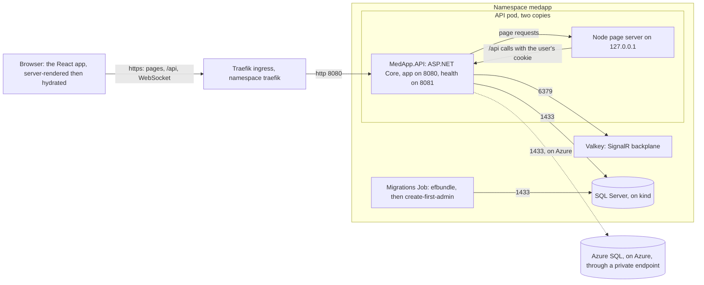

| Building block | Where | Responsibility |
|---|---|---|
| **API** | `MedApp.API` and the projects it references | Everything server-side: the JSON API, sign-in and sessions, the live notifications hub, serving the React app's files, and forwarding page requests to the Node page server. |
| **Node page server** | `MedApp.Web/server/server.mjs`, built to `wwwroot/ssr/` | Renders pages to HTML with their data. Started and supervised by the API, reachable only on loopback inside the pod. |
| **React app** | `MedApp.Web/src`, built to `wwwroot/` | The UI, in the browser. |
| **Database** | SQL Server 2022, or Azure SQL | All durable state: patients, procedures, audit, notifications, users, sessions, settings. |
| **Valkey** | `deploy/helm/medapp/templates/valkey.yaml` | Relays SignalR messages between API copies. Stores nothing. |
| **Migrations Job** | `deploy/helm/medapp/templates/migrations-job.yaml` | Runs the EF Core migrations bundle from the API's image, then creates the first admin if there are no accounts. |

### 5.2 Level 2: the .NET solution

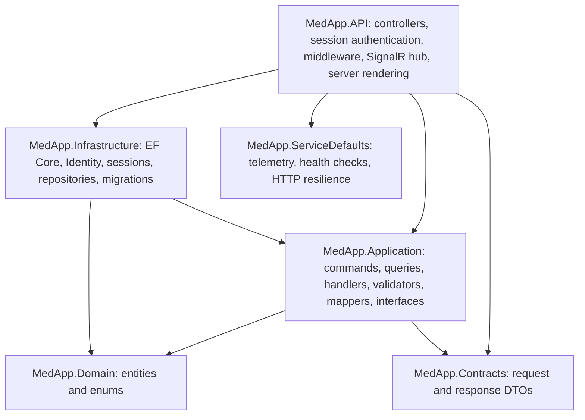

Dependencies point inward: the API and Infrastructure depend on Application, which depends on Domain. The API references Infrastructure only to register its services (`Program.cs`).

| Project | Responsibility | Depends on |
|---|---|---|
| `MedApp.Domain` | Entities and enums. No dependencies at all. | nothing |
| `MedApp.Contracts` | Request and response DTOs (data transfer objects): the API's public shapes. | Microsoft.Extensions.Identity.Core, only for `IdentityError` in `ResetUserPasswordResponse` (see [11.4](#114-code-and-architecture-debt)) |
| `MedApp.Application` | One folder per use case: command or query, handler, validator. Repository and service **interfaces**, the mappers, paging, the procedure workflow, and the app's exceptions. | Domain, Contracts, MediatR, FluentValidation, Identity's core types |
| `MedApp.Infrastructure` | `MedAppDbContext`, EF configurations, repository implementations, Identity services, sessions, the first-admin command, migrations. | Application, Domain, EF Core, ASP.NET Core Identity |
| `MedApp.API` | Thin controllers, the session authentication handler, the exception middleware, the notifications hub and publisher, server rendering. The composition root (`Program.cs`). | all of the above, ServiceDefaults |
| `MedApp.ServiceDefaults` | Aspire's shared defaults: OpenTelemetry, health checks (`/health`, `/alive`), HTTP client resilience and service discovery. | OpenTelemetry, Microsoft.Extensions.Http.Resilience |
| `MedApp.AppHost` | Development orchestration with .NET Aspire. Not deployed. | the API |
| `MedApp.UnitTests` | NUnit tests for Application, Infrastructure and the API. | everything |
| `MedApp.IntegrationTests` | The real API in memory (`WebApplicationFactory`, as Production) against SQL Server 2022 in Docker (Testcontainers): sign-in, sessions, authorisation, the forced password change, users, patients, procedures, notifications and the hub, errors, and the migrations. | the API |
| `MedApp.E2ETests` | Playwright for .NET journeys through the React app: sign-in, patients, a procedure's stages, My Tasks, a new user's first sign-in, and the notification bell. | the API |
| `MedApp.Client.Deprecated` | The original Blazor WebAssembly UI. Kept compiling, never run. | Contracts |
| `tools/MedApp.DevMcp` | The `medapp-dev` MCP server for local chores. Not in `MedApp.sln`, so CI's `unit-tests` job builds it on its own. | Application, Infrastructure |

The top-level `Application/`, `Domain/`, `Infrastructure/`, `UnitTests/`, `IntegrationTests/` and `E2ETests/` folders hold only stale build output from an old layout.

### 5.3 Inside the API: the request pipeline

`MedApp.API/Program.cs` builds the host, registers the API, Application and Infrastructure services, and then:
- **if started as `dotnet MedApp.API.dll create-first-admin`**, runs `FirstAdminSetup` and exits without starting the web server (`Program.cs:18-19`);
- **otherwise** maps the health checks and the pipeline, and runs.

The pipeline, in order (`MedApp.ServiceDefaults/Extensions.cs`, `MedApp.API/Common/Extensions/ApplicationBuilderExtensions.cs`):

| # | Step | Notes |
|---|---|---|
| 1 | Forwarded headers | Added by the host when `ASPNETCORE_FORWARDEDHEADERS_ENABLED=true` (the Helm chart sets it), so the API sees the client's scheme and address from Traefik. |
| 2 | Health checks | `/health` and `/alive`, only on the port in `HealthChecks:Port` (8081 in Kubernetes), or on the app's port in Development, otherwise not at all. |
| 3 | Swagger, or HSTS | Swagger UI in Development; HTTP Strict Transport Security everywhere else (`ApplicationBuilderExtensions.cs:19`). |
| 4 | HTTPS redirect | Skipped only for the Node page server's own calls: from loopback, carrying its key (`SsrServer.IsFromRenderer`). |
| 5 | Blocked paths | `/ssr`, `/.vite`, and any path containing `//` get a 404 (`PageServerFiles.IsBlocked`). |
| 6 | Static files | The built React app in `wwwroot`. |
| 7 | Exception handling | `ExceptionHandling` turns known exceptions into problem responses ([8.3](#83-validation-and-errors)). |
| 8 | Authentication, password change, authorisation | The session cookie scheme; then `PasswordChangeRequired`, which refuses a user who must change a password an admin gave them everything under `/api` but its allowlist (who am I, sign in, sign out, their own settings, their own password change) with a 403 `password_change_required`; then policies and roles. |
| 9 | Endpoints | Controllers under `/api`; the SignalR hub at `/api/notifications/hub`. |
| 10 | `/api` catch-all | Any other `/api` path is a 404, never the app's HTML. |
| 11 | Page fallback | Every other path that isn't a file goes to `SsrPages.Handle`: server-rendered, or `index.html` ([6.2](#62-a-server-rendered-page-request)). |

**Controllers are thin.** Each action maps the request to a command or query, adds the signed-in user where needed (`User.ToProcedureActor()`), calls `mediator.Send(...)` and returns the result.

### 5.4 The Application layer

**Feature slices.** Each use case has its own folder, for example `MedApp.Application/Procedures/PatientProcedures/Commands/FinishProcedureStage/`, holding:
- `FinishProcedureStageCommand.cs`: a sealed record implementing `IRequest<TResponse>`;
- `FinishProcedureStageHandler.cs`: a sealed class with its dependencies in its primary constructor;
- `FinishProcedureStageValidator.cs`, when the input needs checking.

There are 53 handlers and 30 validators in four areas: Authentication (users, roles, sessions, settings), Patients, Procedures (procedures, stage definitions, templates, audit, the patient timeline) and Notifications. Staff calendars add two more areas: Calendar (calendars, blocks, activity types, day and week templates) and Appointments.

**The pipeline.** `AddApplication()` (`MedApp.Application/Common/Extensions/ServiceExtensions.cs`) registers MediatR by assembly scanning, with one open behaviour, `ValidationBehaviour<,>`, which runs the command's validators before its handler and throws FluentValidation's `ValidationException` on failure. It also registers every validator, `TimeProvider.System` (so handlers and validators that need "now" can be tested at a fixed time), and the `NotificationSender`.

**Errors.** Handlers throw `NotFoundException` (404), `ConflictException` (409), `InvalidCredentialsException` (401) and `AccountLockedOutException` (423). The older Patients and Auth slices return `null`, `bool` or `IdentityResult` and leave the status code to the controller; `AGENTS.md` says to keep that style there unless migrating them.

**Mappers.** Entities become responses only through hand-written static mappers, one per area, in that area's `Common/` folder: `PatientMapper`, `UserSettingsMapper`, `NotificationMapper`, `AuditEntryMapper`, `ProcedureMapper`, `StageDefinitionMapper`, `StageTemplateMapper`, `AppointmentMapper`, `CalendarMapper`, `CalendarSetupMapper`, and `UserMapper` (in Infrastructure, because `ApplicationUser` is an Infrastructure type). `PagedMapper` builds every search endpoint's `PagedResponse<T>`. No handler or controller builds a response from an entity itself, and no query returns a Domain entity to the API (#44). See [ADR-8](#9-architecture-decisions).

**Paging.** The search endpoints (four, plus `GET api/appointments/search`) filter, sort and page in the database and return `PagedResponse<T>` (`items`, `page`, `pageSize`, `totalCount`, `totalPages`). `pageSize` defaults to 10, at most 100. Sorting always ends on a unique key (`ThenBy(x => x.Id)`), so pages never repeat or skip rows. Filters and sorts are plain LINQ that EF can translate, so the same code runs in SQL and in the unit tests (`PatientSearch`). A patient's timeline is the exception: a feed paged by cursor (keyset), newest first by time then ID, so entries added meanwhile don't shift its pages (`PatientTimelineSearch`).

**Procedures.** All workflow rules are in `MedApp.Application/Procedures/Common`:
- `ProcedureWorkflow`: statuses, which stage is current, what can be edited, what status changes are allowed, overdue.
- `ProcedureChange`: applies one request's changes, moves the status automatically, stamps `LastUpdated` and collects the audit entries.
- `DueDates`: due dates as the end of a UK day, stored in UTC.
- `ProcedureAudit`, `ProcedureMapper`, `ProcedureActor` (the signed-in user, from the claims).
- For stage visits: `ProcedureWorkflow.WhyStageNeedsVisit` (a stage whose visit is required needs an Attended appointment before it's finished), and `ProcedureChange.RequestVisit` and `CancelRequestedVisit`, which collect the appointments and their history to save with the procedure change.

**Calendars and appointments** (`docs/calendar-plan.md`, section 3). The calendar rules are in `MedApp.Application/Calendar/Common`:
- `WorkingHours`: the working day (08:00 to 18:00 UK time, Monday to Friday), the slot length, and `WhyOutside(startUtc, endUtc)` for the validators.
- `UkTime`: UK dates and clock times to and from UTC, and readable times for messages.
- `TemplateHistory`: replacing a set of dated template rows from today, so past days keep what applied then.
- `CalendarProjection`: a person's days, with the blocks their templates give each day, worked out when the calendar is read from the rows the repository loads (`CalendarData`). Nothing is generated ahead of time.
- `CalendarClashes`: what a time would overlap. Commands that add or move something take a per-person database lock first (`ICalendarLock`), so two bookings for one slot can't both succeed.
- `CalendarMapper`, `CalendarSetupMapper`.

The appointment rules are in `MedApp.Application/Appointments/Common`: `AppointmentWorkflow` (statuses and what's allowed), `AppointmentChange` (applies a change and writes its history) and `AppointmentMapper`.

**Notifications.** A handler calls `INotificationSender.SendAsync(...)` after its own change is saved. The sender stores the notification, then asks the host's `INotificationPublisher` to push it. The API's publisher is SignalR's.

### 5.5 The Infrastructure layer

**Database access.** `MedAppDbContext` (`MedApp.Infrastructure/Data/MedAppDbContext.cs`) extends Identity's `IdentityDbContext` with Guid keys, and picks up every `IEntityTypeConfiguration` in the assembly. The SQL Server provider retries transient failures (five times, up to 30 s between tries), mainly for Azure SQL serverless waking from a pause (`MedApp.Infrastructure/Common/Extensions/ServiceExtensions.cs:40-46`, #52).

**Repositories.** Six, registered in `AddRepositories()`: patients, procedures, stage definitions and templates, audit, user settings, notifications. Each method calls `SaveChangesAsync` itself; there's no unit of work. Reads use `AsNoTracking()`.

The procedure repository is the exception, by design: handlers load a **tracked** procedure with `GetForUpdateAsync`, change it through `ProcedureChange`, and `SaveAsync(change)` saves the change, its audit entries, and any appointments it requested or cancelled with their history, in **one** `SaveChangesAsync`, so one database transaction. That way EF works out which stages and assignments changed, and no change can be saved without its audit entries.

**Identity.** ASP.NET Core Identity (`AddIdentityCore<ApplicationUser>().AddRoles<IdentityRole<Guid>>()`), with password and lockout rules from the `Identity` section of `appsettings.json`: at least 8 characters with a digit, a lower-case and an upper-case letter; 5 failed attempts lock the account for 5 minutes. Behind Application's interfaces:
- `IdentityAuthenticationService`: checks a password, counts failures, honours lockout (#38).
- `IdentityUserService`, `IdentityRoleService`, `IdentityReadService`: users, roles, and username lookups for responses. `IdentityUserService` generates the password for every new account and every admin reset: at least 16 characters, or the configured minimum if that's longer, from a cryptographic random number generator (#53).
- `IdentityTransactions`: runs several Identity changes in one transaction, inside EF's execution strategy so a retry repeats the whole transaction, clearing the change tracker first (#52). So the work loads everything it changes itself, inside the retried delegate, never using entities loaded before it.

**Sessions.** `SessionService` creates a `UserSession` row on sign-in (8 hours, extendable to 24 at most from sign-in), validates it on every request (the session, then the user and their roles), and revokes it on sign-out. See [6.1](#61-signing-in-and-the-session-check).

**The first admin.** `FirstAdminSetup` (`MedApp.Infrastructure/Common/Identity/FirstAdminSetup.cs`) creates the `Admin` and `User` roles if missing, then, **only if there are no users at all**, an admin with both roles from `FirstAdmin:Username` and `FirstAdmin:Password`, in one transaction. It exits 0 when it made the admin or found accounts, and 1 when it isn't configured or Identity refuses. See [6.6](#66-first-install-migrations-and-the-first-admin).

**Migrations.** Nine, in one linear history in `MedApp.Infrastructure/Migrations/`, from `InitialCreate` (30 January 2026) to `AddedNotifications` (15 November 2026). They're never applied at startup: in development by hand with `dotnet ef`, in Kubernetes by the migrations Job. The seed data is one archived stage definition, "Definition missing", kept for old rows, and, since staff calendars, six activity types (Lunch, Admin time, Training, Meeting, Annual leave and Travel). Staff calendars add one migration, `AddedStaffCalendars`.

### 5.6 The domain model

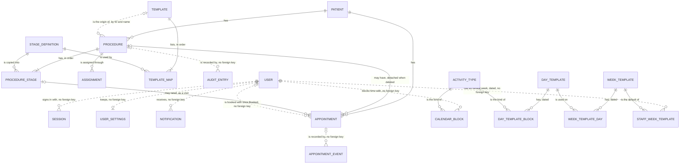

| Entity | Key fields | Notes |
|---|---|---|
| `Patient` | first and last name, date of birth (`DateOnly`), email | Can't be deleted while it has procedures (409). |
| `PatientProcedure` | title, notes (Markdown), `DueDateUtc`, priority, status, `BlockedFromStatus`, `TemplateId` and `TemplateName` | Created only from a template. Keeps the template's name, in case the template changes. |
| `PatientProcedureStage` | order, a **snapshot** of the definition's name, description and instructions; notes; started at and by; finished (`IsCompleted`) at and by; `IsLocked` | The snapshot means later edits to a definition never rewrite a finished procedure. |
| `PatientProcedureAssignment` | user, assigned by, assigned at | Drives task lists and notifications, not permissions. |
| `PatientProcedureStageDefinition` | name, description, instructions (Markdown), `VisitRequirement` (none, suggested or required), `IsArchived` | Archived, not deleted, once in use. The stage copies `VisitRequirement` too. |
| `PatientProcedureStageTemplate` and `…TemplateMap` | name, `IsArchived`; ordered definitions | A definition may appear more than once (for example a consultation before and after). |
| `PatientProcedureAuditEntry` | procedure ID and title, patient ID, stage ID and name, action, user ID and username, `AtUtc`, details (JSON) | No foreign keys, so the history outlives deletes. |
| `Notification` | user, kind, title, message, procedure ID, appointment ID, created, read at | No foreign keys, like the audit log. |
| `Appointment` | patient; procedure and stage (optional); member of staff, start and end (UTC; none while Requested); status; notes (2,000 characters); cancellation reason (500); `IsAutomatic`; who requested, booked and recorded the outcome, and when | Foreign keys to the patient, procedure and stage that don't cascade; none to the member of staff. One open (Requested or Booked) appointment per stage. |
| `AppointmentEvent` | appointment, patient and procedure IDs, procedure title, stage name, action, user ID and username, `AtUtc`, member of staff and time, details (JSON: old and new times and staff, old and new notes, the cancellation reason) | The appointment's history. No foreign keys, like the audit log. |
| `CalendarBlock` | member of staff, activity type, start and end (UTC), note (200 characters), created by and at | Time blocked off on a calendar. No foreign key to the member of staff. |
| `CalendarActivityType` | name, colour (from a fixed palette), `IsArchived` | Seeded with six; archived, not deleted, once in use. |
| `DayTemplate` and `DayTemplateBlock` | name, `IsArchived`; blocks of activity type, UK start and end time (`TimeOnly`), note, `ValidFrom` and `ValidTo` | The dates keep history: an edit closes changed rows and adds new ones from today (`TemplateHistory`). |
| `WeekTemplate` and `WeekTemplateDay` | name, `IsArchived`; a day template for each weekday, `ValidFrom` and `ValidTo` | Dated, like day template blocks. |
| `StaffWeekTemplate` | member of staff, week template, `ValidFrom` and `ValidTo` | A person's default week, dated. |
| `CalendarDayOverride` and `CalendarBlockException` | member of staff, date; a day template (or none), or the template block not to show that day | One day's change to what the templates give. |
| `UserSession` | user, created, expires, revoked, IP address, user agent | The session cookie holds its ID. |
| `UserSettings` | user, one JSON document, updated at | The account's settings, as the React app stores them. |
| `ApplicationUser` | Identity's user (in Infrastructure) | Roles `Admin` and `User`. |

**Stored enums.** `PatientProcedureStatus`, `PatientProcedureAuditAction`, `NotificationKind`, `AppointmentStatus`, `AppointmentEventAction` and `VisitRequirement` are stored as numbers, so they must never be renumbered. `PatientProcedureStatus` has a gap at 2, where `NotStarted` was removed (#30).

**The status workflow** (`ProcedureWorkflow`, `docs/procedures-ui-plan.md` section 4):

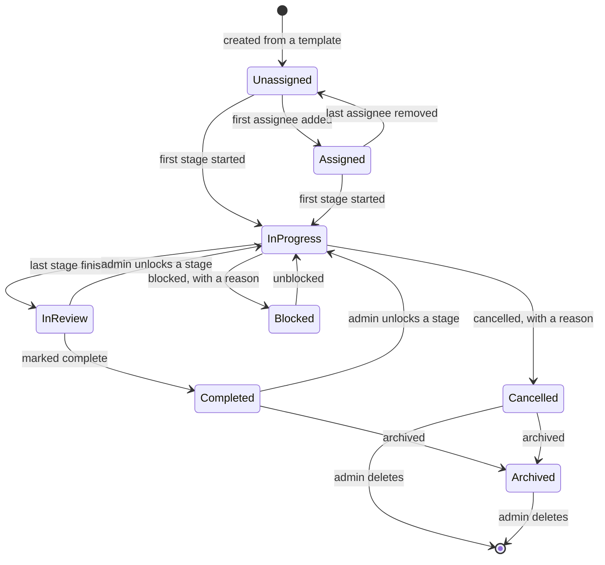

- **Open** statuses are `Unassigned`, `Assigned`, `InProgress` and `InReview`. Any of them can be blocked or cancelled (the diagram shows only `InProgress`, for clarity). Unblocking returns to the status it was blocked from.
- **Stages can be worked only while the procedure is open**, and only the current stage (the first unfinished one). Finishing a stage locks it. An admin can unlock a finished stage while the procedure is open or `Completed`; that reopens just that stage, and moves an `InReview` or `Completed` procedure back to `InProgress`.
- **Overdue** means open and past the due date. A blocked procedure is never overdue.
- **Every response lists the status changes allowed from where the procedure is** (`allowedStatusChanges`), so the UI never has to repeat the rules.

**Audit actions:** created, details updated, status changed, assigned, unassigned, stage started, stage notes updated (old and new text), stage finished (with `withoutVisit`, the visit requirement and an admin's reason, when finished without a visit), stage unlocked, deleted.

**Due dates** are whole days. A procedure is due by the end of its day in UK time, stored as that moment in UTC (`DueDates.EndOfDayUtc`), so the day survives the clocks changing. The API takes and returns a date.

**Appointments** (`AppointmentWorkflow`, `docs/calendar-plan.md` section 1):

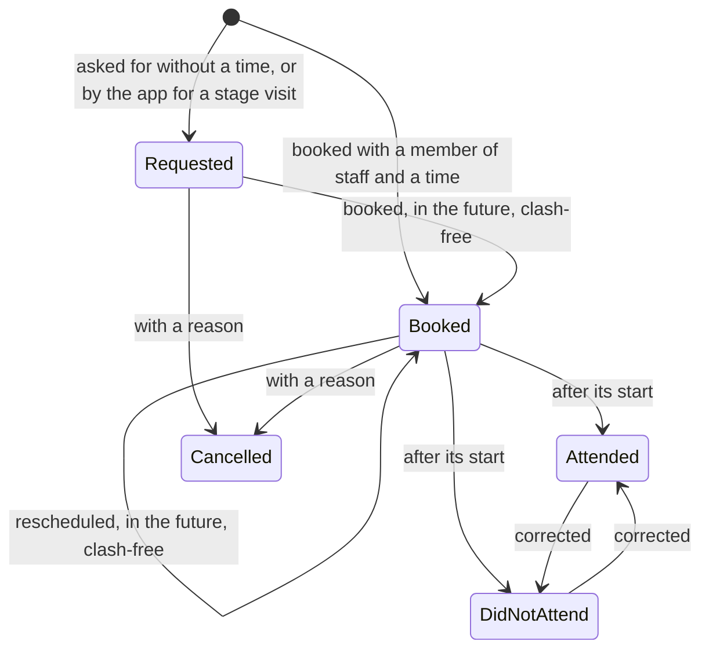

- **Calendars hold no overlaps:** a Booked, Attended or Did not attend appointment, or a block (stored or from a template), can't overlap another on the same person's calendar (409).
- **Stage visits:** when a stage whose definition involves a visit becomes current, `ProcedureChange` adds a Requested appointment for it, unless it already has one that's Requested, Booked or Attended. A **required** visit must be Attended before the stage is finished, unless an admin finishes it with a reason; a **suggested** one only asks for confirmation in the UI. Finishing the stage cancels its Requested appointments, and cancelling the procedure cancels all its Requested ones; Booked ones are never cancelled by the app.
- **Deleting:** a patient with appointments can't be deleted. Deleting a procedure detaches its appointments. An account with upcoming Booked appointments can't be deleted.

### 5.7 The API surface

57 HTTP endpoints in seven controllers, plus the SignalR hub, at #53; staff calendars add the calendar and appointment endpoints in the last rows (`docs/calendar-plan.md`, section 4). "Staff" means role `User` or `Admin` (`AuthPolicies.Staff`).

| Area | Endpoints | Who |
|---|---|---|
| Sign-in | `POST api/auth/login`, `POST api/auth/logout`, `GET api/auth/whoami` | Anyone |
| Users | `POST api/auth/users` (a username only; returns the generated first password, once); `GET api/auth/users`, `users/search`, `users/{username}`; `PUT users/{username}/reset-password`; `DELETE users/{username}` (with the admin's own password) | Admin |
| Roles | `GET`/`POST api/auth/roles`; `DELETE roles/{roleName}`; `POST roles/assign`, `roles/revoke`; `GET`/`PUT users/{username}/roles` | Admin |
| Own password | `PUT api/auth/users/{username}/update-password` | Staff, and only for your own username (`SelfUserOnly`) |
| Own settings | `GET`/`PUT api/auth/me/settings` | Staff |
| Patients | `POST`, `GET {id}`, `GET search`, `GET` (all), `PATCH {id}`, `DELETE {id}` under `api/patients` | Staff |
| Procedures | `POST`, `GET {id}`, `GET search`, `PATCH {id}`, `POST {id}/status`, and stage `start`, `notes`, `finish` under `api/procedures/patient-procedures`. `finish` takes an optional `{ withoutVisit, reason }`, which only an admin may use to finish a stage whose visit is required | Staff |
| Procedure administration | `DELETE {id}`; `POST`/`DELETE {id}/assignments/{userId}`; `POST {id}/stages/{stageId}/unlock` | Admin |
| Stage definitions and templates | reads under `api/procedures/patient-procedure-stage/definitions` and `/templates` | Staff |
| | create, update, archive, restore, delete | Admin |
| Audit log | `GET api/procedures/audit/search` | Admin |
| Patient timeline | `GET api/patients/{id}/timeline` (paged by cursor; procedure changes and appointment history), `GET api/patients/{id}/timeline/overview` | Staff (admins see more: deleted procedures, and the free text of the log and of appointments) |
| Notifications | `GET api/notifications`; `POST api/notifications/read`; `POST api/notifications/{id}/read` | Staff |
| Live notifications | WebSocket `/api/notifications/hub` | Staff |
| Calendars | `GET api/calendar?staffUserId&from&to` (one person's days, at most 31, with their blocks, stored and from templates, and appointments); `GET api/calendar/staff` (everyone with a role, with their default week) | Staff |
| A calendar's own setup | `POST api/calendar/blocks`, `PUT`/`DELETE blocks/{id}`; `PUT`/`DELETE staff/{userId}/days/{date}/template-blocks/{templateBlockId}` (one day's template block); `PUT`/`DELETE staff/{userId}/days/{date}/day-template` (a day template for one day, or back to the week's); `PUT staff/{userId}/week-template` (the default week; `GET` for staff) | The calendar's owner, or an admin |
| Calendar setup | `api/calendar/activity-types`, `day-templates`, `week-templates`: list (`includeArchived`), get | Staff |
| | add, edit, archive, restore, delete | Admin |
| Appointments | `POST api/appointments` (request, or book); `GET {id}`, `GET search` (by patient, procedure, stage, staff, statuses, from and to); `POST {id}/book` (book or reschedule); `POST {id}/outcome`; `POST {id}/cancel` (with a reason); `PUT {id}/notes` | Staff |

`GET api/patients` and `GET api/auth/users` return every row. Only the deprecated Blazor client uses them, and the UI parity tool's sign-in step uses `GET api/patients`; the React app uses the search endpoints. Swagger is served only in Development.

### 5.8 The React app (`MedApp.Web`)

**Structure** (`MedApp.Web/src`):

| Folder | What's in it |
|---|---|
| `api/` | The typed `openapi-fetch` client, the generated `schema.d.ts`, the 400-to-field-error mapper, query functions per area, `preload` for route loaders |
| `app/` | `App`, providers, the query client, the settings store and its providers (colour mode, colours, text size, navigation, lists, accessibility, favourites), `SettingsSync`, `LiveNotifications`, announcements |
| `auth/` | The `whoami` query, sign-in and sign-out, `requireAdmin` |
| `components/` | Composites built only from Astryx: `pages/` (`Page`, `PageHeader`, `TwoColumns`, half views), `forms/`, `tables/` (`DataTable`, `ListFilterBar`, `ListFavourites`, `RowCards`, `PageControls`), `views/`, `modals/`, `navigation/` (`AppLayout`, `AppSideNav`, `NotificationBell`, `KeyboardShortcuts`), `procedures/` (`ProcedureCells`, `StageList`, `StageWork`, `StatusChangeDialog`, `PatientTimeline`), `shared/` (`AppIcon`, `RichText`) |
| `pages/` | One folder per page: accessibility, account, audit, home, login, patients, procedures, setup (stage definitions and templates), tasks, users; and, with staff calendars, the Calendar, Needs booking, Calendar templates and Activity types pages |
| `routes/` | Thin TanStack Router file routes that point at pages; `routeTree.gen.ts` is generated from them |
| `ssr/` | `document.tsx` (the whole HTML document when rendering on the server), `requestContext.ts` (the per-request API address, cookie and key) |
| `themes/medapp/` | The `medapp` theme (Astryx's stone theme with MedApp's blues), built ahead of time and checked in |

**Routes.** `/login` is public. `/change-password` is for someone signed in who must change a password an admin gave them; it sits outside the layout too. Everything else sits under the `_app` layout route, whose `beforeLoad` guard fetches `whoami` and redirects signed-out visitors to `/login` and anyone who must change their password to `/change-password`, then preloads the account's settings and notifications (`src/routes/_app.tsx`). Admin routes add `requireAdmin`.

| Route | Page | Who |
|---|---|---|
| `/change-password` | Choose your own password, after a generated one | Signed in, with a password to change |
| `/` | Welcome, with your **day calendar**: today, with Previous and Next day, your appointments and blocks; an appointment opens its procedure, or the patient when it has none | Staff |
| `/tasks` | My Tasks: Not started and Started | Staff |
| `/calendar` | **Calendar:** day and week views, your own by default, with a staff picker for anyone's. Click or drag across empty slots (or use the keyboard) to book an appointment or block time; click an appointment or block to see and change it, or drag it to move it. The toolbar has Previous, Today, Next, a date picker, Day or Week, whose calendar, **This day's template** and **My default week**. In a narrow window or a half view, the week view becomes the day view | Staff |
| `/calendar/needs-booking` | **Needs booking:** Requested appointments, soonest procedure due date first, each with Book | Staff |
| `/patients`, `/patients/add`, `/patients/$id`, `/patients/$id/edit`, `/patients/$id/procedures` | Patients | Staff |
| `/procedures`, `/procedures/new`, `/procedures/$id`, `/procedures/$id/edit` | Procedures | Staff |
| `/account`, `/account/colours`, `/account/password` | Account settings | Staff |
| `/accessibility` | Accessibility statement | Anyone signed in |
| `/admin/users`, `/admin/stages`, `/admin/templates` (and `new`, `$id`), `/admin/audit` | Administration | Admin |
| `/admin/calendar-templates` | **Calendar templates:** day and week templates (add, edit, archive, restore, delete when unused), and each member of staff's default week | Admin |
| `/admin/activity-types` | **Activity types:** add, edit, archive, restore, delete when unused | Admin |

**Booking** is one dialog (`BookAppointmentDialog`), opened from the patient page, the procedure page, a stage that needs a visit ("Book visit"), Needs booking, an empty calendar slot, or an appointment (to reschedule). It asks for the patient (and procedure and stage) unless they're known, the member of staff, the length (15 to 120 minutes; 30 by default), the day (the week's working days, with how many slots are free) and a free slot, with optional notes. Without a time, it can add the appointment to Needs booking instead. The procedure page lists a procedure's Booked appointments, so someone can tell the patient if the procedure is cancelled.

**Data.** TanStack Query holds server state. Reads are queries keyed by resource (`['patients']`, `['patients', id]`); writes are mutations that invalidate them. Every call goes through `api` and `unwrap` (`src/api/client.ts`). A 400 becomes an `ApiValidationError`, and `fieldStatus(errors, field)` puts each message on its field. The server's FluentValidation rules are the only rules; the client doesn't repeat them.

**Lists** keep their page, sort and filters in the URL (`validateSearch`, `src/pages/listSearch.ts`), so a search is a shareable link. Each has a `ListFilterBar` (Astryx's PowerSearch, a token per filter) and a `ListFavourites` star for quick filters and saved searches. `DataTable` fills the window, and turns its rows into cards when the columns don't fit.

**Settings** are declared with `defineSetting` and read with `useAppSetting` (`src/app/settingsStore.ts`). They're kept in the browser and with the account: `SettingsSync` loads them on sign-in and saves changes through `PUT api/auth/me/settings`. The keys cover colour mode, colours, text size, navigation behaviour, rows per page, where procedure lists start, favourites, and accessibility.

**Accessibility** ([8.6](#86-accessibility)) is built in: `Page` sets the tab title and announces the page; `useAnnounce()` announces other changes; statuses and priorities use tokens that can show icons; keyboard shortcuts are off by default; eleven switches change the CSS through `AccessibilityProvider`.

**Server rendering, the browser's side.**
- `src/entry-server.tsx` renders a request; `src/entry-client.tsx` hydrates the page, or renders from scratch on the plain `index.html`.
- `createSsrRouter()` (`src/router.tsx`) makes a **new router and query cache for every request**, and dehydrates the cache into the page. This is what keeps one user's data out of another's page.
- Each page with data has a route `loader` that preloads the same query the page reads (`preload`, `src/api/preload.ts`). On the server it waits; in the browser it only starts the fetch.
- On the server, an `openapi-fetch` middleware sends each API call straight to the API with the request's cookie and the page server's key, using `AsyncLocalStorage` to know which request it's serving (`src/api/client.ts`, `src/ssr/requestContext.ts`).
- The server renders with the account's saved settings (`ServerSettingsContext`), so light or dark mode and text size are right from the first paint.
- Rendering must work without a browser: no `window`, `document`, `localStorage` or `matchMedia` during render (`MedApp.Web/AGENTS.md`).

**Live notifications.** `LiveNotifications` (`src/app/LiveNotifications.tsx`), mounted in `AppLayout`, opens one SignalR connection while signed in: WebSocket only, without negotiating first. On a notification it refreshes the bell and procedure lists, and announces it to screen readers if that's switched on.

### 5.9 The Node page server

`MedApp.Web/server/server.mjs` (232 lines) is a small Node HTTP server with two modes:
- **Development (`--dev`)**, run by `npm run dev` and the AppHost on http://localhost:5173. It hosts Vite as middleware (source with hot reload), proxies `/api` and `/swagger` to the API, forwards `/api` WebSockets itself (Vite's proxy doesn't in middleware mode, #43), and renders each page from the source.
- **Production**, started by the API. It loads the built server entry (`dist/ssr/entry-server.js`, which bundles its packages, so no `node_modules`) and the client build's manifest for the page's scripts and styles.

It answers only GET and HEAD (others get 405). It builds the page's URL from `X-Forwarded-Proto` and `X-Forwarded-Host`, so links and redirects use the address the browser used. It streams the HTML as it renders, and answers 500 with "The page could not be rendered." if rendering throws. If a page fails part-way through streaming, only that response is cut short; before #51, a stream error crashed the whole Node process.

**The API's side** (`MedApp.API/ServerRendering`):
- `SsrServer`, a hosted service, starts `node wwwroot/ssr/server.mjs` once the API is listening, on a free loopback port. It passes the API's own address (http preferred), a random 256-bit key (`X-MedApp-Ssr-Key`), and only an allowlist of environment variables, so the API's connection strings aren't in Node's environment (`SsrServer.StartInfo`, #51). That stops accidental leaks, not a determined attacker: Node runs as the same user in the same container, so code running in it could still read the API's environment from `/proc`. It counts Node as ready when Node prints `MedApp pages:`.
- `SsrPages` forwards GET and HEAD page requests to Node ([6.2](#62-a-server-rendered-page-request)).
- `SsrOptions` (the `Ssr` section): `Enabled`, `NodePath`, `ScriptPath`, `RenderTimeout` (15 s).
- If Node is missing, fails to start, or exits, pages are rendered in the browser instead. Node is not restarted ([11.2](#112-reliability-and-operations)).

### 5.10 Development tools

| Tool | Where | What it does |
|---|---|---|
| **Aspire AppHost** | `MedApp.AppHost/AppHost.cs` | Runs the dev stack with one command: SQL Server 2022 in a persistent container on `127.0.0.1:14330` with the `medapp-sql-data` volume; the API on its `https` profile (port 7038), waiting for the database; the React dev server on a fixed http://localhost:5173. Shows logs, traces and health on the Aspire dashboard. On publish, it builds the API from `MedApp.API/Dockerfile` and leaves the Vite server out. |
| **`medapp-dev` MCP server** | `tools/MedApp.DevMcp` | Lets an AI agent manage local state through the app's own commands: accounts, roles, passwords, lockout, sessions, synthetic patients, migration status, whole-database snapshots, and `reset_demo_data` (6 staff accounts with generated passwords, 60 patients, 11 stage definitions and 4 templates with one of each archived, and about 80 procedures with a full audit trail). It refuses anything but a local database, protects `admin`, and needs `confirm: true` for destructive tools. It also creates the local `admin` / `admin` login, bypassing the password rules. |
| **UI parity screenshots** | `tools/ui-parity` | Playwright captures of 46 screens, compared by eye. It compared Blazor and React during the migration; now it captures React. Signs in as a dedicated synthetic `dev-parity` admin. |
| **Accessibility audit** | `tools/ui-parity`, `npm run a11y` | axe over every screen in dark, light and a colour theme, against WCAG 2.2 A and AA. About ten minutes. Not in CI. |
| **End-to-end tests** | `MedApp.E2ETests`, `.github/workflows/e2e.yml` | Playwright for .NET journeys, run on every pull request against the production image (CI's `e2e` job), and by hand against a deployed URL (`e2e.yml`). Locally, against the AppHost. |
| **Integration tests** | `MedApp.IntegrationTests` | The API against SQL Server in Docker; CI's `integration-tests` job. Needs Docker locally. |
| **Astryx docs MCP** | `.mcp.json` (`astryx`) | Lets agents look up Astryx components. |
| **The deprecated Blazor client** | `MedApp.Client.Deprecated` | Kept compiling for reference; not run, and the API no longer allows its origin. |

---

## 6. Runtime view

### 6.1 Signing in and the session check

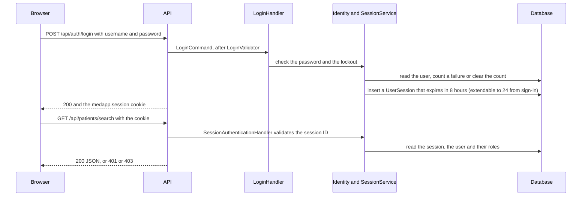

1. **Sign-in.** The login page posts the username and password. `LoginValidator` checks they're present, then `IdentityAuthenticationService` checks the password through Identity, honouring lockout (#38):
   - a locked account is refused even with the right password: **423 Locked**, with the time left ("Try again in 5 minutes.");
   - a wrong password counts as a failure and gives **401** ("Invalid credentials"); the fifth locks the account;
   - a right password clears the count.
2. **The session.** `SessionService` inserts a `UserSession` row: the user, created and expiry times (8 hours, extendable on request to 24 at most from sign-in: see the table below), the client's IP address and user agent.
3. **The cookie.** `SessionCookieService` sets `medapp.session` to the session's ID: `HttpOnly` (script can't read it), `SameSite=Lax` (not sent on cross-site POSTs), `Secure` outside Development, expiring with the session. The response body also carries the session ID and expiry.
4. **Every request.** `SessionAuthenticationHandler` reads the cookie, parses the ID, and asks `SessionService` to validate it: the row must exist, not be revoked or expired, and its user must still exist. It then builds the claims: the user's ID (`NameIdentifier`), username and roles, and `medapp:must_change_password` when the account's `MustChangePassword` is set (an admin generated its password). Roles and the flag are read from the database on every request, so a role change or a reset applies at once, and deleting a user ends their sessions. `PasswordChangeRequired`, between authentication and authorisation, then refuses a flagged user every `/api` request but its allowlist.
5. **Authorisation.** Endpoints require the `Staff` policy (role `User` or `Admin`) or the `Admin` role. The own-password change also requires `SelfUserOnly`: the route's username must be the caller's.
6. **In the React app.** The `whoami` query (`GET api/auth/whoami`, always 200, saying whether you're signed in, with which roles, and whether you must change your password) feeds the `_app` route guard, which sends anyone who must change their password to `/change-password`. A page already open when that happens finds out from its next API call's 403 `password_change_required`, and the API client sends it there with a full page load.
7. **Sign-out.** `POST api/auth/logout` marks the session revoked and deletes the cookie.

What this doesn't do (see [11.1](#111-security-and-privacy)): there's no idle timeout or sliding expiry; changing or resetting a password doesn't end existing sessions; and old session rows are never deleted.

### 6.2 A server-rendered page request

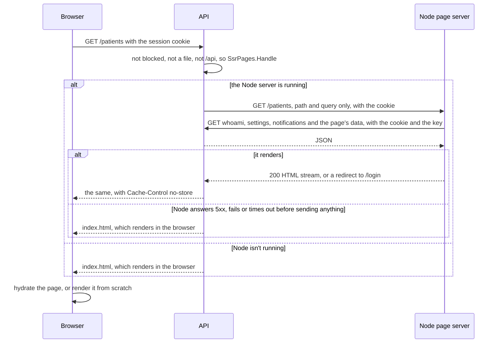

1. **Routing.** A path that isn't a file, isn't under `/api`, and isn't blocked (`/ssr`, `/.vite`, or anything with `//`) reaches the fallback endpoint, `SsrPages.Handle` (`MedApp.API/ServerRendering/SsrPages.cs`).
2. **Forwarding** (only GET and HEAD, and only while Node is running). The target URL is built from the Node server's scheme, host and port plus **only the request's path and query**, then checked against Node's address before anything is sent (#51). That closed an open proxy: before #51, a path like `//evil.example/x` made the API fetch another host with the visitor's cookie. Four request headers go with it (`Cookie`, `Accept`, `Accept-Language`, `User-Agent`), plus `X-Forwarded-Proto` and `X-Forwarded-Host`. The client follows no redirects and keeps no cookies of its own.
3. **Rendering.** Node runs the route's `beforeLoad` and `loader`: `_app` checks sign-in and loads the account's settings and notifications, and the page's loader preloads its data. Each API call goes straight to the API with the visitor's cookie and the key, and is authorised exactly as the browser's would be. There's no service identity.
4. **The answer.** A 2xx, 3xx or 4xx from Node is passed back as it is, streamed, with `Cache-Control: no-store`, because the HTML carries the user's data (#51).
5. **The fallback.** If Node isn't running, answers with a 5xx, or fails in any way before anything has been sent (a connection error, or no response headers within `Ssr:RenderTimeout`, 15 s), the browser gets `index.html` and renders the page itself. The fallback keeps the headers the pipeline had already set, such as HSTS, and drops only Node's. A render is never retried: the `ssr` HTTP client has no resilience handler (#51). If a page fails after it has started streaming, the connection is cut short, since it can't be replaced by another page then. Nothing times out a page that's still streaming: one that stalls part-way holds the request until the browser gives up.
6. **In the browser.** `entry-client.tsx` hydrates the server's HTML, starting from the data the server put in the page, or renders from scratch on `index.html`. After hydration, the app navigates on the client, and loaders only start fetches.

### 6.3 Creating and working a procedure, with the audit trail

Each step is one API call. Each handler loads a tracked procedure, checks the rules in `ProcedureWorkflow`, applies the change through `ProcedureChange`, and saves the change and its audit entries in one `SaveChangesAsync`, so in one transaction.

| # | Who | Action | API call | What changes | Audit entries |
|---|---|---|---|---|---|
| 1 | Staff | New procedure from a patient's procedures list: pick an active template; the title defaults to its name | `POST api/procedures/patient-procedures` | A procedure, `Unassigned`, with a copy of each template stage (name, description, instructions) and the template's ID and name | `Created` (with the template) |
| 2 | Admin | Assign a member of staff | `POST …/{id}/assignments/{userId}` | An assignment; status `Unassigned` to `Assigned`. A notification for the assignee ([6.4](#64-a-live-notification-across-two-api-copies)), unless they assigned themselves | `Assigned`, `StatusChanged` (automatic) |
| 3 | Staff | Open the procedure. If it isn't assigned to them, their first change asks "This procedure is not assigned to you, are you sure…" (a UI check, once per visit, not a permission) | `GET …/{id}` | Nothing | None |
| 4 | Staff | Start the current stage | `POST …/{id}/stages/{stageId}/start` | Started at and by; status to `InProgress` | `StageStarted`, `StatusChanged` (automatic) |
| 5 | Staff | Save the stage's notes (rich text, stored as Markdown); starts the stage if needed | `PUT …/{id}/stages/{stageId}/notes` | The notes | `StageNotesUpdated`, with the old and new text |
| 6 | Staff | Finish the stage. If its visit is required, it needs an Attended appointment first, or an admin finishing it with a reason; if suggested, the UI asks for confirmation | `POST …/{id}/stages/{stageId}/finish` | Finished at and by; locked. After the last stage, status to `InReview`. Its Requested appointments are cancelled, and if the next stage involves a visit, a Requested appointment is added for it | `StageFinished` (with `withoutVisit` when finished without a visit), then `StatusChanged` (automatic) after the last; the appointments' own history entries |
| 7 | Staff | Mark it complete | `POST …/{id}/status` | `Completed`, only from `InReview` with every stage finished and locked | `StatusChanged` |
| 8 | Admin | Unlock a finished stage to correct it | `POST …/{id}/stages/{stageId}/unlock` | Unlocked (still finished); an `InReview` or `Completed` procedure goes back to `InProgress`. Finishing it again re-locks it | `StageUnlocked`, `StatusChanged` (automatic) |
| 9 | Staff | Archive it | `POST …/{id}/status` | `Archived` | `StatusChanged` |
| 10 | Admin | Delete it (only `Cancelled` or `Archived`) | `DELETE …/{id}` | The procedure and its stages and assignments | `Deleted`, which outlives the procedure |

Blocking and cancelling (each with a reason) work the same way as step 7; cancelling also cancels the procedure's Requested appointments, but not its Booked ones. Creating a procedure whose first stage involves a visit adds a Requested appointment for it in step 1. Details (title, notes, due date, priority) are edited with `PATCH …/{id}`, which writes `DetailsUpdated` with the fields' old and new values.

**Reading the trail.** Admins search the whole log at `/admin/audit` (`GET api/procedures/audit/search`), by procedure, stage, user, action and date range, newest first. A procedure page links to its own log. Each entry keeps the username and the procedure's title as they were, so it reads correctly after renames and deletes. Staff see who started and finished each stage on the stage itself.

### 6.4 A live notification across two API copies

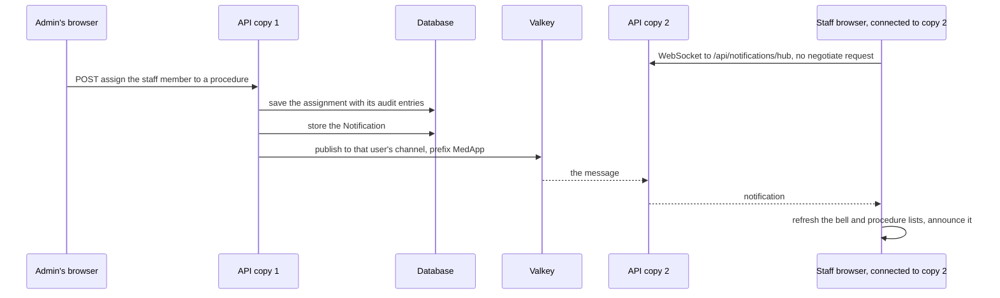

1. **Connecting.** On every signed-in page, `LiveNotifications` opens a WebSocket straight to `/api/notifications/hub`, skipping SignalR's usual negotiate request (`skipNegotiation: true`, WebSockets only). With two copies and no sticky sessions, the negotiate request and the WebSocket could reach different copies, and the second would reject a connection it didn't know. The hub requires the `Staff` policy; the cookie authenticates the WebSocket like any request.
2. **Sending.** The assign handler saves the assignment and its audit entries, then calls `INotificationSender`, which stores the notification (its own save) and calls `SignalRNotificationPublisher`. That sends to `Clients.User(userId)`, addressed by the session's user ID.
3. **The backplane.** With `ConnectionStrings:SignalRBackplane` set, SignalR publishes through Valkey (`MedApp.API/Notifications/SignalRBackplane.cs`, channel prefix `MedApp`). Every copy subscribes, and delivers to its own connections for that user. In development the setting is empty, and there's one copy.
4. **Receiving.** The browser refreshes the bell's list and count, invalidates procedure queries (My Tasks gains the procedure), and announces it to screen readers if announcements are on.
5. **Failure is soft.** Pushing is best effort: a failure is logged, and the stored notification shows on the next page load. If Valkey is down, the API still starts and keeps reconnecting (`AbortOnConnectFail = false`); meanwhile only browsers on the sending copy get it live. The browser reconnects at 0, 2, 10 and 30 seconds after a drop, then gives up until the page is reloaded.

Measured on kind with two copies (#50): 8 of 8 notifications arrived live with the backplane, 4 of 8 without it.

### 6.5 A deploy, from merge to running in the cluster

1. **The pull request.** CI (`.github/workflows/main.yml`) runs `web`, `image`, `helm`, `unit-tests` and `coverage-comment` ([7.7](#77-the-gitops-pipeline)). `web`, `image`, `helm` and `unit-tests` must pass before merging.
2. **The merge** to `main`, as a merge commit.
3. **Publish** (`.github/workflows/publish.yml`) runs on the push, unless only Markdown or `docs/` changed. Runs queue one at a time (`concurrency: publish`). The workflow grants no permissions itself; each of its three jobs asks for only what it needs.
   - **`image` job:** builds `MedApp.API/Dockerfile` with the GitHub Actions cache and pushes `ghcr.io/aliator/medapp-api:<commit SHA>`.
   - **`deploy-kind` job** (from `main` only; needs only `image`): `.github/scripts/deploy-to-env.sh env/kind deploy/argocd/kind-image.yaml …` records the deploy.
     - **The tree:** built in a temporary git index, it's `main` at that commit plus `deploy/argocd/kind-image.yaml` naming the image, except `.github/workflows`, which keeps `env/kind`'s own. GitHub refuses a push with the workflow's token that changes a workflow file, and nothing on an environment branch runs them.
     - **The commit:** it has two parents, `env/kind`'s previous tip first and the commit of `main` second, so the first-parent history is the deploy history. It's pushed without forcing.
     - **Never backwards:** if the branch already runs a newer commit of `main`, the script says so and stops, so re-running an old Publish run can't roll an environment back. A re-run for the commit already deployed changes nothing.
   - **`azure` job** (from `main` only, and only once the Azure repository variables are set; needs only `image`): signs in to Azure with OIDC, copies the image from GHCR to ACR as it is (`docker buildx imagetools create`, no rebuild), then records the deploy on `env/azure` the same way. Since it doesn't wait for `deploy-kind`, a failed kind deploy doesn't stop Azure's.
4. **Argo CD** in each cluster polls its branch (about every three minutes), renders the chart with that environment's values and the image file, and syncs in **waves**:
   - wave −1: the Secrets and ExternalSecrets;
   - wave 0: SQL Server (kind only), Valkey, Services, NetworkPolicies, the Ingress and the rest;
   - wave 1: the migrations Job, as a sync hook: the migrations bundle, then `create-first-admin`;
   - wave 2: the API Deployment, which rolls out gradually (Kubernetes' default rolling update), with a 5-second `preStop` pause so the ingress stops sending requests to a pod before it stops serving.
5. **If the migrations fail,** the sync stops before the API changes, so the old API keeps running. Argo CD doesn't retry the same commit by itself.
6. **Rolling back** is a revert on `main`, through a pull request, which deploys like any change. The database isn't rolled back: the older bundle leaves the newer schema in place, which is safe as long as migrations only add before they remove (the chart's README).

### 6.6 First install: migrations and the first admin

The app seeds no users, and never runs migrations at startup. A new database gets its schema and its first admin from the migrations Job:

1. **The secrets come first.**
   - **kind:** `up.sh` fills a stand-in secret store, the `medapp-vault` namespace, once, with random passwords (SQL Server's `sa`, the connection string, the first admin, the backplane). External Secrets Operator copies them into the `medapp` namespace.
   - **Azure:** `deploy.sh` deploys `main.bicep`, which writes three Key Vault secrets from environment variables (`MEDAPP_SQL_ADMIN_PASSWORD`, `MEDAPP_FIRST_ADMIN_PASSWORD`, `MEDAPP_BACKPLANE_PASSWORD`). External Secrets reads them with workload identity.
   - **Plain Helm without a store:** the chart generates random passwords, kept across upgrades by Helm's `lookup`.
2. **The Job runs.** Under Argo CD it's a sync hook in wave 1; under plain Helm a `post-install` hook (after SQL Server exists), and `pre-upgrade` after that. Its command is:

   ```sh
   /app/efbundle --connection "$ConnectionStrings__DefaultConnection" && exec dotnet /app/MedApp.API.dll create-first-admin
   ```

   The bundle unpacks into `/tmp`, because the root filesystem is read-only.
3. **`create-first-admin`** (`FirstAdminSetup`) adds the `Admin` and `User` roles if they're missing. If there are **no accounts at all**, it creates the admin (username `admin` from the store, with its password) with both roles, in one transaction. If anyone exists, it changes nothing and never resets a password, so it's safe on every deploy.
4. **Signing in.** On kind: `kubectl --context kind-medapp -n medapp-vault get secret medapp-first-admin -o jsonpath='{.data.password}' | base64 -d`. On Azure: the `MEDAPP_FIRST_ADMIN_PASSWORD` chosen at deploy time.
5. **In development** there's no Job. Migrations are applied by hand with `dotnet ef database update`, and `medapp-dev`'s `reset_demo_data` loads the demo data with the `admin` / `admin` test login, which exists only in local databases.

---

## 7. Deployment view

### 7.1 Environments

| | Development | Local Kubernetes (kind) | Azure |
|---|---|---|---|
| **Status** | In daily use | In use; the only cluster MedApp has run on | Written and checked in CI; **never deployed** |
| **Started by** | `dotnet run --project MedApp.AppHost` | `deploy/kind/up.sh` (Helm) or `up.sh --argocd` (GitOps) | `deploy/azure/deploy.sh`, then `bootstrap.sh`; then every merge |
| **App** | API from source on https://localhost:7038; React on Vite's dev server at http://localhost:5173 | The production image, two API copies, at http://localhost:8080 and https://localhost:8443 | The production image from ACR, two copies, behind a public IP and your domain |
| **Server rendering** | The Vite dev server renders pages | Node inside each API pod | Node inside each API pod |
| **Database** | SQL Server 2022 container on `127.0.0.1:14330` | SQL Server 2022 in the cluster (StatefulSet, 5 GiB volume) | Azure SQL serverless, private endpoint |
| **Backplane** | None (one copy) | Valkey | Valkey |
| **Secrets** | Aspire's generated `sa` password in the AppHost's user secrets | External Secrets from a stand-in store (`medapp-vault`) | External Secrets from Key Vault |
| **TLS** | None on 5173; the dev certificate on 7038 | cert-manager, self-signed | cert-manager, Let's Encrypt |
| **Data** | Synthetic demo data (`reset_demo_data`) | Empty with a first admin, or a demo snapshot | Empty with a first admin |

### 7.2 Local development

`MedApp.AppHost` (.NET Aspire 13.6) starts three resources:
- **`sql`:** SQL Server 2022 in Docker, with the `medapp-sql-data` volume, on host port 14330 bound to `127.0.0.1`. It's **persistent**: it keeps running after the AppHost stops, so `dotnet ef` and `medapp-dev` can still reach it. Aspire generated its `sa` password on the first run and keeps it in the AppHost's user secrets. The database in the volume keeps that password for `sa`, so don't change it. `tools/MedApp.DevMcp/.backups` is bind-mounted into it for snapshots.
- **`api`:** `MedApp.API` on its `https` launch profile (port 7038), with `ConnectionStrings__DefaultConnection` injected, waiting for the database.
- **`web`:** `MedApp.Web`'s dev server on a fixed port 5173, which proxies `/api` and `/swagger` to the API, so the cookie is first-party.

The Aspire dashboard shows each resource's logs, traces and health. Migrations are applied by hand.

### 7.3 The container image

`MedApp.API/Dockerfile`, built from the repository root, in three stages:

| Stage | Base | Does |
|---|---|---|
| `web` | `node:22-bookworm-slim` | `npm ci`, then `npm run build`: type check, the client build into `dist/`, the server entry into `dist/ssr/` with every package bundled in, and a copy of `server.mjs` |
| `api` | `mcr.microsoft.com/dotnet/sdk:10.0` | Restores from the six project files first (cached until they change), publishes the API for Release, installs `dotnet-ef` 10.0.15 and builds the migrations bundle `/app/efbundle` |
| `final` | `mcr.microsoft.com/dotnet/aspnet:10.0` | Node's binary from the `web` stage (`/usr/local/bin/node`), the published API and bundle in `/app`, the React build in `/app/wwwroot` |

- It runs as the image's own **non-root** user (`$APP_UID`, 1654), on port 8080, with no TLS: TLS ends at the ingress.
- **One image, three jobs:** the API, the Node page server it starts, and the migrations bundle the Job runs. They always come from the same commit.
- **What it quietly relies on:** Node's binary, built for Debian bookworm, finding its libraries in the `aspnet` image; and the image having a shell (`sh`) for the Job's command. Moving to a "chiseled" or Alpine runtime would break both.
- **`.dockerignore`** keeps Windows `node_modules`, build output, `.env` files, tools, docs, deploy files, tests and Dockerfiles out of the build context.
- **Tags:** the commit SHA from Publish; `local-<image ID>` from `up.sh`. Never `latest`: the chart refuses to render without `image.tag`.
- The image on GHCR is **public**, like the repository. It holds no secrets.

### 7.4 The Helm chart

`deploy/helm/medapp` (chart 0.1.0) deploys everything MedApp needs into one namespace:

| Template | What it makes |
|---|---|
| `api.yaml` | The API's Service (port 80 to 8080 only), Deployment, and, above one copy, a PodDisruptionBudget (`minAvailable: 1`) and a preferred spread across nodes. Fails to render with more than one copy and no backplane. |
| `sql.yaml` | SQL Server 2022 (Developer edition) as a one-pod StatefulSet on a 5 GiB volume (`sql.enabled`, on by default; off on Azure). |
| `valkey.yaml` | Valkey with a password, saving nothing to disk, no volume. |
| `migrations-job.yaml` | The migrations bundle and `create-first-admin`, as a Helm hook and an Argo CD sync hook. |
| `secret.yaml`, `externalsecrets.yaml` | The three Secrets (database, first admin, backplane), from an existing Secret, from External Secrets, or generated by the chart. |
| `ingress.yaml` | One Ingress for everything, with an optional cert-manager issuer. |
| `networkpolicy.yaml` | Default-deny policies for every MedApp pod ([8.1](#81-security)). |
| `_helpers.tpl` | Names, labels, and the shared pod and container security settings. |

**API pod settings** (`api.yaml`): the connection strings from Secrets; `ASPNETCORE_HTTP_PORTS=8080;8081` and `HealthChecks__Port=8081`; `ASPNETCORE_FORWARDEDHEADERS_ENABLED=true`. Probes on port 8081: start-up and liveness on `/alive`, readiness on `/health`. Requests of 250m CPU and 256 MiB, a 1 GiB memory limit shared by .NET and Node, no CPU limit. A 256 MiB `emptyDir` at `/tmp`.

**Values files:** the chart's defaults (`values.yaml`), kind's (`deploy/kind/values.yaml`), Azure's (`deploy/azure/values.yaml`), and the image file each environment branch adds (`deploy/argocd/kind-image.yaml`, `azure-image.yaml`).

### 7.5 The local kind cluster

- **The cluster** (`deploy/kind/cluster.yaml`): one node, with Traefik's node ports mapped to `127.0.0.1:8080` (http) and `:8443` (https).
- **Cluster services**, at the versions in `deploy/versions.sh`: Traefik, cert-manager with a self-signed `ClusterIssuer`, and External Secrets Operator with a `ClusterSecretStore` over the `medapp-vault` namespace (`deploy/kind/local-cluster.yaml`). The stand-in store means kind exercises the same `ExternalSecret` path as Azure.
- **MedApp** (`deploy/kind/values.yaml`): two API copies with Valkey, TLS, secrets from the local store. The `medapp` namespace enforces the `restricted` Pod Security Standard.
- **Two ways to run it,** which refuse to run over each other:
  - `up.sh` builds the image locally, loads it into the node (tagged by image ID, so an unchanged rebuild doesn't roll out) and runs `helm upgrade --install --wait`. For uncommitted code and demo data.
  - `up.sh --argocd` installs Argo CD (UI at http://argocd.localhost:8080), makes the `medapp` namespace with its `restricted` labels, applies the `medapp` project and Application, and follows `env/kind`. `--revision <branch>` follows another branch, with the image `env/kind` runs.
- Every command names the `kind-medapp` context, so the scripts can't touch another cluster.

### 7.6 Azure

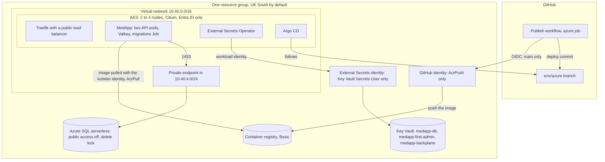

`deploy/azure/main.bicep` creates, in one resource group:

| Resource | Settings |
|---|---|
| **Virtual network** | `10.40.0.0/16`: a `/22` for AKS's nodes and a `/24` for private endpoints. |
| **AKS** | Free tier by default. Azure CNI Overlay with Cilium as the dataplane and network policy engine (pods `10.244.0.0/16`, services `10.41.0.0/16`). Entra ID sign-in only: local accounts off, Azure RBAC, the admin group as cluster admins. Workload identity and the OIDC issuer on. One system node pool of `Standard_D2s_v5`, autoscaling from 2 to 4. Patch upgrades and node image updates automatic. Its control plane runs as a user-assigned identity that gets Network Contributor on the subnet before the cluster exists. The API server is public, behind Entra ID. |
| **Container registry** | Basic, no admin user. AKS's kubelet identity has `AcrPull`. |
| **Azure SQL** | Serverless General Purpose, 1 vCore (0.5 minimum), pausing after 60 idle minutes; locally redundant backups (7 days of point-in-time restore by default); TLS 1.2 minimum; public network access off, reached through a private endpoint and private DNS zone; the admin group as Entra admin, with SQL authentication still on; a `CanNotDelete` lock. |
| **Key Vault** | Standard, RBAC, soft delete for 90 days, purge protection. Three secrets as JSON, including the connection string built from the SQL admin login. |
| **Identities** | External Secrets: federated with its service account, may only read secrets. GitHub Actions: federated with `repo:Aliator/MedApp:ref:refs/heads/main`, may only push images. |

`deploy/azure/deploy.sh` refuses to run while `main.bicepparam` still has the all-zero placeholder admin group, and the Bicep fails with a clear message unless `environmentName` is 1 to 8 lower-case letters and digits.

`deploy/azure/bootstrap.sh` then sets up the cluster:
- **First,** it converts only its own kube context for Entra ID sign-in (`kubelogin --context`), and waits up to ten minutes for the admin group's cluster role to apply, which can lag behind `deploy.sh`;
- **Traefik** with a public IP, http redirected to https, and `externalTrafficPolicy: Local`, so the app sees clients' real addresses;
- **cert-manager** with a Let's Encrypt `ClusterIssuer`;
- **External Secrets** with workload identity, and a `ClusterSecretStore` for Key Vault that serves only the `medapp` namespace;
- **The `medapp` namespace,** with its `restricted` Pod Security labels;
- **Argo CD**, its UI reachable only by port-forward, with the `medapp` project and the Application following `env/azure`.

MedApp's Azure values: two API copies with Valkey, no in-cluster SQL Server, every secret from Key Vault, Let's Encrypt TLS, and an egress rule letting the API and the Job reach the private endpoint subnet on 1433. The ingress host is a placeholder (`medapp.example.com`) to be set before deploying.

**Cost** (`deploy/azure/README.md`, rough UK South prices): two nodes about £120 a month, Azure SQL £5 to £40, the load balancer and IP about £20, the registry and Key Vault a few pounds. The Standard AKS tier, with an uptime SLA, adds about £60.

### 7.7 The GitOps pipeline

GitOps means the cluster runs exactly what a git branch says, and changes only when git does.

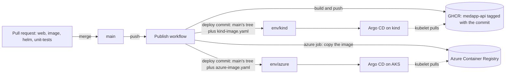

**CI on pull requests** (`.github/workflows/main.yml`):

| Job | Checks | Required to merge |
|---|---|---|
| `web` | `npm ci`, lint, type check, the built theme is current, Vitest with coverage thresholds, the full production build (client, SSR bundle, page server) | Yes |
| `image` | Builds the Dockerfile as Publish does, without pushing | Yes |
| `helm` | `helm lint --strict` in five configurations (defaults, kind, an external database with TLS, an external database from a secret store, Azure); renders the chart; builds and lints the Bicep; renders Traefik, cert-manager, External Secrets and Argo CD at the pinned versions with every values file the scripts use | Yes |
| `unit-tests` | Builds `tools/MedApp.DevMcp` (which isn't in the solution), then `dotnet test MedApp.UnitTests` in Release with coverage, and a report of classes under 80% | Yes |
| `coverage-comment` | One sticky PR comment with both coverage reports | No |

**Environment branches.** `env/kind` and `env/azure` each hold the full deployed state: the chart, the values and the image, from one commit, because Argo CD can't take the chart and the image tag from two revisions of one repository ([ADR-18](#9-architecture-decisions)). Each deploy commit is `main`'s files plus the image file, except `.github/workflows`, which keeps the branch's own ([6.5](#65-a-deploy-from-merge-to-running-in-the-cluster)). `git log --first-parent env/kind` is the deploy history. A hand commit to an `env/*` branch is for emergencies only, and the next deploy replaces it.

**Argo CD** (`deploy/argocd`): one Application per cluster, in the `medapp` AppProject, which allows only this repository, only the `medapp` namespace, and only the kinds the chart renders, with nothing cluster-wide, not even a Namespace. Sync is automated, with `prune` (removes what's gone from git) and `selfHeal` (undoes changes made by hand). Argo CD doesn't create the namespace: `up.sh --argocd` and `bootstrap.sh`, running as cluster admin, make `medapp` with its `restricted` Pod Security labels before applying the Application, so a commit on an environment branch can't relabel it to allow privileged pods.

### 7.8 How to run it

**Development.** Needs the .NET 10 SDK, Node.js with npm, Docker Desktop running, and the ASP.NET Core development certificate (`dotnet dev-certs https`).

```bash
dotnet run --project MedApp.AppHost   # SQL container, API, React app and the Aspire dashboard
# React app:  http://localhost:5173
# Swagger:    https://localhost:7038/swagger
# Dashboard:  the login URL the command prints
```

On a new, empty database, apply the migrations, then load the demo data:

```bash
PW=$(dotnet user-secrets list --project MedApp.AppHost | sed -n 's/^Parameters:sql-password = //p')
dotnet ef database update --project MedApp.Infrastructure --startup-project MedApp.API \
  --connection "Server=127.0.0.1,14330;Database=MedApp;User ID=sa;Password=$PW;TrustServerCertificate=True"
dotnet build tools/MedApp.DevMcp      # then ask the agent for medapp-dev's reset_demo_data
```

Sign in as `admin` / `admin`. Before calling a change done:

```bash
dotnet build MedApp.sln && dotnet test MedApp.UnitTests
cd MedApp.Web && npm run lint && npm run typecheck && npm test
```

**Local Kubernetes.** Needs Docker Desktop, kind, kubectl, Helm, and Bash with openssl (Git Bash on Windows); about 4 GB of memory.

```bash
deploy/kind/up.sh                         # an empty database with a first admin
deploy/kind/up.sh --demo-data kind-demo   # or a medapp-dev snapshot called kind-demo
deploy/kind/up.sh --argocd                # or have Argo CD follow env/kind
deploy/kind/down.sh                       # delete the cluster
```

Open http://localhost:8080 or https://localhost:8443 (the browser warns about the self-signed certificate). `up.sh` prints the command for the first admin's password.

**Azure.** It costs money from the moment `deploy.sh` finishes, so only run it deliberately. Needs a subscription where you can create role assignments, an Entra ID group for the admins, a domain, and the Azure CLI, kubectl, kubelogin and Helm.

1. Fill in `deploy/azure/main.bicepparam`: the admin group's object ID and name (`deploy.sh` refuses the all-zero placeholder), and `environmentName` (1 to 8 lower-case letters and digits). Set `ingress.host` in `deploy/azure/values.yaml`, and merge that to `main`.
2. Export the three passwords (`MEDAPP_SQL_ADMIN_PASSWORD`, `MEDAPP_FIRST_ADMIN_PASSWORD`, `MEDAPP_BACKPLANE_PASSWORD`), and keep them. Every later run must use the same ones.
3. `az login`, then `deploy/azure/deploy.sh rg-medapp-prod uksouth`: it shows a what-if, asks, deploys, and prints four repository variables.
4. `deploy/azure/bootstrap.sh rg-medapp-prod you@example.com`, then point the domain's DNS at the IP it prints. It waits for your cluster role first, and is safe to run again if it stops partway. It leaves AKS as your current kube context, so switch back before running kind's scripts.
5. Set the repository variables `AZURE_CLIENT_ID`, `AZURE_TENANT_ID`, `AZURE_SUBSCRIPTION_ID` and `AZURE_ACR_NAME` in GitHub. The next merge deploys, or run Publish by hand on `main` to deploy at once.
6. Sign in as `admin` with the first admin password.

To delete it, remove the `medapp-keep-database` lock first; deleting the SQL server deletes its backups too. Key Vault's name then can't be reused for 90 days.

---

## 8. Cross-cutting concepts

### 8.1 Security

#### Authentication

- **Accounts are local.** Usernames and passwords, hashed by ASP.NET Core Identity's password hasher. There's no single sign-on and no multi-factor authentication.
- **Password rules** (`appsettings.json`, `Identity` section): at least 8 characters, with a digit, a lower-case and an upper-case letter.
- **Lockout:** 5 wrong passwords lock the account for 5 minutes. A locked account gets 423 with the time left, even with the right password (#38).
- **Sensitive actions re-check:** changing your own password needs the old one; deleting a user needs the deleting admin's own password.
- **The server generates every first password and every reset** (#53): at least 16 characters, or the configured minimum if that's longer, from a cryptographic random number generator (`IdentityUserService.GeneratePassword`). There's no default password. `POST api/auth/users` takes only a username and returns the new password once, with `Cache-Control: no-store`. The Users page shows it once, with a copy button, and forgets it when the dialog closes. The response records print `***` in place of the password, so logging one can't leak it.
- **A generated password must be changed at first sign-in.** Creating an account or resetting a password sets `ApplicationUser.MustChangePassword`; changing it clears it. Until then the session carries a claim, and `PasswordChangeRequired` refuses every `/api` request with a 403 except who am I, signing in again, signing out, reading one's own settings and changing one's own password, and the web app holds them on `/change-password` (an open page is sent there by its next 403). The first admin and `medapp-dev`'s accounts are exempt. Accounts created before #53 were given the published password `DefaultPassword1`, may still have it, and nothing finds them yet ([11.1](#111-security-and-privacy), S1).
- **"Forgot password?"** is a stand-in: it says a link was sent, and sends nothing.

#### Authorisation

- **Two roles,** `User` (staff) and `Admin`, checked on every endpoint with `[Authorize(Policy = AuthPolicies.Staff)]` or `[Authorize(Roles = "Admin")]`. [Section 5.7](#57-the-api-surface) has the full matrix.
- **The API is the only enforcement.** The React app's guards (`_app`, `requireAdmin`) and hidden admin buttons are conveniences.
- **Roles are re-read on every request,** so a change applies at once.
- **"Not assigned to you" is not a permission.** Any staff member may work on any procedure; the confirmation is a UI safeguard, and the audit log records who acted (procedures plan, decision 18).
- **All staff see all patients,** and all calendars and appointments. There's no restriction by team, ward or care relationship. Any staff member may book, move or cancel any appointment; a calendar's blocks and its day and week templates are changed only by its owner or an admin.
- **Only two endpoints' attributes are tested.** The own-password change (#51) and creating a user (#53) have tests that evaluate their `[Authorize]` attributes with the API's real policies. The other controller tests call actions directly through a recording mediator, so a missing or wrong `[Authorize]` anywhere else wouldn't fail a test ([11.1](#111-security-and-privacy)).

#### Sessions and cookies

| Property | Value | Where |
|---|---|---|
| Cookie name | `medapp.session` | `SessionAuthenticationDefaults.cs` |
| Value | The session's ID (a GUID), looked up in `UserSessions` | `SessionService` |
| `HttpOnly` | Yes | `SessionCookieService.cs` |
| `SameSite` | `Lax`: not sent on cross-site POSTs | `SessionCookieService.cs` |
| `Secure` | Outside Development | `SessionCookieService.cs` |
| Lifetime | 8 hours from sign-in, extendable on request ("Stay signed in", `POST api/auth/session/extend`) to 24 at most from sign-in; using the app doesn't extend it; no idle timeout | `UserSession.cs`, `SessionService.cs` |
| Revocation | On sign-out; or when the user is deleted (validation fails) | `SessionService.cs` |

**Cross-site request forgery (CSRF).** There are no antiforgery tokens. The defence is `SameSite=Lax`, which keeps the cookie off cross-site POSTs, PUTs, PATCHes and DELETEs, together with JSON request bodies. There's no CORS policy, so no other origin is allowed to read responses.

#### Transport

- **TLS ends at the ingress** (Traefik). On Azure, Traefik redirects http to https and cert-manager gets Let's Encrypt certificates; on kind the certificate is self-signed.
- **HSTS** (HTTP Strict Transport Security) is sent outside Development, with ASP.NET Core's defaults (30 days, no subdomains). ASP.NET Core sends it only on https and never for `localhost`, so it depends on the forwarded headers telling the API that Traefik received https.
- **Inside the cluster** traffic is plain: the API to Valkey, and on kind the API to SQL Server (`TrustServerCertificate=True`). Azure SQL connections are encrypted (`Encrypt=True`).

#### The server rendering protections (#42, #51)

| Protection | How |
|---|---|
| Node is unreachable from outside | It listens on `127.0.0.1` only, on a random port, inside the API's container. |
| The renderer's key does very little | A random 256-bit key per process, compared in constant time. It only lets Node's calls from loopback skip the https redirect. Node's calls still need the user's session. |
| No open proxy | The target URL is built from Node's address plus only the request's path and query, and checked before sending. Any path containing `//` is a 404. |
| Node's own files aren't served | `/ssr` and `/.vite` are a 404 (`PageServerFiles.IsBlocked`). That's a string check, which holds on Linux, where the image runs; on a Windows host, `\`, trailing-dot and 8.3 short-name forms of those paths still reach the files. |
| Node's environment holds no secrets | It's an allowlist (`SsrServer.StartInfo`): no connection strings, so they can't leak from Node by accident, into its logs for example. It isn't isolation: Node runs as the API's user, in the API's container, and could read the API's environment from `/proc`. |
| A failed render loses nothing else | The fallback restores the pipeline's own headers (HSTS) and drops only Node's. |
| No caching of personal data | Rendered pages carry `Cache-Control: no-store`. |
| No data shared between requests | A new router and query cache per request; the request's cookie travels through `AsyncLocalStorage`. |
| No surprises from the HTTP client | It follows no redirects, keeps no cookies, and has no retries or circuit breaker. |
| Escaping | React escapes rendered text; rich text is shown with Astryx `Markdown`, which never runs raw HTML and turns unsafe links into plain text (#41). |

#### The platform (`deploy/helm/medapp`)

- **Network policies:** default-deny for every MedApp pod, with only these connections allowed. kind's network plugin and AKS's Cilium both enforce them.

  | From | To | Port |
  |---|---|---|
  | The ingress controller's namespace (`traefik`) | API | 8080 |
  | API | DNS (CoreDNS in `kube-system`) | 53 |
  | API | SQL Server (or Azure SQL's private endpoint subnet on Azure) | 1433 |
  | API | Valkey | 6379 |
  | Migrations Job | DNS; SQL Server or the private endpoint subnet | 53; 1433 |
  | Anything else | MedApp's pods | refused |

  The kubelet's probes on 8081 aren't affected by policies, and Node's calls stay inside the pod on loopback.
- **The `restricted` Pod Security Standard,** enforced on the namespace: non-root users (1654 for the API and Job, 10001 for SQL Server, 999 for Valkey), the `RuntimeDefault` seccomp profile, no privilege escalation, every Linux capability dropped (SQL Server keeps `NET_BIND_SERVICE`, which `sqlservr` needs).
- **No Kubernetes API tokens** mounted in any pod, since none calls the Kubernetes API.
- **Read-only root filesystems,** with a small `emptyDir` at `/tmp`; SQL Server writes only to its volume.
- **Health checks on a private port** (8081), which neither the Service nor the ingress exposes.
- **Resource requests and memory limits** on every container; no CPU limits.
- **Argo CD's `medapp` project** limits what a deploy branch can create: only the kinds the chart renders, only in the `medapp` namespace, and nothing cluster-wide, not even a Namespace. A ClusterRole, a webhook or a relabelled namespace landing on `env/*` fails the sync. The setup scripts make the namespace instead (#52).

#### Secrets

- **Never in git.** Passwords are generated (kind), or chosen and exported as environment variables (Azure), and stored in a secret store.
- **External Secrets Operator** copies them into Kubernetes Secrets: from Key Vault on Azure (workload identity, read-only), or from the `medapp-vault` stand-in on kind. On Azure the store serves only the `medapp` namespace.
- **The chart's fallback** generates random passwords and keeps them across upgrades and on uninstall (`helm.sh/resource-policy: keep`).
- **In the pods,** secrets are environment variables. Running pods never re-read them, so a changed password needs a restart (`deploy/azure/README.md`, Passwords).
- **Two secrets appear on process command lines:** the migrations Job's connection string and Valkey's password ([11.1](#111-security-and-privacy)).

#### Identities on Azure

| Identity | Federated with | May |
|---|---|---|
| AKS control plane (user-assigned) | n/a | Network Contributor on the AKS subnet |
| AKS kubelet | n/a | `AcrPull` on the registry |
| External Secrets | the `external-secrets` service account in AKS | Key Vault Secrets User |
| GitHub Actions | `repo:Aliator/MedApp:ref:refs/heads/main` | `AcrPush` on the registry |
| The admin Entra ID group | n/a | AKS RBAC Cluster Admin; Azure SQL's Entra admin |

No cloud secret is stored anywhere: GitHub signs in with OIDC, External Secrets with workload identity, and people with Entra ID (the cluster has no local accounts). The app itself still signs in to Azure SQL with the server admin's SQL login ([11.1](#111-security-and-privacy)).

#### Supply chain

- **Pinned:** `@astryxdesign/*` and Lexical exactly; ReportGenerator's action by commit SHA; `dotnet-ef` by version.
- **Floating:** the other GitHub Actions by major tag (`@v4`, `@v3`), the base images (`node:22-bookworm-slim`, `dotnet/aspnet:10.0`, `dotnet/sdk:10.0`), `mssql/server:2022-latest` and `valkey:8.1-alpine`, and caret ranges in `package.json` (the lock file fixes what's installed).
- **Missing:** Dependabot or Renovate, image vulnerability scanning, an SBOM (software bill of materials) and image signing.

### 8.2 Data protection and privacy, as they stand

This describes what the code does today. It isn't a compliance statement; [section 2.3](#23-regulatory-and-legal-constraints) lists what hasn't been assessed.

| Topic | Today |
|---|---|
| **Personal data held** | Patients: name, date of birth, email. Procedures: titles, notes and stage notes, free text that will in practice hold clinical information. Staff: username, password hash, and on each session the IP address and browser user agent. Audit entries: usernames, and the old and new text of every notes change. Notifications: the procedure's title. Appointments: the patient, the member of staff, the time, the status, notes and a cancellation reason (free text about the patient), and their history with old and new notes. Calendar blocks: the member of staff, the time, the activity (Annual leave, Training, ...) and a short note, about staff. |
| **Minimisation** | The patient record is deliberately small. Free text isn't limited by structure. |
| **At rest** | In SQL Server. Azure SQL encrypts data at rest by default (transparent data encryption), which the Bicep doesn't change. On kind, the data is on the SQL Server pod's volume. No column-level encryption. |
| **In transit** | TLS to the ingress; encrypted to Azure SQL; plain inside the cluster to Valkey (which carries procedure titles) and, on kind, to SQL Server. |
| **In pages and the browser** | Server-rendered HTML carries the page's data, and is sent with `Cache-Control: no-store`. The browser keeps the account's settings in `localStorage` (`medapp.*` keys), and they're also saved with the account; they include saved searches, whose terms can be patient names. The side navigation's pinned patients and procedures are kept only in the browser, as IDs. No patient records are stored in the browser. Signing out clears the query cache, but not `localStorage`. |
| **In logs** | EF Core logs every SQL command at Information level, but without parameter values (sensitive data logging is off). Nothing logs patient fields on purpose. |
| **Who can see what** | Every staff member sees every patient and procedure, and every calendar and appointment. Only admins read the audit log; staff see each patient's timeline without its free text (no appointment notes or cancellation reasons either). |
| **Access logging** | **Reads aren't logged.** Changes to procedures are fully audited; changes to patients (create, edit, delete) and to accounts and roles are not. |
| **Retention** | None. Nothing is ever purged: patients, procedures, appointments and their history, calendar blocks, audit entries, notifications and expired sessions stay forever. |
| **Erasure** | A patient with procedures or appointments can't be deleted. Deleting a procedure keeps its audit entries, including notes text and the patient's ID, by design, and detaches its appointments, whose history keeps the procedure. There's no export for subject access requests. |
| **Backups** | Azure SQL: 7 days of point-in-time restore, locally redundant. kind: none. Development: `medapp-dev` snapshots. No restore has been tested. |
| **Residency** | UK South by default on Azure. GitHub holds only code and the public image. |
| **Test data** | Synthetic only, by convention (`AGENTS.md`); the demo seeds invent names and use `@example.com` addresses. |

### 8.3 Validation and errors

- **Validation** runs in the MediatR pipeline. `ValidationBehaviour` runs the command's FluentValidation validators and throws `ValidationException`, which `ExceptionHandling` (`MedApp.API/Middleware/ExceptionHandling.cs`) turns into **400** `ValidationProblemDetails`, with errors keyed by property name, as `application/problem+json`.
- **Other expected failures** are exceptions that become `ProblemDetails`: `NotFoundException` 404, `ConflictException` 409, `InvalidCredentialsException` 401, `AccountLockedOutException` 423.
- **Anything else** isn't caught by the middleware, and surfaces as a 500 with no details.
- **`/api` paths with no endpoint** are 404s, never the React app.
- **In the React app,** `unwrap()` throws `ApiValidationError` for a 400; `fieldStatus()` puts each message on its field; `ValidationAlert` lists the rest. Forms reserve a line under every field for its error, so nothing moves when one appears.
- **The server is the only source of rules.** The client never repeats them.

### 8.4 Logging, telemetry and health

- **OpenTelemetry** (`MedApp.ServiceDefaults`): logs, metrics (ASP.NET Core, HTTP client, .NET runtime) and traces (ASP.NET Core, HTTP client), with health check requests left out of traces.
- **Export** happens only when `OTEL_EXPORTER_OTLP_ENDPOINT` is set. The AppHost sets it, so the Aspire dashboard shows everything in development. **In Kubernetes nothing sets it:** logs go to the container's console, and no metrics or traces leave the pod. There's no Container Insights, Log Analytics or alerting.
- **The Node page server's output** is logged by the API as `SSR: …` lines (stderr as warnings).
- **Health checks:** `/alive` and `/health` both run only the built-in "self" check, so they say the process is up and nothing more. In Kubernetes they're on port 8081: start-up and liveness probes use `/alive`, readiness `/health`.
- **Known noise:** MediatR 14's licence warning at startup, and one log line per SQL command.

### 8.5 Testing and coverage

| Layer | What's tested | How |
|---|---|---|
| Application | Every handler, validator and mapper; the procedure workflow | NUnit, FluentAssertions, Moq, AutoFixture with AutoMoq. Procedure handler tests share `ProcedureHandlerTestBase` (a mocked repository and username lookup, a fixed clock). |
| Infrastructure | Identity services, the first admin, mappers | The same; an `AsyncQueryable` helper runs EF's async operators over in-memory data. |
| API | Controllers (through `RecordingMediator`, which records each request and its cancellation token), the exception middleware, session authentication, the cookie service, the SignalR publisher and backplane, server rendering | Including a real Node process (`SsrServerProcessTests`) and the real `ssr` HttpClient registration (`SsrClientTests`, #51). |
| React | Every component and page, the providers, API modules, and whole pages rendered on the server in Node (`src/entry-server.test.tsx`) | Vitest with React Testing Library on jsdom; `renderWithApp` and `mockFetch` helpers; a stand-in SignalR connection. |
| Chart and infrastructure | Lint and render in five configurations; the cluster services' charts with every values file; the Bicep built and linted | CI's `helm` job. |
| Image | Builds | CI's `image` job. |
| UI and accessibility | 46 screens captured; axe across them in three colour schemes | `tools/ui-parity`, by hand, not in CI. |
| Integration | Every area through HTTP against real SQL Server: sign-in, sessions and lockout, an authorisation matrix (admin-only and staff endpoints by role), the forced password change, users and roles (with `IdentityTransactions`), patients' search in SQL, procedures' workflow, audit and due dates, archiving, notifications and the hub, errors, and every migration up and down | `MedApp.IntegrationTests`: `WebApplicationFactory` and Testcontainers, data reset with Respawn; CI's `integration-tests` job. |
| End-to-end | Signing in and out, patients, a procedure's stages, My Tasks, a new user's first sign-in and password change, and the notification bell | `MedApp.E2ETests` (Playwright) against the production image in CI's `e2e` job. |

- **Numbers:** 815 .NET unit tests, 185 integration tests, 11 end-to-end tests and 713 web tests.
- **Coverage.** The web job fails below 99% of lines, statements and functions, and 92% of branches (`MedApp.Web/vite.config.ts`). .NET coverage is reported in the sticky PR comment (classes under 80%), but doesn't fail the build. The .NET report leaves out commands, queries, DTOs, repositories, the DbContext, migrations, generated code, the service defaults and wiring (`ServiceExtensions`, `ApplicationBuilderExtensions`, `Program`), plus `SessionService` and `IdentityTransactions`, which need a real database.
- **Conventions:** the test tree mirrors the source; names follow `Method_Scenario_ExpectedResult`; shared test data lives in `MedApp.UnitTests/Common/Constants`; synthetic data only.
- **The gap:** the integration tests run the assembled pipeline against a real database (authentication, the forced password change before authorisation, the error middleware, the `/api` 404 against the app's fallback), but not the blocked page-server paths, HSTS or the health port, and their authorisation matrix samples 26 endpoints rather than covering every one. The end-to-end tests run one copy of the image, without the Valkey backplane.

### 8.6 Accessibility

- **Target:** WCAG 2.2 AA. The statement is at `/accessibility`.
- **Components:** only Astryx, whose components carry their own keyboard and screen reader behaviour. Every colour comes from theme tokens, so a new component follows the chosen colours and the accessibility settings without extra work.
- **Eleven switches** (Account Settings, `src/app/accessibility.tsx`), all off by default: high contrast, reduce motion, stronger focus indicator, more text spacing, easy-to-read font (Atkinson Hyperlegible), icons on statuses, colour-blind-friendly colours, underlined links, bigger buttons and fields, keyboard shortcuts (`?` lists them; never while typing), and screen reader announcements.
- **Also:** text size; light and dark mode; colour themes and custom colours; page titles set and announced on every page (`usePageTitle`); list results announced; tables that become cards when their columns don't fit, which also covers zooming to 400%.
- **Checked by:** `npm run a11y` in `tools/ui-parity`, axe against WCAG 2.2 A and AA on every screen in dark, light and a colour theme. It passes (`docs/todo.md`).
- **Still to do** (`docs/todo.md`): a screen reader pass by hand (NVDA, VoiceOver) and keyboard-only use of every dialog; a warning when custom colours fall below 4.5:1 contrast; more announcements; a save shortcut; and a warning before a session ends (WCAG 2.2.1, timing adjustable).

### 8.7 Configuration

| Setting | Source | Notes |
|---|---|---|
| `ConnectionStrings:DefaultConnection` | AppHost (development); a Secret (Kubernetes) | Never in `appsettings*.json`. |
| `ConnectionStrings:SignalRBackplane` | A Secret | Empty means no backplane, one copy. |
| `Identity:*` | `appsettings.json` | Password and lockout rules. |
| `Ssr:Enabled`, `NodePath`, `ScriptPath`, `RenderTimeout` | Defaults in `SsrOptions` | On by default; only starts if `wwwroot/ssr/server.mjs` exists. |
| `HealthChecks:Port` | The chart (8081) | Without it, health checks exist only in Development. |
| `ASPNETCORE_HTTP_PORTS`, `ASPNETCORE_FORWARDEDHEADERS_ENABLED` | The image (8080) and the chart (`8080;8081`, `true`) | |
| `FirstAdmin:Username`, `FirstAdmin:Password` | A Secret, for the migrations Job only | |
| `OTEL_EXPORTER_OTLP_ENDPOINT` | The AppHost | Unset in Kubernetes. |
| Node's `PORT`, `HOST`, `MEDAPP_API_URL`, `MEDAPP_SSR_KEY`, `NODE_ENV`, `NODE_OPTIONS` | Set by `SsrServer` | Plus the allowlisted system variables. |
| The `sa` password for development | The AppHost's user secrets (`Parameters:sql-password`) | Generated by Aspire on the first run. |
| Per-environment deployment | `deploy/kind/values.yaml`, `deploy/azure/values.yaml`, `deploy/azure/main.bicepparam`, `deploy/versions.sh` | |
| Azure for Publish | Repository variables `AZURE_CLIENT_ID`, `AZURE_TENANT_ID`, `AZURE_SUBSCRIPTION_ID`, `AZURE_ACR_NAME` | Identifiers, not secrets. |
| Per-user settings | `UserSettings` table, through `GET`/`PUT api/auth/me/settings` | Also cached in the browser. |

`AllowedHosts` is `*`; the ingress decides which host names reach the app.

### 8.8 Time, dates and locale

- **Timestamps are UTC,** set in handlers from an injected `TimeProvider`, so tests run at a fixed time. (`SessionService` is the exception: it reads `DateTime.UtcNow` directly.)
- **Due dates are whole days** in UK time, stored as the end of that day in UTC (`DueDates`), and sent and received as dates.
- **Calendars work in UK time and store UTC.** The working day is 08:00 to 18:00 UK time (Europe/London). Appointments and blocks are stored and sent as UTC. Template times are UK clock times (`TimeOnly`), turned into UTC for each date by `UkTime`, so a 12:00 lunch stays at 12:00 UK time across a clock change; template history is dated in UK dates. The calendar response gives each day's working start and end in UTC, so the browser steps through slots without time zone arithmetic. A UK working day never spans a clock change (they happen at 01:00 and 02:00).
- **The UI is `en-GB`:** UK date formats, and calendars starting on Monday. Dates go to the API as ISO `YYYY-MM-DD`.

### 8.9 Persistence conventions

- **IDs** are GUIDs made in handlers.
- **Migrations** form one linear history; a new one goes on top, and an applied one is never edited. EF scaffolds a rename as drop-and-create, which loses data, so every scaffold is read and renames are written by hand (`RenamedTasksToProcedures` is the reference). `has-pending-model-changes` must report nothing. A non-trivial migration is tested up and down on a throwaway LocalDB database.
- **Expand, then contract.** Migrations run before the new API starts, so the old API briefly runs on the new schema. A removal or rename takes two releases: add first, remove later. Nothing enforces this but review.
- **No optimistic concurrency.** No entity has a concurrency token, so two simultaneous edits to one procedure or patient end with the last write winning. For procedure notes both saves are audited, with the old and new text, so nothing is lost for good.
- **Stored enums** are never renumbered.

### 8.10 How changes are made

- **Branches** are `feature/<name>`, merged to `main` by pull request with a merge commit. Commit messages are short, capitalised and past tense.
- **Three stages** for every real change: plan at the highest effort, implement with a separate agent at high effort, then review with a fresh agent at the highest effort, which isn't told the author's conclusions ([ADR-19](#9-architecture-decisions)).
- **"Merge it" or "ship it"** runs a fixed flow (`AGENTS.md`): commit and push; open the pull request; write the review document (`docs/reviews/pr-<number>-<name>.md`) and stop on any high or critical finding; wait for CI; merge; delete the branch; pull `main`; and check the Publish run, which is the deploy.
- **CI is watched, not assumed.** A background agent follows the run for the pushed commit and reports a failure with its cause and a proposed fix; nothing is fixed without the owner's approval.
- **UI changes** get targeted parity screenshots while working, and the full set when merging.

---

## 9. Architecture decisions

Each row is a short architecture decision record (ADR): what was decided, why, what else was considered, and what follows. Sources are the pull requests and plans; **(inferred)** marks a reason that isn't written down anywhere.

| ID | Decision | Context | Alternatives considered | Consequences |
|---|---|---|---|---|
| ADR-1 | **Clean Architecture, with CQRS through MediatR and FluentValidation in its pipeline** (PRs #2 to #7, January 2026) | A new API meant to grow by use case. Its reasons weren't written down (inferred: testable handlers, one place for validation, and dependencies that point inward). | Not recorded (inferred: a conventional service layer, or minimal APIs with services). | One known shape for every feature, easy to test in isolation; more files per feature. MediatR has since become commercial, so production needs a licence or a replacement. The Application layer has picked up ASP.NET Identity's `IdentityResult`. |
| ADR-2 | **Server-side sessions in the database, carried by an HttpOnly cookie** ("Stateful Authentication", #14) | A browser app on one origin. | (Inferred) ASP.NET Core's cookie authentication with encrypted tickets, or JWT bearer tokens. | Sessions can be revoked at once and seen by tools; nothing depends on keys shared between API copies. Costs a database lookup per request, and the lifetime and revocation rules are MedApp's own to get right ([11.1](#111-security-and-privacy)). |
| ADR-3 | **One origin: the API serves the React app, with no CORS** (react-migration-plan Q3, Q4) | The HttpOnly cookie must stay first-party. | Static hosting on its own origin with CORS and cross-site cookies; a Node server in front of the API. | `SameSite=Lax` is enough; one front door; Vite proxies `/api` in development. The API also serves files. |
| ADR-4 | **React on Astryx replaces Blazor WebAssembly**, built alongside and then switched over; Blazor kept as `MedApp.Client.Deprecated` (react-migration-plan; #23 to #29) | A fixed goal of the migration, with Astryx as the UI library (inferred reasons: a richer, accessible component set, the React ecosystem, and server rendering). | Keeping Blazor; page-by-page mixing (rejected, Q12); other React UI kits (ruled out: Astryx only). | One UI library, in beta, pinned exactly; a parity process with screenshots; the old client kept compiling for reference. |
| ADR-5 | **API types generated from the OpenAPI document** (Q6) | Types must not drift from the API. | NSwag; hand-written types (both rejected). | One source of truth. `npm run gen:api` after each DTO change, with the AppHost running. Every generated field is optional, so the code carries `??` fallbacks. |
| ADR-6 | **Lists are filtered, sorted and paged by the API** (phase 4, revising Q10) | Blazor loaded every row and paged in the browser. | Paging in the browser. | Scales; list state lives in the URL; the same LINQ runs in SQL and in tests; ordering always ends on a unique key. |
| ADR-7 | **Procedures copy their template's stages, keep their rules in two classes, and save audit entries with each change; the audit table has no foreign keys** (procedures-ui-plan; #30) | Finished work must never change when a definition is edited, and every change must be traceable. | Stages pointing at live definitions (the old model); auditing by database triggers or a separate service (inferred). | History is stable; definitions and templates in use are archived, not deleted; audit entries outlive deletes, but the database can't enforce their links; every new procedure command must go through `ProcedureChange`. |
| ADR-8 | **Hand-written static mappers, no mapping library** (#44) | Handlers built responses inline in several styles, and two endpoints returned the Domain `Patient`. | AutoMapper, Mapster. | Mapping is visible, cheap and tested per mapper; more boilerplate, and a new field can be forgotten (the tests guard that). |
| ADR-9 | **Server-side rendering, with the API starting and fronting a Node page server, falling back to browser rendering** (#42, hardened in #51) | Faster first paint with the data in it; every page sits behind sign-in, with per-user data, and the app was static files in the API. | Node in front of the API (for example TanStack Start, which the to-do item suggested); a sidecar container; no SSR. The PR doesn't say why Start wasn't used (inferred: it expects to own the server and the build). | One image and one origin; Node on loopback only. But the API is now Node's supervisor, without restarts, health checks or memory isolation; and the first version had an open proxy and a broken fallback, fixed in #51. |
| ADR-10 | **One image holding the API, the React app, Node and the EF migrations bundle; migrations as a Kubernetes Job, never at startup** (#45, #47) | The schema must always match the code, and a failed migration must stop a rollout. | Migrating at startup; a separate migrations image; a separate web server image. | The Job can't apply a different schema; a failed migration leaves the old API running. Migrations and the app share one database credential. Changes must follow expand-then-contract. |
| ADR-11 | **The first admin is created by a command, from a secret, only on an empty database** (#48, both roles since #51) | A deployed database starts empty; the app seeds no users. | A seeded account in a migration (a known login in every database); an anonymous first-run sign-up (a race). | No default credentials anywhere but local development; safe to run on every deploy. The name is always `admin`, so anyone can lock it out for 5 minutes. |
| ADR-12 | **Kubernetes with a Helm chart, proven on a local kind cluster before any cloud** (#46 to #48) | Step by step towards Azure (`docs/todo.md`). | kustomize (#46 started with it; replaced in #47 because the chart has real options); Azure Container Apps or App Service, which the review says would cost a fraction (`flaws-review.md`, judgement). The documents don't say why AKS was preferred (inferred: portability, and room for more services). | The same chart and the same delivery everywhere; production can be tried locally for free. Many moving parts for a one-maintainer app, and about £150 a month on Azure before the database. |
| ADR-13 | **Traefik as the ingress controller** (#47) | ingress-nginx, the long-standing default, has been retired (`docs/reviews/overview.md`). | ingress-nginx; AKS's application routing add-on; Azure Application Gateway. | Traefik merges `//` in paths, which hid the open proxy until #51; the app now blocks it itself. One replica by default. It must report an ingress address for Argo CD to see the Ingress as healthy (#49). |
| ADR-14 | **External Secrets Operator, with a local stand-in store on kind** (#48) | No passwords in git, and the same secret path locally and in the cloud. | (Inferred) the Secrets Store CSI driver, Sealed Secrets, or only the chart's generated Secrets. | kind exercises the same `ExternalSecret`s as Azure. Secrets arrive as environment variables, so a change needs a restart. |
| ADR-15 | **Valkey as the SignalR backplane, and browsers connecting by WebSocket only, without negotiating** (#50) | Two API copies: a notification sent by one must reach browsers connected to the other. | Sticky sessions at the ingress (tied to one ingress controller); Azure SignalR Service; staying on one copy. | No affinity needed; Valkey stores nothing. No fallback transport where WebSockets are blocked (stored notifications still show on reload); the backplane's traffic isn't encrypted. Valkey chosen for its BSD licence. |
| ADR-16 | **Bicep for the Azure infrastructure** (#52) | Azure is the only cloud target. The reason isn't written down (inferred: first-party, no state file to store and lock, what-if built in, and it can be compiled and linted in CI with the Azure CLI already on the runner). | Terraform, Pulumi, ARM JSON. | One file, with a what-if before each deploy. Ties the infrastructure code to Azure. Bicep currently owns the secrets' values, so each run resets them. |
| ADR-17 | **Azure Container Registry for AKS, GitHub Container Registry for kind** (#49, #52) | AKS can pull from its own registry with its kubelet identity (`AcrPull`), with no pull secrets (inferred, from `deploy/argocd/README.md`'s note that a private registry would need them). | AKS pulling from GHCR, public or with pull secrets. | The `azure` job copies the image as it is, so the digest on Azure is the one that ran on kind. The copy relies on the GHCR image staying public. |
| ADR-18 | **Environment branches for GitOps, where each deploy commit is `main`'s tree plus an image file** (#49, replaced merging with tree replacement in #52) | `main` takes only pull requests, so a workflow can't commit the image tag there; and Argo CD can't take the chart and the tag from two revisions of one repository (tried in #49). | Argo CD Image Updater; a separate configuration repository; `helm upgrade` from CI; merging `main` into the branch (#49's way, whose documented rollback silently lost changes at the next deploy). | The branch history is the deploy log; chart and image move together; rollback is a revert on `main`. A deploy keeps the branch's own workflow files, because the workflow's token may not change them, and never moves a branch back to an older commit of `main`. Every merge deploys to every environment, with no promotion step; write access to an `env/*` branch is deploy access. |
| ADR-19 | **Three stages for every change, with an adversarial review document per merge** (`AGENTS.md`, #52) | AI agents write the code, and an agent reviewing its own conclusions tends to confirm them. | One pass; human review only. | A written review for every merge, under `docs/reviews/`; high or critical findings block the merge. More time and cost per change. The repository still requires no human approval. |
| ADR-20 | **Health checks on their own port, 8081** (#48) | Kubernetes needs HTTP probes, which shouldn't be public. | On the app's port, hidden by ingress rules; TCP probes only (as before #48). | The public can't reach them. But 8081 also serves the whole app, so the Service and the network policy are what keep it private. |
| ADR-21 | **On Azure: Cilium for network policy, private Azure SQL, OIDC and workload identity, and SQL authentication as a first step** (#52) | The chart relies on NetworkPolicies being enforced; Azure's own policy manager can't be enabled on new subscriptions (`docs/reviews/azure.md`). | Passwordless SQL from the start. | No stored cloud secrets. The app signs in to Azure SQL as the server admin until passwordless SQL and a least-privilege user are done. |
| ADR-22 | **.NET Aspire for development, with SQL Server in a persistent container** (Q1, Q2; #26) | One command for the whole stack, and a database close to production's. | LocalDB (the old way); docker-compose. | Simple start-up and a dashboard; needs Docker Desktop and its licence; migrations are still applied by hand. |
| ADR-23 | **Calendar templates applied when a calendar is read, with history kept by dated rows; clashes refused on the server under a lock per member of staff** (`docs/calendar-plan.md`, decisions 6 and 11) | Templates fill every week with its usual blocks, and must change from today without rewriting past days. Two people can book the same slot at once. | (Inferred) generating each day's blocks ahead of time with a background job; copying a template's rows on every edit; a unique index or a serialisable transaction instead of an application lock. | Nothing runs in the background, and an edit shows on every day it applies to at once; a past day shows what applied then. Reading a calendar does more work (`CalendarProjection`), and dated rows must be changed only through `TemplateHistory`. The lock (`sp_getapplock`) ties clash checking to SQL Server. Something already booked can come to overlap a later template change; both show, flagged, and nothing is moved. |

---

## 10. Quality requirements

### 10.1 How each quality goal is met and measured

| Goal | Scenario | How it's met | How it's measured | Gaps |
|---|---|---|---|---|
| **Confidentiality** | A signed-out request for `/api/patients/search` gets 401; a staff member calling an admin endpoint gets 403. | The session scheme and role checks on every endpoint. | Session authentication tests; the integration tests' authorisation matrix (20 admin-only and 6 staff endpoints: by role, signed out, and for staff whose roles were removed, so the Staff policy itself is what refuses them). | The matrix covers a sample of endpoints, not every one. |
| | A crafted path such as `//evil.example/x` never leaves the pod. | URL built from parts; `//` blocked (#51). | 14 path cases in `PageServerFilesTests`; `SsrPagesTests`. | No end-to-end test of the assembled pipeline. |
| | A pod in another namespace can't reach SQL Server or the API. | Default-deny network policies. | A connection matrix on kind (#48). | Not checked on AKS. |
| | Nothing secret is in git or the image. | Secret stores; `.dockerignore`. | Review; the image is public and was checked (`docs/reviews/container-image.md`). | No automated secret scanning. |
| **Traceability** | Every procedure change records who, when and what, in the same transaction. | `ProcedureChange` and `SaveAsync(auditEntries)`. | Handler tests for every procedure command; demo data written through the same code. | Patients and accounts aren't audited; reads aren't logged. |
| **Accessibility** | Every screen passes WCAG 2.2 A and AA checks in dark, light and a colour theme. | Astryx, theme tokens, the accessibility settings. | `npm run a11y` (axe), run by hand. | Not in CI; no manual screen reader pass yet. |
| **Maintainability** | A new feature follows the slice pattern and comes with tests. | `AGENTS.md`, mappers, the review stage. | CI: build, lint, type check, tests, web coverage at 99% of lines. | .NET coverage isn't a gate. |
| **Deployability** | A merge reaches kind with no manual step. | Publish and Argo CD. | Publish runs on every merge; Argo CD syncs (checked on #49 and #50). | Azure never run; no promotion gate. |
| | A rollout serves every request. | Two copies, `preStop`, a PodDisruptionBudget. | 180 requests over three rollouts, all 200 (#47). | |
| **Graceful degradation** | With Node gone, pages still load. | The fallback to `index.html`. | By hand (#42); `SsrPagesTests`; `SsrClientTests` proves one render attempt only. | Node isn't restarted, and nothing reports it. |
| | With two API copies, every live notification arrives. | The Valkey backplane, WebSocket-only connections. | 8 of 8 with the backplane, 4 of 8 without (#50). | No reconnects after about 42 seconds. |
| **Performance** | A page arrives with its data on the first paint. | SSR. | Seen by hand. | No load tests, and no measured page or API timings. |

### 10.2 What's not measured at all

- **Load and capacity.** Nothing has been load-tested: not the API, not .NET and Node together under the 1 GiB limit, not the database.
- **Availability.** No uptime figures; no environment has run long enough to have any.
- **Recovery.** No backup has been restored; no disaster recovery has been tried.

---

## 11. Risks and technical debt

Severity is for taking MedApp into production with real patient data. Each item names its source: a finding in `docs/reviews/flaws-review.md` (F1 to F31), another review document, or **(handbook)** for something found while writing this.

### 11.1 Security and privacy

| ID | Risk | Severity | Source |
|---|---|---|---|
| S1 | **Fixed in #53: new accounts no longer share a password.** Before #53, every account was created with `DefaultPassword1`, which was in the public source and shown in the UI. Now the server generates each first password and shows it once. **Left over:** accounts created before #53 may still have `DefaultPassword1`, and nothing finds them yet (a reset now forces its user to choose their own). A generated password must now be changed at first sign-in. If the admin leaves the page while an account is being created, its password is never shown. The deprecated Blazor client doesn't show the generated password. | Was high. Now medium (the old accounts) and low (the rest) | (handbook); `docs/reviews/pr-53-generated-first-password.md`, findings 1, 3 and 7; `docs/todo.md` |
| S2 | **Patient records and account administration aren't audited, and reads aren't logged at all.** Any staff member can delete a patient who has no procedures, and nothing records it. For health data, who viewed and changed what is usually required. | High | (handbook) |
| S3 | **On Azure, the app, the migrations Job and anyone who can read an API pod's environment use the SQL server's admin login.** | High before real data | F15 (the open store half is fixed) |
| S4 | **No approved regulatory groundwork:** the DPIA, retention schedule, subject access and erasure procedures and the rest are drafts in `docs/governance/`, not approved, and the app doesn't yet enforce retention or export a patient's data ([2.3](#23-regulatory-and-legal-constraints)). | High before real data | (handbook) |
| S5 | **Sessions:** 8 hours, extendable on request to 24 at most from sign-in (since #63; anyone at an unattended screen in its last five minutes can extend it), with no idle timeout; not ended by a password change, a reset or a lockout; IDs stored as they are (not hashed), so a database reader could use live sessions; expired rows never deleted; and the login response repeats the session ID in its body, outside the HttpOnly cookie. | Medium | (handbook) |
| S6 | **No security headers** on pages: no Content Security Policy, `X-Content-Type-Options`, `frame-ancestors` or `X-Frame-Options`, or `Referrer-Policy`. | Medium | F24 (the `Cache-Control` half is fixed) |
| S7 | **Authorisation is barely tested.** Endpoint roles and policies are attributes, and only the own-password and create-user endpoints' are checked by a test. Nothing tests the assembled pipeline (HSTS, blocked paths, the health port, the order of middleware). | Medium | F18 in part; `pr-51-ssr-security-fixes.md` 3.6; (handbook) |
| S8 | **No multi-factor authentication or single sign-on,** and "Forgot password?" tells users a link was sent when nothing was. | Medium | (handbook) |
| S9 | **Public endpoints on Azure:** the AKS API server, Key Vault and the registry are reachable from the internet, behind Entra ID. | Medium | `docs/reviews/azure.md` |
| S10 | **Data protection keys are in memory, per pod,** with two pods. Harmless today; a trap for the next feature that protects data across requests (an emailed reset link, antiforgery tokens). | Low to medium | `docs/reviews/kubernetes.md` |
| S11 | **All staff see all patients.** There's no restriction by team or care relationship. | Depends on the customer | (handbook) |
| S12 | Forwarded headers are trusted from any caller; safe only because of the network policy and Traefik. | Low | F26 |
| S13 | Secrets on process command lines (the Job's `--connection`, Valkey's `--requirepass`) and, with plain Helm, in release history. | Low | F27 |
| S14 | Valkey traffic isn't encrypted, and carries procedure titles. | Low | `docs/reviews/signalr-backplane.md` |
| S15 | Port 8081 serves the whole app, not just health checks. | Low | F21 |
| S16 | The first admin is always called `admin`, so anyone can lock it out for 5 minutes. | Low | `docs/reviews/app-changes.md` |
| S17 | **Node's environment allowlist isn't isolation.** Code running in Node (a rendering flaw, a compromised npm package) could read the API's connection strings from `/proc`, because both run as one user in one container. Real separation needs the page server in a sidecar container. | Low to medium | `pr-51-ssr-security-fixes.md` 3.5 |
| S18 | On a Windows host, `/ssr` and `/.vite` can still be fetched through `\`, trailing-dot or 8.3 short-name paths. The Linux image isn't affected; moving the page server out of `wwwroot` is on the to-do list. | Low | `pr-51-ssr-security-fixes.md` 3.2 |

### 11.2 Reliability and operations

| ID | Risk | Severity | Source |
|---|---|---|---|
| R1 | **No monitoring or alerting** in any deployed environment: no exported telemetry, no log store, no alerts. The silent failures below would go unnoticed. | High before production | `flaws-review.md`, judgement; `deploy/azure/README.md` |
| R2 | **Node is never restarted.** If the page server exits (a crash, or running out of memory), that pod serves browser-rendered pages until it restarts, and nothing reports it. A stream error no longer kills it (#51). | Medium | F12 |
| R3 | **Readiness checks only the process,** not the database, Valkey or Node. | Medium | F21 |
| R4 | **A changed password breaks the app until pods restart.** Bicep sets the secrets on every run; there's no reloader. The README now says how to restart. | Medium | F5 (documented, not fixed) |
| R5 | **Backups:** 7 days of locally redundant point-in-time restore on Azure, never tested; none on kind. | Medium | `docs/reviews/azure.md` |
| R6 | **Azure has never run.** Expect first-run problems. Still unverified: whether what-if prints the secret values, whether EF's retries outlast a paused database waking up, whether `azure/login` needs `allow-no-subscriptions`, and whether a second `deploy.sh` run objects to a node count the autoscaler has changed. | Medium | `pr-52-azure.md`, "Not verified" |
| R7 | **MediatR's licence** is needed for production use. | Medium (legal) | `docs/todo.md` |
| R8 | **No optimistic concurrency:** the last of two simultaneous edits wins. | Low to medium | (handbook) |
| R9 | .NET and Node share one 1 GiB limit with no heap caps. | Low | F23 |
| R10 | One Traefik pod and one Valkey pod, without disruption budgets, and AKS upgrades with no maintenance window. | Low | F22 (the API spread is fixed) |
| R11 | Live notifications stop reconnecting after about 42 seconds. | Low | F25 |
| R12 | `create-first-admin` doesn't dispose the host, so its last log line can be lost. | Low | F28 |
| R13 | EF Core logs every SQL command at Information level: cost and noise. | Low | `flaws-review.md`, judgement |
| R14 | Nothing times out a server-rendered page once it has started streaming: one that stalls part-way holds the request until the browser gives up. | Low | `pr-51-ssr-security-fixes.md` 3.6 |
| R15 | **Fixed:** a retry inside `IdentityTransactions` (after a failover, say) could fail a role change with a misleading concurrency error, because the user was loaded outside the retried work. `SetRolesAsync` now loads the user and roles inside it. Still open: a commit whose acknowledgement is lost is retried as if it had failed. | Was low | `pr-52-azure.md`, finding 5 |

### 11.3 Delivery and supply chain

| ID | Risk | Severity | Source |
|---|---|---|---|
| D1 | **Every merge deploys to every environment,** with no promotion step and no approval. The four CI checks are required, but the repository needs no human approval. Once Azure is set up, "merged" means "in production". | Medium | F7, F8, judgement |
| D2 | **Actions and images are pinned by tag, not digest,** in workflows that can push images and deploy branches; no Dependabot. | Medium | F14 |
| D3 | **No vulnerability scanning, SBOM or image signing.** `npm audit` reports moderate advisories (#41). | Medium | `docs/reviews/container-image.md` |
| D4 | **Write access to an `env/*` branch is deploy access.** The ruleset blocks deletion and force-pushes, not ordinary pushes. | Medium | F8 (the AppProject and main-only deploys are fixed) |
| D5 | **Fixed in #52.** Azure deploys used to wait for the kind deploy, so a failed kind deploy stopped Azure's. Now `deploy-kind` and `azure` are separate jobs that each need only the image build. | Was low to medium | `docs/reviews/gitops.md`; `pr-52-azure.md`, finding 2 |
| D6 | Quick merges can skip images for commits in between; the "in order" comment in `publish.yml` is wrong. | Low | F29 |
| D7 | Node 24 in CI, Node 22 in the image. | Low | F13 (the rest is fixed) |
| D8 | Argo CD doesn't retry a failed sync, and its Applications are applied from a local checkout. | Low | `docs/reviews/gitops.md` |

### 11.4 Code and architecture debt

| ID | Debt | Severity | Source |
|---|---|---|---|
| C1 | **.NET coverage isn't a gate**, and the integration tests' authorisation matrix samples the endpoints rather than covering every one. (The integration and end-to-end suites now exist, run on every pull request and are required checks on `main`.) | Low | (handbook) |
| C2 | **Astryx is in beta.** Pinned and wrapped in composites, but every upgrade is a deliberate project. | Medium | react-migration-plan, risks |
| C3 | The Application layer returns ASP.NET Identity's `IdentityResult`, and `MedApp.Contracts` references an Identity package for one type, `IdentityError` in `ResetUserPasswordResponse`, so the API's public shapes depend on Identity. | Low | (handbook) |
| C4 | Two error styles: the Patients and Auth slices return `null`, `bool` or `IdentityResult`. | Low | `AGENTS.md` |
| C5 | `FluentValidation.AspNetCore` is registered but has nothing to validate (every validator targets a command or a query), and its author has deprecated it. | Low | (handbook) |
| C6 | `GET api/patients` and `GET api/auth/users` return every row; only the deprecated client and a tool use them. | Low | `AGENTS.md` |
| C7 | The deprecated Blazor client still builds with the solution, and stale top-level folders remain. | Low | `AGENTS.md` |
| C8 | `SessionService` reads the clock directly instead of `TimeProvider`. | Low | (handbook) |
| C9 | The chart's in-cluster SQL Server is the Developer edition, which isn't licensed for production. | Low (Azure uses Azure SQL) | `deploy/helm/medapp/values.yaml` |
| C10 | Comments and docs that have drifted from the code ([Appendix A](#appendix-a-where-the-docs-and-the-code-disagree)). | Low | F31 and (handbook) |

### 11.5 Organisational and product

| ID | Risk | Severity |
|---|---|---|
| O1 | **One maintainer.** The bus factor is one. | High, for a buyer |
| O2 | **Never in production,** so no operational history: no incidents, no performance data, no users' feedback. | High, for a buyer |
| O3 | **Young and fast-moving,** largely written by AI agents over three days in November 2026, with no required human review. The review documents and tests offset this, but don't replace experience in production. | Medium |
| O4 | **Narrow scope** ([3.3](#33-scope-what-medapp-doesnt-do)): no integrations, no SSO, no email. Real use would need several. | Depends on the use |

### 11.6 The review's 31 findings, after #51 and #52

`docs/reviews/flaws-review.md` reviewed everything from server-side rendering to the Azure work, before these fixes.

| # | Finding | Severity | Status after #51 and #52 |
|---|---|---|---|
| 1 | SSR page forwarding was an open proxy (`//host/…`) | High | **Fixed** (#51) |
| 2 | Rolling back by `git revert -m 1` on an env branch lost changes at the next deploy | High | **Fixed** (#52): deploy commits replace the tree; roll back on `main` |
| 3 | The SSR client's resilience handler retried renders and broke the fallback | High | **Fixed** (#51) |
| 4 | `bootstrap.sh` would fail on Traefik's values | High | **Fixed** (#52), and CI now renders the cluster services |
| 5 | Changing an Azure password causes an outage | Medium | **Documented**, not fixed: restart by hand |
| 6 | The first admin couldn't change their own password | Medium | **Fixed** (#51): the first admin gets both roles, and the endpoint now allows any staff member |
| 7 | CI wasn't required before merging | Medium | **Fixed** in repository settings: `web`, `image`, `helm` and `unit-tests` are all required |
| 8 | Env branches and Argo CD's project unrestricted; manual runs deployed any branch | Medium | **Mostly fixed** (#52): an AppProject limited to this repository, the `medapp` namespace and the chart's kinds, with nothing cluster-wide; main-only deploys; branch rules block deletion and force-push, not pushes |
| 9 | No EF retries against serverless Azure SQL | Medium | **Fixed** (#52) |
| 10 | Node inherited the API's connection strings | Medium | **Fixed** (#51) |
| 11 | Scripts committed without the executable bit | Medium | **Fixed** (#52) |
| 12 | Node never restarted; failures silent | Medium | **Partly fixed** (#51): a stream error no longer kills Node; no restart or health check yet |
| 13 | CI didn't build what Publish ships | Medium | **Fixed** (#52): `image` job, full web build; Node versions still differ |
| 14 | Floating tags for actions and images | Medium | Open |
| 15 | App signs in as SQL admin; open ClusterSecretStore | Medium | **Half fixed** (#52): store limited to `medapp`; admin login open |
| 16 | Teardown deleted the database and backups | Medium | **Fixed** (#52): delete lock, README |
| 17 | Carriage returns in `az` output on Windows | Medium | **Fixed** (#52) |
| 18 | SSR tests missed the failing paths | Medium | **Partly fixed** (#51): `//` paths, renderer 5xx, kept headers, the real client registration; still no tests of the assembled pipeline |
| 19 | `//ssr/server.mjs` bypassed the block | Low | **Fixed** (#51) |
| 20 | Bicep names could be invalid | Low | **Fixed** (#52): Key Vault length, and `environmentName` checked for 1 to 8 lower-case letters and digits |
| 21 | Readiness is only "process up"; 8081 serves the app | Low | Open |
| 22 | Copies not spread; single Traefik and Valkey; no maintenance window | Low | **Partly fixed** (#52): API copies spread by preference |
| 23 | Shared 1 GiB limit, no heap caps | Low | Open |
| 24 | No `Cache-Control` or security headers on pages | Low | **Half fixed** (#51): `no-store`; security headers open |
| 25 | Notifications stop reconnecting after about 42 s | Low | Open |
| 26 | Forwarded headers trusted from anyone | Low | Open (client addresses on Azure fixed by `externalTrafficPolicy: Local`) |
| 27 | Secrets in process arguments and Helm history | Low | Open |
| 28 | `create-first-admin` doesn't dispose the host | Low | Open |
| 29 | Publish's "in order" comment; skipped commits | Low | Open |
| 30 | `up.sh --argocd --revision` left the image pinned | Low | **Fixed** (#52) |
| 31 | Docs that disagreed with the code | Low | **Partly fixed**; see [Appendix A](#appendix-a-where-the-docs-and-the-code-disagree) |

`docs/todo.md` carries the open deployment items: deploy to Azure for real; passwordless SQL, a least-privilege user, private endpoints and monitoring; the MediatR licence; readiness checks and restarting Node; restarting pods when passwords change; pinning by digest; the remaining repository setting (a deploy-only GitHub App as the only pusher to `env/*`); and moving the page server out of `wwwroot`. Its features list carries what #53 left: finding the accounts that may still have `DefaultPassword1`. (Forcing a password change at first sign-in, and making `medapp-dev`'s `create_user` all-or-nothing, are done.)

---

## Roadmap: the next 10 steps

This roadmap takes MedApp from a well-built app for one organisation to a product that passes a buyer's technical, security, data protection and clinical safety due diligence. It's based on `main` as it stood on 15 November 2026, with pull requests (PRs) #51 (server-side rendering fixes), #52 (Azure) and #53 (generated first passwords) merged, and on the law, standards and guidance in force that day. Sources are linked where they're used and listed at the end.

### Where MedApp stands

**What a buyer's technical reviewer will like:**
- A .NET 10 application programming interface (API) built with Clean Architecture: one folder per use case, hand-written mappers, and the procedure rules in one place (`ProcedureWorkflow` and `ProcedureChange`).
- Over 1,700 automated tests (815 .NET unit, 185 integration, 11 end-to-end and 713 web), with continuous integration (CI) holding the web suite at 99% line coverage.
- A procedure audit log, written in the same save as each change, kept after deletes, and readable only by admins.
- A locked-down Helm chart: the `restricted` Pod Security Standard, default-deny network policies, read-only filesystems, no service account tokens, and secrets from External Secrets.
- GitOps (git decides what's deployed) through Argo CD, required CI checks on `main`, and an Azure design in Bicep, written but not yet deployed, with private SQL, cluster access through Microsoft Entra ID only, and OpenID Connect (OIDC) federation instead of stored cloud secrets.
- Accessibility work: an automated axe audit that passes the Web Content Accessibility Guidelines (WCAG) 2.2 AA in every theme, and an accessibility statement.
- Candid documentation: `AGENTS.md`, a README for each deployment, and review documents that grade their own findings.

**Red flags a buyer would raise today** (each is dealt with below):
- **Licences and intellectual property:**
  - MediatR 14 runs without a licence key, and logs that production use needs one.
  - FluentAssertions 8 needs a paid licence for commercial use, and `@remixicon/react` is on a custom licence.
  - Both the repository and the container image are public.
  - There's no `LICENSE`, third-party notice or SBOM (software bill of materials).
- **Sign-in:**
  - Passwords only, with no multi-factor authentication (MFA) or single sign-on (SSO).
  - "Forgot password?" says a link was sent when nothing is sent (`MedApp.Web/src/pages/login/ForgotPasswordDialog.tsx`).
  - The first admin is always called `admin`.
  - Sessions have no idle timeout, and they survive a password change or reset.
- **Accountability:** only procedures are audited. Viewing, creating, editing or deleting a patient, changing users and roles, and signing in leave no audit entry. Any staff member can permanently delete a patient who has no procedures.
- **Paperwork:** there's no data protection impact assessment (DPIA), record of processing activities (ROPA), data processing agreement, privacy notice, retention schedule, breach plan or clinical safety case.
- **Operations:** MedApp has never been deployed. There's no monitoring, alerting, restore evidence or service level, and on Azure the app would sign in to the database as the server administrator.
- **Product:**
  - one organisation per deployment
  - a patient record of name, date of birth and email, with no NHS number
  - no integrations, documents, reporting or email
- **People:** one developer.

### How to read the steps

**Effort** assumes one developer working full time:
- **S:** up to a week.
- **M:** 2 to 4 weeks.
- **L:** 1 to 3 months.
- **XL:** more than 3 months.

External costs, such as a clinical safety officer, a penetration test, certificates and legal review, are noted where they come up. Steps 3, 6 and 10 are mostly documents and third parties, so they can run alongside the code steps if someone helps.

**Pilots.** After step 7, MedApp is ready for a first paying pilot in a dedicated deployment: the Helm chart already runs one organisation per namespace. Step 8 then turns it into a multi-tenant service.

An NHS pilot also needs the evidence NHS buyers ask for before contract:
- Data Security and Protection Toolkit (DSPT) status
- the Digital Technology Assessment Criteria (DTAC) form
- Cyber Essentials
- a penetration test from the last 12 months

If an NHS pilot is lined up, do a first, smaller penetration test and DSPT submission at the end of step 7, and repeat them in step 10.

| Step | Title | Kind | Effort | Depends on |
|---|---|---|---|---|
| 1 | Make the intellectual property and licences clean | Foundation | S–M | none |
| 2 | Close the remaining review findings and set an OWASP Application Security Verification Standard (ASVS) Level 2 baseline | Security | M–L | 1 |
| 3 | Write the data protection and information governance pack | Compliance gate | M | 1 |
| 4 | Strong sign-in: MFA, passkeys, SSO and the account lifecycle | Security | L | 2, 3 |
| 5 | Run it in production: Azure, least privilege, monitoring, backups and recovery | Operations | L | 2, 3 |
| 6 | Clinical safety and the medical device decision | Compliance gate | M | 3 |
| 7 | Privacy in the product: audit trail, data subject rights and retention | Compliance in the product | L | 3, 4, 5 |
| 8 | Multi-tenancy: organisations, sites and their own settings | Architecture | XL | 4, 7 |
| 9 | The features buyers expect | Product | XL | 6, 7, 8 |
| 10 | External assurance and the sale pack | Assurance | L | all |

### Step 1: Make the intellectual property and licences clean

**Goal:** Be able to show a buyer that the owner holds every right in the code, that every dependency can be used commercially without a fee or restriction they'd inherit, and that no secret has leaked.

**Why now:**
- **MediatR** has been dual-licensed since version 13 (July 2025): the Reciprocal Public License 1.5, a copyleft licence that closed-source products generally avoid, or a commercial licence.
  - The free Community licence is only for organisations with under US$5 million revenue and under US$10 million of outside investment.
  - Non-production use needs no licence, and a missing key only logs a warning ([Lucky Penny FAQ](https://luckypennysoftware.com/faq)).
  - MediatR 14 already logs that warning on the local kind cluster (`docs/reviews/azure.md`, risk 20), and any likely buyer is over those limits.
  - Paid tiers start at £399 a year ([MediatR](https://mediatr.io/)).
- **FluentAssertions 8** is free only for non-commercial use. "Commercial users will need to purchase a subscription", counted per person who uses it to test code. Version 7 stays Apache 2.0 ([Xceed FAQ](https://xceed.com/fluent-assertions-faq/)).
- **Buyers scan for this.** Black Duck found licence conflicts in 94% of the mergers and acquisitions (M&A) it audited ([Black Duck](https://www.blackduck.com/resources/white-papers/ma-open-source-audits.html)). Open-source findings "can directly influence escrow amounts, price adjustments" ([Mayer Brown](https://www.mayerbrown.com/en/insights/publications/2025/10/key-representations-and-warranties-in-tech-m-and-a-critical-safeguards-for-deal-success)).
- **Chain of title:**
  - Under the Copyright, Designs and Patents Act 1988, an employer owns an employee's work unless agreed otherwise, and a contractor keeps copyright unless they assign it in writing ([s11](https://www.legislation.gov.uk/ukpga/1988/48/section/11), [s90](https://www.legislation.gov.uk/ukpga/1988/48/section/90)).
  - The git history credits an AI assistant as co-author on 49 of the 312 commits on `main` (after #53). The government's March 2026 report says copyright "should continue to protect works created with AI assistance" ([GOV.UK](https://www.gov.uk/government/publications/report-and-impact-assessment-on-copyright-and-artificial-intelligence/report-on-copyright-and-artificial-intelligence)).
  - Even so, buyers now ask which AI tools were used, on what terms, and how their output was reviewed ([Black Duck, 2026](https://www.blackduck.com/resources/analyst-reports/open-source-security-risk-analysis.html)).
- **Exposure:** the repository is public, and the image can be pulled anonymously (`docs/reviews/README.md`). Anyone can read the source a buyer would pay for, and the reviews that list its weaknesses.

**Scope:**
- **Replace MediatR.** `MedApp.Application` has 53 handlers and one pipeline behaviour (`Common/Behaviors/ValidationBehavior.cs`), and the controllers only call `IMediator.Send`. That's small enough to replace with about a hundred lines of in-house dispatch (a sender, the handler interface, and validation as a decorator) or an MIT-licensed, source-generated mediator. Pinning MediatR 12.5.0 (the last Apache 2.0 release) works but leaves an unmaintained dependency.
- **Replace FluentAssertions 8** in `MedApp.UnitTests` (122 files) with AwesomeAssertions, the Apache 2.0 community fork ([NuGet](https://www.nuget.org/packages/AwesomeAssertions)), or pin FluentAssertions 7.x. Both are close to drop-in.
- **Remove `FluentValidation.AspNetCore`** (`MedApp.API/Common/Extensions/ServiceExtensions.cs`). It's deprecated as "legacy and is no longer maintained" ([NuGet](https://www.nuget.org/packages/FluentValidation.AspNetCore)), and validation already runs in the MediatR pipeline.
- **Settle the front-end licences** (`MedApp.Web/package-lock.json`):
  - `@remixicon/react` 4.9.0 is under the Remix Icon License v1.0 (January 2026) ([licence](https://raw.githubusercontent.com/Remix-Design/RemixIcon/master/License)).
    - It allows commercial and SaaS (software as a service) use. It forbids redistributing the icons as a set, building a competing icon set, or using them as a logo.
    - It has no SPDX (Software Package Data Exchange) identifier, so scanners report it as unknown.
    - Pin 4.8.0, the last Apache 2.0 release, or put it on the allow-list. Every icon goes through `src/components/shared/icons.ts` and `src/themes/medapp/icons.ts`, so swapping sets is cheap.
  - Astryx (`@astryxdesign/*` 0.7.15) is MIT-licensed, from Meta, but "Currently in Beta", with no stable version yet ([repository](https://github.com/meta/astryx)). Record it as a maturity risk, mitigated by the exact version pins and the composites in `src/components/`.
  - Everything else is MIT, Apache, BSD or ISC, apart from a font under the SIL Open Font License and build tools under the Mozilla Public License, which are fine.
- **Licences outside the code:**
  - The chart's in-cluster SQL Server defaults to the Developer edition (`deploy/helm/medapp/values.yaml:126-128`), which is "licensed for use as a development and test system, not as a production server" ([Microsoft Learn](https://learn.microsoft.com/en-us/sql/sql-server/editions-and-components-of-sql-server-2022)). Make the chart refuse it outside kind.
  - Note for the buyer that local development uses Docker Desktop, which is free only below 250 employees and US$10 million revenue ([Docker](https://www.docker.com/pricing/faq/)).
- **Licence and SBOM checks in CI:**
  - generate CycloneDX SBOMs with the CycloneDX .NET tool ([GitHub](https://github.com/CycloneDX/cyclonedx-dotnet)) and `npm sbom` ([npm](https://docs.npmjs.com/cli/v11/commands/npm-sbom))
  - keep a `THIRD-PARTY-NOTICES` file
  - fail any build that adds a licence outside the allow-list (the dependency review action does this: [GitHub](https://github.com/actions/dependency-review-action))
- **Ownership:**
  - **Licence and visibility:**
    - Add a proprietary `LICENSE` ("all rights reserved").
    - Make the repository and the GHCR (GitHub Container Registry) package private. The Publish workflow's copy to Azure then needs `packages: read` (`docs/reviews/azure.md`, open question 19).
    - Budget for it: on private repositories, CodeQL, dependency review and artifact attestations need paid GitHub plans ([GitHub](https://github.blog/changelog/2025-03-04-introducing-github-secret-protection-and-github-code-security/)), or use free scanners and sign images with cosign and a Key Vault key instead.
    - Keep `docs/reviews` private.
  - **An IP statement:**
    - one author, with two git identities (add a `.mailmap`)
    - no third-party code copied in, checked with a scanner such as ScanCode
    - no employer or client claim on the work
    - the AI tools used, their terms on who owns the output, and the human review process in `AGENTS.md` ("Effort for each stage of a change")
  - **A company to own it:** if the business is to be sold as a company, assign the IP from the owner to it in writing.
- **Secrets:** scan the whole git history with gitleaks or TruffleHog, rotate anything they find, and turn on GitHub secret scanning with push protection.
- **Repository hygiene:**
  - delete the stale top-level `Application/`, `Domain/`, `Infrastructure/`, `UnitTests/`, `IntegrationTests/` and `E2ETests/` folders and the 318 KB `project-structure.txt`
  - move `MedApp.Client.Deprecated` to an archive tag
  - add `SECURITY.md` (how to report a vulnerability) and `CODEOWNERS`
  - finish the repository settings in `docs/todo.md`: let only a deploy-only GitHub App push to `env/*` (the `image` job is already required)

**Done when:**
- No dependency in the .NET or npm graph has a commercial, unknown or non-standard licence, unless it's on a written allow-list with a reason. MediatR and FluentAssertions 8 are gone, or a paid licence is on file.
- CI publishes SBOMs for every build and fails on a licence outside the allow-list.
- A full-history secret scan reports nothing that hasn't been rotated.
- The repository and image are private, and the `LICENSE` and IP statement exist.

**Effort:** S–M (1 to 2 weeks), plus any licence fees. No dependencies, so do it first.

**Risks of skipping:**
- A licence scan in due diligence finds an unlicensed commercial library running in production. That becomes a price cut, an indemnity or a condition of completion.
- Unclear authorship of AI-assisted code invites the same.
- A public repository weakens any claim that the code is a confidential asset.

### Step 2: Close the remaining review findings and set an ASVS Level 2 baseline

**Goal:** Close what the reviews left open, add the web security controls MedApp lacks, harden the build pipeline, and record the result against the OWASP (Open Worldwide Application Security Project) Application Security Verification Standard (ASVS) 5.0 at Level 2.

**Why now:**
- **The law:** UK GDPR (the UK General Data Protection Regulation) Article 32 requires security "appropriate to the risk". The Information Commissioner's Office (ICO) expects you to "strongly authenticate users who have privileged access" and to record user access to personal data ([ICO](https://ico.org.uk/for-organisations/uk-gdpr-guidance-and-resources/security/a-guide-to-data-security/security-outcomes/)).
- **The level:** ASVS 5.0 (May 2025) says Level 2 is what "most applications should be striving to achieve" ([OWASP](https://asvs.owasp.org/)). The previous version put apps that process healthcare information at Level 2, and those holding sensitive medical data at Level 3 ([ASVS 4.0.3](https://raw.githubusercontent.com/OWASP/ASVS/v4.0.3/4.0/en/0x03-Using-ASVS.md)). So aim for Level 2, plus the Level 3 controls that matter most here, such as phishing-resistant MFA for admins.
- **NHS buyers:** DTAC asks for an external penetration test from the last 12 months with "no vulnerabilities that score 7.0 or above" on the Common Vulnerability Scoring System (CVSS) ([DTAC form 2.0](https://digital.nhs.uk/binaries/content/assets/website-assets/services/dtac/dtac_form_2.0_february_2026.docx)). Find and fix those issues first.
- **The government's Software Security Code of Practice** (May 2025) asks vendors to secure their build environment, know their software's composition, publish a vulnerability disclosure process and patch promptly. DTAC and Cyber Essentials now refer to it ([GOV.UK](https://www.gov.uk/government/publications/software-security-code-of-practice/software-security-code-of-practice)).
- **The pipeline deploys.** In March 2026 attackers replaced most of a popular scanner's GitHub Action tags with a credential stealer, and the advice was to pin actions to commit SHAs ([Aqua Security](https://www.aquasec.com/blog/trivy-supply-chain-attack-what-you-need-to-know/)). MedApp's Publish workflow, which can push images and environment branches, refers to actions by tag.

**Scope:**
- **Finish the review items.** PR #51 fixed the open proxy in server-side rendering (SSR), the retrying fallback, page caching and Node's environment. Still open:
  - live notifications that give up after about 42 seconds offline (`MedApp.Web/src/app/LiveNotifications.tsx:33`)
  - forwarded headers trusted from any source (`deploy/helm/medapp/templates/api.yaml`)
  - secrets in process arguments (`migrations-job.yaml`, `valkey.yaml`)
  - readiness that ignores the database and Valkey, and a Node renderer that's never restarted (`SsrServer`)
  - the page server still in `wwwroot`, and in the API's container, where it could read the API's environment (PR #51 review, findings 3.2 and 3.5). Move it out of `wwwroot` and into a sidecar container.
- **Security headers** (`MedApp.API/Common/Extensions/ApplicationBuilderExtensions.cs`), cited by ASVS requirement ([V3](https://raw.githubusercontent.com/OWASP/ASVS/master/5.0/en/0x12-V3-Web-Frontend-Security.md), [V14](https://raw.githubusercontent.com/OWASP/ASVS/master/5.0/en/0x23-V14-Data-Protection.md)):
  - a Content Security Policy (CSP) with a per-request nonce for the router's hydration scripts, `object-src 'none'` and `base-uri 'none'` (V3.4.3)
  - `frame-ancestors 'none'` (V3.4.6), `nosniff` (V3.4.4) and a `Referrer-Policy` (V3.4.5)
  - `Cache-Control: no-store` on every `/api` response (V14.3.2), not only on rendered pages
  - the session cookie renamed with the `__Host-` prefix outside development (V3.3.3); today it's `medapp.session`
- **Sign-in throttling** (V6.3.1): ASP.NET Core's rate limiter on `POST api/auth/login`, per IP address and per username, and a per-session limit on everything else.
  - The NCSC (National Cyber Security Centre) prefers throttling to lockout, because lockout lets anyone lock people out ([NCSC](https://www.ncsc.gov.uk/collection/passwords/updating-your-approach)). Keep the lockout, but add throttling in front of it.
  - Give the same answer for an unknown user, a wrong password and a locked account, so the 423 no longer confirms that an account exists.
- **Sessions** (`MedApp.Infrastructure/Common/Authentication/SessionService.cs`, `MedApp.Domain/Authentication/UserSession.cs`; [ASVS V7](https://raw.githubusercontent.com/OWASP/ASVS/master/5.0/en/0x16-V7-Session-Management.md)):
  - an idle timeout (V7.3.1), configurable with 30 minutes as a starting point, as well as the 8-hour lifetime, extendable to 24 hours from sign-in (V7.3.2)
  - end a user's other sessions when their password is changed or reset (V7.4.3), when their roles change, and when their account is disabled
  - let admins end anyone's sessions (V7.4.5)
  - store a hash of a random 256-bit token instead of the row's GUID, so a copy of the database can't be replayed as sessions
  - the session timeout warning in `docs/todo.md` (WCAG 2.2.1)
- **Passwords** (`appsettings.json`, `Identity`): no composition rules, a deny list of common and breached passwords, and a longer minimum ([NCSC](https://www.ncsc.gov.uk/collection/passwords/updating-your-approach); [ASVS](https://raw.githubusercontent.com/OWASP/ASVS/master/5.0/en/0x15-V6-Authentication.md) V6.2.1 recommends 15 characters, and V6.2.12 a breached-password check). Admin resets already generate a password and show it once, and since #53 so does creating an account. The "must change password" flag that #53 left is in place: a generated password has to be replaced at the next sign-in (`ApplicationUser.MustChangePassword`, `PasswordChangeRequired`).
- **Data protection keys:** persist ASP.NET Core's keys, encrypted with Key Vault. `docs/reviews/kubernetes.md` (risk 2) says two pods need this before any emailed link can work (step 4).
- **Authorisation:**
  - remove `GET api/patients` and `GET api/auth/users`, which return every row and are used only by the deprecated client, and the first also by the UI parity tool's sign-in check
  - make patient deletion admin-only until step 7 replaces it
  - write down the access rule for every endpoint (ASVS V8.1.1), and test it
- **Pipeline** (`.github/workflows`):
  - **Pinning:**
    - Pin actions by commit SHA, or use GitHub's workflow lockfiles (`.github/workflows/actions.lock`, generally available since 28 October 2026: [GitHub](https://github.blog/changelog/2026-10-28-github-actions-workflow-lockfiles-are-generally-available/)).
    - Pin images by digest, with Dependabot keeping both current ([GitHub](https://docs.github.com/en/actions/reference/security/secure-use)).
  - **Scanning:**
    - CodeQL for C# and TypeScript, and dependency review on pull requests.
    - An image scan with Grype or Trivy, itself pinned, failing on critical or high findings.
    - Fail the build on NuGet audit warnings NU1903 and NU1904, which are only warnings by default ([Microsoft Learn](https://learn.microsoft.com/en-us/nuget/concepts/auditing-packages)), and on `npm audit`.
    - OpenSSF Scorecard on the repository ([OpenSSF](https://github.com/ossf/scorecard)).
  - **Provenance:** SBOM and build provenance attestations on the published image, checked before deploy. GitHub's attestations meet SLSA (Supply-chain Levels for Software Artifacts) Build Level 2 ([GitHub](https://docs.github.com/en/actions/concepts/security/artifact-attestations), [SLSA](https://slsa.dev/spec/v1.2/build-track-basics)).
  - **A deploy gate:** a GitHub environment with a required reviewer in front of `env/azure`.
- **Tests of the real pipeline:**
  - extend `MedApp.IntegrationTests` (`WebApplicationFactory` and Testcontainers, already covering sessions, expiry and revocation, lockout and a sample authorisation matrix): the matrix for every endpoint and role, security headers, `//` paths through the whole pipeline, and rate limits
  - more Playwright journeys in `MedApp.E2ETests` (it has the main ones), e.g. the admin screens for stages, templates and the audit log
  - run an OWASP ZAP baseline scan in CI
- **A threat model and a checklist:**
  - a STRIDE threat model (spoofing, tampering, repudiation, information disclosure, denial of service, elevation of privilege) of the real data flows (browser, Traefik, API, Node renderer, SQL, Valkey, Argo CD, GitHub Actions, Azure) in `docs/security/threat-model.md`
  - an ASVS 5.0 Level 2 checklist in `docs/security/asvs.md`, with each requirement marked met, not applicable, or accepted risk with an owner

**Done when:**
- `docs/reviews` has no open high or medium finding.
- The ASVS Level 2 checklist is complete, with every gap fixed or accepted by name.
- Integration tests cover every endpoint for every role.
- CodeQL, Dependabot, the image scan and the ZAP baseline run on every pull request, with no unresolved critical or high result.
- Every action is pinned by SHA (or lockfile) and every image by digest, and the published image carries an SBOM and a provenance attestation.

**Effort:** M–L (3 to 6 weeks). Depends on step 1, so the dispatcher and the test library are replaced only once.

**Risks of skipping:**
- These are the issues a penetration tester finds first, and DTAC fails a test with any finding of 7.0 or above.
- A buyer reads open findings in your own reviews as unmanaged risk.

### Step 3: Write the data protection and information governance pack

**Goal:** Produce the documents that UK GDPR, the DSPT and buyers' information governance (IG) teams ask for, and settle the decisions (roles, lawful bases, retention, transfers) that steps 4 to 9 build in.

**Status:** drafts written, not yet approved: [`docs/governance/`](governance/README.md) holds the roles and lawful bases, the data inventory, the ROPA, the DPIA, the retention schedule, the data processing agreement template, the sub-processor list, transfers, breach response, data subject rights, privacy notice templates and the DSPT readiness map. Its README lists the decisions made and what the app must build for them to be true. The DPIA's go-live gate is steps 2, 4, 5 and 7 **plus step 6's patient banner**, because the wrong-patient risk stays high without it. The organisational items (the ICO fee, a DPO, a solicitor's review, Cyber Essentials, the DSPT registration, a tabletop exercise) are still to do.

**Why now:**
- **A DPIA comes first.** It's mandatory for "processing on a large scale of special categories of data", which health data is ([Article 35](https://www.legislation.gov.uk/eur/2016/679/article/35)). If a high risk can't be reduced, "You cannot begin the processing until you have consulted us" ([ICO](https://ico.org.uk/for-organisations/uk-gdpr-guidance-and-resources/accountability-and-governance/guide-to-accountability-and-governance/data-protection-impact-assessments/)).
- **Records and contracts:**
  - The exemption from keeping records for organisations under 250 staff doesn't apply to special category data, so both MedApp's business and its customers need a ROPA ([Article 30](https://www.legislation.gov.uk/eur/2016/679/article/30)).
  - Article 28 sets the terms a processor contract must contain, and processors "may be subject to administrative fines" in their own right ([ICO](https://ico.org.uk/for-organisations/uk-gdpr-guidance-and-resources/accountability-and-governance/contracts-and-liabilities-between-controllers-and-processors-multi/responsibilities-and-liabilities-for-processors-in-their-own-right/)).
- **NHS buyers:**
  - DTAC's data protection section asks for a product DPIA, ICO registration, data location and DSPT status ([DTAC form 2.0](https://digital.nhs.uk/binaries/content/assets/website-assets/services/dtac/dtac_form_2.0_february_2026.docx)).
  - Every organisation with access to NHS patient data must complete the DSPT ([DSPT](https://www.dsptoolkit.nhs.uk/Help/Overview)).
  - Government and NHS contracts that handle personal information need Cyber Essentials ([PPN 014](https://www.gov.uk/government/publications/ppn-014-cyber-essentials-scheme/ppn-014-cyber-essentials-scheme-html)).
- **New duties** from the Data (Use and Access) Act 2025 (DUAA):
  - Most of its data protection changes took effect on 5 February 2026 ([ICO](https://ico.org.uk/about-the-ico/media-centre/news-and-blogs/2026/02/statement-on-the-commencement-of-the-data-use-and-access-act-duaa/)).
  - A duty to handle data protection complaints, acknowledging them within 30 days, took effect on 19 June 2026 ([ICO](https://ico.org.uk/about-the-ico/media-centre/news-and-blogs/2026/06/new-data-protection-complaints-law-now-in-force/)).
  - Since 30 September 2026 the regulator is formally the Information Commission, still known as the ICO ([ICO](https://ico.org.uk/about-the-ico/media-centre/news-and-blogs/2026/09/ico-governance-changes-confirmed-for-30-september-2026/)).
- **Order:** the retention, rights and audit features in step 7 carry out decisions made here. Building them first means building them twice.

**Scope:**
- **Roles and lawful bases:**
  - **Controllers and processor:** customers are controllers of their patients' and staff's data. MedApp's business is their processor, and a controller only for its own customer, billing and marketing data. Using customer data for its own purposes, such as product analytics, would make it a controller of that too ([ICO](https://ico.org.uk/for-organisations/uk-gdpr-guidance-and-resources/controllers-and-processors/controllers-and-processors/what-does-it-mean-if-you-are-a-processor/)).
  - **Guidance for customers on their lawful bases:**
    - NHS bodies: Article 6(1)(e) or (c).
    - Private clinics: usually 6(1)(f) or 6(1)(b) ([NHS England](https://digital.nhs.uk/data-and-information/information-governance/guidance/information-governance-framework-shared-care-records/requirements)).
    - The health condition: Article 9(2)(h), with paragraph 2 of Schedule 1 Part 1 to the Data Protection Act 2018 (DPA 2018), "health or social care purposes", which needs no appropriate policy document ([ICO](https://ico.org.uk/for-organisations/uk-gdpr-guidance-and-resources/lawful-basis/special-category-data/what-are-the-conditions-for-processing/)).
  - **Professional secrecy:** Article 9(3) and DPA 2018 section 11 require processing by health professionals, or by people with a duty of confidentiality. Put that duty into the contracts of anyone at MedApp who can reach patient data.
  - **Registration and a DPO:**
    - Pay the ICO data protection fee.
    - Appoint a data protection officer (DPO), or use a DPO service. Article 37 requires one once large-scale processing of health data is the core activity.
- **A data inventory,** field by field, from the code:
  - `Patient`: names, date of birth and email
  - `PatientProcedure`: title, notes and due date; `PatientProcedureStage.Notes`: clinical free text
  - `PatientProcedureAuditEntry.Details`: JSON that includes the old and new stage notes
  - `Notification.Title`: procedure titles
  - `UserSession`: staff IP addresses and browsers
  - `UserSettings.Json`: settings, including saved searches that can hold patient names
  - the Identity tables, OpenTelemetry and EF Core logs, Azure SQL backups, and the browser's `localStorage` (`medapp.*`)
- **A ROPA:** the processor's record (Article 30(2)), and the controller's record for the business's own processing, using the ICO's templates ([ICO](https://ico.org.uk/for-organisations/uk-gdpr-guidance-and-resources/accountability-and-governance/documentation/how-do-we-document-our-processing-activities/)).
- **A product DPIA,** on the ICO's template ([ICO](https://ico.org.uk/media2/migrated/2553993/dpia-template.docx)), that customers adapt for their own. It covers:
  - every staff member can see every patient
  - oversharing in free text
  - no MFA (until step 4) and unaudited reads (until step 7)
  - notifications, and rendered pages held in caches
  - sub-processors, and later cross-tenant leakage

  Map each risk to the step that reduces it.
- **Contracts:**
  - a standard data processing agreement with the Article 28(3) terms ([ICO](https://ico.org.uk/for-organisations/uk-gdpr-guidance-and-resources/accountability-and-governance/contracts-and-liabilities-between-controllers-and-processors-multi/what-needs-to-be-included-in-the-contract/)), including deletion or return at the end of the contract and help with data subject requests
  - a published sub-processor list: Microsoft Azure (UK South), the email provider from step 4, and GitHub, which holds code but no patient data
  - a support access policy
- **Transfers:**
  - Host patient data in UK regions. NHS guidance allows the UK, the European Economic Area or another adequate country ([NHS England](https://digital.nhs.uk/data-and-information/looking-after-information/data-security-and-information-governance/nhs-and-social-care-data-off-shoring-and-the-use-of-public-cloud-services/guidance)), but "UK only" is the simplest answer to DTAC.
  - Any US tool that touches personal data needs the UK-US data bridge ([ICO](https://ico.org.uk/for-organisations/uk-gdpr-guidance-and-resources/international-transfers/adequacy-regulations/how-does-the-uk-extension-to-the-eu-us-data-privacy-framework-work/)), or the International Data Transfer Agreement (IDTA) and a transfer risk assessment ([ICO](https://ico.org.uk/for-organisations/uk-gdpr-guidance-and-resources/international-transfers/a-brief-guide-to-international-transfers/)).
- **Transparency:**
  - template privacy notice wording for customers to use with patients
  - a privacy notice for staff users (sessions, IP addresses, audit)
  - a statement on cookies and browser storage under the Privacy and Electronic Communications Regulations (PECR): one strictly necessary session cookie, and preferences kept in the browser ([ICO](https://ico.org.uk/for-organisations/direct-marketing-and-privacy-and-electronic-communications/guidance-on-the-use-of-storage-and-access-technologies/what-are-the-exceptions/))
  - a complaints route for the business's own processing, as the DUAA now requires
- **Policies,** short and dated:
  - information security, access control and acceptable use
  - secure development, and supplier management
  - **records retention and disposal,** with each customer's periods defaulting to the Records Management Code of Practice ([NHS England](https://digital.nhs.uk/data-and-information/information-governance/guidance/records-management-code-of-practice/appendix-ii/retention-schedule-care-records)):
    - adult hospital records: 8 years
    - children's records: to the 25th birthday, or the 26th if the patient was 17 when treatment ended
    - mental health records: 20 years, or 10 after death
  - **incident and breach response:**
    - A processor tells the controller "without undue delay".
    - The controller has 72 hours to tell the ICO, and must record every breach ([Article 33](https://www.legislation.gov.uk/eur/2016/679/article/33)).
    - NHS bodies report through the DSPT's incident tool ([DSPT](https://www.dsptoolkit.nhs.uk/Help/incident-reporting)).
  - business continuity and disaster recovery (DR)
  - vulnerability and patch management
  - handling data subject requests on a customer's behalf
- **The NHS context:**
  - a statement of how MedApp supports the Caldicott Principles ([GOV.UK](https://www.gov.uk/government/publications/the-caldicott-principles))
  - why the National Data Opt-out doesn't apply to direct care, but would apply to research and planning uses of publicly funded care ([NHS England](https://digital.nhs.uk/services/national-data-opt-out/operational-policy-guidance-document/which-organisations-does-the-opt-out-apply-to))
- **Training and certification:**
  - Annual data security training for everyone with access.
  - Cyber Essentials for the company's own IT: laptops, GitHub, Azure and email. From April 2026 (version 3.3), cloud services can't be left out of scope, and "Authentication to cloud services must always use MFA" ([IASME](https://iasme.co.uk/articles/important-update-changes-to-cyber-essentials-for-april-2026/)). It costs from £320 plus VAT ([NCSC](https://www.ncsc.gov.uk/cyberessentials/overview)).
- **The DSPT:**
  - Register as a supplier. A company under 50 staff and £10 million turnover is a small supplier, not a Category 2 "large supplier", which needs an independent audit ([DSPT](https://www.dsptoolkit.nhs.uk/Help/Org-Types)).
  - Start the 2026-27 assessment, which is due by 30 June 2027 ([DSPT](https://www.dsptoolkit.nhs.uk/News/169)).
- **The information security management system (ISMS):** start a risk register and a draft ISO/IEC 27001 Statement of Applicability, so step 10 is an audit rather than a project.

**Done when:**
- The ICO registration number is on file, and a DPO is named.
- The DPIA is signed off by the DPO, with each high residual risk tied to a step.
- The ROPA, the data processing agreement (reviewed by a solicitor), the sub-processor list, the privacy notices and the policies are approved, dated and given review dates.
- A breach tabletop exercise has been run and written up.
- The Cyber Essentials certificate is issued, and the DSPT registration is done.

**Effort:** M (2 to 4 weeks of the owner's time), plus a solicitor's review, a DPO service and the Cyber Essentials fee. Depends on step 1, which settles the dependencies and sub-processors. It informs steps 4 to 9.

**Risks of skipping:**
- No lawful pilot.
- NHS IG teams stop procurement at the first questionnaire.
- Retention and rights features built without these decisions get rebuilt.

### Step 4: Strong sign-in: MFA, passkeys, SSO and the account lifecycle

**Goal:** Replace password-only sign-in with MFA, including phishing-resistant passkeys; add standard OIDC single sign-on; and give staff accounts a proper lifecycle.

**Why now:**
- **Fines:**
  - In March 2025 the ICO fined an NHS IT supplier, acting as a processor, £3.07 million after a ransomware attack that disrupted NHS 111. It cited "gaps in the deployment of MFA" ([ICO](https://ico.org.uk/about-the-ico/media-centre/news-and-blogs/2025/03/software-provider-fined-3m-following-2022-ransomware-attack/)).
  - In June 2025 it fined a genetic-testing company £2.31 million, in part for not requiring MFA ([ICO](https://ico.org.uk/about-the-ico/media-centre/news-and-blogs/2025/06/23andme-fined-for-failing-to-protect-uk-users-genetic-data/)).
  - The ICO fines public bodies only "in the most egregious cases", so private suppliers carry most of the fine risk ([ICO](https://ico.org.uk/about-the-ico/our-information/policies-and-procedures/public-sector-approach/)).
- **The NHS:**
  - NHS England's MFA policy covers services supplied under contract ([NHS England](https://digital.nhs.uk/cyber-and-data-security/guidance-and-resources/multi-factor-authentication-mfa-policy/nhs-england-multi-factor-authentication-policy)).
  - DTAC asks for MFA for all account types, "preferably through identity federation" ([DTAC form 2.0](https://digital.nhs.uk/binaries/content/assets/website-assets/services/dtac/dtac_form_2.0_february_2026.docx)).
  - The 2026-27 DSPT asks IT suppliers whether their software supports identity federation or MFA, with plans due by 30 June 2027 ([DSPT 2026-27 assertions](https://www.dsptoolkit.nhs.uk/News/Attachment/943)).
- **Staff identity:** NHS Care Identity Service 2 (CIS2), the national staff sign-in, uses OIDC. It's required for apps that use national APIs on a user's behalf, such as the Personal Demographics Service (step 9), and recommended for other health and care apps ([NHS England](https://digital.nhs.uk/services/care-identity-service/applications-and-services/cis2-authentication)).
- **ASVS:** Level 2 requires MFA (V6.3.3), and Level 1 forbids default accounts such as "admin" (V6.3.2) ([ASVS V6](https://raw.githubusercontent.com/OWASP/ASVS/master/5.0/en/0x15-V6-Authentication.md)).
- **The stand-in password reset** misleads people today.

**Scope:**
- **MFA** (`MedApp.Infrastructure/Common/Identity`, `IdentityAuthenticationService`, and the login slice in `MedApp.Application/Authentication/Sessions/Commands/Login`):
  - time-based one-time passwords (TOTP) through ASP.NET Core Identity's authenticator provider, which `AddDefaultTokenProviders` already registers, with recovery codes
  - passkeys (WebAuthn), using the passkey support in .NET 10's Identity (Identity schema version 3, plus a migration) ([Microsoft Learn](https://learn.microsoft.com/en-us/aspnet/core/security/authentication/passkeys)). Passkeys count as MFA for Cyber Essentials and for CIS2's authenticators.
  - sign-in in two steps: the password gives a short-lived pending state, not a `UserSession`, until the second factor passes
  - MFA compulsory for admins from day one, and on by default for everyone else
- **Screens** (`MedApp.Web/src/pages/login/LoginPage.tsx`, `src/pages/account/`, `src/pages/users/UsersPage.tsx`):
  - the second-factor step at sign-in
  - a Security page:
    - set up an authenticator with a QR code
    - recovery codes and passkeys
    - active sessions, with "sign out everywhere" (ASVS V7.5.2)
  - admin actions to reset a user's MFA and force a password change
- **A real password reset** in place of the stand-in `ForgotPasswordDialog.tsx`: single-use, time-limited links by email, through a UK or EU-hosted provider behind an `IEmailSender` (a new sub-processor on step 3's list), using the persisted data protection keys from step 2. Until email exists, remove the dialog.
- **Accounts** (`ApplicationUser`, `CreateUserRequest`):
  - a display name, a confirmed email, a job title, and optionally a professional registration number (from the General Medical Council, the Nursing and Midwifery Council or the Health and Care Professions Council)
  - deactivation instead of deletion: `DeleteUser` removes the account today, and the audit keeps only a username snapshot
  - the "must change password" flag from step 2, and the last sign-in time
  - a first admin with a chosen name rather than `admin` (`FirstAdminSetup` and the three places that generate it), who must set up MFA at first sign-in
- **SSO:**
  - `AddOpenIdConnect`, with external logins linked to local accounts (Identity's `AspNetUserLogins` table already exists), still ending in MedApp's own session cookie.
  - Test it with a Microsoft Entra ID tenant. Design it so CIS2 is configuration, not code, and so NHSmail (now NHS.net Connect) sign-in works through the same route.
  - Each organisation gets its own identity provider in step 8.
- **Least privilege:**
  - an `Auditor` role that can read the audit log but change nothing, for a Caldicott Guardian or an IG lead
  - template administration split from user administration

**Done when:**
- An integration test shows that an admin without MFA can't reach any admin endpoint, and every production account has MFA set up.
- Passkey sign-in works in current Chrome, Edge, Safari and Firefox, and OIDC sign-in works with an Entra ID test tenant.
- A reset link issued by one API pod works on the other.
- No screen claims to do something the system doesn't.
- The ASVS Level 2 authentication and session requirements (V6 and V7) pass.

**Effort:** L (4 to 6 weeks). Depends on step 2 (sessions and data protection keys) and step 3 (the email provider in the contract).

**Risks of skipping:**
- Stolen and guessed passwords stay the easiest way in.
- The ICO's fines show that missing MFA is treated as a basic failure.
- NHS buyers' DTAC and DSPT reviews will mark password-only sign-in down.

### Step 5: Run it in production: Azure, least privilege, monitoring, backups and recovery

**Goal:** Deploy staging and production on Azure from git, take the database administrator's credential away from the app, and prove with alerts, dashboards and drills that MedApp is monitored, backed up and recoverable to a written service level.

**Why now:**
- **The law:** Article 32 requires "the ability to restore the availability and access to personal data in a timely manner", and regular testing of security measures ([ICO](https://ico.org.uk/for-organisations/uk-gdpr-guidance-and-resources/security/a-guide-to-data-security/)).
- **What the DSPT asks of IT suppliers** ([DSPT 2026-27 assertions](https://www.dsptoolkit.nhs.uk/News/Attachment/943)):
  - tested restores, with backups kept separate from the network
  - tested continuity plans
  - logs in a "read only format, tamper proof"
  - critical patches applied within 14 days
- **The NHS's voluntary Cyber Security Charter** for suppliers adds 24/7 monitoring, immutable backups and tested recovery ([NHS England](https://digital.nhs.uk/cyber-and-data-security/guidance-and-resources/cyber-security-charter-for-suppliers-to-the-nhs)).
- **Availability history:** DTAC asks for "average service availability for the past 12 months", so measuring has to start a year before step 10.
- **Due diligence** asks for documented recovery objectives and dated restore tests. "No disaster recovery or inefficient backups" is a standard red flag ([AKF Partners](https://akfpartners.com/growth-blog/technical-due-diligence-for-saas-founders-in-2026/), [madewithlove](https://madewithlove.com/guides/technical-due-diligence-checklist/)).
- **Already planned:** `deploy/azure/README.md` ("Not yet") lists most of this work.

**Scope:**
- **Deploy** `deploy/azure` to staging and production, in separate resource groups (ideally separate subscriptions), and fix what the first run finds:
  - Promote to production by commit SHA, through a GitHub environment with a required reviewer (`.github/workflows/publish.yml`).
  - Use AKS's (Azure Kubernetes Service's) Standard tier in production for its uptime SLA (service level agreement): 99.9%, or 99.95% with availability zones. The Free tier has none ([Microsoft Learn](https://learn.microsoft.com/en-us/azure/aks/free-standard-pricing-tiers)). The README puts that at about £60 a month more.
  - Restrict the AKS API server to authorised IP ranges, or make the cluster private.
  - Reserve the ingress IP address, and run two Traefik pods with a disruption budget and a maintenance window, as the README's "Not yet" list says.
  - Turn on Microsoft Defender for Cloud for containers, SQL and Key Vault, and check the cluster against the Center for Internet Security (CIS) AKS Benchmark ([CIS](https://www.cisecurity.org/insights/blog/cis-benchmarks-november-2026-update)).
- **Passwordless, least-privilege database access:**
  - workload identity for the API ([Microsoft Learn](https://learn.microsoft.com/en-us/azure/aks/workload-identity-overview)), with a contained database user that has data rights only
  - a separate identity with schema rights for the migrations Job
  - then Microsoft Entra-only authentication on the SQL server, with SQL logins off ([Microsoft Learn](https://learn.microsoft.com/en-us/azure/azure-sql/database/authentication-azure-ad-only-authentication))

  That takes the server admin's connection string out of Key Vault (`main.bicep`) and out of the API. Entra ID's token endpoints then need a Cilium egress rule by fully qualified domain name (FQDN) (`docs/reviews/azure.md`, risk 16).
- **Network:** private endpoints for Key Vault and Azure Container Registry (Premium tier), and a reloader so pods restart when a secret is rotated.
- **Encryption and backups** ([Microsoft Learn](https://learn.microsoft.com/en-us/azure/azure-sql/database/automated-backups-overview)):
  - transparent data encryption (TDE) with a customer-managed key in Key Vault ([Microsoft Learn](https://learn.microsoft.com/en-us/azure/azure-sql/database/transparent-data-encryption-tde-overview)). TDE is on by default, with Microsoft's own key.
  - point-in-time restore for 35 days instead of the default 7
  - long-term retention set to step 3's policy, with immutable long-term backups. Unlike point-in-time backups, they survive the SQL server being deleted.
  - geo-redundant backup storage, which copies to the paired region (UK West for UK South), so it stays in the UK
- **Monitoring:**
  - The API already emits OpenTelemetry (`MedApp.ServiceDefaults`) once `OTEL_EXPORTER_OTLP_ENDPOINT` is set. Send it to Application Insights, with Container Insights, in a UK Log Analytics workspace with a set retention ([Microsoft Learn](https://learn.microsoft.com/en-us/azure/azure-monitor/app/opentelemetry-enable)).
  - Alert on availability, the 5xx rate, latency, SSR fallbacks, sign-in failures and lockouts, database health, backup failures, certificate expiry and Argo CD sync failures.
  - Set EF (Entity Framework) Core's command logging to Warning outside development, and check that no log line carries patient data.
- **Health:** readiness that checks the database and Valkey (reported as degraded, not failed, during a first install), and Node restarted with backoff (`docs/todo.md`).
- **Service levels:** publish targets and measure them: for example 99.9% availability a month, a recovery point objective (RPO) of 15 minutes and a recovery time objective (RTO) of 4 hours. Start the availability record DTAC asks for.
- **Incident response:**
  - runbooks in `docs/runbooks/`: restore the database, rebuild in UK West, rotate a secret, roll back, Node down, a certificate expiring, a suspected breach
  - a status page and a post-incident review template
  - an honest support model: with one developer, contract a managed monitoring service for out-of-hours alerts, or state support hours
- **Drills:** restore a point-in-time copy and run the app against it every quarter, rebuild the whole environment from Bicep and Argo CD in UK West at least once, and record the timings.
- **A cost model:** the monthly cost of each environment, extending the README's £150 to £200 with the Standard tier, the Premium registry, Log Analytics and backup retention.

**Done when:**
- Staging and production run from git behind an approval, and the API holds no database password.
- SQL authentication is off, and Key Vault and the registry have no public endpoint.
- A test incident fires every alert to a person.
- A restore drill and an environment rebuild are written up, with measured RPO and RTO within target.
- There are 30 days of service level measurements, and every runbook has been walked through once.

**Effort:** L (4 to 8 weeks), plus Azure's running costs. Depends on steps 2 and 3.

**Risks of skipping:**
- Losing patient records with no tested way back.
- Silent failures: `docs/reviews` found several that nothing would report.
- No operating history for a buyer to judge.

### Step 6: Clinical safety and the medical device decision

**Status:** the documents are drafted in `docs/clinical-safety/` (16 November 2026, against `88dc1fa`): a clinical risk management plan, a hazard log of 21 hazards, a safety case report template, the intended purpose and medical device decision (not a device), and a guide for deploying organisations under DCB0160. They are drafts for a CSO to review and sign; nothing is approved, and no CSO is appointed yet. On DCB0129's consequence table, one hazard is rated 4 (wrong template content) and twelve are rated 3 today; with the product and process controls marked "before first live use", three stay at 3 and need the CSO's justification. The time display defect the hazard log found (H-12) is fixed by PR #62; the CSO still has to verify it (`docs/clinical-safety/README.md`).

**Goal:** Put a clinical risk management system in place under DCB0129 (the NHS standard for manufacturers of health IT), with a named Clinical Safety Officer (CSO), a hazard log and a safety case for the current release, and write an intended purpose that places MedApp outside medical device regulation on purpose.

**Why now:**
- **The standards and the law:**
  - DCB0129 and DCB0160 (its counterpart for the organisations that deploy health IT) are information standards under section 250 of the Health and Social Care Act 2012 ([legislation.gov.uk](https://www.legislation.gov.uk/ukpga/2012/7/section/250)).
  - Since 5 February 2026, section 121 of the DUAA lets those standards bind IT suppliers directly ([legislation.gov.uk](https://www.legislation.gov.uk/ukpga/2025/18/section/121)).
  - NHS England's review of both standards says future versions will likely use the new powers ([NHS England](https://www.england.nhs.uk/long-read/national-review-of-clinical-risk-management-standardsdcb0129-and-dcb0160-supporting-information/)). Its consultation, which proposed a tiered, risk-based approach, closed on 11 September 2026.
- **DTAC starts with clinical safety:**
  - It covers products that "influence, support or manage real time or near real time direct care", which a tool for working through a patient's procedure very likely is.
  - The CSO must be a suitably qualified and experienced clinician with a current professional registration, and the role can be contracted out ([DTAC form 2.0](https://digital.nhs.uk/binaries/content/assets/website-assets/services/dtac/dtac_form_2.0_february_2026.docx)).
- **Order:** clinical risk management has to run alongside development. Every feature in step 9 needs a hazard assessment, so the system has to exist first.
- **The device line** ([MHRA guidance](https://assets.publishing.service.gov.uk/media/6abf6c8c943e890cb55e5e52/Medical_device_stand-alone_software_including_apps__including_IVDMDs.pdf)):
  - The Medicines and Healthcare products Regulatory Agency (MHRA) treats software that "just follows the path of a procedure/treatment - there are no decisions" as not a medical device.
  - Software that calculates, scores risk, triages or raises "red flag" indicators from patient data is likely to be one.
  - Its intended purpose guidance warns about "function creep" ([MHRA](https://www.gov.uk/government/publications/crafting-an-intended-purpose-in-the-context-of-software-as-a-medical-device-samd/crafting-an-intended-purpose-in-the-context-of-software-as-a-medical-device-samd)).
  - The government plans to consult by spring 2027 on a new device definition, with possible carve-outs for administrative software ([GOV.UK](https://www.gov.uk/government/publications/government-response-to-the-national-commissions-recommendations-on-the-regulation-of-ai-in-healthcare/government-response-to-the-national-commissions-recommendations-on-the-regulation-of-ai-in-healthcare)).
- **Private providers:** the Care Quality Commission's (CQC's) Regulation 17 requires records that are accurate and amended only by authorised people ([CQC](https://www.cqc.org.uk/guidance-regulation/providers/regulations-service-providers-and-managers/health-social-care-act/regulation-17)).

**Scope:**
- **Appoint a CSO** on contract for a few days a month. The owner can't be the CSO without a clinical registration.
- **The clinical risk management file:**
  - a clinical risk management plan
  - a hazard log
  - a clinical safety case report for each release, stating the risk-scoring scheme, residual hazards and outstanding defects
  - a process for safety incidents
- **The first hazards, from the code:**
  - **Wrong patient:** patients are identified by name, date of birth and email only, with no NHS number and no duplicate check.
  - **Lost update:** no entity has a concurrency token, so when two people save the same stage's notes, the second silently overwrites the first. The audit keeps both texts, but nobody is warned.
  - **Missed work:** live notifications stop after about 42 seconds offline, and nothing emails or escalates overdue work.
  - **A stage finished in error:** it stays locked until an admin unlocks it.
  - **Stale or failed pages** when SSR falls back.
  - **No downtime procedure** for when MedApp is unavailable part-way through a procedure.
- **Fixes the hazards call for** (small ones here, larger ones in step 9):
  - optimistic concurrency: a `rowversion` on procedures and stages, and a 409 on conflict
  - a patient banner (name, date of birth and, from step 9, NHS number) on every patient and procedure page
  - a printable task list and procedure summary for downtime
- **A release gate:** a clinical safety section in the pull request template for any change to clinical workflow, signed off by the CSO before release.
- **A DCB0160 pack for customers:** a template hazard log for deployment, configuration and training guidance, and a downtime procedure.
- **Intended purpose and qualification:**
  - an intended purpose statement, for example "records and coordinates the administrative and clinical workflow steps of a procedure; it does not interpret clinical data, prioritise patients or recommend treatment"
  - a recorded assessment against the MHRA's flowchart for standalone software
  - a change-control rule: any feature that works out a priority, a risk or a recommendation from patient data triggers a new assessment
- **Accessibility:** finish the manual screen reader pass in `docs/todo.md`. DTAC scores usability and accessibility against WCAG 2.2 AA, the level public sector bodies must meet ([GOV.UK](https://www.gov.uk/guidance/accessibility-requirements-for-public-sector-websites-and-apps)).
- **A first draft of DTAC** from the evidence so far.

**Done when:**
- A CSO is appointed, with their registration on file.
- The hazard log covers every existing workflow, each hazard with its controls and a residual risk rating, and the CSO has signed safety case report version 1.
- The intended purpose and the qualification decision are signed and dated.
- Optimistic concurrency is in place and tested.
- The DCB0160 pack is published, and the pull request template has the clinical safety section.

**Effort:** M (2 to 4 weeks), plus the CSO's fees. Depends on step 3, and can run alongside steps 4 and 5.

**Risks of skipping:**
- No NHS organisation can pass MedApp through DTAC.
- A buyer inherits unknown clinical liability.
- A later feature could make MedApp a medical device without anyone noticing.

### Step 7: Privacy in the product: audit trail, data subject rights and retention

**Goal:** Give each customer, without anyone touching the database, a complete record of who saw and changed what, and the tools to answer data subject requests and apply their retention schedule.

**Why now:**
- **The ICO's letter on snooping:** on 12 November 2026 it wrote to over 200 health leaders, asking them to confirm that access to patient records is "granted, reviewed and removed appropriately", backed by "effective monitoring and audit systems". It had received over 300 reports of unauthorised access from health organisations in 2026 ([ICO](https://ico.org.uk/about-the-ico/media-centre/news-and-blogs/2026/11/uk-health-sector-warned-to-tackle-medical-record-snooping/)).
- **NHS buyers:** DTAC asks for "audit trails of all access", and the DSPT asks for tamper-proof logs.
- **Requests:**
  - Subject access has a one-month deadline, which can be paused while the controller asks for information it reasonably needs. Since the DUAA, it needs only "a reasonable and proportionate search" ([ICO](https://ico.org.uk/for-organisations/uk-gdpr-guidance-and-resources/subject-access-requests/a-guide-to-subject-access/)).
  - Health data has a "serious harm" exemption that needs a health professional's opinion ([ICO](https://ico.org.uk/for-organisations/uk-gdpr-guidance-and-resources/individual-rights/right-of-access/health-information/)).
- **Retention:** the Records Management Code says "In no circumstances should a record or series be automatically destroyed or deleted", and that "A separate record should be kept of what record has been deleted" ([NHS England](https://digital.nhs.uk/data-and-information/information-governance/guidance/records-management-code-of-practice/management-of-records-when-the-minimum-retention-period-is-reached)).
- **Order:** step 3 decided the retention defaults and how requests are handled; this step builds them. Doing it before multi-tenancy (step 8) keeps it simpler, and step 8 adds the organisation to these tables along with the rest.

**Scope:**
- **One audit trail for everything** (`MedApp.Domain`, `MedApp.Application`, `MedApp.Infrastructure/Data`). Extend the procedure audit (`PatientProcedureAuditEntry`, written through `ProcedureChange`) to every read and change of patient-identifiable data:
  - patients viewed, searched (with the terms), created, edited (each field before and after), archived and erased
  - procedures viewed, and exports
  - sign-ins, successful and failed (ASVS V16.3.1), and refused requests (V16.3.2) ([ASVS V16](https://raw.githubusercontent.com/OWASP/ASVS/master/5.0/en/0x25-V16-Security-Logging-and-Error-Handling.md))
  - MFA changes and session revocations
  - changes to users, roles and settings

  Keep each stage's note history in a note-version table, and have the audit refer to versions instead of copying clinical text into `Details`, so retention and erasure apply in one place.
- **Tamper evidence:** make the audit table an append-only ledger table, which Azure SQL and SQL Server 2022 support, with its digests in immutable storage ([Microsoft Learn](https://learn.microsoft.com/en-us/azure/azure-sql/database/ledger-overview)). Also stream it to the log workspace from step 5, a separate system (V16.4.3).
- **Access reports:**
  - "who has accessed this patient's record" and "what has this person accessed", for admins and the new `Auditor` role
  - a periodic access review: who can sign in, with which role, and when they last did
  - an alert when one account opens an unusual number of records
  - an export of the audit for each customer, which NCSC cloud principle 13 ("audit information for customers") expects ([NCSC](https://www.ncsc.gov.uk/collection/cloud/the-cloud-security-principles))
- **Data subject rights:**
  - **Access and portability (Articles 15 and 20):**
    - `GET api/patients/{id}/export` returns everything held about a patient as JSON, with a readable PDF: details, procedures, stages, note versions, assignments, and the access log if the controller wants it.
    - A clinician can review the export and hold back anything that meets the serious harm test.
    - A test fills every table and checks that the export includes each.
    - Portability doesn't apply to NHS bodies acting on public task, but does to clinics relying on contract ([Article 20](https://www.legislation.gov.uk/eur/2016/679/article/20)).
  - **Rectification (Article 16):**
    - audited patient edits, and amending a finished stage with a reason, alongside today's unlock
    - a "disputed" flag: the ICO says an opinion isn't inaccurate just because the patient disagrees with it, and that noting the challenge is good practice ([ICO](https://ico.org.uk/for-organisations/uk-gdpr-guidance-and-resources/individual-rights/individual-rights/right-to-rectification/))
  - **Restriction (Article 18):** a restricted flag that hides the patient from lists and searches except for named roles, makes the record read-only and shows a banner.
  - **Erasure (Article 17):**
    - Replace the hard `DeletePatient` with archiving. The right to erasure often doesn't apply to health records, because of the exceptions in Article 17(3) for public health and legal claims ([ICO](https://ico.org.uk/for-organisations/uk-gdpr-guidance-and-resources/individual-rights/individual-rights/right-to-erasure/)).
    - True erasure or anonymisation runs only through an approved workflow: records made in error, or past their retention date.
    - It covers audit details, notifications, saved searches and backups.
  - **Objections and preferences:** contact preferences (for example "don't email"), and a National Data Opt-out flag for any secondary use.
- **A retention engine:**
  - a scheduled job (a `BackgroundService` holding a lease, or a Kubernetes CronJob) with rules per record type, defaulting to the Code and set by each customer
  - a "due for review" list; an admin approves; the records are destroyed or anonymised; and a destruction log records what, when and who approved
  - the audit trail for a record kept as long as the record itself ([NHS England](https://digital.nhs.uk/data-and-information/information-governance/guidance/records-management-code-of-practice/appendix-ii/retention-schedule-care-records))
  - short fixed periods (for example 12 months) for staff sessions (IP addresses and browsers), notifications and logs
- **Minimisation:**
  - guidance in the notes box against unnecessary identifiers
  - no patient identifiers in notification text or emails
  - clear `localStorage` at sign-out (ASVS V14.3.1)
- **Field-level encryption, where the DPIA asks for it:** Always Encrypted, deterministic so that lookups by exact value still work, for direct identifiers such as the NHS number once it exists ([Microsoft Learn](https://learn.microsoft.com/en-us/sql/relational-databases/security/encryption/always-encrypted-database-engine)). TDE with a customer-managed key (step 5) covers the rest, because encrypting names and notes would break search.

**Done when:**
- Every read and change of patient-identifiable data, and every sign-in, is in the audit with the person, the time and the IP address, and ledger verification passes daily.
- A subject access export for a synthetic patient contains everything from every table, proven by a test.
- Restriction, archiving and erasure are tested end to end.
- The retention job runs nightly in staging and writes a destruction log.
- The DPIA is updated to show the residual risks reduced.

**Effort:** L (6 to 8 weeks). Depends on steps 3, 4 and 5.

**Risks of skipping:**
- Requests are answered by hand-written SQL, late and incomplete.
- Inappropriate access can't be detected or disproved, which is exactly what the ICO is now asking about.
- Data is kept forever.
- It's the first thing a buyer's privacy reviewer asks to see.

### Step 8: Multi-tenancy: organisations, sites and their own settings

**Goal:** Let one deployment serve many customer organisations, each with its own users, patients, templates, settings, identity provider and retention rules, with the separation enforced in the database and proven by tests.

**Why now:**
- **The business model:**
  - Comparable clinic software is sold per user per month, for example from £19.95 ([WriteUpp](https://www.writeupp.com/pricing)), or per named user per year to the NHS ([G-Cloud price list](https://assets.applytosupply.digitalmarketplace.service.gov.uk/g-cloud-15/documents/92354/350916372429104-pricing-document-2026-01-30-1125.pdf)).
  - A dedicated AKS deployment costs about £150 to £200 a month before anyone's time (`deploy/azure/README.md`), which makes small customers unprofitable.
- **The usual answer:** most customers share infrastructure, and those who need it get their own ([Azure Architecture Center](https://learn.microsoft.com/en-us/azure/architecture/guide/multitenant/considerations/tenancy-models)).
- **Buyers and assurers test separation:** "separation between customers" is principle 3 of the NCSC's cloud security principles ([NCSC](https://www.ncsc.gov.uk/collection/cloud/the-cloud-security-principles)), and due diligence tests multi-tenant isolation ([AKF Partners](https://akfpartners.com/growth-blog/technical-due-diligence-for-saas-founders-in-2026/)).
- **Order:** it has to come before step 9's features, which must each be tenant-aware, and before step 10's penetration test, which must test the separation.

**Scope:**
- **The model:**
  - an `Organisation`, with sites or departments under it, and an `OrganisationId` on every table: patients, procedures, stage definitions, templates, audit, notifications, settings and sessions
  - users belong to an organisation (several later, for bank staff)
  - a migration (`AddedOrganisations`) that puts existing data into a default organisation, so pilots carry over
- **Separation in two layers:**
  - EF Core global query filters on the organisation in the session, which `SessionAuthenticationHandler` adds as a claim ([Microsoft Learn](https://learn.microsoft.com/en-us/ef/core/miscellaneous/multitenancy))
  - SQL Server row-level security keyed on `SESSION_CONTEXT`, set by a connection interceptor, so a query that misses the filter still returns nothing ([Microsoft Learn](https://learn.microsoft.com/en-us/sql/relational-databases/security/row-level-security))
  - unique indexes that are unique within an organisation
- **Live notifications:** SignalR groups per organisation.
- **Administration:**
  - a vendor "platform admin", separate from each organisation's admins
  - onboarding:
    - create the organisation, and its first admin with MFA
    - set up its OIDC identity provider, with the client secret in Key Vault
    - set its retention defaults, MFA policy and session timeout
  - offboarding: export everything the organisation holds, then delete it, as Article 28(3)(g) requires at the end of a contract
- **A dedicated option:** keep the Helm chart's one release per namespace, with its own database, for customers such as NHS trusts who want their own, priced as a premium tier.
- **Fairness:** rate limits and query limits per organisation.
- **Tests:**
  - for every endpoint, a user in organisation A gets a 404 for organisation B's IDs
  - a reflection test that every entity has a query filter
  - a database test that row-level security blocks a deliberately unfiltered query

**Done when:**
- Two test organisations share staging, and the cross-tenant suite covers every endpoint and passes.
- Row-level security blocks a raw query without the filter.
- Onboarding and offboarding are runbooks with measured timings.
- Two organisations sign in through two different Entra ID tenants.

**Effort:** XL (2 to 3 months). Depends on step 4 (identity) and step 7 (audit and retention, which become per organisation here).

**Risks of skipping:**
- Every customer costs a cluster, which limits the market to large customers.
- A buyer with their own SaaS platform sees a rewrite.
- Adding tenancy after step 9's features costs more.

### Step 9: The features buyers expect

**Goal:** Turn a procedure checklist into something buyers recognise as a clinical workflow product: real patient identity, structured stages, standard interoperability, documents, reporting and communications.

**Why now:**
- **What comparable products offer** as standard:
  - configurable forms and templates
  - messaging and reminders
  - scheduling
  - dashboards and exports
  - integration with electronic patient record (EPR) systems through HL7 (Health Level Seven) v2 or FHIR (Fast Healthcare Interoperability Resources), with NHS number lookup and SNOMED CT coding (the clinical terminology NHS systems must use)

  Examples: [Concentric](https://www.applytosupply.digitalmarketplace.service.gov.uk/g-cloud-15/services/602302860349329), [Accurx](https://www.applytosupply.digitalmarketplace.service.gov.uk/g-cloud-15/services/650967208338040), [Semble](https://www.semble.io/).
- **NHS England's procurement guidance** sets minimum standards for clinical software: the NHS number, FHIR UK Core, SNOMED CT, DCB0129, Cyber Essentials or ISO 27001, MHRA compliance and WCAG ([NHS England](https://www.england.nhs.uk/nhs-commercial/central-commercial-function-ccf/procurement-framework-strategy-recommendations/)).
- **DTAC** asks for open APIs, and for the NHS number, traced through the Personal Demographics Service (PDS) or locally.
- **The NHS number** is a mandated standard ([NHS England](https://standards.nhs.uk/published-standards/nhs-number)). Private hospitals must also report each episode of care to the Private Healthcare Information Network (PHIN), with validated NHS numbers ([PHIN](https://www.phin.org.uk/about/our-mandate-and-governance)).
- **Integrate, don't compete:**
  - Nearly every NHS trust now has or has bought an EPR ([Health Business](https://healthbusinessuk.net/node/9175)).
  - NHS England's Federated Data Platform (FDP) gives trusts waiting-list and theatre tools that are "already paid for" ([NHS England](https://www.england.nhs.uk/digitaltechnology/nhs-federated-data-platform/trust-offer/)).
  - So MedApp sells best as a procedure workflow module that plugs into an EPR, and to the independent sector.
- **Order:** after tenancy and the clinical safety system, each feature is built once, tenant-aware, with its hazards assessed.

**Scope,** in priority order, each released on its own with a hazard assessment:
1. **Patient identity:**
   - **Details:**
     - the NHS number, with format and check-digit validation, unique within an organisation
     - a local hospital number
     - sex and gender as the NHS data dictionary defines them
     - address, phone, and registered GP practice (its Organisation Data Service, or ODS, code)
     - a deceased flag, and handling for restricted (sensitive) records
   - **Duplicates:** finding and merging them.
   - **NHS customers:** look up and check details through the PDS FHIR API ([NHS England](https://digital.nhs.uk/developer/api-catalogue/personal-demographics-service-fhir)). Onboarding needs:
     - the DSPT
     - a DCB0129 hazard log
     - risk logs for each access mode
     - CIS2 for access by health workers
     - a penetration test
     - a connection agreement ([NHS England](https://digital.nhs.uk/developer/guides-and-documentation/onboarding-process))
   - **Hospitals:** take details from their patient administration system (PAS) through their integration engine, as HL7 v2 admission, discharge and transfer (ADT) messages or FHIR.
2. **Structured stages:**
   - Stage definitions carry fields (checkboxes, choices, dates, numbers, signatures) as well as notes, so a "Consent" or "Pre-assessment" stage records the same things every time.
   - Templates carry a SNOMED CT procedure concept and, where useful, an OPCS-4 code (the NHS classification of procedures) ([SNOMED CT standard](https://standards.nhs.uk/published-standards/snomed-ct), [OPCS-4](https://digital.nhs.uk/data-and-information/information-standards/information-standards-and-data-collections-including-extractions/publications-and-notifications/standards-and-collections/dapb0084-opcs-classification-of-interventions-and-procedures)).
3. **A FHIR R4 API on the UK Core profiles** ([NHS England](https://digital.nhs.uk/developer/api-catalogue/fhir-uk-core-standards)):
   - the patient as Patient, the procedure as a CarePlan or ServiceRequest, each stage as a Task, templates as PlanDefinitions, attachments as DocumentReferences, and the audit as AuditEvents
   - OAuth 2.0 client credentials for systems, and webhooks for status changes
   - a PDF summary sent back to the customer's EPR when a procedure completes
4. **Documents:**
   - attach consent forms, referral letters and images to a procedure or stage
   - store them in Azure Blob Storage with a private endpoint and a customer-managed key, scanned for malware by Defender for Storage ([Microsoft Learn](https://learn.microsoft.com/en-us/azure/defender-for-cloud/introduction-malware-scanning)), with type and size limits and audited downloads
5. **Reporting:** dashboards for each organisation (open work by status, overdue work, time spent in each stage, bottlenecks by template, workload by person), and audited CSV exports, aggregated by default.
6. **Communications and escalation:**
   - the notification kinds in `docs/todo.md` (overdue, blocked, stage unlocked), by email, with no patient identifiers in the message
   - due dates for each stage, escalation to a lead, and daily digests

**Done when:**
- NHS numbers are validated and shown in the patient banner.
- One integration works end to end: the PDS FHIR sandbox, or a test feed through a hospital's integration engine.
- The FHIR API's resources pass validation against the UK Core profiles.
- Structured stage fields are in at least three standard templates.
- Uploads are scanned, encrypted and audited; five standard reports ship; and email notifications carry no patient data.
- The CSO has signed off the hazards for each feature, and DTAC's interoperability section is complete.

**Effort:** XL (3 to 4 months, released in slices). Depends on steps 6, 7 and 8.

**Risks of skipping:** MedApp stays a well-built niche tool with no way into NHS data flows, valued as code rather than as a product.

### Step 10: External assurance and the sale pack

**Goal:** Turn the internal work into evidence a buyer can rely on without redoing it: a penetration test, Cyber Essentials Plus, a DSPT at "Standards Met", a completed DTAC, ISO/IEC 27001, and an organised due diligence data room.

**Why now:**
- **Timing:** the tests and certificates have to describe the product being sold, so they come after the architecture (step 8) and the features (step 9) settle.
- **NHS buyers have needed DTAC 2.0 since 6 April 2026** ([NHS England](https://digital.nhs.uk/services/digital-technology-assessment-criteria-dtac)). The DSPT reaches "Standards Exceeded" with Cyber Essentials Plus ([DSPT](https://www.dsptoolkit.nhs.uk/Help/Overview)).
- **The NHS supplier Cyber Security Charter** is voluntary, but signatories skip most of DTAC's technical security questions ([NHS England](https://digital.nhs.uk/cyber-and-data-security/guidance-and-resources/cyber-security-charter-for-suppliers-to-the-nhs)).
- **G-Cloud 15** opened on 10 August 2026, the first under the Procurement Act 2023, with a window for new suppliers to join ([GOV.UK](https://www.gov.uk/government/news/g-cloud-relaunches-with-biggest-upgrade-in-its-history)).
- **What buyers pay for** in health technology:
  - recurring revenue and "regulatory & clinical validation" ([Cooper Parry](https://www.cooperparry.com/wp-content/uploads/2026/01/Cooper-Parry-Deals-HealthTech-Insights-January-2026.pdf))
  - DTAC compliance and native FHIR or HL7 APIs ([Nelson Advisors](https://www.healthcare.digital/single-post/quantifying-european-healthtech-m-a-readiness-key-valuation-multiples-financial-metrics-regulator))
  - "Key-person concentration in the codebase" is the highest-risk finding in due diligence ([AKF Partners](https://akfpartners.com/growth-blog/technical-due-diligence-for-saas-founders-in-2026/))

**Scope:**
- **A penetration test** by a firm accredited by CREST, the industry body for penetration testing. Government's CHECK scheme isn't needed for a private supplier ([NCSC](https://www.ncsc.gov.uk/information/check-penetration-testing)).
  - **Scope:** the web app and API as every role and two tenants, SSR, SignalR, and the AKS and Azure configuration.
  - Fix, retest, and get a summary letter you can share.
  - The NCSC notes that a test only validates the day it's done, so keep step 2's scanning running between tests ([NCSC](https://www.ncsc.gov.uk/guidance/penetration-testing)).
- **Cyber Essentials Plus** for the company: the same controls as step 3, with an independent technical audit.
- **The DSPT:** complete the current toolkit as a supplier, to "Standards Met" (or "Exceeded" with Cyber Essentials Plus), with the evidence from steps 2 to 7.
- **DTAC:** complete version 2.0 with the clinical safety case, the DPIA, the DSPT status, Cyber Essentials, the penetration test summary, the accessibility statement and audit, the interoperability evidence, and 12 months of availability.
- **The Charter:** sign it once its commitments are met: patching, DSPT "Standards Met", MFA with identity federation, monitoring, immutable backups and incident reporting.
- **ISO/IEC 27001:2022** certification of the ISMS started in step 3:
  - **Time:** six to twelve months is typical.
  - **Audit fees:** about £6,250 for a one-person company ([GRC Solutions](https://grcsolutions.io/iso27001-certification-costs)), and £10,000 to £40,000 over a three-year cycle ([SureCloud](https://www.surecloud.com/blog-hub/iso-27001-certification-cost-in-the-uk)).
  - **Privacy:** add ISO/IEC 27701:2025, now a standalone privacy standard, if buyers want privacy certification ([UKAS](https://www.ukas.com/wp-content/uploads/2026/03/2026.03.18-Technical-Bulletin-Transition-Arrangements-for-Privacy-Information-Management-Systems.pdf)).
  - **SOC 2 (System and Organization Controls 2),** a US attestation: only if a US buyer asks ([AICPA](https://www.aicpa-cima.com/topic/audit-assurance/audit-and-assurance-greater-than-soc-2)).
- **The Software Security Code of Practice:** complete and publish the government's self-assessment ([GOV.UK](https://www.gov.uk/government/publications/software-security-code-of-practice)).
- **Routes to market:** a G-Cloud 15 listing, and the NHS frameworks in NHS England's guidance.
- **A data room:**
  - the architecture (`docs/reviews/overview.md`) and decision records
  - the threat model, ASVS checklist, SBOMs, licence report and IP statement
  - test and coverage reports, and how CI and deployment work
  - service level history, the incident log and the recovery drill records
  - the cost model
  - the DPIA, ROPA, data processing agreement and sub-processor list
  - the clinical safety case
  - certificates and the penetration test letter
  - the known issues list, and pilot metrics and references
- **Key-person risk:** runbooks, recorded walkthroughs, a second engineer (a contractor) who has deployed and restored the system, and escrow terms for customers.
- **Watch:** the Cyber Security and Resilience Bill, not yet law on 15 November 2026, could let regulators designate critical suppliers to the NHS ([GOV.UK](https://www.gov.uk/government/publications/cyber-security-and-resilience-network-and-information-systems-bill-factsheets/summary-of-the-bill)).

**Done when:**
- The penetration test has no open finding of 7.0 or above, with a retest letter.
- Cyber Essentials Plus is certified, the DSPT is published at "Standards Met" or better, and a pilot customer has reviewed the completed DTAC.
- ISO 27001 is certified, or Stage 1 has passed with a date for Stage 2.
- An adviser has reviewed the data room index and found no gaps.

**Effort:** L (2 to 3 months elapsed, much of it waiting on third parties), plus fees. Depends on every earlier step.

**Risks of skipping:** a buyer prices in their own assurance work, extends due diligence, or walks away.

### Features worth adding

**Positioning:** nearly every NHS trust now has an EPR, and the FDP gives trusts waiting-list and theatre tools for free. So the strongest position is a procedure workflow module that integrates with EPRs, plus a standalone product for independent clinics and private hospitals.

These go beyond step 9, ranked by how often comparable products offer them and how often buyers ask. Each needs a hazard assessment (step 6) and a DPIA update (step 3).

1. **Patient messaging and reminders.** SMS and email reminders, with replies. It's one of the most common features in clinical and clinic software ([Accurx](https://www.applytosupply.digitalmarketplace.service.gov.uk/g-cloud-15/services/650967208338040), [Pabau](https://www.pabau.com/pricing/)).
2. **Scheduling.** Book the appointments a procedure's stages need (pre-assessment, the procedure, follow-up), with calendar views and patient self-booking. Every clinic system has it ([Jane](https://jane.app/pricing), [WriteUpp](https://www.writeupp.com/pricing)). **Partly built:** staff calendars, booking by staff and stage visits (`docs/calendar-plan.md`). Still to do: patient self-booking and reminders, rooms and resources, recurring appointments, and closed days (`docs/todo.md`, "Calendar follow-ups").
3. **Patient questionnaires and a portal.**
   - Pre-assessment questionnaires and outcome measures that patients complete themselves ([Ultramed](https://www.applytosupply.digitalmarketplace.service.gov.uk/g-cloud/services/799143724896306)).
   - NHS login for identity. It must be sponsored by an NHS organisation and takes three to four months to integrate ([NHS England](https://digital.nhs.uk/services/nhs-login/nhs-login-for-partners-and-developers)).
   - Patient access also brings the identity standard DAPB3051 ([NHS England](https://standards.nhs.uk/information-standards-notice/identity-verification-and-authentication-std-for-health-care-digital-data-analytics-and-tech-use)).
4. **Digital consent.** Procedure-specific consent forms and patient information, signed in clinic or remotely, versioned and attached to the stage. Trusts often buy this separately ([Concentric](https://www.applytosupply.digitalmarketplace.service.gov.uk/g-cloud-15/services/602302860349329)), so integrating with one may beat building it.
5. **Waiting-list tracking.** Referral-to-treatment (RTT) clocks, breach alerts and patient tracking lists. Priorities must stay clinician-assigned, or MedApp could become a medical device. Aim at independent providers, since the FDP covers NHS trusts ([FDP catalogue](https://www.england.nhs.uk/digitaltechnology/nhs-federated-data-platform/solution-exchange/solution-exchange-product-catalogue)).
6. **Mobile and offline use.** An installable web app for wards and theatres. Offline read access to the day's list is rare, so it's a differentiator.
7. **Insurer billing for private clinics.** Invoices to patients and insurers through Healthcode, the UK clearing house ([Healthcode](https://www.healthcode.co.uk/)).
8. **PHIN reporting.** Episode data for private hospitals' mandatory returns ([PHIN](https://www.phin.org.uk/about/our-mandate-and-governance)).
9. **A template library.** Ready-made templates for common procedures, as a selling point and a quick start.
10. **Bulk import.** CSV import of patients and procedures already under way, so a new customer can move off spreadsheets in a day.
11. **Letters to GPs and other organisations.** Templated letters through NHSmail or MESH, the NHS messaging service. MESH needs national onboarding.
12. **Team discussion on a procedure.** Comments and handover notes, with mentions.
13. **Data exports for analytics.** Scheduled, pseudonymised exports to a customer's own data warehouse, honouring the National Data Opt-out.

### Compliance map

| Requirement | Where MedApp stands now | Step |
|---|---|---|
| **UK GDPR Art 5(1)(a), 6, 9, 13 and 14:** lawful basis, the health condition, privacy information | Drafts in `docs/governance/`, not approved: guidance on lawful bases, and privacy notice templates | 3 |
| **Art 5(1)(c):** data minimisation | The patient record is small. But stage notes are copied whole into audit `Details`, and saved searches can hold patient names | 3, 7 |
| **Art 5(1)(d) and 16:** accuracy and rectification | Patients and procedure details can be edited, but patient edits aren't audited. Finished stages lock, and unlocking is audited | 7 |
| **Art 5(1)(e):** storage limitation | Nothing is deleted on a schedule. Sessions (with IP addresses), notifications and audit entries are kept forever. Retention schedule: Drafts in `docs/governance/`, not approved | 3, 7 |
| **Art 5(1)(f) and 32:** security | Partly in place: TLS, and HSTS (HTTP Strict Transport Security); an HttpOnly, Secure, SameSite=Lax cookie; lockout after 5 failures; network policies; the restricted Pod Security Standard; External Secrets; PR #51's SSR fixes. Missing: MFA, security headers, throttling, an idle timeout | 2, 4, 5 |
| **Art 5(2) and 30:** accountability and the ROPA | Drafts in `docs/governance/`, not approved | 3 |
| **Art 12A and 15:** subject access, with the DUAA's search and timing rules | No export; it would take hand-written SQL | 7 |
| **Art 17, 18, 20 and 21:** erasure, restriction, portability, objection | Any staff member can hard-delete a patient with no procedures; one with procedures can't be deleted (409); no restriction, export or preferences | 7 |
| **Art 25:** data protection by design and default | Partly: the procedure audit, stage snapshots, an admin-only audit log, audit rows that outlive deletes. But every staff member sees every patient by default | 3, 7, 8 |
| **Art 28:** processor terms and sub-processors | Drafts in `docs/governance/`, not approved: a data processing agreement template and a sub-processor list | 3 |
| **Art 33 and 34:** breach notification | A breach procedure: Drafts in `docs/governance/`, not approved. No monitoring to notice a breach | 3, 5 |
| **Art 35 and 36:** DPIA | Drafts in `docs/governance/`, not approved | 3 |
| **Art 37:** DPO | Decided (an external DPO service) in `docs/governance/`; none appointed | 3 |
| **Chapter V:** international transfers | Azure UK South is planned. Code and images are on GitHub, with no patient data. Transfers assessment: Drafts in `docs/governance/`, not approved | 3, 5 |
| **DPA 2018 s164A** (from the DUAA): complaints handling | A complaints procedure: Drafts in `docs/governance/`, not approved | 3 |
| **PECR:** cookies and browser storage | One strictly necessary cookie, preferences in `localStorage`; a statement: Drafts in `docs/governance/`, not approved | 3 |
| **Common law duty of confidentiality, Caldicott Principles** | Two roles, but every staff member can see every patient, and reads aren't audited | 3, 7, 8 |
| **ICO's November 2026 letter:** access reviewed, monitoring and audit | Only procedure changes are audited; no access reports or reviews | 7 |
| **Records Management Code of Practice** | A retention schedule following it: Drafts in `docs/governance/`, not approved. No review process or destruction log in the app | 3, 7 |
| **National Data Opt-out** | Doesn't apply to direct care; no secondary use yet | 3, 7 |
| **DSPT 2026-27** (IT supplier assertions) | Some technical controls; no registration, policies, training records, tested restores or penetration test | 3, 5, 10 |
| **DCB0129** (manufacturer) | None | 6 |
| **DCB0160** (deploying organisation) | No support pack for customers | 6 |
| **DTAC 2.0** | An accessibility statement and a passing WCAG 2.2 AA axe audit. No Cyber Essentials, penetration test, DPIA, safety case, NHS number or availability record | 3, 5, 6, 9, 10 |
| **Cyber Essentials (v3.3) and Plus** | None | 3, 10 |
| **NHS supplier Cyber Security Charter** | Not signed; commitments not yet met | 5, 10 |
| **NHS England MFA policy** | Passwords only | 4 |
| **UK Medical Devices Regulations 2002 and MHRA guidance** | Not assessed. Today's features look like workflow, not a device | 6 |
| **CQC Regulation 17** (private providers) | Finished stages lock, and changes to procedures are audited. Concurrent edits can overwrite each other | 6, 7 |
| **NHS number (ISB 0149), PDS, FHIR UK Core, SNOMED CT, OPCS-4** | None | 9 |
| **CIS2 and other SSO** | Local passwords only | 4, 8 |
| **WCAG 2.2 AA** | axe audit passes in every theme; statement at `/accessibility`; manual screen reader pass and session timeout warning outstanding | 2, 6 |
| **OWASP ASVS 5.0 Level 2** | Not assessed. Strong in places: output escaping, cookie flags, same-origin hosting | 2, 4, 7 |
| **Penetration test** (DTAC: within 12 months, nothing of CVSS 7.0 or above) | None | 7 (first), 10 |
| **Supply chain:** SBOM, SLSA, signing, pinning | Partly: OIDC to Azure, a non-root image, one action pinned by SHA. No SBOM, scanning or signing; tags, not digests | 1, 2 |
| **Software Security Code of Practice** | Partly: design and review documents. No vulnerability disclosure policy, SBOM or support commitments | 1, 2, 10 |
| **ISO/IEC 27001:2022 and 27701:2025** | None | 3, 10 |
| **NCSC cloud security principles** | Partly, in the Azure design: private SQL, Entra-only AKS, Key Vault with RBAC (role-based access control), OIDC federation. No separation between customers | 5, 7, 8 |
| **Kubernetes hardening** (CIS benchmarks) | Strong: restricted Pod Security Standard, network policies, read-only filesystems, no service account tokens, seccomp | 5 |
| **Open-source licences** | MediatR 14 unlicensed, FluentAssertions 8 commercial, Remix Icon on a custom licence | 1 |
| **Intellectual property and chain of title** | One author, assisted by AI; nothing written down | 1 |
| **Multi-tenancy** | One organisation per deployment | 8 |
| **Operations:** SLOs (service level objectives), incident response, backups, DR | None evidenced; 7-day point-in-time restore planned | 5 |
| **Documentation** | Strong: `AGENTS.md`, READMEs, review documents | 10 |
| **Key-person risk** | One developer | 10 |

### Sources

All accessed on or before 15 November 2026.

**UK GDPR, the DPA 2018 and the ICO**
- [UK GDPR Article 20: data portability](https://www.legislation.gov.uk/eur/2016/679/article/20)
- [UK GDPR Article 30: records of processing](https://www.legislation.gov.uk/eur/2016/679/article/30)
- [UK GDPR Article 33: breach notification](https://www.legislation.gov.uk/eur/2016/679/article/33)
- [UK GDPR Article 35: DPIAs](https://www.legislation.gov.uk/eur/2016/679/article/35)
- [Data (Use and Access) Act 2025, section 121: information standards for IT providers](https://www.legislation.gov.uk/ukpga/2025/18/section/121)
- [ICO: commencement of the DUAA (February 2026)](https://ico.org.uk/about-the-ico/media-centre/news-and-blogs/2026/02/statement-on-the-commencement-of-the-data-use-and-access-act-duaa/)
- [ICO: complaints law in force (June 2026)](https://ico.org.uk/about-the-ico/media-centre/news-and-blogs/2026/06/new-data-protection-complaints-law-now-in-force/)
- [ICO: the Information Commission (September 2026)](https://ico.org.uk/about-the-ico/media-centre/news-and-blogs/2026/09/ico-governance-changes-confirmed-for-30-september-2026/)
- [ICO: special category data conditions](https://ico.org.uk/for-organisations/uk-gdpr-guidance-and-resources/lawful-basis/special-category-data/what-are-the-conditions-for-processing/)
- [ICO: what it means to be a processor](https://ico.org.uk/for-organisations/uk-gdpr-guidance-and-resources/controllers-and-processors/controllers-and-processors/what-does-it-mean-if-you-are-a-processor/)
- [ICO: what a processor contract must include](https://ico.org.uk/for-organisations/uk-gdpr-guidance-and-resources/accountability-and-governance/contracts-and-liabilities-between-controllers-and-processors-multi/what-needs-to-be-included-in-the-contract/)
- [ICO: processors' own liabilities](https://ico.org.uk/for-organisations/uk-gdpr-guidance-and-resources/accountability-and-governance/contracts-and-liabilities-between-controllers-and-processors-multi/responsibilities-and-liabilities-for-processors-in-their-own-right/)
- [ICO: documentation templates](https://ico.org.uk/for-organisations/uk-gdpr-guidance-and-resources/accountability-and-governance/documentation/how-do-we-document-our-processing-activities/)
- [ICO: DPIA guidance](https://ico.org.uk/for-organisations/uk-gdpr-guidance-and-resources/accountability-and-governance/guide-to-accountability-and-governance/data-protection-impact-assessments/)
- [ICO: DPIA template](https://ico.org.uk/media2/migrated/2553993/dpia-template.docx)
- [ICO: a guide to data security](https://ico.org.uk/for-organisations/uk-gdpr-guidance-and-resources/security/a-guide-to-data-security/)
- [ICO: security outcomes](https://ico.org.uk/for-organisations/uk-gdpr-guidance-and-resources/security/a-guide-to-data-security/security-outcomes/)
- [ICO: subject access guide (updated July 2026)](https://ico.org.uk/for-organisations/uk-gdpr-guidance-and-resources/subject-access-requests/a-guide-to-subject-access/)
- [ICO: health information and the serious harm test](https://ico.org.uk/for-organisations/uk-gdpr-guidance-and-resources/individual-rights/right-of-access/health-information/)
- [ICO: right to rectification](https://ico.org.uk/for-organisations/uk-gdpr-guidance-and-resources/individual-rights/individual-rights/right-to-rectification/)
- [ICO: right to erasure](https://ico.org.uk/for-organisations/uk-gdpr-guidance-and-resources/individual-rights/individual-rights/right-to-erasure/)
- [ICO: a brief guide to international transfers](https://ico.org.uk/for-organisations/uk-gdpr-guidance-and-resources/international-transfers/a-brief-guide-to-international-transfers/)
- [ICO: the UK extension to the EU-US Data Privacy Framework](https://ico.org.uk/for-organisations/uk-gdpr-guidance-and-resources/international-transfers/adequacy-regulations/how-does-the-uk-extension-to-the-eu-us-data-privacy-framework-work/)
- [ICO: exceptions for storage and access technologies (PECR)](https://ico.org.uk/for-organisations/direct-marketing-and-privacy-and-electronic-communications/guidance-on-the-use-of-storage-and-access-technologies/what-are-the-exceptions/)
- [ICO: software provider fined £3m after the 2022 ransomware attack (March 2025)](https://ico.org.uk/about-the-ico/media-centre/news-and-blogs/2025/03/software-provider-fined-3m-following-2022-ransomware-attack/)
- [ICO: genetic-testing company fined (June 2025)](https://ico.org.uk/about-the-ico/media-centre/news-and-blogs/2025/06/23andme-fined-for-failing-to-protect-uk-users-genetic-data/)
- [ICO: public sector approach](https://ico.org.uk/about-the-ico/our-information/policies-and-procedures/public-sector-approach/)
- [ICO: health sector warned to tackle medical record snooping (12 November 2026)](https://ico.org.uk/about-the-ico/media-centre/news-and-blogs/2026/11/uk-health-sector-warned-to-tackle-medical-record-snooping/)

**NHS information governance and records**
- [NHS England: IG framework for shared care records, lawful bases](https://digital.nhs.uk/data-and-information/information-governance/guidance/information-governance-framework-shared-care-records/requirements)
- [NHS England: Records Management Code of Practice, retention schedule for care records](https://digital.nhs.uk/data-and-information/information-governance/guidance/records-management-code-of-practice/appendix-ii/retention-schedule-care-records)
- [NHS England: Records Management Code of Practice, when the minimum retention period is reached](https://digital.nhs.uk/data-and-information/information-governance/guidance/records-management-code-of-practice/management-of-records-when-the-minimum-retention-period-is-reached)
- [NHS England: which organisations the National Data Opt-out applies to](https://digital.nhs.uk/services/national-data-opt-out/operational-policy-guidance-document/which-organisations-does-the-opt-out-apply-to)
- [NHS England: off-shoring and the use of public cloud services](https://digital.nhs.uk/data-and-information/looking-after-information/data-security-and-information-governance/nhs-and-social-care-data-off-shoring-and-the-use-of-public-cloud-services/guidance)
- [GOV.UK: the Caldicott Principles](https://www.gov.uk/government/publications/the-caldicott-principles)
- [CQC: Regulation 17, good governance and records](https://www.cqc.org.uk/guidance-regulation/providers/regulations-service-providers-and-managers/health-social-care-act/regulation-17)
- [PHIN: mandate and governance](https://www.phin.org.uk/about/our-mandate-and-governance)

**NHS assurance: DSPT, DTAC, clinical safety, identity**
- [DSPT: overview and status levels](https://www.dsptoolkit.nhs.uk/Help/Overview)
- [DSPT: organisation types](https://www.dsptoolkit.nhs.uk/Help/Org-Types)
- [DSPT: version 9 for 2026-27 (2 October 2026)](https://www.dsptoolkit.nhs.uk/News/169)
- [DSPT: 2026-27 assertions and evidence for suppliers (spreadsheet)](https://www.dsptoolkit.nhs.uk/News/Attachment/943)
- [DSPT: incident reporting](https://www.dsptoolkit.nhs.uk/Help/incident-reporting)
- [NHS England: DTAC](https://digital.nhs.uk/services/digital-technology-assessment-criteria-dtac)
- [NHS England: DTAC form version 2.0 (February 2026)](https://digital.nhs.uk/binaries/content/assets/website-assets/services/dtac/dtac_form_2.0_february_2026.docx)
- [Health and Social Care Act 2012, section 250](https://www.legislation.gov.uk/ukpga/2012/7/section/250)
- [NHS England: national review of DCB0129 and DCB0160](https://www.england.nhs.uk/long-read/national-review-of-clinical-risk-management-standardsdcb0129-and-dcb0160-supporting-information/)
- [NHS England: Cyber Security Charter for suppliers to the NHS](https://digital.nhs.uk/cyber-and-data-security/guidance-and-resources/cyber-security-charter-for-suppliers-to-the-nhs)
- [NHS England: multi-factor authentication policy](https://digital.nhs.uk/cyber-and-data-security/guidance-and-resources/multi-factor-authentication-mfa-policy/nhs-england-multi-factor-authentication-policy)
- [NHS England: CIS2 authentication](https://digital.nhs.uk/services/care-identity-service/applications-and-services/cis2-authentication)
- [NHS England: NHS login for partners and developers](https://digital.nhs.uk/services/nhs-login/nhs-login-for-partners-and-developers)
- [NHS England: DAPB3051 identity verification and authentication standard](https://standards.nhs.uk/information-standards-notice/identity-verification-and-authentication-std-for-health-care-digital-data-analytics-and-tech-use)
- [GOV.UK: accessibility requirements for public sector websites and apps](https://www.gov.uk/guidance/accessibility-requirements-for-public-sector-websites-and-apps)

**Medical devices**
- [MHRA: medical device stand-alone software including apps (PDF)](https://assets.publishing.service.gov.uk/media/6abf6c8c943e890cb55e5e52/Medical_device_stand-alone_software_including_apps__including_IVDMDs.pdf)
- [MHRA: crafting an intended purpose for software as a medical device](https://www.gov.uk/government/publications/crafting-an-intended-purpose-in-the-context-of-software-as-a-medical-device-samd/crafting-an-intended-purpose-in-the-context-of-software-as-a-medical-device-samd)
- [GOV.UK: government response on the regulation of AI in healthcare (October 2026)](https://www.gov.uk/government/publications/government-response-to-the-national-commissions-recommendations-on-the-regulation-of-ai-in-healthcare/government-response-to-the-national-commissions-recommendations-on-the-regulation-of-ai-in-healthcare)

**Interoperability**
- [NHS England: the NHS number standard](https://standards.nhs.uk/published-standards/nhs-number)
- [NHS England: PDS FHIR API](https://digital.nhs.uk/developer/api-catalogue/personal-demographics-service-fhir)
- [NHS England: onboarding to national APIs](https://digital.nhs.uk/developer/guides-and-documentation/onboarding-process)
- [NHS England: FHIR UK Core](https://digital.nhs.uk/developer/api-catalogue/fhir-uk-core-standards)
- [NHS England: SNOMED CT standard](https://standards.nhs.uk/published-standards/snomed-ct)
- [NHS England: OPCS-4 classification](https://digital.nhs.uk/data-and-information/information-standards/information-standards-and-data-collections-including-extractions/publications-and-notifications/standards-and-collections/dapb0084-opcs-classification-of-interventions-and-procedures)

**Cyber security frameworks and the UK government**
- [NCSC: Cyber Essentials overview and cost](https://www.ncsc.gov.uk/cyberessentials/overview)
- [IASME: changes to Cyber Essentials from April 2026](https://iasme.co.uk/articles/important-update-changes-to-cyber-essentials-for-april-2026/)
- [GOV.UK: PPN 014, Cyber Essentials in procurement](https://www.gov.uk/government/publications/ppn-014-cyber-essentials-scheme/ppn-014-cyber-essentials-scheme-html)
- [GOV.UK: Software Security Code of Practice](https://www.gov.uk/government/publications/software-security-code-of-practice/software-security-code-of-practice)
- [GOV.UK: Software Security Code of Practice, publication page and self-assessment](https://www.gov.uk/government/publications/software-security-code-of-practice)
- [NCSC: the cloud security principles](https://www.ncsc.gov.uk/collection/cloud/the-cloud-security-principles)
- [NCSC: password guidance for system owners](https://www.ncsc.gov.uk/collection/passwords/updating-your-approach)
- [NCSC: penetration testing](https://www.ncsc.gov.uk/guidance/penetration-testing)
- [NCSC: CHECK penetration testing](https://www.ncsc.gov.uk/information/check-penetration-testing)
- [GOV.UK: Cyber Security and Resilience Bill summary](https://www.gov.uk/government/publications/cyber-security-and-resilience-network-and-information-systems-bill-factsheets/summary-of-the-bill)
- [OWASP: ASVS](https://asvs.owasp.org/)
- [OWASP: ASVS 4.0.3, using the ASVS (levels)](https://raw.githubusercontent.com/OWASP/ASVS/v4.0.3/4.0/en/0x03-Using-ASVS.md)
- [OWASP: ASVS 5.0, V3 web frontend security](https://raw.githubusercontent.com/OWASP/ASVS/master/5.0/en/0x12-V3-Web-Frontend-Security.md)
- [OWASP: ASVS 5.0, V6 authentication](https://raw.githubusercontent.com/OWASP/ASVS/master/5.0/en/0x15-V6-Authentication.md)
- [OWASP: ASVS 5.0, V7 session management](https://raw.githubusercontent.com/OWASP/ASVS/master/5.0/en/0x16-V7-Session-Management.md)
- [OWASP: ASVS 5.0, V14 data protection](https://raw.githubusercontent.com/OWASP/ASVS/master/5.0/en/0x23-V14-Data-Protection.md)
- [OWASP: ASVS 5.0, V16 security logging](https://raw.githubusercontent.com/OWASP/ASVS/master/5.0/en/0x25-V16-Security-Logging-and-Error-Handling.md)
- [CIS: benchmarks update, November 2026 (Kubernetes and AKS)](https://www.cisecurity.org/insights/blog/cis-benchmarks-november-2026-update)
- [GRC Solutions: ISO 27001 certification costs](https://grcsolutions.io/iso27001-certification-costs)
- [SureCloud: ISO 27001 certification cost in the UK](https://www.surecloud.com/blog-hub/iso-27001-certification-cost-in-the-uk)
- [UKAS: transition arrangements for ISO/IEC 27701:2025](https://www.ukas.com/wp-content/uploads/2026/03/2026.03.18-Technical-Bulletin-Transition-Arrangements-for-Privacy-Information-Management-Systems.pdf)
- [AICPA: SOC 2](https://www.aicpa-cima.com/topic/audit-assurance/audit-and-assurance-greater-than-soc-2)

**Supply chain and build security**
- [SLSA 1.2: build track](https://slsa.dev/spec/v1.2/build-track-basics)
- [GitHub: artifact attestations](https://docs.github.com/en/actions/concepts/security/artifact-attestations)
- [GitHub: secure use of Actions](https://docs.github.com/en/actions/reference/security/secure-use)
- [GitHub: workflow lockfiles generally available (28 October 2026)](https://github.blog/changelog/2026-10-28-github-actions-workflow-lockfiles-are-generally-available/)
- [GitHub: Secret Protection and Code Security plans](https://github.blog/changelog/2025-03-04-introducing-github-secret-protection-and-github-code-security/)
- [GitHub: dependency review action](https://github.com/actions/dependency-review-action)
- [Aqua Security: the Trivy supply chain attack (March 2026)](https://www.aquasec.com/blog/trivy-supply-chain-attack-what-you-need-to-know/)
- [Microsoft Learn: auditing NuGet packages](https://learn.microsoft.com/en-us/nuget/concepts/auditing-packages)
- [CycloneDX: .NET tool](https://github.com/CycloneDX/cyclonedx-dotnet)
- [npm: npm sbom](https://docs.npmjs.com/cli/v11/commands/npm-sbom)
- [OpenSSF: Scorecard](https://github.com/ossf/scorecard)

**Azure and .NET**
- [Microsoft Learn: passkeys in ASP.NET Core Identity](https://learn.microsoft.com/en-us/aspnet/core/security/authentication/passkeys)
- [Microsoft Learn: AKS pricing tiers](https://learn.microsoft.com/en-us/azure/aks/free-standard-pricing-tiers)
- [Microsoft Learn: AKS workload identity](https://learn.microsoft.com/en-us/azure/aks/workload-identity-overview)
- [Microsoft Learn: Microsoft Entra-only authentication for Azure SQL](https://learn.microsoft.com/en-us/azure/azure-sql/database/authentication-azure-ad-only-authentication)
- [Microsoft Learn: transparent data encryption for Azure SQL](https://learn.microsoft.com/en-us/azure/azure-sql/database/transparent-data-encryption-tde-overview)
- [Microsoft Learn: automated backups for Azure SQL Database](https://learn.microsoft.com/en-us/azure/azure-sql/database/automated-backups-overview)
- [Microsoft Learn: OpenTelemetry with Azure Monitor](https://learn.microsoft.com/en-us/azure/azure-monitor/app/opentelemetry-enable)
- [Microsoft Learn: ledger in Azure SQL Database](https://learn.microsoft.com/en-us/azure/azure-sql/database/ledger-overview)
- [Microsoft Learn: Always Encrypted](https://learn.microsoft.com/en-us/sql/relational-databases/security/encryption/always-encrypted-database-engine)
- [Microsoft Learn: multi-tenancy in EF Core](https://learn.microsoft.com/en-us/ef/core/miscellaneous/multitenancy)
- [Microsoft Learn: row-level security](https://learn.microsoft.com/en-us/sql/relational-databases/security/row-level-security)
- [Azure Architecture Center: tenancy models](https://learn.microsoft.com/en-us/azure/architecture/guide/multitenant/considerations/tenancy-models)
- [Microsoft Learn: malware scanning in Defender for Storage](https://learn.microsoft.com/en-us/azure/defender-for-cloud/introduction-malware-scanning)
- [Microsoft Learn: SQL Server 2022 editions](https://learn.microsoft.com/en-us/sql/sql-server/editions-and-components-of-sql-server-2022)

**Due diligence, intellectual property and licences**
- [madewithlove: technical due diligence checklist](https://madewithlove.com/guides/technical-due-diligence-checklist/)
- [AKF Partners: technical due diligence for SaaS founders in 2026](https://akfpartners.com/growth-blog/technical-due-diligence-for-saas-founders-in-2026/)
- [Black Duck: Open Source Security and Risk Analysis 2026](https://www.blackduck.com/resources/analyst-reports/open-source-security-risk-analysis.html)
- [Black Duck: open source audits in M&A](https://www.blackduck.com/resources/white-papers/ma-open-source-audits.html)
- [Mayer Brown: representations and warranties in tech M&A (October 2025)](https://www.mayerbrown.com/en/insights/publications/2025/10/key-representations-and-warranties-in-tech-m-and-a-critical-safeguards-for-deal-success)
- [Copyright, Designs and Patents Act 1988, section 11](https://www.legislation.gov.uk/ukpga/1988/48/section/11)
- [Copyright, Designs and Patents Act 1988, section 90](https://www.legislation.gov.uk/ukpga/1988/48/section/90)
- [GOV.UK: report on copyright and artificial intelligence (March 2026)](https://www.gov.uk/government/publications/report-and-impact-assessment-on-copyright-and-artificial-intelligence/report-on-copyright-and-artificial-intelligence)
- [Lucky Penny Software: MediatR and AutoMapper licensing FAQ](https://luckypennysoftware.com/faq)
- [MediatR: prices](https://mediatr.io/)
- [Xceed: FluentAssertions FAQ](https://xceed.com/fluent-assertions-faq/)
- [NuGet: AwesomeAssertions](https://www.nuget.org/packages/AwesomeAssertions)
- [NuGet: FluentValidation.AspNetCore (deprecated)](https://www.nuget.org/packages/FluentValidation.AspNetCore)
- [Remix Icon License v1.0](https://raw.githubusercontent.com/Remix-Design/RemixIcon/master/License)
- [Astryx repository](https://github.com/meta/astryx)
- [Docker: pricing FAQ](https://www.docker.com/pricing/faq/)

**Market, comparable products and procurement**
- [NHS England: procurement framework recommendations and minimum standards](https://www.england.nhs.uk/nhs-commercial/central-commercial-function-ccf/procurement-framework-strategy-recommendations/)
- [GOV.UK: G-Cloud 15 relaunch (August 2026)](https://www.gov.uk/government/news/g-cloud-relaunches-with-biggest-upgrade-in-its-history)
- [Health Business: EPR roll-out across NHS trusts (2026)](https://healthbusinessuk.net/node/9175)
- [NHS England: Federated Data Platform, the trust offer](https://www.england.nhs.uk/digitaltechnology/nhs-federated-data-platform/trust-offer/)
- [NHS England: FDP solution exchange catalogue](https://www.england.nhs.uk/digitaltechnology/nhs-federated-data-platform/solution-exchange/solution-exchange-product-catalogue)
- [G-Cloud 15: Concentric digital consent](https://www.applytosupply.digitalmarketplace.service.gov.uk/g-cloud-15/services/602302860349329)
- [G-Cloud 15: Accurx](https://www.applytosupply.digitalmarketplace.service.gov.uk/g-cloud-15/services/650967208338040)
- [G-Cloud 15: Ultramed pre-operative assessment](https://www.applytosupply.digitalmarketplace.service.gov.uk/g-cloud/services/799143724896306)
- [G-Cloud 15: price list for a clinical workflow product, per named user](https://assets.applytosupply.digitalmarketplace.service.gov.uk/g-cloud-15/documents/92354/350916372429104-pricing-document-2026-01-30-1125.pdf)
- [Semble: practice management for private clinics](https://www.semble.io/)
- [WriteUpp: pricing](https://www.writeupp.com/pricing)
- [Jane: pricing (UK)](https://jane.app/pricing)
- [Pabau: pricing](https://www.pabau.com/pricing/)
- [Healthcode: insurer billing](https://www.healthcode.co.uk/)
- [Cooper Parry: health tech deals insights (January 2026)](https://www.cooperparry.com/wp-content/uploads/2026/01/Cooper-Parry-Deals-HealthTech-Insights-January-2026.pdf)
- [Nelson Advisors: European health tech M&A readiness and valuation](https://www.healthcare.digital/single-post/quantifying-european-healthtech-m-a-readiness-key-valuation-multiples-financial-metrics-regulator)

---

## 12. Glossary

| Term | Meaning |
|---|---|
| **ACR** | Azure Container Registry: Azure's private store for container images. |
| **Activity type** | One kind of blocked time on a staff calendar (Lunch, Training, Annual leave, ...), with a colour; admins manage the list. |
| **ADR** | Architecture decision record: a short note of a decision, its context, the alternatives and the consequences. |
| **AKS** | Azure Kubernetes Service: Kubernetes run by Microsoft, with MedApp on its virtual machines. |
| **AppHost** | The .NET Aspire project (`MedApp.AppHost`) that starts the development stack. |
| **Appointment** | A patient booked with a member of staff at a time, optionally for a procedure's stage: Requested (needs booking), Booked, Attended, Did not attend or Cancelled. |
| **AppProject** | An Argo CD setting that limits what its Applications may deploy, and where. |
| **arc42** | A standard template for describing software architecture, in twelve sections. |
| **Argo CD** | A tool running in the cluster that keeps it in step with a git branch. |
| **Aspire** | .NET Aspire: Microsoft's tooling for running and observing a multi-part app in development. |
| **AsyncLocalStorage** | A Node.js feature that keeps a value (here, the current request's cookie) available to all code running for one request. |
| **Astryx** | Meta's open-source React design system, MedApp's only UI library. |
| **Audit entry** | One row in `PatientProcedureAuditEntries`: who changed what on a procedure, and when. |
| **axe** | An automated accessibility checker, run through Playwright. |
| **Backplane** | A shared message relay that lets several copies of a server pass real-time messages to each other's connections. |
| **Bicep** | Microsoft's language for describing Azure resources as code. |
| **Blazor WebAssembly** | Microsoft's framework for C# web UIs that run in the browser; MedApp's original UI. |
| **Block (calendar)** | Time a member of staff has blocked off on their calendar for an activity type, so nothing can be booked over it. |
| **cert-manager** | A Kubernetes add-on that gets and renews TLS certificates. |
| **CI** | Continuous integration: the automatic build and tests on every pull request. |
| **Cilium** | A Kubernetes network plugin, used on AKS to route traffic and enforce network policies. |
| **Clean Architecture** | A way of layering code so that dependencies point inward, to the business rules. |
| **ClusterIssuer** | A cert-manager setting saying where certificates come from (Let's Encrypt, or self-signed). |
| **ClusterSecretStore** | An External Secrets setting saying which secret store to read, and how. |
| **CNI Overlay** | An AKS networking mode where pods get addresses from a private range separate from the virtual network's. |
| **CORS** | Cross-origin resource sharing: browser rules for letting one site call another's API. MedApp avoids it by using one origin. |
| **CQRS** | Command and query responsibility segregation: separate objects for changing data (commands) and reading it (queries). |
| **CSP** | Content Security Policy: a response header that limits what a page may load and run. |
| **CSRF** | Cross-site request forgery: another site making a signed-in browser send a request. |
| **Day template, week template** | A named set of blocks for one day; a named set of day templates for Monday to Friday. A person's default week template fills their calendar, worked out when it's read. |
| **DCB0129, DCB0160** | NHS England's clinical risk management standards for makers and users of health IT. |
| **DPIA** | Data protection impact assessment, required by UK GDPR for high-risk processing. |
| **DSPT** | The NHS Data Security and Protection Toolkit. |
| **DTO** | Data transfer object: a plain shape for data crossing the API (`MedApp.Contracts`). |
| **EF Core** | Entity Framework Core: .NET's object-relational mapper, which turns C# into SQL. |
| **efbundle** | The EF Core migrations bundle: a single program that applies the migrations. |
| **Entra ID** | Microsoft's identity service (formerly Azure Active Directory). |
| **Environment branch** | `env/kind` or `env/azure`: a branch holding exactly what an environment should run. |
| **Expand, then contract** | Changing a database schema in two releases: add the new thing, then remove the old. |
| **External Secrets Operator** | A Kubernetes add-on that copies secrets from a secret store into the cluster. |
| **FluentValidation** | A .NET library for validation rules written in code. |
| **GHCR** | GitHub Container Registry. |
| **GitOps** | Running a system so that it always matches what a git branch says. |
| **Helm, chart, values** | Kubernetes' package manager; a package of templates; the settings filled into them. |
| **Helm hook** | A resource Helm runs at a point in an install or upgrade, such as before an upgrade. |
| **HSTS** | HTTP Strict Transport Security: a header telling browsers to use only https for a site. |
| **HttpOnly** | A cookie setting that hides the cookie from the page's JavaScript. |
| **Hydration** | The browser attaching the app's behaviour to HTML that was rendered on the server. |
| **Identity** | ASP.NET Core Identity: users, roles, password hashing and lockout. |
| **Ingress, ingress controller** | The rules for routing outside traffic into a cluster, and the program (Traefik) that applies them. |
| **kind** | Kubernetes in Docker: a whole cluster on one machine. |
| **Kestrel** | ASP.NET Core's built-in web server. |
| **Key Vault** | Azure's managed secret store. |
| **kubelet** | The agent on each Kubernetes node that runs pods and their health probes. |
| **LINQ** | .NET's query syntax, which EF Core translates to SQL. |
| **Managed identity** | An Azure identity for a program, with no password to store. |
| **MCP** | Model Context Protocol: a standard way to give an AI agent tools. `medapp-dev` is an MCP server. |
| **MediatR** | A .NET library that sends each command or query to its handler, through a pipeline. |
| **Migration** | A versioned change to the database schema, kept in code. |
| **Needs booking** | The list of Requested appointments: asked for, with no member of staff or time yet. |
| **NetworkPolicy** | Kubernetes rules for which pods may talk to which. |
| **Node.js** | JavaScript run outside a browser; it runs the page server. |
| **OIDC** | OpenID Connect: a sign-in standard; here, GitHub proving its identity to Azure without a secret. |
| **OpenAPI, Swagger** | A standard description of an HTTP API, and the tool that serves it. |
| **OpenTelemetry, OTLP** | A standard for logs, metrics and traces, and its protocol for sending them. |
| **PDB** | PodDisruptionBudget: a rule that keeps a minimum number of pods running during maintenance. |
| **Pod** | Kubernetes' smallest unit: one or more containers running together. |
| **Pod Security Standard, `restricted`** | Kubernetes' strictest built-in set of rules for what a pod may do. |
| **Private endpoint** | An address inside a virtual network for an Azure service, so it needn't be public. |
| **Probe** | A Kubernetes health check: start-up, liveness (restart if failing) or readiness (no traffic if failing). |
| **Read-only root filesystem** | A container whose own files can't be changed while it runs. |
| **Resilience handler** | Retries, timeouts and a circuit breaker added to an HTTP client. |
| **SameSite** | A cookie setting that controls whether it's sent on requests from other sites. |
| **seccomp** | A Linux feature that limits which system calls a process may make. |
| **Secret (Kubernetes)** | A Kubernetes object holding sensitive values for pods. |
| **SignalR** | ASP.NET Core's library for real-time messages to browsers, usually over WebSockets. |
| **Skip negotiation** | Connecting to SignalR straight over a WebSocket, without its first HTTP request. |
| **Snapshot (stage)** | A procedure's own copy of a stage definition's text, taken when the procedure is created. |
| **Special category data** | Personal data UK GDPR protects most closely, including health data. |
| **SSR** | Server-side rendering: building a page's HTML, with its data, on the server. |
| **StatefulSet** | A Kubernetes workload for pods with their own lasting storage, such as a database. |
| **Sticky sessions** | Sending all of one browser's requests to the same server copy. |
| **Sync wave** | Argo CD's ordering of resources within one sync. |
| **TanStack Router, Query** | Libraries for typed routing, and for fetching and caching server data, in React. |
| **TDE** | Transparent data encryption: a database encrypting its files on disk. |
| **TDS** | Tabular Data Stream: SQL Server's network protocol. |
| **TLS** | Transport Layer Security: the encryption behind https. |
| **Traefik** | The ingress controller MedApp uses. |
| **Valkey** | An open-source, BSD-licensed fork of Redis, an in-memory data store; here, only a message relay. |
| **Visit requirement** | Whether a stage involves seeing the patient: none, suggested (finishing without one asks for confirmation) or required (it needs an Attended appointment, unless an admin finishes it with a reason). |
| **Vite, Vitest** | A JavaScript build tool and dev server, and the test runner built on it. |
| **WCAG** | Web Content Accessibility Guidelines; 2.2 AA is the level MedApp targets. |
| **WebSocket** | A long-lived two-way connection between browser and server. |
| **What-if** | An Azure preview of what a deployment would change. |
| **Workload identity** | A way for a Kubernetes pod to act as an Azure managed identity, without a secret. |

---

## Appendix A: where the docs and the code disagree

As of `main` at `eef92dd`, after #53. The code (or, for repository settings, GitHub) is right in each case unless stated. #52 fixed the slips this list used to include in `deploy/kind/up.sh`, `deploy/kind/traefik-values.yaml` and `templates/secret.yaml`.

| Where | The doc says | The code does |
|---|---|---|
| `docs/procedures-ui-plan.md`, section 6 | Home (`/`) is My tasks. | `/` is a welcome page (`src/pages/home/HomePage.tsx`); My Tasks is `/tasks`. The plan's planned component names (`ProcedureStatusBadge`, `NotAssignedConfirm`, `SearchDialog`) also differ from what was built (`ProcedureCells`, `StageWork`, `ListFilterBar`). |
| `MedApp.Web/README.md`, Layout and Theme | `components/modals` holds a `SearchDialog`; the light/dark toggle is in the side navigation's footer. | There's no `SearchDialog` (lists use `ListFilterBar`); dark mode is a switch in Account Settings (`src/pages/account/AccountPage.tsx:83`). |
| `MedApp.API/Common/Extensions/ApplicationBuilderExtensions.cs:38` | The AppHost copies the built React app into `wwwroot` on publish. | Since #45, `MedApp.API/Dockerfile` builds it into the image. `docs/react-migration-plan.md` (Q4, phase 5) describes the earlier way too, as history. |
| `MedApp.Web/server/server.mjs:6, 15` | The API's class is `SsrHost`. | It's `SsrServer`. |
| `deploy/helm/medapp/README.md:77`, "How it's locked down" | The API and the Job reach only DNS and the database. | The API also reaches Valkey (`templates/networkpolicy.yaml:38-46`). |
| `.github/workflows/publish.yml:21` | Runs go "one at a time, in order". | GitHub keeps only the newest waiting run, so commits in between can be skipped. |
| `docs/reviews/flaws-review.md` | Describes its 31 findings as open. | It's a point-in-time review: #51 and #52 fix many of them ([11.6](#116-the-reviews-31-findings-after-51-and-52)). `docs/reviews/README.md` now says so. |
| `AGENTS.md`, Solution layout | `MedApp.Domain` holds `Patient`, `PatientProcedure`, `PatientProcedureStage*` and `UserSession`. | It also holds `UserSettings`, `Notification` and `NotificationKind`. |
| `AGENTS.md`, Commands | `global.json` pins the SDK to 10.0.x. | It asks for 10.0.100 with `rollForward: latestMinor`, so any later 10.x SDK is accepted. |

---

## Appendix B: document map

| To learn about | Read |
|---|---|
| Conventions for all code, and the merge flow | `AGENTS.md` |
| Conventions for the React app | `MedApp.Web/AGENTS.md`, `MedApp.Web/README.md` |
| Why and how the UI moved from Blazor to React | `docs/react-migration-plan.md` |
| The procedures concept and its decisions | `docs/procedures-ui-plan.md` |
| Staff calendars, appointments and stage visits, and their decisions | `docs/calendar-plan.md` |
| Smaller open items | `docs/todo.md` |
| Clinical safety (DCB0129 drafts) and the medical device decision | `docs/clinical-safety/README.md` and the documents it lists |
| Data protection and information governance: DPIA, ROPA, retention, contracts, privacy notices, DSPT (drafts) | `docs/governance/README.md` |
| Plain-language guide to the technology | `docs/reviews/overview.md` |
| Detailed reviews of SSR, the image, Kubernetes, GitOps, the backplane, Azure and app changes | `docs/reviews/README.md` and the documents it lists |
| The adversarial review's 31 findings | `docs/reviews/flaws-review.md` |
| The reviews of #51 (SSR security fixes), #52 (Azure and the deploy fixes) and #53 (generated first passwords), each with how its findings were resolved | `docs/reviews/pr-51-ssr-security-fixes.md`, `pr-52-azure.md`, `pr-53-generated-first-password.md` |
| The review of this handbook (#54) | `docs/reviews/pr-54-project-handbook.md` |
| The Helm chart | `deploy/helm/medapp/README.md`, `values.yaml` |
| kind | `deploy/kind/README.md` |
| Argo CD and environment branches | `deploy/argocd/README.md` |
| Azure | `deploy/azure/README.md` |
| The `medapp-dev` MCP server | `tools/MedApp.DevMcp/README.md` |
| UI parity and the accessibility audit | `tools/ui-parity/README.md` |
| End-to-end test setup | `MedApp.E2ETests/README.md` |
