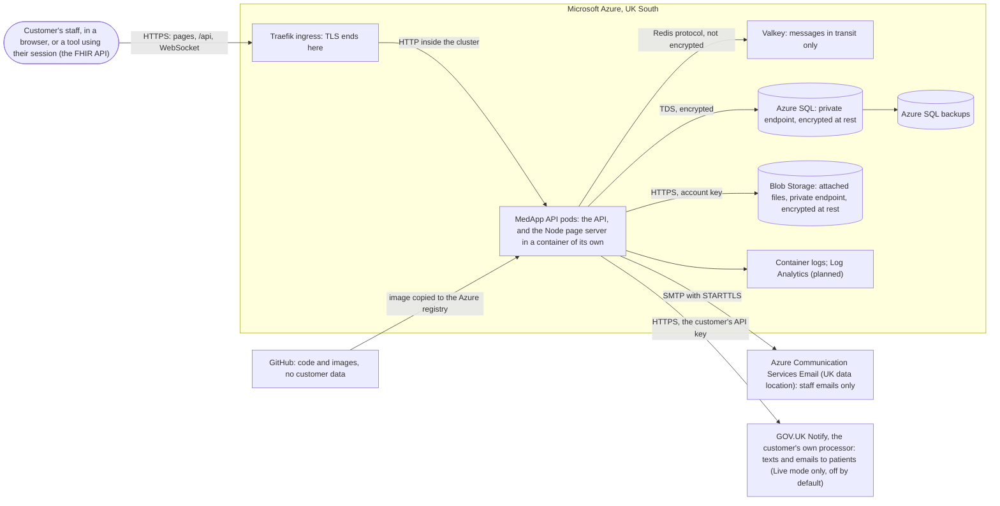

# Data inventory and data flows

**Draft prepared for review. It is not legal advice and must be reviewed and approved by a qualified data protection professional and the organisation's Data Protection Officer before use.**

| | |
|---|---|
| **Version** | 0.3 (draft), 16 November 2026: the NHS number, the FHIR API, SNOMED CT codes and the demographics lookup (roadmap step 9's first part); 0.4 (draft), the same day: admins' monitoring rules and each person's notification choices; 0.5 (draft), the same day: file attachments; 0.6 (draft), the same day: staff calendars and appointments, merged with staff email addresses and two-factor sign-in (#86, which added its rows without a version of its own); 0.7 (draft), the same day: meetings, the team view, suggested meeting times and personal calendar templates (`docs/calendar-plan.md`, decisions 50 on); 0.8 (draft), 17 November 2026: meeting notifications, and templates after their owner's account goes (review of #99); 0.9 (draft), the same day: deleting pathway notes, and staff's requests to delete them (branch `feature/note-deletion`); 0.10 (draft), 18 November 2026: two-factor codes by email (each account's method, and the emailed codes, kept only as hashes for minutes); 0.11 (draft), 18 November 2026: each attendee's reply to a meeting, and the organiser told of a decline (`docs/calendar-plan.md`, decision 71); 0.12 (draft), 18 November 2026: referrals, their history and letters, and the referrer's details, from a new source, the referrer (`docs/centre-phase2-plan.md`, PR 5; branch `feature/referrals`); 0.13 (draft), 18 November 2026: staff working hours and sites' opening hours (`docs/centre-phases-3-5-plan.md`, PR 22; branch `feature/working-hours`); 0.14 (draft), 18 November 2026: triage (branch `feature/triage`): the decision columns filled, `RedirectDetail`, the `ReferralTriaged` notification, and referral searches by name in the activity log; 0.15 (draft), 18 November 2026: patients' postal address, postcode, mobile and registered GP practice, the GP practice directory, a referral's practice from the directory, and staff full names and job titles (`docs/centre-phases-3-5-plan.md`, PR 12; branch `feature/patient-contact-gp`); 0.16 (draft), 18 November 2026: clinic sessions and patterns, and each appointment's session and room (`docs/centre-phases-3-5-plan.md`, PR 23; branch `feature/clinic-sessions`); 0.17 (draft), 18 November 2026: texts and emails to patients (`PatientMessage`), the patient's reminder choice in use, a Did not attend's follow-up on the appointment and in its history, and GOV.UK Notify as a recipient in the Live mode (`docs/centre-phases-3-5-plan.md`, PR 26; branch `feature/patient-reminders`); letters (PR 16 of `docs/centre-phases-3-5-plan.md`, 18 November 2026): `Letter` and `LetterRecipient`, letters' recipients (GP practices, referrers and others) and the secure email relay (section 8); 0.18 (draft), 18 November 2026: specimens, their history in the pathway audit, specimen types and labs, lab reports as attached files, two specimen notifications (with `Notifications.SubjectId`, shared with letters), and a new recipient, the external lab, which gets the specimen and its printed label and request sheet outside MedApp (`docs/centre-phases-3-5-plan.md`, PR 13; branch `feature/specimens`); 0.19 (draft), 18 November 2026: service alerts: `MonitoringRules.ThresholdDays` and `SpecialtyId`, `MonitoringAlertsSent`, and the six service alert notifications (`docs/centre-phases-3-5-plan.md`, PR 25; branch `feature/service-alerts`); 0.20 (draft), 18 November 2026: the multi-clinic centre's planned data (section 14), from its design (`docs/multi-clinic-plan.md`, MC1); none of it is held yet |
| **Owner** | [DPO name], with the lead developer |
| **Checked against** | The code on `main` as of 16 November 2026, with branch `feature/privacy-features` (roadmap step 7), branch `feature/nhs-integrations` (step 9's first part), file attachments and branch `feature/staff-calendars` (staff calendars and appointments, `docs/calendar-plan.md`): `MedApp.Domain`, `MedApp.Infrastructure/Data`, `MedApp.Infrastructure/Attachments`, `MedApp.Application`, `MedApp.API/Attachments`, `MedApp.Web/src/app` and `deploy/` |
| **Next review** | With every change that adds or changes a stored field, and at least every 6 months |

Every place MedApp stores or sends personal data, field by field, from the code. The ROPA ([ropa.md](ropa.md)), the DPIA ([dpia.md](dpia.md)) and the retention schedule ([retention-schedule.md](retention-schedule.md)) refer to it.

**Who the data is about:**
- **Patients** of the customer.
- **Staff users:** the customer's staff with MedApp accounts, including their calendars: when they're booked with patients, and when they're away or busy (annual leave, training).
- **Referrers:** the clinician who referred a patient (usually a GP) and their practice, as written on a referral. A named clinician is a third party's personal data.
- **Hospital patients and surgeons** (planned, MC18 and MC20; section 14): patients known only through a hospital's request to the centre's lab, and the surgeon named on it.
- **Supplier staff:** only in the supplier's own systems (Azure, GitHub), not in MedApp's database.

## 1. The database (SQL Server; Azure SQL in production)

| Entity (table) | Personal data | About | Special category? | Notes |
|---|---|---|---|---|
| `Patient` (`Patients`) | `FirstName`, `LastName`, `DateOfBirth`, `Email`, `NhsNumber` (optional), `CreatedAt`, `LastUpdated`; **contact details, all optional:** `AddressLines` (up to three lines), `Postcode`, `MobilePhone` (a UK mobile, stored as `+447…`), `PracticeId` (the registered GP practice, from the directory below) **or**, when it isn't in the directory, `UnlistedPracticeName`, `UnlistedPracticeAddressLines`, `UnlistedPracticePostcode` and `UnlistedPracticePhone` (the practice's name, address and phone, typed by staff and held on this patient only, never added to the directory; never both) and `ReminderChannel` (how they want appointment messages: none, text, email, or text and email; asked on the patient form, and changed by staff when the patient asks); the privacy flags `RestrictedAtUtc` and `RestrictionReason` (Article 18), `DisputedAtUtc` and `DisputeReason` (Article 16), and `AnonymisedAtUtc`; the retention decision `RetentionKeptUntil` and `RetentionKeptReason` | Patients | No on its own; yes in combination with the pathways below. **The reasons are free text** an admin types, and can say what the patient disputes. | `MedApp.Domain/Patients/Patient.cs`. **The NHS number is a national unique identifier,** so it identifies the patient on its own, in MedApp and in every other NHS system: see the note below the table. **The address and mobile make the record more identifying** (DPIA risk 31): they're for letters (Phase 3) and texts and emails about appointments (PR 26: `PatientMessage` below, only on the channels the reminder choice names), and the practice for letters to the GP; edits record only the names of the fields changed (`reminderChannel` among them). Staff type them, or take them from the demographics lookup (offline stub only). No sex or local hospital number today. An anonymised patient keeps the row with placeholders: the name "Anonymised Patient", a placeholder email, no NHS number, address, postcode, mobile or practice (directory or unlisted), a reminder choice of none, and only the year of birth (`PatientAnonymiser`). |
| `PatientPathway` (`PatientPathways`) | `Title`, `DueDateUtc`, `Priority`, `Status`, `TemplateName`, `SpecialtyId` (its template's specialty when it was created), `RetentionClass` (its template's: how long the record is kept before review), `PatientId`, timestamps; the old `Notes` column (Markdown free text), no longer used | Patients | **Yes:** what pathway a patient is having | `MedApp.Domain/Pathways/PatientPathways/PatientPathway.cs`. **The old `Notes` column** (`LegacyNotes` in code) still holds what the single notes field held before pathways had several notes: the migration copied it into each pathway's first note and left it, so API copies from before keep working during a rollout. Nothing reads it now; anonymising the patient replaces it with the placeholder; a later release drops it (`docs/todo.md`). |
| `PatientPathwayNote` (`PatientPathwayNotes`) | `PatientPathwayId`, `AuthorUserId`, `Text` (Markdown free text, 4,000 characters), `CreatedAtUtc`, `LastEditedAtUtc`, `Version`; once deleted, `DeletedAtUtc`, `DeletedByUserId`, `DeletionReason` (a fixed choice: wrong patient, written in error, duplicate, other) and `DeletionDetail` (free text, 500 characters, optional); `PendingDeletionRequestId` while a request to delete it waits | Patients; staff (who wrote it, and who deleted it) | **Yes** (clinical free text). **The deletion detail is free text** an admin types (or keeps from the request), and can say why the note was wrong, for example whose it really is. A note deleted as "wrong patient" is most likely another person's clinical text on this record | `PatientPathwayNote.cs`. A pathway's notes, several each, newest first. Staff add them; only the author edits one (admins can't edit anyone else's). **Only admins delete one, and deleting is soft:** the note is hidden from the pathway page for everyone, but its row and versions are kept, with who deleted it, when and why, so the record still accounts for it (the export lists it as deleted; admins see it on the timeline). Goes with its pathway (cascade); its versions stay. A note moved from the old field whose creator wasn't recorded has no author ("Unknown"). Anonymising replaces `Text` and `DeletionDetail` with the placeholder (the reason is a fixed choice and stays). The author is told when an admin deletes their note. |
| `PatientPathwayNoteVersion` (`PatientPathwayNoteVersions`) | `NoteId`, `Version`, `PatientPathwayId`, `PatientId`, `Text` (each version's free text), `UserId`, `Username` (as at the time), `AtUtc` | Patients; staff | **Yes** | `PatientPathwayNoteVersion.cs`. **Every version of every note:** the text as added, then after each edit, with who and when. This is where old note text lives now, instead of copies in the audit's `Details` (risk 4). No foreign keys, like the audit: versions outlive a deleted pathway, and the export and anonymisation find them by `PatientId`. Admins see the text on the patient timeline (from here); staff never do. Anonymising replaces every version's `Text` with the placeholder. |
| `PathwayNoteDeletionRequest` (`PathwayNoteDeletionRequests`) | `NoteId`, `PatientPathwayId`, `PatientId`, `RequestedByUserId`, `RequestedByUsername` (as at the time), `Reason` (a fixed choice), `Detail` (free text, 500 characters, optional), `RequestedAtUtc`, `Status` (pending, approved, declined, closed), `DecidedByUserId`, `DecidedByUsername`, `DecidedAtUtc` | Patients; staff (who asked, and the admin who decided) | **Possibly:** the detail is free text a member of staff writes about a note, and can name the patient or another one ("this is about the patient in bay 4") | `PathwayNoteDeletionRequest.cs`. A member of staff's request that an admin delete a note. **Admins only** read it (the request's dialog, which shows the note's text and the patient); staff see only that a note has a request waiting ("Deletion requested"), never anyone's reason. No foreign keys, like the audit: a request outlives its note's pathway, and the export and anonymisation find it by `PatientId`. Kept with the record, like notes. Deleting the pathway closes a waiting request; anonymising replaces every `Detail` with the placeholder and closes a waiting request. |
| `PatientPathwayStage` (`PatientPathwayStages`) | `Notes` (clinical free text); `StartedByUserId`, `CompletedByUserId` and times; when it was skipped, by whom (`SkippedByUserId`), why (`SkipReason`, a fixed choice) and `SkipDetail` (free text, 500 characters: why an optional stage was skipped, e.g. "Patient declined"); the template's `IsOptional`, `ChoosesBranch` and `Branch` copied on (to become a choice node's kind and the clinician's recorded **outcome**, MC10b); **the lab's result** (free text, health data, entered as it finishes its stage: planned, MC10b, anonymised like notes); a copy of the stage's name, description, instructions and SNOMED CT code and term | Patients; staff (who did what) | **Yes** (notes) | `PatientPathwayStage.cs`. The name, description, instructions and code are copied from the stage definition and hold no personal data unless an admin wrote some into the definition. On a patient's stage, the SNOMED CT code says what kind of step it is, which is health data only as the stage's name already is. |
| `PatientPathwayAssignment` (`PatientPathwayAssignments`) | `UserId`, `AssignedByUserId`, `AssignedAtUtc` | Staff; links to a patient | Indirectly | `PatientPathwayAssignment.cs` |
| `PatientPathwayAuditEntry` (`PatientPathwayAuditEntries`) | `PatientId`, `PathwayTitle`, `StageName`, `UserId`, `Username`, `AtUtc`, `Action`, and `Details` (JSON) | Patients; staff | **Yes** | `PatientPathwayAuditEntry.cs`. **`Details` holds copies of clinical text:** `StageNotesUpdated` stores the old and new stage notes (`PathwayChange.UpdateStageNotes`), and `DetailsUpdated` stores the old and new title (`UpdatePatientPathwayHandler`), and, in entries written before pathways had several notes, the old and new pathway notes. **Pathway notes are no longer copied:** `NoteAdded` and `NoteEdited` store only the note's ID and version (`PathwayChange.AddNote`, `EditNote`); the text is in `PatientPathwayNoteVersion`. `NoteDeleted` stores the note's ID and version, the request it approved, and **the admin's reason** (free text), never the note's text (`PathwayChange.DeleteNote`); the timeline shows the reason to admins only. Status changes store the reason for a block or cancellation. **Attached files:** `AttachmentAdded`, `AttachmentDeleted` and `AttachmentDownloaded` store the file's ID, **name**, type, size and what it's attached to (`AttachmentAudit`); a patient's own file is recorded with no pathway (`PatientPathwayId` is all zeros). So the log is also a record of **who downloaded which patient's file**, each download on its own. A stage finished without a visit stores that, the visit requirement and, when an admin finished one whose visit was required, the admin's reason (free text). **Branches and skipped stages:** `StageSkipped` stores the reason by name and its `detail` (free text), `StageReinstated` the `reason` (free text) and how the stage had been skipped, and `BranchChosen` the branch's name and the skipped stages' IDs and names (written by the template's author); the timeline shows the free text to admins only, and anonymising replaces it. **Specimens:** `SpecimenTaken`, `SpecimenSent`, `SpecimenReceived`, `SpecimenReported`, `SpecimenRejected`, `SpecimenLost`, `SpecimenEnteredInError` and `SpecimenDetailsEdited` (actions 16 to 23, written by `SpecimenChange`) store the specimen's ID and number, its type and lab by ID and name, the statuses, the rejection reason by name, the times and an edit's field names (with values only for the type, lab, taken time and requesting clinician); **never the site, request notes, lab or courier references or any detail**, which live only on the specimen. No foreign keys: entries outlive the pathway and the user. Anonymising the patient replaces the titles and every piece of free text in `Details` with placeholders, file names included. |
| `Attachment` (`Attachments`) | `PatientId`, `PathwayId`, `StageId`, `ReferralId` (a referral's letter); `FileName`; `ContentType`, `SizeBytes`, `Sha256`, `ScanStatus`, `HasThumbnail`; `UploadedByUserId`, `UploadedByUsername`, `UploadedAtUtc`; for a deleted file `DeletedAtUtc`, `DeletedByUserId`, `DeletedByUsername` | Patients; staff (who uploaded or deleted it) | **Yes:** that a patient has a scan, result or letter, and **`FileName` is free text**, which can hold a patient's name, a condition or a test (for example `ultrasound-report-2026-11.pdf`) | `MedApp.Domain/Attachments/Attachment.cs`. The metadata of each file; the file itself is in blob storage (section 2). No foreign keys, like the audit log, so a row outlives a deleted patient or pathway. **A referral's letter** is a file attached to the referral (`ReferralId`), under every rule here, and is listed with the patient's other files; it can name third parties (the referrer, relatives). Files can't be added to a referral marked entered in error, and staff can't delete their own from it (an admin still can). Deleting is soft: the row stays, marked deleted, visible to admins only. On a restricted or anonymised record, files can't be added or deleted. Anonymising the patient renames each file "Anonymised file" with its type's usual extension and deletes every live one, with an `AttachmentDeleted` audit entry for each (the contents stay in storage until the purge job, section 2). In the subject access export, without the files themselves. |
| `Appointment` (`Appointments`) | `PatientId`, `PathwayId`, `StageId`, `StaffUserId`, `StartUtc`, `EndUtc`, `Status` (requested, booked, attended, did not attend, cancelled, entered in error), `Notes` (free text, 2,000 characters), `CancelReason` (free text, 500 characters), `IsAutomatic`, `IsRecordedAfterEvent` (recorded after the event, a walk-in, rather than booked ahead: then `BookedByUserId` is who recorded it), `ClinicSessionId` and `RoomId` (the clinic session it's booked into, and the room), `CreatedByUserId`, `BookedByUserId`, `OutcomeByUserId` and their times; after a Did not attend, the follow-up staff recorded: `DnaFollowUp` (rebook, clinician to review, or no further appointment), `DnaFollowUpDetail` (free text, 500 characters, required for no further appointment), `DnaFollowUpAtUtc` and `DnaFollowUpByUserId` | Patients; staff (who the patient is booked with, and who booked or recorded it) | **Yes:** that a patient is being seen, for which pathway and stage, and whether they attended. Notes and cancellation reasons are free text about the patient, treated like pathway notes | `MedApp.Domain/Appointments`. Foreign keys to the patient, pathway and stage; none to staff. A patient with appointments can't be deleted; deleting a pathway detaches its appointments. Anonymising the patient replaces `Notes`, `CancelReason` and `DnaFollowUpDetail` with placeholders (the follow-up's decision stays); a restricted patient's appointments can only be cancelled, and an anonymised patient's can't be changed. **The follow-up is a person's decision, recorded:** MedApp never discharges, re-prioritises or changes a pathway because of a missed appointment. The follow-up's detail is free text about the patient (who decided, and why), shown to admins only on the timeline; staff see the decision. Correcting the outcome to attended clears the follow-up. |
| `AppointmentEvent` (`AppointmentEvents`) | `AppointmentId`, `PatientId`, `PathwayId`, `PathwayTitle`, `StageName`, `Action`, `UserId`, `Username`, `AtUtc`, `StaffUserId`, `StaffUsername`, `StartUtc`, `EndUtc`, and `Details` (JSON) | Patients; staff | **Yes** | The appointment's history: requested, booked, rescheduled (with the old time and member of staff), attended, did not attend, cancelled (**with the reason**), notes changed (**with the old and new notes**) and a Did not attend's follow-up recorded (`DnaFollowUpRecorded`: the decision by name and **the detail**). **So it keeps copies of appointment notes and cancellation reasons,** like the pathway audit. No foreign keys: entries outlive the appointment, the pathway and the user. Anonymising the patient replaces the notes, reasons and follow-up details in `Details` with placeholders, and gives `PathwayTitle` the pathway's new title, as in the pathway audit. |
| `PatientMessage` (`PatientMessages`) | `PatientId`, `AppointmentId`, `Kind` (appointment reminder, appointment moved, appointment cancelled, missed appointment), `Channel` (text or email), `Destination` (**the patient's mobile number or email address, as sent**), `Body` (**the message as sent**), `AppointmentStartUtc`, `Status` (pending, sent, delivered, failed, cancelled, not sent), `StatusReason` (a fixed code, such as `NoConsent`, `NoMobile`, `NoEmail`, `NoLongerApplies`, `ChoiceChanged`, `RecordClosed`, `Rejected` or `TooManyAttempts`, or the provider's delivery status name; never free text), `ProviderReference`, `RequestedByUserId` (the member of staff who asked to tell the patient of a move or cancellation; none for the job's reminders), `CreatedAtUtc`, `SentAtUtc`, `StatusAtUtc`, `SendAttempts` | Patients; staff (who asked) | **Yes, indirectly:** that the patient has an appointment, when and where. **The wording never says why:** the organisation's name (`PatientMessages:SenderName`), the date and time, and the site's name, address, postcode and phone (from the appointment's room's site; with no room, no site), or a contact phone setting; never the specialty, clinician, pathway, stage, notes, a cancellation's reason or the NHS number (`PatientMessageTexts`). The organisation's or site's name can still suggest the kind of care | `MedApp.Domain/PatientMessages`. **Every message about an appointment, as sent,** made by the `patient-reminders` job (reminders, and missed-appointment messages when the customer turns them on) or when staff tick "Tell the patient by text or email" on moving or cancelling an appointment, or cancelling a clinic session. **Even one that can't be sent is stored** (`NotSent`, with an empty destination and text and the reason), so the appointment shows "No reminder: no consent or contact". Unique per appointment, kind, channel and appointment start, so nothing is sent twice. No foreign keys, like the appointment history: rows outlive what they're about, and the export and anonymisation find them by `PatientId`. Shown on the appointment (`GET api/appointments/{id}/messages`, recorded as `PatientViewed`). In the export (kind, channel, destination, text, status and reason, dates, who asked). Anonymising replaces `Destination` with "[Removed]" and `Body` with the placeholder, and cancels any still waiting. Kept with the patient's record ([retention-schedule.md](retention-schedule.md)). |
| `Referral` (`Referrals`) | `PatientId`, `SpecialtyId` (the specialty asked for), `ReceivedOn` (a date), `ReferrerPractice` (free text, 200 characters, required), `ReferrerClinician` (free text, 200, optional), `ReferrerOdsCode` (the practice's Organisation Data Service code, optional, 3 to 10 letters and digits), `PracticeId` (the practice from the directory, if staff chose one), `RequestedPriority`, `Reason` (free text, 2,000 characters), `Status` (awaiting triage, accepted, rejected, redirected elsewhere, withdrawn, entered in error); `RegisteredAtUtc`, `RegisteredByUserId`, `RegisteredByUsername` (as at the time); the decision: `DecidedAtUtc`, `DecidedByUserId`, `DecidedByUsername`, `RejectionReason` (a fixed choice), `DecisionDetail` (free text, 500), `RedirectedTo` (free text, 200), `PathwayId`; `RedirectDetail` (free text, 500: why it was redirected here from another specialty); the waiting-time clock: `TargetDays`, `WaitStartOn`, `TargetOn`, `PausedDays`, `PausedSinceOn`, `PauseReviewOn`, `StoppedOn` (dates), `StopReason` (a fixed choice); `Version`, `LastUpdated` | Patients; **referrers** (the clinician named, and their practice); staff (who registered it, and who triaged or closed it) | **Yes:** the reason for referral is clinical free text, typed from the letter, and that a patient was referred to a specialty is health data. **The referrer's clinician is a third party's personal data.** The decision detail, the redirect detail and where it was sent are free text a member of staff types (why it was rejected or redirected, who withdrew it, or what was wrong) | `MedApp.Domain/Referrals/Referral.cs`. **A new source:** the data comes from the referrer (usually a GP practice), not the patient or the customer's staff; staff type it in from the letter. Staff with `RegisterReferrals` register, edit (while it awaits triage), withdraw or mark it entered in error, each with a detail; staff with `ViewPatients` read it, free text included, as they read notes. A clinician with `TriageReferrals` who belongs to its specialty triages it: accepting fills `DecidedAt…` and `PathwayId` (the pathway it creates); rejecting, `RejectionReason` and an optional `DecisionDetail`; redirecting elsewhere, `RedirectedTo` and `DecisionDetail`; redirecting to another specialty here moves `SpecialtyId` and keeps its detail in `RedirectDetail` (the latest only), while it stays awaiting triage. The ODS code is checked for format only and stored in upper case. Foreign keys to the patient and specialty refuse deleting either while a referral exists (a patient with any referral can't be deleted). Deleting the pathway it was accepted into clears `PathwayId`; the referral stays. Kept with the patient's record ([retention-schedule.md](retention-schedule.md)). Anonymising replaces the reason, practice, clinician, decision and redirect details and the link to the directory's practice and redirect destination with placeholders and clears the ODS code; the dates, statuses, priority and specialty stay. |
| `Practice` (`Practices`) | `Name`, `OdsCode` (optional, unique), `AddressLines`, `Postcode`, `Phone`, `SecureEmail` (optional, in an allowed domain, `nhs.net` by default), `IsArchived`, `Version`, timestamps | **None:** GP practices are organisations | No | `MedApp.Domain/Practices/Practice.cs`. The centre's directory of GP practices, kept by staff with `EditPatients`, read by staff with `ViewPatients`. A practice's details are an organisation's, not a person's (a single-handed practice's name may be a GP's name: business contact details). One that a patient or referral has is archived, never deleted (the foreign keys refuse too). Reading the directory records nothing in the activity log: it names no patient. Not in a patient's export except as the name and code of their own practice; anonymising a patient clears their link to it, never the practice. |
| `ReferralClockPause` (`ReferralClockPauses`) | `ReferralId`, `PatientId`, `PausedOn`, `PausedAtUtc`, `PausedByUserId`, `PausedByUsername` (as at the time), `Reason` (a fixed choice: the patient chose to wait, the patient is unavailable, other), `Detail` (free text, 500, required for Other), `ReviewOn`, `ResumedOn`, `ResumedAtUtc`, `ResumedByUserId`, `ResumedByUsername` | Patients; staff (who paused and resumed it) | **Yes:** why a patient's wait was paused (the patient chose to wait, or was unavailable), and the detail may say why (a holiday, an illness) | `MedApp.Domain/Referrals/ReferralClockPause.cs`. A pause of an accepted referral's waiting-time clock, for a delay the patient chose or caused, with a review date at most 90 days ahead. Staff with `WorkPathways` pause and resume; staff with `ViewPatients` read the detail on the referral and pathway pages. Foreign key to the referral (restrict); `PatientId` copied for the export and anonymisation. Kept with the referral. The history records the reason by name and the review date, never the detail. Anonymising replaces the detail with a placeholder; the dates and reason stay. |
| `ReferralEvent` (`ReferralEvents`) | `ReferralId`, `PatientId`, `PathwayId`, `Action`, `AtUtc`, `UserId`, `Username` (as at the time), `Details` (JSON) | Patients; staff (who did what) | **Yes:** a referral's history | `MedApp.Domain/Referrals/ReferralEvent.cs`. The referral's history: registered, details edited, withdrawn, entered in error, triage's outcomes, and the waiting-time clock's pauses, resumptions, stop and target changes (the pause reason by name, the review date, days and the stop reason). Written in the same save as the change (`ReferralChange`). **`Details` hold structured values only, never free text:** statuses, the specialty's ID and name, the date received, the priority and the names of the fields edited; the reason, the referrer's details and the detail given live only on the referral, so an edit's old text isn't kept (the letter is the source of record). Referral changes are recorded here, not also in the activity log. No foreign keys, like the audit: entries outlive the pathway and the accounts. Staff see the structured values on the patient timeline; admins also see the referral's current reason, practice and detail beside them. Anonymising scrubs `Details` as it does other history (there's no free text to replace). |
| `Specimen` (`Specimens`) | `Number` (MedApp's own specimen number, for example `MA26-000123`), `PatientId`, `PathwayId`, `StageId` (the stage that took it), `SpecimenTypeId`, `LaboratoryId`, `Site` (free text, 200 characters, optional: "left forearm"), `RequestNotes` (free text, 1,000, optional), `RequestingUserId` (the requesting clinician), `Status` (taken, sent, received, reported, rejected by the lab, lost, entered in error); `TakenAtUtc`, `TakenByUserId`, `RecordedAtUtc`; `SentAtUtc`, `SentByUserId`, `CourierReference` (50, optional); `ReceivedAtUtc`, `ReceivedByUserId`, `LabReference` (the lab's own reference, 50, optional); `ReportedAtUtc`, `ReportedByUserId`, `ReportAttachmentId` (the report, an attached file); `RejectionReason` (a fixed choice: unlabelled, mislabelled, leaked, insufficient sample, wrong container, other), `ClosedDetail` (free text, 500), `ClosedAtUtc`, `ClosedByUserId`; `Version` | Patients; staff (the requesting clinician, and who took, sent, received, reported or closed it) | **Yes:** that a patient had a specimen of a type taken (a skin biopsy) and sent for testing is health data. **The site and request notes are clinical free text**, and the closing detail is free text a member of staff types (why it was lost or rejected, or what was wrong) | `MedApp.Domain/Specimens/Specimen.cs`. Staff with `RecordSpecimens` record it as taken, send it and edit its details until it's sent; staff with `ProcessSpecimens` (the lab's) receive, reject and report it; either marks it lost (neither permission is in Admin's fixed set). Staff with `ViewPatients` read it, its free text included, as they read notes. **It goes to an external lab** (a new recipient, section 3): the specimen itself, with its printed label (the patient's name, date of birth and NHS number beside the number, as text and as a QR code holding **only the number**) and request sheet (adding the site, the request notes, the requesting clinician and the lab), travels physically, outside MedApp; nothing is sent to the lab electronically. **The report** comes back as a file uploaded by lab staff (`Attachment`, on the pathway, or the patient if the pathway has closed), under every rule for files, and **can't be deleted on its own** (a 409, admins too). Its history is in the pathway audit (above), with no free text. Foreign keys to the patient, pathway, type and lab: a pathway with specimens can't be deleted. Kept with the patient's record ([retention-schedule.md](retention-schedule.md)). Anonymising is refused while one is open (taken, sent or received); then it replaces the site, request notes and closing detail with placeholders and removes the lab and courier references (which the lab could match back to the patient); the number, statuses, dates, type and lab stay, and the report is deleted with every other file. |
| `ConsentRecord` (`ConsentRecords`) | `PatientId`, `PathwayId`, `StageId` (the stage consented to), `ConsentFormId`, `FormName` and `FormVersion` (copied from the form), `SignedOn` (a date), `SignedBy` (a fixed choice: the patient, a person with parental responsibility, or a best-interests decision recorded by a clinician), `RecordedByUserId`, `RecordedAtUtc`, `ScanAttachmentId` (the scanned form, an attached file, optional), `Status` (valid, withdrawn, entered in error), `WithdrawnOn`, `StatusDetail` (free text, 500: what was said on withdrawal, or what was wrong), `StatusChangedAtUtc`, `StatusChangedByUserId`; `Version` | Patients; staff (who recorded and changed it) | **Yes:** what a patient agreed to, and a best-interests decision says something about capacity. **The detail is free text** a member of staff types | `MedApp.Domain/Consent/ConsentRecord.cs` (PR 31). Staff with `RecordConsent` record and withdraw it (not in Admin's fixed set); whoever recorded it (within 24 hours) or a holder of `CorrectRecords` marks it entered in error, which deletes its scan. Staff with `ViewPatients` read it on the pathway page (`PathwayViewed`). **MedApp records the clinician's statement; it assesses nothing.** Its history is in the pathway audit (actions 42 to 44), with no free text. The scan is an `Attachment` on the pathway that **can't be deleted on its own**. Foreign keys to the patient, pathway and form: a pathway with consent records can't be deleted. Exported in full; anonymising replaces the detail and deletes the scan with every other file. |
| `Letter` (`Letters`) | `PatientId`, `PathwayId` or `ReferralId`, `TemplateId` and `TemplateName`, `Kind`; **`Letterhead`, `Body` (Markdown, up to 20,000 characters) and `Closing`: free text, written by staff, clinical**; `LargePrint`; `Status`; `AuthorUserId`, `ApproverUserId`, `SubmittedAtUtc`, `ApprovedAtUtc`; `ReturnComment` (free text, 500) with `ReturnedAtUtc` and `ReturnedByUserId`; `PdfAttachmentId` (the approved PDF, an `Attachment`); `WithdrawnAtUtc`, `WithdrawnByUserId`, `WithdrawnReason` (free text, 500); `ReplacesLetterId`; `Version`, `RowVersion`, timestamps | Patients; staff (authors and approvers); third parties named in the text | **Yes** | `MedApp.Domain/Letters/Letter.cs`. Clinical correspondence: the body is the author's own; merge fields (`{{patient.name}}`) copy identity and administrative data only (the patient's name, date of birth, NHS number and address, the practice's name and address, dates, staff names and job titles, the site). Its history is in the pathway audit (actions 29 to 34), which holds IDs, kinds, recipients' kinds and methods and usernames, never the text, comment or reason. |
| `LetterRecipient` (`LetterRecipients`) | `LetterId`, `Position`, `Kind` (GP practice, patient, referrer or other), `PracticeId`, `Name`, `AddressLines`, `Postcode`, `Email` (a secure address, never a patient's), `DispatchStatus`, `Method` (post, handed to the patient, secure email from MedApp, emailed outside MedApp, other), `SentOn`, `SentAtUtc`, `SentByUserId`, `TransportReference` (the relay's message ID) | Patients (their name and address, as the patient recipient); referrers and anyone else a letter goes to; staff (who sent it) | Indirectly: that a letter about the patient went to someone | `MedApp.Domain/Letters/Letter.cs`. Names and addresses are copied from the record when the draft is saved and again when it's approved, so what was sent doesn't change when someone moves. |
| `ActivityEntry` (`ActivityEntries`) | `AtUtc`, `Action`, `UserId`, `Username`, `IpAddress`, `PatientId`, `PathwayId`, `TargetUsername`, `Details` (JSON) | Staff (who did what, from which address); patients by ID | Indirectly: that a patient's record was opened. **No patient names, details or clinical text:** edits record the names of the fields changed, searches the names of the filters used and the number found (never the terms, so never an NHS number searched for), demographics lookups only whether anyone was found, and refused sign-ins the username tried (and the account's ID when it exists). Reasons for restricting, disputing, keeping or anonymising are the only free text, and anonymising replaces the earlier ones. | `MedApp.Domain/Activity/ActivityEntry.cs`, written through `IActivityLog`: patients viewed (once per person every 5 minutes), shown in search results, searched, created, edited, deleted, exported, anonymised, restricted and disputed, including reads and searches through the FHIR API (marked `via: "fhir"`); NHS number lookups in the demographics service (`DemographicsLookedUp`); pathways viewed; a referral opened (`ReferralViewed`, with the referral's ID, once per person and referral every 5 minutes) and referrals shown in a list (`PatientListed` for each patient shown; the side nav's count of referrals awaiting triage records nothing, as it names nobody); a specimen opened (`SpecimenViewed`, with the specimen's ID: its page, its label or request sheet, or finding it by its number) and specimens shown on the Lab worklist (`PatientListed` for each patient shown); a patient's, pathway's, stage's or referral's files listed (`AttachmentsViewed`) and a file downloaded (`AttachmentDownloaded`), against the patient and, for a pathway's or stage's files, the pathway, in the same 5-minute window (thumbnails aren't recorded; they come with a list); appointments read (on the calendar, the Requires Appointment list or the booking dialog, or opened), as reads of the patients they show; sign-ins, refused sign-ins (a wrong two-factor code included, never the code) and sign-outs; a right password asked for a two-factor code; account, password and role changes (giving people roles, and, from the Roles and Permissions page, making, changing, archiving and deleting roles: `RoleCreated`, `RoleChanged`, `RoleDeleted`, with the role's name and the permission names added or removed, never its description's words), and which specialties someone belongs to (`StaffSpecialtiesChanged`: the specialties' names and IDs before and after); a full name or job title changed (`StaffDetailsChanged`: the names of the fields, never their values); two-factor turned on, off or reset, recovery codes used or replaced, password reset requests (the account if one matched, never what was typed) and resets by email, and email address changes (never the address). Admins only. No foreign keys: entries outlive the patient and the account. Never deleted yet: a scheduled job to purge sign-in events at 12 months is to come (retention schedule, section 3). Not in the subject access export: the export gives the patient each access by username, action and time, without the staff's account IDs or addresses. |
| `CalendarBlock` (`CalendarBlocks`) | `StaffUserId`, `ActivityTypeId`, `StartUtc`, `EndUtc`, `Note` (free text, 200 characters), `CreatedByUserId`, `CreatedAtUtc`, `LastUpdated` | Staff | Not by design. But **a block reveals when someone is away** (annual leave) or busy, and a note could reveal a staff member's health (for example "hospital appointment"). The UI tells staff not to put patient details in a note | `MedApp.Domain/Calendar`. Time blocked off on a member of staff's calendar. |
| `StaffWeekTemplate`, `CalendarDayOverride`, `CalendarBlockException` | `StaffUserId`, a week or day template, dates | Staff | No | A person's default week, and one day's changes to it. |
| `StaffHours` | `StaffUserId`, `DayOfWeek`, `Starts`, `Ends`, `SiteId`, `ValidFrom`, `ValidTo` | Staff | No. But it says **when someone works and where** (a part-time pattern can hint at caring duties or health) | `MedApp.Domain/Calendar/StaffHours.cs`. A member of staff's working hours, dated rows so past days keep what applied. Set by holders of `ManageClinics` or `ManageAnyCalendar`; every member of staff can see anyone's (their calendar shows them). No foreign key to the users table; kept after the account goes, like default weeks (no purge yet). |
| `SiteHours` | `SiteId`, `DayOfWeek`, `Opens`, `Closes`, `ValidFrom`, `ValidTo` | None, by design | No | `MedApp.Domain/Sites/SiteHours.cs`. A site's opening hours: organisation-wide configuration, deleted with an unused site. |
| `ClinicSession` (`ClinicSessions`) | `StaffUserId`, `RoomId`, `SpecialtyId`, `PatternId`, `Date`, `StartUtc`, `EndUtc`, `SlotMinutes`, `Status` (planned, cancelled), `CreatedByUserId`, `CancelledByUserId`, `CancelledAtUtc`, `CancelReason` (free text, 500 characters, about the clinic) | Staff | No. It says **when a clinician runs a clinic, where, and for which specialty**, as their calendar does | `MedApp.Domain/Clinics/ClinicSession.cs`. A clinician's time in a room, cut into slots that appointments are booked into; no patient is on it (the appointments name them). Set by holders of `ManageClinics`; every member of staff can see them. Cancelled, never deleted; a room or specialty one names is archived, not deleted. The reason must not name a patient (the dialog says so); each cancelled appointment copies it as its own cancellation reason, which anonymising replaces. Kept like appointments (no purge yet). |
| `ClinicPattern` (`ClinicPatterns`) | `StaffUserId`, `RoomId`, `SpecialtyId`, `DayOfWeek`, `Starts`, `Ends`, `SlotMinutes`, `EveryWeeks`, `FromDate`, `UntilDate`, `CreatedByUserId` | Staff | No; a clinician's usual clinic, like their working hours | `MedApp.Domain/Clinics/ClinicPattern.cs`. A clinic that repeats, which makes sessions only when someone with `ManageClinics` asks. Kept after the account goes, like working hours (no purge yet). |
| `Meeting` (`Meetings`), `MeetingAttendee` (`MeetingAttendees`) | `Title` (100 characters) and `Notes` (500), free text; `StartUtc`, `EndUtc`, `OrganiserUserId`, `IsMdt` and `SpecialtyId` (a specialty's MDT, PR 30), `CreatedAtUtc`, `LastUpdated`; each attendee's `StaffUserId`, their `Reply` (no reply, accepted or declined) and `RepliedAtUtc` | Staff | Not by design. Meetings are arranged by admins for staff, and every member of staff can see them on the calendars they open: who is going, each person's reply, and the title and notes. The UI says notes are about staff, never patients, but a title or note could still name a patient or reveal something private ("Return-to-work meeting"). | Staff data: when people are busy, and with whom, and whether each said they'd go. Only the attendee sets their own reply; moving the meeting clears everyone's. Deleted when cancelled; taken off a person's meetings to come when their account goes. |
| `MdtItem` (`MdtItems`), `MdtItemAttendee` (`MdtItemAttendees`) | `PatientId`, `PathwayId`, `SpecialtyId`, `MeetingId` (the MDT), `MeetingCancelledStartUtc`, `Question` (**free text, 1,000 characters**), `Status` (listed, discussed, deferred, withdrawn), who listed it and when, `Outcome` (**free text, 2,000: what the team decided, as a person wrote it**), who recorded it and when, who withdrew it and when, `Version`; who was present (`StaffUserId`, `Username`) | Patients; staff | **Yes:** the question and the outcome are clinical free text about the patient | PR 30 ([dpia.md](dpia.md), risk 34). A pathway put forward for a specialty's multidisciplinary team meeting. Shown on the MDT page (`/mdt`, opening or printing records `PatientListed` for each patient) and the pathway's MDT card (`PathwayViewed`). History in the pathway audit log (`MdtListed`, `MdtDeferred`, `MdtWithdrawn`, `MdtOutcomeRecorded`: IDs, the specialty, meeting times and who was present, **never the question or outcome**); the staff timeline shows those, no free text. In the export; anonymising replaces the question and outcome and withdraws open items. Deleted with its pathway. Kept with the patient's record. |
| `Notification` (`Notifications`) | `UserId`, `Kind`, `Title`, `Message`, `PathwayId`, `AppointmentId`, `CalendarDate`, `NoteDeletionRequestId`, `MeetingId` (a meeting notification's link to the meeting; none for a cancellation), `SubjectId` (what a newer kind is about, its meaning coming from the kind: a specimen's or a letter's ID), `CreatedAtUtc`, `ReadAtUtc`. **Letter** notifications (`LetterAwaitingApproval`, `LetterApproved`, `LetterReturned`) have fixed titles and a message of usernames and the letter's kind, never its text, comment or the patient. **Specimen** notifications (`SpecimenNotifications`: to the requesting clinician and whoever took it, never to whoever made the change): a fixed `Title` ("Specimen rejected" or "Specimen lost"), the specimen as `SubjectId` and its pathway as `PathwayId`, and a message of the specimen type's admin-written name and, for a lost one, who marked it ("The lab rejected a Skin biopsy (punch) specimen."); never the patient, the number, the site, the notes or the reason. **Note deletion** notifications (`NoteDeletionNotifications`): to every admin but the requester when a member of staff asks for a note to be deleted ("Note deletion requested", "s.nurse asked to delete a note on a pathway.", linking to the request), to the requester when an admin decides ("Note deleted" or "Note kept", "admin deleted the note you asked to delete."), and to a deleted note's author ("Your note was deleted", "admin deleted a note you wrote on a pathway."), unless they deleted it, or asked for it, themselves. Fixed titles, and messages of usernames only: never the note, the reason or the patient. **Assignment** notifications: the pathway's title as `Title`, and "[username] assigned you to this pathway." **Appointment** notifications (to the member of staff when someone else books, moves or cancels their appointment): a fixed `Title` ("Appointment booked", "Appointment moved", "Appointment cancelled" or "Appointment recorded", for one recorded after the event), and who booked, moved, cancelled or recorded it, with its time (and, when recorded, whether the patient attended); never the patient's name or the appointment's notes (`docs/calendar-plan.md`, decision 20). **Stage visit withdrawn** notifications (to the pathway's assignees and every admin, never to whoever withdrew it, when a walk-in marked entered in error was the only attended visit of a finished stage that requires one): a fixed `Title` ("Stage visit withdrawn"), the pathway as `PathwayId`, and a message of who withdrew it, the visit's time, the stage's admin-written name and when the stage was finished; never the patient, the pathway's title or the reason. **Monitoring** notifications (to an admin whose rule matched): a fixed title for the event ("Stage finished") and a message built only from usernames, the priority, the template's and stage's names and target dates, e.g. "sam finished the Bloods stage on a High priority Knee review pathway." Never the pathway's title, notes, reasons or the patient. **Service alerts** (kinds 32 to 37, one per rule and run): a fixed title ("Referrals awaiting triage") and a count with the rule's days, specialty name and, for results, the responsible clinician's username, e.g. "3 Dermatology referrals have waited more than 2 days for triage."; the rule's specialty as `SubjectId`; no `PathwayId`. **Meeting** notifications (to each attendee when an admin arranges, moves or cancels a meeting, or adds them to it or takes them off it; never of their own change): a fixed `Title` ("Meeting invitation", "Meeting moved" or "Meeting cancelled"), the meeting's day as `CalendarDate`, and a message of who did it, the meeting's title and its time, e.g. "admin invited you to 'Team huddle', Tuesday 17 November, 09:00 to 10:00." A decline tells the meeting's organiser the same way ("Meeting declined": "k.ashford declined 'Team huddle', ..."); an acceptance tells nobody. The meeting's title is free text an admin writes, treated like a template's name (the dialog says not to put patient details in it); its notes are never copied. These copies stay after the meeting is cancelled (deleted) | Staff (the admin told, and the staff member it's about); patients indirectly (through `PathwayId`) | Assignment: possibly, as a pathway title can name a condition or treatment. Appointment and monitoring: no free text, though a template's name can say what kind of pathway it was. Meeting: not by design, but a meeting's title could name a patient or reveal something private despite the warning; such a title isn't linked to any patient, so a patient's export and anonymisation don't find it | `MedApp.Domain/Notifications/Notification.cs`; written by `AssignPatientPathwayHandler`, the appointment handlers (`AppointmentNotifications`), the specimen handlers (`SpecimenNotifications`) and `PathwayMonitor` (`MonitoringNotifications`). Anonymising the patient gives assignment notifications about their pathways the pathway's new title; a fixed title (a monitoring event's or an appointment's) stays as it is, and no message holds free text other than a meeting's admin-written title. Written by the meeting handlers too (`MeetingNotifications`). No foreign keys. |
| `MonitoringRule` (`MonitoringRules`) | `OwnerUserId` (the admin), `SubjectUserId` (the staff member watched, or null for anyone; for a results service alert, the responsible clinician), `Event`, `MinimumPriority`, `TemplateId`, `StageDefinitionId`, `SpecialtyId`, `ThresholdDays` (a service alert's days), `IsEnabled`, `CreatedAtUtc`, `UpdatedAtUtc` | Staff: which admin watches which staff member, for what | No | `MedApp.Domain/Monitoring/MonitoringRule.cs`. Admins' rules for being told what staff do, and of work waiting longer than they chose (service alerts) (Administration, Monitoring). An admin sees only their own. No foreign keys: a rule naming a deleted account stays until its admin deletes it. |
| `MonitoringAlertSent` (`MonitoringAlertsSent`) | `RuleId`, `SubjectId` (a referral's, result's, appointment's, specimen's or clock pause's ID), `SentAtUtc` | Neither directly: IDs and a time | No | `MedApp.Domain/Monitoring/MonitoringAlertSent.cs`. Which items a service alert rule has reported, so each is reported once (`ServiceAlertsJob`). Deleted with its rule (a foreign key, cascade); not in a patient's export (it says nothing about them). |
| `NotificationPreferences` (`NotificationPreferences`) | `UserId`, `PathwayAssigned` (whether to be told of being assigned), `UpdatedAtUtc` | Staff | No | `MedApp.Domain/Notifications/NotificationPreferences.cs`. Each person's own choice (Account Settings); no row means every notification. |
| `UserSession` (`UserSessions`) | `UserId`, `CreatedAtUtc`, `ExpiresAtUtc`, `RevokedAtUtc`, `CreatedByIp` (IP address), `UserAgent` (browser) | Staff | No | `MedApp.Domain/Authentication/UserSession.cs`. The row's ID is the session cookie's value. Deleted 12 months after creation by the operational purge, once its dry run is turned off (`Retention:Operational`). |
| `Notepad` (`Notepads`) | `UserId` (the key: one each), `Text` (Markdown free text, up to 20,000 characters), `LastUpdatedUtc`, `Version` | Staff (whose notepad it is); **patients, possibly**: staff jot things down during a call or a clinic | **Possibly** (free text about patients) | `MedApp.Domain/Notepads/Notepad.cs`. A member of staff's own notepad, beside every page or in a half view (`/notepad`), kept on the server (never in the browser). **Not linked to any patient,** so a patient's export and anonymisation can't find what it says about them. The staff privacy notice says it's for jottings, and that anything about a patient belongs in their record (the notepad itself no longer says so, since 17 November 2026), through **Add note to pathway**, which adds its text (or the part selected) as a note on a pathway after a confirmation that shows the patient, and offers to take it out of the notepad. **The whole notepad is cleared once it has gone 30 days without any change** (`Notepad:KeepDays`), when it's next read or saved, so what's in it stays for as long as it's used (each change restarts the 30 days for all of it); deleted with the account (a foreign key's cascade); the owner can clear it. Nobody else can read it, admins included, and reading or saving it isn't in the activity log (it's the owner's own). DPIA risk 26. |
| `UserSettings` (`UserSettings`) | `UserId`, `Json`, `UpdatedAtUtc` | Staff; patients indirectly | Possibly | `UserSettings.cs`. The JSON includes **saved searches ("favourites"), now each list's tabs** (only the user's changes: tabs added or edited, from 18 November 2026), whose terms can be patient names, NHS numbers (the patient list's NHS number filter) and specimen numbers (a Lab tab's search), and the IDs of the patients and pathways the user has pinned (`medapp.pins`). |
| ASP.NET Core Identity (`AspNetUsers`, `AspNetUserRoles`, `AspNetRoles` with each role's description and flags, `RolePermissions` with each role's permissions by name, and the other Identity tables) | `UserName`, `NormalizedUserName`, `PasswordHash`, `SecurityStamp`, `AccessFailedCount`, `LockoutEnd`, `CreatedAt`, `MustChangePassword`; **optionally a work email address** (`Email`, `EmailConfirmed`, and `PendingEmail` while a new one waits for its link to be opened); `TwoFactorEnabled`, and `TwoFactorMethod` (none, an authenticator app, or codes by email); **optionally a full name and job title** (`FullName`, `JobTitle`, 100 characters each, as they'll go on letters). The `PhoneNumber` column exists but MedApp doesn't fill it | Staff | No | `MedApp.Infrastructure/Common/Identity/ApplicationUser.cs`. Passwords are stored only as Identity's salted hashes. The email address is given by the staff member (Account Settings) or by an admin creating the account, and is used only for password reset links, security notices and, for someone who chooses them, two-factor codes, once confirmed. Admins see it on the Users page. **The full name and job title** are set by the person (Account Settings) or by an admin with `ManageUsers` (the Users page), shown on the Users page, and will go on the letters they write or approve (Phase 3); a change is recorded in the activity log by field name only (`StaffDetailsChanged`). They go with the account. |
| Identity's user tokens (`AspNetUserTokens`) | For staff who turn on two-factor authentication: the authenticator key, the unused recovery codes, and the time step of the last code accepted | Staff | No | Stored as Identity stores them, in clear (the database is encrypted at rest on Azure). Removed when two-factor is turned off or an admin resets it (`TwoFactorService`). |
| `SignInChallenge` (`SignInChallenges`) | `UserId`, a SHA-256 hash of the challenge token, `CreatedAtUtc`, `ExpiresAtUtc`, `FailedAttempts` | Staff | No | The second step of a sign-in with two-factor; deleted when used, and expired ones are deleted at the next sign-in, and by the operational purge a day after they expire. Kept at most 5 minutes in practice (10 for someone who signs in with codes by email). |
| `EmailCode` (`EmailCodes`) | `UserId`, `Purpose` (signing in, turning codes by email on, or confirming a change), `ChallengeId` (for signing in), a SHA-256 hash of the 6-digit code (bound to the row), `SentAtUtc`, `ExpiresAtUtc`, `Resends`, `FailedAttempts` | Staff | No | `MedApp.Domain/Authentication/EmailCode.cs`. Two-factor codes by email: the code itself is only ever in the email; MedApp keeps a hash, which keeps it out of sight but, at six digits, could be worked out from a copy, so the short life is the protection. Valid 10 minutes; deleted when used, with its sign-in challenge or its account (cascading deletes), and expired ones are deleted whenever the next code is sent to anyone. Kept minutes in practice. |
| `SecuritySettings` (`SecuritySettings`) | Whether admins must use two-factor; when it was last changed and by whom (a user ID) | Staff (the admin) | No | One row. |
| ASP.NET Core data protection keys (`DataProtectionKeys`) | Cryptographic keys that seal reset and confirmation links | None | No | Wrapped with a Key Vault key on Azure. |
| `PatientPathwayStageDefinition`, `PathwayTemplate` and its map | Names, descriptions, instructions; a definition's SNOMED CT code and term; whether a stage involves a visit; a template's retention class | None, by design | No | Configuration. Admins should not write patient or staff details into them. A SNOMED CT code names a kind of procedure or finding, not a person, so it isn't personal data. |
| `CalendarActivityType` | Names, colours | None, by design | No | Calendar configuration, organisation-wide. |
| `Specialty` (`Specialties`) | `Name` (100 characters), `IsArchived`, `Version`, `CreatedAt`, `LastUpdated` | None, by design | No | `MedApp.Domain/Specialties/Specialty.cs`. The centre's services (Dermatology, Urology), organisation-wide: admins manage them. Every pathway template belongs to one, and each pathway keeps a copy of its template's (`PatientPathways.SpecialtyId`), which says only which service a patient is under, as the template's name already did. Every database starts with General. |
| `SpecimenType` (`SpecimenTypes`) | `Name` (100 characters, e.g. "Skin biopsy (punch)"), `ExpectedTurnaroundDays` (1 to 90), `IsArchived`, `CreatedAt`, `LastUpdated` | None, by design | No | `MedApp.Domain/Specimens/SpecimenType.cs`. Organisation-wide setup, changed by holders of `ManageSetup`; archived, not deleted, once a specimen names it. Its name is admin-written, so specimen notifications quote it. The expected days give a specimen's "Overdue at lab": date arithmetic, nothing clinical. |
| `Laboratory` (`Laboratories`) | `Name` (200 characters), `UsesMedApp`, `IsArchived`, `CreatedAt`, `LastUpdated` | None, by design: an organisation, the centre's own lab or a partner | No | `MedApp.Domain/Specimens/Laboratory.cs`. The labs specimens are sent to, set up like specimen types. `UsesMedApp` only says whether the lab's own staff use MedApp to receive and report specimens (otherwise the centre's staff record what the lab tells them); it changes no rule, and MedApp sends nothing to any lab. |
| `ConsentForm` (`ConsentForms`) | `Name` (200), `FormVersion` (50), `IsArchived`, `CreatedAt`, `LastUpdated` | None, by design | No | `MedApp.Domain/Consent/ConsentForm.cs`. The consent forms an organisation uses, kept by holders of `ManageSetup`; archived, not deleted, once a record names it. |
| `StaffSpecialty` (`StaffSpecialties`) | `UserId`, `SpecialtyId` | Staff: which services each member of staff works in | No | `MedApp.Domain/Specialties/StaffSpecialty.cs`. Set by admins on the Users page; each person sees their own in Account Settings. Changes nothing about what anyone can see; triage (Phase 2's next steps) will use it to decide who may triage a specialty's referrals. Deleted with the account (a foreign key's cascade). Changes are in the activity log. |
| `ClosedDay` (`ClosedDays`) | `Date`, `Name` (100 characters, e.g. "Christmas Day"), `SiteId` (the site it closes, or none for everywhere), `CreatedAtUtc`, `CreatedByUserId` | Staff (the admin who added it) | No: a day the clinic is closed, organisation-wide. The admin page doesn't ask for patient details, and a closed day isn't about anyone | `MedApp.Domain/Calendar/ClosedDay.cs`. Calendar configuration, kept until an admin removes it (past days can't be). No foreign keys. |
| `Site` (`Sites`) and `Room` (`Rooms`) | A site's name, postal address, postcode and phone number; a room's site and name; whether each is archived; when added and changed | None, by design: the organisation's own places ("Main site", "Room 2") | No | `MedApp.Domain/Sites/`. Configuration, organisation-wide (Administration, Sites and Rooms). A site's address and phone are the organisation's, never a person's. |
| `DayTemplate`, `DayTemplateBlock`, `WeekTemplate`, `WeekTemplateDay` | `OwnerUserId`, names, times, template block notes | Staff: each template is one person's own, so it says how their days usually go | No, by design. Template block notes are free text: they should not hold patient or private details. | A member of staff's usual working pattern. Any member of staff can read anyone's (the calendar names the template a day came from). Deleting an account doesn't delete its templates yet ([retention-schedule.md](retention-schedule.md)). |

**The NHS number** (branch `feature/nhs-integrations`) needs more care than the other details, because it's the same in every NHS system: anyone who gets it can match the patient across them.
- **Minimised:** it's optional, so a customer that doesn't need it leaves it empty.
- **Checked:** its Modulus 11 check digit, on the server and in the form, so most typing errors are caught. Placeholders that pass the check (ten of one digit, `0123456789`, `9876543210`) are refused. Nothing checks it belongs to the patient: there's no PDS tracing, so the FHIR API reports it as "02 Number present but not traced".
- **Unique:** two patients can't have the same number (a filtered unique index; a 409 otherwise), across the whole deployment until step 8 makes it per organisation.
- **Stored** as 10 digits in `varchar(10)`. **It isn't encrypted at field level:** Always Encrypted, which step 7 planned once the number existed, is still to do (`docs/todo.md`); TDE covers it at rest as it does the rest of the database.
- **Not in the logs:** EF Core logs a failed save or command at Debug, which the app doesn't write, because SQL Server's message for the unique index holds the duplicate number (`ServiceExtensions.LogFailedSavesAtDebug`). A failure that isn't handled still reaches the error log as an unhandled exception, with its message.
- **Not in the activity log:** it records the field name `nhsNumber` for an edit and the filter name for a search, never the number; a demographics lookup records only whether anyone was found. The demographics lookup takes it in its body (`POST api/demographics/lookup`), never its URL. **But it is in some URLs:** the patient list's filter (browser history, below) and the FHIR search's query string (`identifier=…|{number}`, as FHIR defines it), so request logs and traces that record URLs can hold it (below, and `docs/todo.md`).
- **In saved searches:** a search saved on the patient list keeps its filters, the NHS number among them, in the account's settings (`UserSettings.Json`) and in the browser (`medapp.favourites`) until the user deletes it. **Anonymising a patient doesn't remove it** (`docs/todo.md`), as it doesn't remove a saved name.
- **In the subject access export,** and **removed** by anonymisation from the patient's record (not from saved searches, above).
- **Through the FHIR API:** an anonymised record is sent as `active: false`, with an "anonymous" name, the year of birth only and no email, never as a patient's details; a restricted or disputed one carries a `meta.tag` saying so.
- **Test numbers:** tests, demo data and screenshots use only the 999 range, which is never issued to real people (`AGENTS.md`).

## 2. Outside the database

| Where | What | Personal data | Kept for |
|---|---|---|---|
| **The session cookie** `__Host-medapp.session` (`medapp.session` in development) | The session's ID | Pseudonymous identifier for a staff user | Until the session ends (8 hours, extendable to 24 at most from sign-in) |
| **Browser `localStorage`** (`medapp.*` keys, `MedApp.Web/src/app`) | The account's settings (colour mode, colours, text size, list settings, accessibility), saved searches (`medapp.favourites`), and pinned patients and pathways as IDs (`medapp.pins`, `MedApp.Web/src/components/navigation/pins.ts`) | Saved search terms can be patient names and NHS numbers; pinned items are IDs | **Until sign-out,** which clears every `medapp.` key but the four visual settings (colour mode, colours, text size, accessibility); the account keeps the rest for the next sign-in (`clearStorageAtSignOut`, `MedApp.Web/src/app/settingsStore.ts`). Pins kept under the old per-user keys (`medapp.pinnedPatients.<username>`) move to the account and are cleared too. A session that only expires leaves them until the next sign-out. Full list: [cookies-and-storage.md](cookies-and-storage.md). |
| **Browser `sessionStorage`** (`medapp.halfView`) | The page open in the half view | Can include a patient or pathway ID | Until the tab closes or the user signs out |
| **Browser history and address bar suggestions** | Every page URL visited. List pages keep their filters in the URL (`MedApp.Web/src/pages/listSearch.ts`), and the patient list's filters are first name, last name, email, NHS number and a date of birth range, so a search becomes a URL like `/patients?last=…&dobFrom=…` | Patient names, emails, NHS numbers and dates of birth searched for, and record IDs; on a shared computer, the next user can see who was searched for | Until the browser's history is cleared or expires. **Signing out doesn't clear it.** The filters stay in the URL by the product owner's decision (16 November 2026), because shareable list links are a feature; the mitigations are the customer's: separate browser profiles, or history cleared, on shared computers ([dpia.md](dpia.md), risk 10). |
| **The browser's memory** (TanStack Query cache) | Data of the pages viewed, including lists of attached files (names, sizes, who uploaded them) and the thumbnails shown | Patients, pathways, calendars and appointments | Until sign-out, which clears it, or the tab closes |
| **Blob storage** (Azure Blob Storage on Azure; Azurite, Microsoft's storage emulator, on the kind cluster and in development) | **The attached files themselves:** scans, photos, results (lab reports among them), letters (PDF, PNG, JPEG, HEIC/HEIF, Word `.docx`, plain text; at most 20 MB each), stored exactly as uploaded; and, for PNG and JPEG, a small thumbnail (at most 320 pixels) re-encoded by the server | **Special category:** health data, and possibly images of the body. **Photos keep their original metadata** (EXIF: possibly where and when they were taken, and the camera or phone); the thumbnails don't, because re-encoding strips it (`SkiaThumbnailGenerator`). Letters and results can name **third parties** (relatives, other clinicians, other patients). | For as long as the clinical record ([retention-schedule.md](retention-schedule.md)). **Deleted files' bytes are kept too,** anonymised patients' included, until a purge job deletes them, and no purge job exists yet, so today they're kept indefinitely. On Azure, a purged file stays in soft delete for 7 more days. |
| **The API pod's temporary disk** (`/tmp`, an `emptyDir` on the node's disk) | Each upload, while the API checks its type, scans and hashes it | The file's contents | Seconds: created readable only by the API's user, and on Linux (where the image runs) unlinked from `/tmp` straight after it's opened, so only the open handle keeps the bytes, and nothing is left if the process dies; closed as soon as the file is checked. Stale `medapp-upload-*.tmp` files are swept when the API starts (`TempFileUploadStaging`) |
| **Staff computers' download folders** | Every file a member of staff downloads. The API sends every file as a download (`Content-Disposition: attachment`), never shown in the page | The file's contents, with its original metadata | **Outside MedApp's control:** until the user or the customer's device policy deletes it. Downloads are recorded in the audit and activity logs, so the customer can see who has a copy. |
| **Server-rendered pages** | HTML with the page's data | Patients, pathways | Not kept: sent with `Cache-Control: no-store` (`MedApp.API/ServerRendering/SsrPages.cs`) |
| **The Node page server** | Renders each page in memory, with a new router and cache per request | Transient | Not kept |
| **Valkey** (the SignalR backplane, in the cluster) | Notifications in transit between API copies | Assignment: the pathway title, the assigner's username. Appointment: a fixed title ("Appointment booked", "Appointment moved", "Appointment cancelled" or "Appointment recorded"), the username of whoever booked, moved, cancelled or recorded it, the appointment's time (and a recorded one's outcome). Day closed: a fixed title, the admin's username, the day, the closed day's name and how many appointments, blocks and meetings the person has then. Stage visit withdrawn: a fixed title, the username of whoever withdrew the visit, its time, the stage's name and when the stage was finished. Monitoring: usernames, the priority, template and stage names, dates. Meeting: a fixed title, the username of the admin who made the change (or of the attendee who declined), the meeting's title and time. Specimen: a fixed title, the specimen type's name and, for a lost one, who marked it. Never a patient's name by design | Not kept: Valkey saves nothing to disk (`deploy/helm/medapp/templates/valkey.yaml`). Traffic inside the cluster isn't encrypted. |
| **Application logs** (container console; Log Analytics once step 5 is done) | The API's logs, at the levels in `MedApp.API/appsettings.json` (`Default: Information`, `Microsoft.AspNetCore: Warning`) | EF Core logs every SQL command at Information level **without parameter values** (sensitive data logging is off). Its failed-save and failed-command events go to Debug, which isn't written, as SQL Server's message can hold a value (a duplicate NHS number). An unhandled exception's message is logged, and can hold a record ID or, rarely, a value from the database's message. ASP.NET Core's own request logs are below the configured level. The Node page server's output is logged as `SSR: …` lines. An upload's file name travels in a request header (`X-File-Name`), which isn't logged at these levels; attachment code logs only a file's type when a thumbnail fails. | Console logs: as long as the node keeps them. Planned: 90 days ([retention-schedule.md](retention-schedule.md)) |
| **OpenTelemetry traces and metrics** | Request timings, paths and status codes | Paths include record IDs; list pages keep their filters in the URL, so a search term (which can be a patient's name or NHS number) can appear in a traced URL, and so can the NHS number in a FHIR search (the demographics lookup takes it in its body). [Check what the instrumentation records before exporting traces.] | Exported only where `OTEL_EXPORTER_OTLP_ENDPOINT` is set: in development, to the local Aspire dashboard. Not exported in Kubernetes today. |
| **Azure SQL backups** | The whole database, including the files' metadata, but **not the files**, which are in blob storage | Everything in section 1 | 7 days of point-in-time restore today (`deploy/azure/main.bicep`); planned 35 days plus long-term retention |
| **Blob storage soft delete** (Azure) | Deleted blobs and containers | Files' contents | 7 days (`deploy/azure/main.bicep`). There's no other backup of the files: no versioning, no vaulted backup (`deploy/azure/README.md`, "Not yet") |
| **The Azurite volume** (kind cluster) | The files, on a persistent volume in the cluster | Files' contents (synthetic only on kind) | Until the volume is deleted |
| **Kubernetes Secrets and Key Vault** | Connection strings (the database, the backplane, and the storage account's, which carries its account key) and the first admin's password | The first admin's credentials | While deployed |
| **GOV.UK Notify** (only in the Live mode, off by default and configured nowhere in the repository or chart) | Each text or email to a patient: the mobile number or email address, the text, and MedApp's message ID as its reference | Patients | [To confirm with GOV.UK Notify's documentation: how long Notify keeps a message's content and recipient, and whether the customer's service can shorten it.] Kept under the customer's own Notify agreement, outside MedApp's control |
| **Mailpit** (development and the kind cluster; the `Offline` mode) | Each patient message, emailed to a fixed `.invalid` address with its destination in the subject, never to the patient | Synthetic patients only | In memory, until Mailpit restarts. **The `Offline` mode must never be used with real patients:** it would pass their messages through the staff email service |
| **GitHub** | Source code, CI logs, container images, documentation | **No customer personal data.** Commit author names and emails of the supplier's developers. Test data is synthetic only (`AGENTS.md`). | For the life of the repository |
| **Developers' machines** | The local development database | **Synthetic data only**, from `tools/seed-demo-data.sh` (invented names, `@example.com` addresses, NHS numbers from the 999 test range) | Until reset |

## 3. Data flows

| Flow | Data | Protection | Status |
|---|---|---|---|
| Browser to ingress | Everything a user sees or enters | TLS (Let's Encrypt certificate, http redirected to https); HSTS | Built; never deployed to Azure |
| Ingress to API | The same | Plain HTTP inside the cluster; network policy allows only the ingress namespace | Built |
| API to Azure SQL | All stored data | TLS (`Encrypt=True`), private endpoint, public access off | Built in Bicep; never deployed |
| API to blob storage | Attached files and thumbnails | TLS 1.2 or later, private endpoint, public network access off, no anonymous access; the API signs in with the account key from Key Vault (passwordless access planned, step 5). On kind: Azurite over plain HTTP inside the cluster, reachable only from the API by network policy | Built in Bicep; never deployed. Built on kind |
| API to browser: downloads | One file at a time, always as a download, only through the API (never a direct storage link), with `no-store`, `nosniff` and a sandboxing CSP; each download audited | As browser to ingress | Built |
| API to Valkey | Notifications (assignments, appointments, meetings, specimens and monitoring) | Password, not encrypted; network policy | Built |
| API to the email service, then to the staff member's mailbox | A staff member's email address and username; a password reset or email confirmation link; a notice that their password, email address or two-factor authentication changed; or, for someone who chose codes by email, a two-factor code (6 digits, valid 10 minutes, single use) with nothing else but what it's for, how long it lasts and what to do if they didn't ask for it (no username). **Never patient data, clinical text, a password, an authenticator key or recovery codes** (`EmailTemplates`) | SMTP with STARTTLS to Azure Communication Services (kind and development: Mailpit, which keeps mail in memory and sends nothing on) | Built; Azure part never deployed |
| API to GOV.UK Notify, then to the patient's phone or mailbox | For each text or email about an appointment: the patient's mobile number or email address, the message (the organisation's name, the date and time, the site's name, address and phone; never clinical content or the NHS number), an email's fixed subject, and MedApp's message ID as the reference; then requests for each message's delivery status, for 3 days. Only on the channels the patient chose, each checked again when it's sent (the appointment unchanged and still to come, the record not restricted or anonymised, except that a cancellation still goes to a restricted record, and the choice and contact still on the record) | HTTPS to Notify's API, signed with the customer's API key (a secret in the deployment's secret store, never in the repository); Notify's responses are never logged, as they can quote the number or address; no inbound route (delivery is polled) | **Built; off by default** (`PatientMessages:Mode`), and configured nowhere in the repository or chart. Notify is the customer's own processor ([sub-processors.md](sub-processors.md), [international-transfers.md](international-transfers.md)) |
| API to logs | Logs | Inside Azure | Logging built; export planned (step 5) |
| GitHub to Azure | Container images | OIDC federation; an identity limited to the registry (`AcrPush`, which can push and pull images), with no access to the database or Key Vault | Built |
| Customer to supplier support | Support requests | Email (planned helpdesk); **no patient data in tickets** ([support-access-policy.md](support-access-policy.md)) | Policy only |
| Supplier to customer at exit | Full export | Planned: an encrypted export (roadmap steps 7 and 8) | Planned |
| The FHIR API to its caller | A patient's name, date of birth, email, NHS number, and, when known, their address, mobile and registered GP practice (by name and ODS code), as UK Core Patient resources (`GET api/fhir/Patient/{id}`, or by NHS number) | The same as the browser: TLS, a signed-in staff session (no system clients or OAuth yet), `no-store`; each read and search recorded in the activity log (`via: "fhir"`) | Built (branch `feature/nhs-integrations`); read-only |
| The clinic to the external lab, by hand or courier, **outside MedApp** | The specimen, its printed label (the patient's name, date of birth and NHS number, and the specimen number as text and as a QR code holding only the number) and its printed request sheet (adding the site, the request notes, the requesting clinician and the lab); the lab's report comes back by its own route and lab staff upload it as a file | The customer's own: its courier and specimen-handling procedures, and its agreement with the lab. MedApp only prints the pages (`/specimens/{id}/print`, each print recorded as `SpecimenViewed`) and sends nothing electronically | Built (branch `feature/specimens`); a link to a lab's own system is Phase 5 |
| Demographics lookup (PDS) to the form | Name and date of birth for an NHS number, and the address, postcode and mobile the service holds, for staff to check with the patient before saving | The same as the browser; off by default (`Pds:Mode`); each lookup recorded without the number | Only an offline stub of four synthetic people exists. **The real PDS isn't connected:** it would make NHS England a source of patient data, and needs NHS England's onboarding and this inventory, the DPIA and the ROPA updated first |

| API to the secure email relay, then to a GP practice's (or referrer's) secure mailbox | An approved letter's PDF (the patient's identifiers on every page, and the clinical letter), with an email that says only "A letter from [the centre]. It's attached." | The deploying organisation's relay (NHSmail or another accredited under DCB1596), TLS required by default; **only** when the organisation declares the relay meets DCB1596 (`Letters:SecureEmail:RelayMeetsDcb1596`), **only** to addresses in the allowed domains (`Letters:SecureEmailDomains`, `nhs.net` by default), **never** to a patient; sent at once, marked sent only when the relay accepts it | Built (PR 16); off unless configured (Mailpit in development) |
| Letters printed from the PDF, posted or handed over | An approved letter, to a GP practice, the patient, the referrer or another recipient | Outside MedApp: staff print the PDF and record how and when it went | Built (PR 16): recorded, not sent, by MedApp |

**Specimens, and letters, and texts and emails to patients, are the other recipients.** Apart from the staff emails above, letters (sent by secure email, or recorded as posted or handed over) and, when a customer turns them on, texts and emails to patients about their appointments through GOV.UK Notify, nothing goes outside MedApp electronically. Patients are sent nothing unless the customer chooses the Live mode, and then only on the channels each patient chose: reminders before a booked appointment, a message when staff move or cancel one and tick "Tell the patient", and, if the customer turns it on, a message the next working day after a missed one (section 8). MedApp has no other integrations with other systems, and no analytics, advertising or third-party scripts ([architecture handbook, 3.3](../architecture.md#33-scope-what-medapp-doesnt-do)). The FHIR API is a new way for data to leave MedApp, but only to a caller signed in as one of the customer's staff, and each use is logged; whatever that caller does with the data is the customer's processing. **Referrals come in the other direction, outside MedApp:** a referrer sends a letter (by post, email or a printout), and staff type its details into MedApp and upload it; nothing from a referrer reaches MedApp directly (section 7). **Specimens go to an external lab, a new recipient, outside MedApp:** the specimen travels with its printed label and request sheet, which carry the patient's name, date of birth and NHS number, and the request sheet also the site, the request notes and the requesting clinician; the lab's report comes back by the lab's own route, and lab staff upload it as a file. MedApp has no link to any lab and sends it nothing electronically (section 10). Which labs a customer uses is its own choice, under its own agreement with each.

## 4. Volumes (to fill per customer)

Article 35 asks whether processing is large scale. Fill these in for each customer:
- **Patients:** [number] a year, [number] in total.
- **Staff users:** [number].
- **Pathways:** [number] a year.
- **Referrals:** [number] a year, and from how many referring practices.
- **Specimens:** [number] a year, and to which labs (the customer's own, and partners).
- **Attached files:** [number] a year, [size] in total, and what kinds (letters, results, photos).
- **Texts and emails to patients,** if turned on: [number] a year, and through which provider.
- **Geography:** [area served].

A single clinic may not be large scale on its own, but the supplier's processing across all customers is, which is why the supplier treats it as large scale.

## 5. What will change

The roadmap adds data. Each addition needs this inventory and the DPIA updated first:
- **Step 4:** done on `feature/email-2fa`: an optional staff email address, authenticator keys and recovery codes (and, on `feature/email-2fa-codes`, two-factor codes by email, kept as hashes for minutes), and Azure Communication Services Email as the email provider. Still to come: display name, job title, professional registration number, passkeys, last sign-in time.
- **Step 7, built:** the activity log (who viewed, searched or changed which patient, with the filters used but not the search terms; sign-ins with IP addresses; account and role changes), restriction and dispute flags, the anonymised marker, and retention decisions (above). **Pathway note versions are built** (`PatientPathwayNoteVersion`, above), and so is **deleting a note** (soft, by admins, with a reason) with staff's requests to delete one (`PathwayNoteDeletionRequest`, above). **Still to come:** versions for stage and appointment notes (their old text is still copied into the audit and the appointment history), a destruction log. (Patients' contact preference, the reminder choice, is built: section 8.)
- **Step 8:** an organisation on every record.
- **Step 9, built** (branch `feature/nhs-integrations`): the NHS number, SNOMED CT codes on stage definitions (not personal data), the FHIR API and an offline demographics lookup (above). **Documents and images** have a first version (attached files, sections 1 and 2). **Built since** (PR 12, branch `feature/patient-contact-gp`): the postal address, postcode, mobile and registered GP practice (section 1). **Still to come:** a local hospital number, sex and gender, a deceased flag, and the real PDS lookup; for documents, malware scan results from Defender for Storage, a customer-managed encryption key and FHIR `DocumentReference`s, which change no field listed here but add Microsoft's scanner as a processing operation ([sub-processors.md](sub-processors.md)).
- **Calendar follow-ups:** texts and emails to patients are built (PR 26: section 8), through GOV.UK Notify, the customer's own processor, and never through the staff email service (except the `Offline` mode's synthetic copies in development). **Still to come** (`docs/todo.md`): video appointment links in messages (PR 34); messages about a cancelled pathway's or a closed day's appointments; self-booking, which needs patients to sign in.
- **Referrals, the community specialist centre's Phase 2** (`docs/centre-phase2-plan.md`): referrals, their history and letters, and triage (the decision columns, `RedirectDetail`, and the `ReferralTriaged` notification to whoever registered the referral: a fixed title, the triager's username, the outcome and the specialty) are built (section 1 and section 7). **The waiting-time clock is built** (branch `feature/waiting-clock`): its dates on the referral, and its pauses (reason, detail, review date, who paused and resumed: `ReferralClockPause`, above). Receiving referrals electronically (the NHS e-Referral Service) is Phase 5.
- **The multi-clinic centre** (`docs/multi-clinic-plan.md`): teams, the boundary between clinics, the lab's cases, hospital requests, consults and clinical photos. Planned: section 14.

## 6. Appointments and the privacy features

Appointments (branch `feature/staff-calendars`) are covered by the privacy features of step 7 like pathways are:
- **Anonymising a patient** replaces their appointments' `Notes` and `CancelReason`, and the notes and reasons copied into their appointment history (`AppointmentEvent.Details`), with placeholders; the history's copies of the pathway title take its new title. Notifications about the appointments keep their fixed titles, as monitoring notifications do (above). Anonymising is refused while the patient has a requested or booked appointment: it must be cancelled, or its outcome recorded, first.
- **The subject access export** includes the patient's appointments and their appointment history.
- **Restriction:** a restricted patient's appointments can't be booked, rescheduled, given an outcome or have their notes changed (a 409), but can be cancelled with a reason, as their pathways can be blocked or cancelled, so care can be paused safely; an anonymised patient's can't be changed at all.
- **The activity log** records reading appointments (the calendar, the Requires Appointment list, the booking dialog, an appointment opened) as reads of the patients they show, as it records other reads.

## 7. Referrals and the privacy features

Referrals (branch `feature/referrals`) are covered by the privacy features of step 7 like pathways and appointments are:
- **A new source:** a referral's details come from the referrer, not from the patient. Staff type them in from the letter (by post, email or a printout), and upload the letter. MedApp receives nothing from referrers directly.
- **Anonymising a patient** is refused while any of their referrals awaits triage. Otherwise it replaces each referral's reason, referring practice and clinician, decision and redirect details, redirect destination and clock pauses' details with placeholders, and clears the ODS code; the referral history holds no free text, so it keeps its structured values. The letters are renamed and deleted like other files.
- **The subject access export** includes every referral (all its fields and its clock, staff by username) with its clock's pauses (reason, detail, review date, who paused and resumed, by username), its history (without staff account IDs) and its letters' details (shown as attached to the referral).
- **Restriction:** a restricted patient's referrals can't be registered, edited or given a letter (a 409, whose message tells staff to give the letter to an admin, so it isn't lost), but can be withdrawn or marked entered in error, with a detail, so care can be stopped safely; an anonymised patient's can't be changed at all. Restricting a patient counts their referrals awaiting triage in the confirmation.
- **The activity log** records opening a referral (`ReferralViewed`), the patients shown in a referral list (`PatientListed`), and a referral search by the patient's name as `PatientsSearched`, with the names of the filters used, never the name typed. Changes to a referral, triage included, are in its history, in the same save, not also in the activity log.
- **Triage** (branch `feature/triage`): the decision (who, when, the outcome, the rejection reason by name, the detail, where it was sent) is kept on the referral; its history holds only structured values (the outcome, the specialty, the template and priority chosen, the pathway, the rejection reason by name). The pathway it creates records the referral's ID in its Created audit entry. Whoever registered the referral gets a notification (`ReferralTriaged`) with a fixed title and the triager's username, the outcome and the specialty: never the patient or free text; it carries the referral's ID, so the export finds it and anonymising leaves it, as its text holds nothing to replace.
- **Deleting:** a patient with any referral can't be deleted.
- **Retention:** the referral history counts towards the conclusion of treatment, so a patient whose only referral was withdrawn has a conclusion from it; a patient with a referral awaiting triage isn't put up for review.

## 8. Texts and emails to patients, and the privacy features

Texts and emails to patients (PR 26, branch `feature/patient-reminders`; [dpia.md](dpia.md), risk 32) are covered by the privacy features like appointments are:
- **Only what the patient chose:** each patient's reminder choice (`ReminderChannel`: none, text, email, or both) is asked on the patient form, and staff change it when the patient asks (texts can't be replied to). Nothing goes to a channel the patient didn't choose, or for which the record has no contact; such a message is stored as not sent, with the reason. Changing the choice is recorded in the activity log as the field's name, `reminderChannel`, never its value.
- **Off unless the customer turns it on:** `PatientMessages:Mode` is `Off` by default (nothing made or sent, and the pages offer nothing). `Offline` (development and the kind cluster) emails each message to Mailpit; `Live` sends through GOV.UK Notify.
- **When:** the `patient-reminders` scheduled job, every 15 minutes, makes reminders from 09:00 to 19:00 UK time for booked appointments more than 2 hours and at most `Reminders:DaysBefore` days (2 by default) away; sends moves and cancellations on its next run, and reminders and missed-appointment messages only from 09:00 to 19:00; gives up on a message after 5 failed attempts; and asks about delivery for 3 days. Missed-appointment messages (`Reminders:MissedMessage`) are **off by default**, and go only from 10:00 on the next working day after a Did not attend. Moves and cancellations are told only when staff tick "Tell the patient by text or email". No reminder is made for a restricted or anonymised record. The job logs counts and exception type names only, never a patient, destination or text.
- **Checked again when sent:** a waiting message goes only if the appointment is still as the message says and still to come, the record isn't restricted (a cancellation still goes to a restricted record, as cancelling is allowed then) or anonymised, and the patient still chose that channel and has the contact; it goes to the contact on the record at that moment. Otherwise it's cancelled, with the reason.
- **Reading them:** an appointment's messages (`GET api/appointments/{id}/messages`) record `PatientViewed`. The Did not attend view (`GET api/appointments/search?view=didNotAttend`) records `PatientListed` for the patients it shows, as any search does.
- **The subject access export** includes every message (kind, channel, destination, text, status and reason, dates, and who asked, by username), the reminder choice, and each appointment's follow-up.
- **Anonymising a patient** replaces each message's destination with "[Removed]" and its text with the placeholder, cancels any still waiting, replaces the follow-up's detail (the decision stays), and sets the reminder choice to none. A copy the provider still holds is outside MedApp's reach (section 2).
- **Restriction:** a restricted record gets no reminders, and messages waiting for it are cancelled when the job reaches them, except a cancellation, which still goes. Recording a follow-up is a change, so it's refused (409) on a restricted or anonymised record.
- **Retention:** messages and follow-ups are part of the patient's record, kept and reviewed with it ([retention-schedule.md](retention-schedule.md)); the operational purge never touches them. Whether a message's destination and text should be cleared sooner is for the DPO (`docs/todo.md`).

## 9. Letters and the privacy features

Letters (PR 16 of `docs/centre-phases-3-5-plan.md`, decisions 100 to 108; DPIA risk 30) are covered by the privacy features of step 7 like pathways and referrals are:
- **New recipients:** GP practices (from the directory), referrers, the patient and anyone else staff type, by secure email from MedApp (to allowed domains only, through the organisation's declared relay; never to a patient), or by post or by hand (recorded). Each sending is recorded per recipient, with the method and date.
- **Reads are logged:** opening a letter, or its draft's preview, records `LetterViewed` (the letter's ID in the details); the letters list records `PatientListed` for each patient shown; downloading the approved PDF is `AttachmentDownloaded`. The side nav's count names nobody and records nothing.
- **The timeline:** staff see each step (drafted, submitted to whom, returned, approved, sent to which kind of recipient and how, withdrawn) with the letter's kind and template, never its text, the return comment or the withdrawal reason; admins see those two from the letter.
- **The subject access export** includes every letter with its text, recipients and sending, staff by username only; the approved PDFs are among the files.
- **Anonymisation** is refused while a letter is a draft, awaiting approval, or approved and not yet sent to everyone. It then replaces each letter's body, closing, return comment and withdrawal reason, and every recipient's name and address but a GP practice's from the directory (an organisation); the PDFs are deleted with the other files.
- **Restriction:** a restricted patient's letters can't be started, edited, approved or sent (a 409 asking an admin); an approved one can still be withdrawn. Anonymised: nothing changes.
- **Retention:** letters are part of the clinical record and kept with it; their audit entries count towards the conclusion of treatment.
- **Deleting:** a pathway with letters can't be deleted, nor can a letter's approved PDF on its own (withdraw the letter instead).

## 10. Specimens and the privacy features

Specimens (branch `feature/specimens`, `docs/centre-phases-3-5-plan.md`, PR 13) are covered by the privacy features of step 7 like referrals are:
- **A new recipient:** the external lab gets the specimen with its printed label and request sheet (the patient's name, date of birth and NHS number; the sheet adds the site, the request notes, the requesting clinician and the lab), outside MedApp. The label's QR code holds the specimen number only. The report comes back as a file that lab staff upload.
- **Anonymising a patient** is refused while any of their specimens is open (taken, sent or received). Otherwise it replaces each specimen's site, request notes and closing detail with placeholders and removes the lab's and courier's references; the number, statuses, dates, type and lab stay. The specimen history in the pathway audit holds no free text, so it keeps its structured values. Reports are renamed and deleted like other files.
- **The subject access export** includes every specimen (all its fields, staff by username) and its report's details, as a file.
- **Restriction:** a restricted patient can't have a new specimen recorded or a specimen's details edited (a 409 telling staff to ask an admin), but a specimen already taken can still be sent, received, rejected, reported, marked lost or marked entered in error, so the lab's work and its report are never stuck; an anonymised patient's can't be changed at all.
- **The activity log** records opening a specimen (`SpecimenViewed`: its page, its label or request sheet, or finding it by its number, which is sent in the request's body, never its URL) and the patients shown on the Lab worklist (`PatientListed`). Changes are in the pathway audit, in the same save, not also in the activity log.
- **The patient timeline** shows staff the action, who, when, the number, the type, the lab and the statuses; never the site, request notes or any detail. Admins also see those, read from the specimen.
- **Deleting:** a pathway with specimens can't be deleted, and a specimen's report can't be deleted on its own.
- **Retention:** kept with the patient's record; specimen changes are pathway audit entries, so they count towards the conclusion of treatment.
- **Results** (PR 14, branch `feature/results-signoff`): see section 11.

## 11. Results

Results (`docs/centre-phases-3-5-plan.md`, PR 14, decisions 91 to 97): a report a named clinician must sign off, made when a specimen's report is attached or from an attached file marked as an external result.
- **`Result` (`Results`):** `PatientId`, `PathwayId` (optional), `SpecimenId` (optional), `Source` (specimen or external report), `Title` (free text, 200: for a specimen's, its type and number), `ReportAttachmentId` (the report is an ordinary attached file), `ReportedAtUtc`, `ReportedByUserId`, `ResponsibleUserId` (the clinician who must sign it off), `Status` (awaiting sign-off, seen, signed off, entered in error), `SeenAtUtc`/`SeenByUserId`, `SignedOffAtUtc`/`SignedOffByUserId`, `Action` (a fixed choice: no further action, patient informed, appointment arranged, to be discussed at MDT, referred on, other), `ActionDetail` (free text, 1,000), `EnteredInErrorAtUtc`/`EnteredInErrorByUserId`, `ErrorDetail` (free text, 500), `Version`, `RowVersion`. Special category (health). **MedApp never reads or interprets the report.**
- **Stage definitions and pathways' stages** gain `WaitsForResults` (a setting, no personal data).
- **Reads:** opening a result records `ResultViewed` (its ID); the results list records `PatientListed`; the side nav's count names no patient and records nothing.
- **History:** pathway audit entries (`ResultRecorded` to `ResultEnteredInError`) with IDs, the source, the specimen's number and type, statuses, the action by name and usernames; **never** the title, action detail or error detail. Staff's timeline shows those structured values; admins also the free text, read from the result.
- **Notifications:** "Result ready", "Result reassigned to you", "Result signed off": fixed titles, usernames and the specimen type's name only.
- **Export:** every result with its free text, staff by username. **Anonymisation** is refused while one awaits sign-off, then replaces the title, action detail and error detail; the report is deleted with every file.
- **Restriction:** a restricted record's results can still be seen, signed off, reassigned and entered in error; a new external result can't be recorded.
- **Deleting:** a pathway or patient with results can't be deleted; a result's report can't be deleted on its own (entered in error deletes it).
- **Retention:** kept with the record; result changes are audit entries, counted towards the conclusion of treatment.

## 12. Consent records and the privacy features

Consent records (PR 31, `docs/centre-phases-3-5-plan.md` decisions 145 to 147; DPIA risk 35) are covered like specimens:
- **Restriction:** a restricted patient can't have new consent recorded or a scan added (a 409 telling staff to ask an admin); a withdrawal or an entry in error can still be recorded, as it protects the patient. Anonymised: nothing changes.
- **The activity log:** reading a pathway's consent records records `PathwayViewed`, as the pathway page does. Changes are in the pathway audit, not also in the activity log.
- **The patient timeline** shows staff the form and version, who signed (by kind), the date signed and the status; never the withdrawal or correction detail, which admins see, read from the record.
- **The subject access export** includes every consent record (all its fields, staff by username), and its scan's details under the files.
- **Anonymising** replaces the detail with a placeholder; the form, dates, who signed and statuses stay; the scan is deleted with every other file.
- **Deleting:** a pathway with consent records can't be deleted, and a scan can't be deleted on its own.
- **Retention:** kept with the patient's record; consent changes are pathway audit entries, so they count towards the conclusion of treatment.

## 13. Data requests and the privacy features

Data requests (PR 36 of `docs/centre-phases-3-5-plan.md`, decisions 160 to 163; DPIA risk 37): tables `DataRequests` and `DataRequestWithheldItems`. A request holds the patient, the date received, who asked (the patient, or someone on their behalf: name and relationship, free text), the identity check (date, method, a detail, who), the due date and any extension (with its reason), the review (who, when, and each item withheld with its reason, free text; done by an admin, who takes an appropriate health professional's opinion outside MedApp), and how it ended (sent: date and method; refused: the reason; withdrawn).
- **Who sees it:** holders of ManagePrivacy (admins) only, who log, review and answer requests (the owner's decision, 18 November 2026: requests reach the company by email or its website and go straight to admins). Reading one records `PatientViewed` (with the request's ID), the list `PatientListed`; changes record `DataRequestChanged` (the request's ID and what changed, never a value). A daily job tells ManagePrivacy holders 7 days before the due date (`DataRequestDueSoon`: the due date only).
- **The pack** (a ZIP: a plain-language PDF, the record as JSON, the files still held, leaving out what the review withheld) is built when downloaded and never stored; the download records `DataRequestPackDownloaded`. It's written to a temporary file on the API's disk while it's sent, deleted when the download ends.
- **Restriction** doesn't stop a request (the right of access stays); an anonymised record's requests can't change. **Anonymising** is refused while one is open, and replaces the requester's name and relationship, the identity check's detail, the extension and refusal reasons and the withheld items' reasons.
- **The subject access export** includes every request with its review. **Deleting** a patient with any request is refused.
- **Retention:** kept with the patient's record.

## 14. Planned: the multi-clinic centre

From its design (`docs/multi-clinic-plan.md`, drafted in MC1). **None of this is held yet;** each PR moves its rows into section 1 when it builds them. Specialties become **teams** (MC2, a rename: the data stays).

| Planned | Personal data | About | Special category? | PR |
|---|---|---|---|---|
| `TeamMemberships` (today's `StaffSpecialties`) | Gains `Role` (member or clinic admin) | Staff | No | MC2, MC3 |
| A `TeamId` on every clinical row (pathways, referrals, appointments, files, letters, results, consent, MDT items, samples, messages to patients, and the audit and history entries) | Which clinic a patient is under | Patients | **Yes:** a clinic's name can reveal the care | MC4 |
| `PathwayAccess` | The pathway, patient, team or user, reason (`Owner`, `StageOwner`, `Consult`, `Mdt`), whether they can change it, and when access started and ended | Patients; staff | Indirectly | MC4, MC7, MC25, MC26 |
| Activity log | Read entries gain `access` and an admin's `teamFilter`; a new `TeamBoundaryRefused` entry (the target's kind and ID) | Staff; patients by ID | Indirectly | MC4 |
| `HospitalRequests` | The hospital, its patient number, the NHS number, the surgeon's name as written, priority, cancer pathway or not, dates, the sample type | Hospital patients; the surgeon | **Yes** | MC18 |
| `LabCases` and their steps | The test, the patient, statuses, who did each step and when, due dates; the report as an attached file | Patients; staff | **Yes** | MC15, MC19 |
| Surgery details | Date, procedure and outcome, **free text as written** | Patients | **Yes** | MC20 |
| `Consults` | The question (2,000) and reply (4,000), **free text**; who asked and replied | Patients; staff | **Yes** | MC25 |
| Clinical photos | Attached files marked as clinical photos, with photo consent | Patients | **Yes:** images of the body | MC27 |
| `Hospitals` | Name, ODS code, a contact | An organisation (a contact may name a person) | No | MC18 |

**The hospital, a new source and recipient** (MC18, MC20): requests come from it, typed in by lab staff (nothing arrives electronically yet), and reports go back to it as letters, recorded as sent. **The external labs list is dropped** (MC13): the in-house lab does the work.
