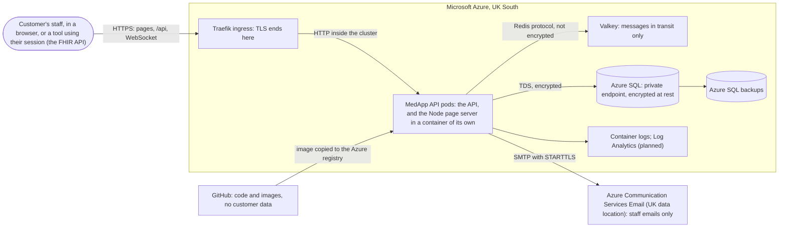

# Data inventory and data flows

**Draft prepared for review. It is not legal advice and must be reviewed and approved by a qualified data protection professional and the organisation's Data Protection Officer before use.**

| | |
|---|---|
| **Version** | 0.3 (draft), 16 November 2026: the NHS number, the FHIR API, SNOMED CT codes and the demographics lookup (roadmap step 9's first part); 0.4 (draft), the same day: admins' monitoring rules and each person's notification choices |
| **Owner** | [DPO name], with the lead developer |
| **Checked against** | The code on `main` as of 16 November 2026, with branch `feature/privacy-features` (roadmap step 7) and branch `feature/nhs-integrations` (step 9's first part): `MedApp.Domain`, `MedApp.Infrastructure/Data`, `MedApp.Application`, `MedApp.Web/src/app` and `deploy/` |
| **Next review** | With every change that adds or changes a stored field, and at least every 6 months |

Every place MedApp stores or sends personal data, field by field, from the code. The ROPA ([ropa.md](ropa.md)), the DPIA ([dpia.md](dpia.md)) and the retention schedule ([retention-schedule.md](retention-schedule.md)) refer to it.

**Who the data is about:**
- **Patients** of the customer.
- **Staff users:** the customer's staff with MedApp accounts.
- **Supplier staff:** only in the supplier's own systems (Azure, GitHub), not in MedApp's database.

## 1. The database (SQL Server; Azure SQL in production)

| Entity (table) | Personal data | About | Special category? | Notes |
|---|---|---|---|---|
| `Patient` (`Patients`) | `FirstName`, `LastName`, `DateOfBirth`, `Email`, `NhsNumber` (optional), `CreatedAt`, `LastUpdated`; the privacy flags `RestrictedAtUtc` and `RestrictionReason` (Article 18), `DisputedAtUtc` and `DisputeReason` (Article 16), and `AnonymisedAtUtc`; the retention decision `RetentionKeptUntil` and `RetentionKeptReason` | Patients | No on its own; yes in combination with the procedures below. **The reasons are free text** an admin types, and can say what the patient disputes. | `MedApp.Domain/Patients/Patient.cs`. **The NHS number is a national unique identifier,** so it identifies the patient on its own, in MedApp and in every other NHS system: see the note below the table. No address, phone, sex or local hospital number today. An anonymised patient keeps the row with placeholders: the name "Anonymised Patient", a placeholder email, no NHS number, and only the year of birth (`PatientAnonymiser`). |
| `PatientProcedure` (`PatientProcedures`) | `Title`, `Notes` (Markdown free text), `DueDateUtc`, `Priority`, `Status`, `TemplateName`, `PatientId`, timestamps | Patients | **Yes:** what procedure a patient is having, and clinical free text | `MedApp.Domain/Procedures/PatientProcedures/PatientProcedure.cs` |
| `PatientProcedureStage` (`PatientProcedureStages`) | `Notes` (clinical free text); `StartedByUserId`, `CompletedByUserId` and times; a copy of the stage's name, description, instructions and SNOMED CT code and term | Patients; staff (who did what) | **Yes** (notes) | `PatientProcedureStage.cs`. The name, description, instructions and code are copied from the stage definition and hold no personal data unless an admin wrote some into the definition. On a patient's stage, the SNOMED CT code says what kind of step it is, which is health data only as the stage's name already is. |
| `PatientProcedureAssignment` (`PatientProcedureAssignments`) | `UserId`, `AssignedByUserId`, `AssignedAtUtc` | Staff; links to a patient | Indirectly | `PatientProcedureAssignment.cs` |
| `PatientProcedureAuditEntry` (`PatientProcedureAuditEntries`) | `PatientId`, `ProcedureTitle`, `StageName`, `UserId`, `Username`, `AtUtc`, `Action`, and `Details` (JSON) | Patients; staff | **Yes** | `PatientProcedureAuditEntry.cs`. **`Details` holds copies of clinical text:** `StageNotesUpdated` stores the old and new stage notes (`ProcedureChange.UpdateStageNotes`), and `DetailsUpdated` stores the old and new title and procedure notes (`UpdatePatientProcedureHandler`). Status changes store the reason for a block or cancellation. No foreign keys: entries outlive the procedure and the user. Anonymising the patient replaces the titles and every piece of free text in `Details` with placeholders. |
| `ActivityEntry` (`ActivityEntries`) | `AtUtc`, `Action`, `UserId`, `Username`, `IpAddress`, `PatientId`, `ProcedureId`, `TargetUsername`, `Details` (JSON) | Staff (who did what, from which address); patients by ID | Indirectly: that a patient's record was opened. **No patient names, details or clinical text:** edits record the names of the fields changed, searches the names of the filters used and the number found (never the terms, so never an NHS number searched for), demographics lookups only whether anyone was found, and refused sign-ins the username tried (and the account's ID when it exists). Reasons for restricting, disputing, keeping or anonymising are the only free text, and anonymising replaces the earlier ones. | `MedApp.Domain/Activity/ActivityEntry.cs`, written through `IActivityLog`: patients viewed (once per person every 5 minutes), shown in search results, searched, created, edited, deleted, exported, anonymised, restricted and disputed, including reads and searches through the FHIR API (marked `via: "fhir"`); NHS number lookups in the demographics service (`DemographicsLookedUp`); procedures viewed; sign-ins, refused sign-ins (a wrong two-factor code included, never the code) and sign-outs; a right password asked for a two-factor code; account, password and role changes; two-factor turned on, off or reset, recovery codes used or replaced, password reset requests (the account if one matched, never what was typed) and resets by email, and email address changes (never the address). Admins only. No foreign keys: entries outlive the patient and the account. Never deleted yet: a scheduled job to purge sign-in events at 12 months is to come (retention schedule, section 3). Not in the subject access export: the export gives the patient each access by username, action and time, without the staff's account IDs or addresses. |
| `Notification` (`Notifications`) | `UserId`, `Kind`, `Title`, `Message`, `ProcedureId`, `CreatedAtUtc`, `ReadAtUtc`. **Assignment** notifications: the procedure's title as `Title`, and "[username] assigned you to this procedure." **Monitoring** notifications (to an admin whose rule matched): a fixed title for the event ("Stage finished") and a message built only from usernames, the priority, the template's and stage's names and due dates, e.g. "sam finished the Bloods stage on a High priority Knee review procedure." Never the procedure's title, notes, reasons or the patient | Staff (the admin told, and the staff member it's about); patients indirectly (through `ProcedureId`) | Assignment: possibly, as a procedure title can name a condition or treatment. Monitoring: no free text, though a template's name can say what kind of procedure it was | `MedApp.Domain/Notifications/Notification.cs`; written by `AssignPatientProcedureHandler` and `ProcedureMonitor` (`MonitoringNotifications`). No foreign keys. |
| `MonitoringRule` (`MonitoringRules`) | `OwnerUserId` (the admin), `SubjectUserId` (the staff member watched, or null for anyone), `Event`, `MinimumPriority`, `TemplateId`, `StageDefinitionId`, `IsEnabled`, `CreatedAtUtc`, `UpdatedAtUtc` | Staff: which admin watches which staff member, for what | No | `MedApp.Domain/Monitoring/MonitoringRule.cs`. Admins' rules for being told what staff do (Administration, Monitoring). An admin sees only their own. No foreign keys: a rule naming a deleted account stays until its admin deletes it. |
| `NotificationPreferences` (`NotificationPreferences`) | `UserId`, `ProcedureAssigned` (whether to be told of being assigned), `UpdatedAtUtc` | Staff | No | `MedApp.Domain/Notifications/NotificationPreferences.cs`. Each person's own choice (Account Settings); no row means every notification. |
| `UserSession` (`UserSessions`) | `UserId`, `CreatedAtUtc`, `ExpiresAtUtc`, `RevokedAtUtc`, `CreatedByIp` (IP address), `UserAgent` (browser) | Staff | No | `MedApp.Domain/Authentication/UserSession.cs`. The row's ID is the session cookie's value. Rows are never deleted today. |
| `UserSettings` (`UserSettings`) | `UserId`, `Json`, `UpdatedAtUtc` | Staff; patients indirectly | Possibly | `UserSettings.cs`. The JSON includes **saved searches ("favourites")**, whose terms can be patient names and NHS numbers (the patient list's NHS number filter), and the IDs of the patients and procedures the user has pinned (`medapp.pins`). |
| ASP.NET Core Identity (`AspNetUsers`, `AspNetUserRoles`, `AspNetRoles` and the other Identity tables) | `UserName`, `NormalizedUserName`, `PasswordHash`, `SecurityStamp`, `AccessFailedCount`, `LockoutEnd`, `CreatedAt`, `MustChangePassword`; **optionally a work email address** (`Email`, `EmailConfirmed`, and `PendingEmail` while a new one waits for its link to be opened); `TwoFactorEnabled`. The `PhoneNumber` column exists but MedApp doesn't fill it | Staff | No | `MedApp.Infrastructure/Common/Identity/ApplicationUser.cs`. Passwords are stored only as Identity's salted hashes. The email address is given by the staff member (Account Settings) or by an admin creating the account, and is used only for password reset links and security notices once confirmed. Admins see it on the Users page. |
| Identity's user tokens (`AspNetUserTokens`) | For staff who turn on two-factor authentication: the authenticator key, the unused recovery codes, and the time step of the last code accepted | Staff | No | Stored as Identity stores them, in clear (the database is encrypted at rest on Azure). Removed when two-factor is turned off or an admin resets it (`TwoFactorService`). |
| `SignInChallenge` (`SignInChallenges`) | `UserId`, a SHA-256 hash of the challenge token, `CreatedAtUtc`, `ExpiresAtUtc`, `FailedAttempts` | Staff | No | The second step of a sign-in with two-factor; deleted when used, and expired ones are deleted at the next sign-in. Kept at most 5 minutes in practice. |
| `SecuritySettings` (`SecuritySettings`) | Whether admins must use two-factor; when it was last changed and by whom (a user ID) | Staff (the admin) | No | One row. |
| ASP.NET Core data protection keys (`DataProtectionKeys`) | Cryptographic keys that seal reset and confirmation links | None | No | Wrapped with a Key Vault key on Azure. |
| `PatientProcedureStageDefinition`, `PatientProcedureStageTemplate` and its map | Names, descriptions, instructions | None, by design | No | Configuration. Admins should not write patient or staff details into them. |
| `PatientProcedureStageDefinition`, `PatientProcedureStageTemplate` and its map | Names, descriptions, instructions; a definition's SNOMED CT code and term | None, by design | No | Configuration. Admins should not write patient or staff details into them. A SNOMED CT code names a kind of procedure or finding, not a person, so it isn't personal data. |

**The NHS number** (branch `feature/nhs-integrations`) needs more care than the other details, because it's the same in every NHS system: anyone who gets it can match the patient across them.
- **Minimised:** it's optional, so a customer that doesn't need it leaves it empty.
- **Checked:** its Modulus 11 check digit, on the server and in the form, so most typing errors are caught. Placeholders that pass the check (ten of one digit, `0123456789`, `9876543210`) are refused. Nothing checks it belongs to the patient: there's no PDS tracing, so the FHIR API reports it as "02 Number present but not traced".
- **Unique:** two patients can't have the same number (a filtered unique index; a 409 otherwise), across the whole deployment until step 8 makes it per organisation.
- **Stored** as 10 digits in `varchar(10)`. **It isn't encrypted at field level:** Always Encrypted, which step 7 planned once the number existed, is still to do (`docs/todo.md`); TDE covers it at rest as it does the rest of the database.
- **Not in the logs:** EF Core logs a failed save or command at Debug, which the app doesn't write, because SQL Server's message for the unique index holds the duplicate number (`ServiceExtensions.LogFailedSavesAtDebug`). A failure that isn't handled still reaches the error log as an unhandled exception, with its message.
- **Not in the activity log:** it records the field name `nhsNumber` for an edit and the filter name for a search, never the number; a demographics lookup records only whether anyone was found. The demographics lookup takes it in its body (`POST api/demographics/lookup`), never its URL. **But it is in some URLs:** the patient list's filter (browser history, below) and the FHIR search's query string (`identifier=…|{number}`, as FHIR defines it), so request logs and traces that record URLs can hold it (below, and `docs/todo.md`).
- **In saved searches:** a search saved on the patient list keeps its filters, the NHS number among them, in the account's settings (`UserSettings.Json`) and in the browser (`medapp.favourites`) until the user deletes it. **Anonymising a patient doesn't remove it** (`docs/todo.md`), as it doesn't remove a saved name.
- **In the subject access export,** and **removed** by anonymisation from the patient's record (not from saved searches, above).
- **Through the FHIR API:** an anonymised record is sent as `active: false`, with an "anonymous" name, the year of birth only and no email, never as a patient's details; a restricted or disputed one carries a `meta.tag` saying so.
- **Test numbers:** tests, demo data and screenshots use only the 999 range, which is never issued to real people (`AGENTS.md`).

## 2. Outside the database

| Where | What | Personal data | Kept for |
|---|---|---|---|
| **The session cookie** `__Host-medapp.session` (`medapp.session` in development) | The session's ID | Pseudonymous identifier for a staff user | Until the session ends (8 hours, extendable to 24 at most from sign-in) |
| **Browser `localStorage`** (`medapp.*` keys, `MedApp.Web/src/app`) | The account's settings (colour mode, colours, text size, list settings, accessibility), saved searches (`medapp.favourites`), and pinned patients and procedures as IDs (`medapp.pins`, `MedApp.Web/src/components/navigation/pins.ts`) | Saved search terms can be patient names and NHS numbers; pinned items are IDs | **Until sign-out,** which clears every `medapp.` key but the four visual settings (colour mode, colours, text size, accessibility); the account keeps the rest for the next sign-in (`clearStorageAtSignOut`, `MedApp.Web/src/app/settingsStore.ts`). Pins kept under the old per-user keys (`medapp.pinnedPatients.<username>`) move to the account and are cleared too. A session that only expires leaves them until the next sign-out. Full list: [cookies-and-storage.md](cookies-and-storage.md). |
| **Browser `sessionStorage`** (`medapp.halfView`) | The page open in the half view | Can include a patient or procedure ID | Until the tab closes or the user signs out |
| **Browser history and address bar suggestions** | Every page URL visited. List pages keep their filters in the URL (`MedApp.Web/src/pages/listSearch.ts`), and the patient list's filters are first name, last name, email, NHS number and a date of birth range, so a search becomes a URL like `/patients?last=…&dobFrom=…` | Patient names, emails, NHS numbers and dates of birth searched for, and record IDs; on a shared computer, the next user can see who was searched for | Until the browser's history is cleared or expires. **Signing out doesn't clear it.** The filters stay in the URL by the product owner's decision (16 November 2026), because shareable list links are a feature; the mitigations are the customer's: separate browser profiles, or history cleared, on shared computers ([dpia.md](dpia.md), risk 10). |
| **The browser's memory** (TanStack Query cache) | Data of the pages viewed | Patients, procedures | Until sign-out, which clears it, or the tab closes |
| **Server-rendered pages** | HTML with the page's data | Patients, procedures | Not kept: sent with `Cache-Control: no-store` (`MedApp.API/ServerRendering/SsrPages.cs`) |
| **The Node page server** | Renders each page in memory, with a new router and cache per request | Transient | Not kept |
| **Valkey** (the SignalR backplane, in the cluster) | Notifications in transit between API copies | Assignment: the procedure title, the assigner's username. Monitoring: usernames, the priority, template and stage names, dates | Not kept: Valkey saves nothing to disk (`deploy/helm/medapp/templates/valkey.yaml`). Traffic inside the cluster isn't encrypted. |
| **Application logs** (container console; Log Analytics once step 5 is done) | The API's logs, at the levels in `MedApp.API/appsettings.json` (`Default: Information`, `Microsoft.AspNetCore: Warning`) | EF Core logs every SQL command at Information level **without parameter values** (sensitive data logging is off). Its failed-save and failed-command events go to Debug, which isn't written, as SQL Server's message can hold a value (a duplicate NHS number). An unhandled exception's message is logged, and can hold a record ID or, rarely, a value from the database's message. ASP.NET Core's own request logs are below the configured level. The Node page server's output is logged as `SSR: …` lines. | Console logs: as long as the node keeps them. Planned: 90 days ([retention-schedule.md](retention-schedule.md)) |
| **OpenTelemetry traces and metrics** | Request timings, paths and status codes | Paths include record IDs; list pages keep their filters in the URL, so a search term (which can be a patient's name or NHS number) can appear in a traced URL, and so can the NHS number in a FHIR search (the demographics lookup takes it in its body). [Check what the instrumentation records before exporting traces.] | Exported only where `OTEL_EXPORTER_OTLP_ENDPOINT` is set: in development, to the local Aspire dashboard. Not exported in Kubernetes today. |
| **Azure SQL backups** | The whole database | Everything above | 7 days of point-in-time restore today (`deploy/azure/main.bicep`); planned 35 days plus long-term retention |
| **Kubernetes Secrets and Key Vault** | Connection strings and the first admin's password | The first admin's credentials | While deployed |
| **GitHub** | Source code, CI logs, container images, documentation | **No customer personal data.** Commit author names and emails of the supplier's developers. Test data is synthetic only (`AGENTS.md`). | For the life of the repository |
| **Developers' machines** | The local development database | **Synthetic data only**, from `medapp-dev`'s `reset_demo_data` (invented names, `@example.com` addresses) | Until reset |

## 3. Data flows

| Flow | Data | Protection | Status |
|---|---|---|---|
| Browser to ingress | Everything a user sees or enters | TLS (Let's Encrypt certificate, http redirected to https); HSTS | Built; never deployed to Azure |
| Ingress to API | The same | Plain HTTP inside the cluster; network policy allows only the ingress namespace | Built |
| API to Azure SQL | All stored data | TLS (`Encrypt=True`), private endpoint, public access off | Built in Bicep; never deployed |
| API to Valkey | Notifications | Password, not encrypted; network policy | Built |
| API to the email service, then to the staff member's mailbox | A staff member's email address and username; a password reset or email confirmation link; or a notice that their password, email address or two-factor authentication changed. **Never patient data, clinical text or a password** (`EmailTemplates`) | SMTP with STARTTLS to Azure Communication Services (kind and development: Mailpit, which keeps mail in memory and sends nothing on) | Built; Azure part never deployed |
| API to logs | Logs | Inside Azure | Logging built; export planned (step 5) |
| GitHub to Azure | Container images | OIDC federation; an identity limited to the registry (`AcrPush`, which can push and pull images), with no access to the database or Key Vault | Built |
| Customer to supplier support | Support requests | Email (planned helpdesk); **no patient data in tickets** ([support-access-policy.md](support-access-policy.md)) | Policy only |
| Supplier to customer at exit | Full export | Planned: an encrypted export (roadmap steps 7 and 8) | Planned |
| The FHIR API to its caller | A patient's name, date of birth, email and NHS number, as UK Core Patient resources (`GET api/fhir/Patient/{id}`, or by NHS number) | The same as the browser: TLS, a signed-in staff session (no system clients or OAuth yet), `no-store`; each read and search recorded in the activity log (`via: "fhir"`) | Built (branch `feature/nhs-integrations`); read-only |
| Demographics lookup (PDS) to the form | Name and date of birth for an NHS number | The same as the browser; off by default (`Pds:Mode`); each lookup recorded without the number | Only an offline stub of four synthetic people exists. **The real PDS isn't connected:** it would make NHS England a source of patient data, and needs NHS England's onboarding and this inventory, the DPIA and the ROPA updated first |

**There are no other recipients.** Apart from the staff emails above, MedApp has no integrations with other systems, SMS, analytics, advertising or third-party scripts today ([architecture handbook, 3.3](../architecture.md#33-scope-what-medapp-doesnt-do)). The FHIR API is a new way for data to leave MedApp, but only to a caller signed in as one of the customer's staff, and each use is logged; whatever that caller does with the data is the customer's processing.

## 4. Volumes (to fill per customer)

Article 35 asks whether processing is large scale. Fill these in for each customer:
- **Patients:** [number] a year, [number] in total.
- **Staff users:** [number].
- **Procedures:** [number] a year.
- **Geography:** [area served].

A single clinic may not be large scale on its own, but the supplier's processing across all customers is, which is why the supplier treats it as large scale.

## 5. What will change

The roadmap adds data. Each addition needs this inventory and the DPIA updated first:
- **Step 4:** done on `feature/email-2fa`: an optional staff email address, authenticator keys and recovery codes, and Azure Communication Services Email as the email provider. Still to come: display name, job title, professional registration number, passkeys, last sign-in time.
- **Step 7, built:** the activity log (who viewed, searched or changed which patient, with the filters used but not the search terms; sign-ins with IP addresses; account and role changes), restriction and dispute flags, the anonymised marker, and retention decisions (above). **Still to come:** note versions, contact preferences, a destruction log.
- **Step 8:** an organisation on every record.
- **Step 9, built** (branch `feature/nhs-integrations`): the NHS number, SNOMED CT codes on stage definitions (not personal data), the FHIR API and an offline demographics lookup (above). **Still to come:** a local hospital number, sex and gender, address, phone, registered GP practice, a deceased flag, documents and images, and the real PDS lookup.
