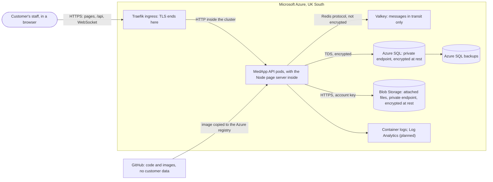

# Data inventory and data flows

**Draft prepared for review. It is not legal advice and must be reviewed and approved by a qualified data protection professional and the organisation's Data Protection Officer before use.**

| | |
|---|---|
| **Version** | 0.1 (draft), 16 November 2026 |
| **Owner** | [DPO name], with the lead developer |
| **Checked against** | The code on `main` as of 16 November 2026, with file attachments: `MedApp.Domain`, `MedApp.Infrastructure/Data`, `MedApp.Infrastructure/Attachments`, `MedApp.Application`, `MedApp.API/Attachments`, `MedApp.Web/src/app` and `deploy/` |
| **Next review** | With every change that adds or changes a stored field, and at least every 6 months |

Every place MedApp stores or sends personal data, field by field, from the code. The ROPA ([ropa.md](ropa.md)), the DPIA ([dpia.md](dpia.md)) and the retention schedule ([retention-schedule.md](retention-schedule.md)) refer to it.

**Who the data is about:**
- **Patients** of the customer.
- **Staff users:** the customer's staff with MedApp accounts.
- **Supplier staff:** only in the supplier's own systems (Azure, GitHub), not in MedApp's database.

## 1. The database (SQL Server; Azure SQL in production)

| Entity (table) | Personal data | About | Special category? | Notes |
|---|---|---|---|---|
| `Patient` (`Patients`) | `FirstName`, `LastName`, `DateOfBirth`, `Email`, `CreatedAt`, `LastUpdated` | Patients | No on its own; yes in combination with the procedures below | `MedApp.Domain/Patients/Patient.cs`. No NHS number, address, phone or sex today. |
| `PatientProcedure` (`PatientProcedures`) | `Title`, `Notes` (Markdown free text), `DueDateUtc`, `Priority`, `Status`, `TemplateName`, `PatientId`, timestamps | Patients | **Yes:** what procedure a patient is having, and clinical free text | `MedApp.Domain/Procedures/PatientProcedures/PatientProcedure.cs` |
| `PatientProcedureStage` (`PatientProcedureStages`) | `Notes` (clinical free text); `StartedByUserId`, `CompletedByUserId` and times; a copy of the stage's name, description and instructions | Patients; staff (who did what) | **Yes** (notes) | `PatientProcedureStage.cs`. The name, description and instructions are copied from the stage definition and hold no personal data unless an admin wrote some into the definition. |
| `PatientProcedureAssignment` (`PatientProcedureAssignments`) | `UserId`, `AssignedByUserId`, `AssignedAtUtc` | Staff; links to a patient | Indirectly | `PatientProcedureAssignment.cs` |
| `PatientProcedureAuditEntry` (`PatientProcedureAuditEntries`) | `PatientId`, `ProcedureTitle`, `StageName`, `UserId`, `Username`, `AtUtc`, `Action`, and `Details` (JSON) | Patients; staff | **Yes** | `PatientProcedureAuditEntry.cs`. **`Details` holds copies of clinical text:** `StageNotesUpdated` stores the old and new stage notes (`ProcedureChange.UpdateStageNotes`), and `DetailsUpdated` stores the old and new title and procedure notes (`UpdatePatientProcedureHandler`). Status changes store the reason for a block or cancellation. **Attached files:** `AttachmentAdded`, `AttachmentDeleted` and `AttachmentDownloaded` store the file's ID, **name**, type, size and what it's attached to (`AttachmentAudit`); a patient's own file is recorded with no procedure (`PatientProcedureId` is all zeros). So the log is also a record of **who downloaded which patient's file**. No foreign keys: entries outlive the procedure and the user. |
| `Attachment` (`Attachments`) | `PatientId`, `ProcedureId`, `StageId`; `FileName`; `ContentType`, `SizeBytes`, `Sha256`, `ScanStatus`, `HasThumbnail`; `UploadedByUserId`, `UploadedByUsername`, `UploadedAtUtc`; for a deleted file `DeletedAtUtc`, `DeletedByUserId`, `DeletedByUsername` | Patients; staff (who uploaded or deleted it) | **Yes:** that a patient has a scan, result or letter, and **`FileName` is free text**, which can hold a patient's name, a condition or a test (for example `ultrasound-report-2026-11.pdf`) | `MedApp.Domain/Attachments/Attachment.cs`. The metadata of each file; the file itself is in blob storage (section 2). No foreign keys, like the audit log, so a row outlives a deleted patient or procedure. Deleting is soft: the row stays, marked deleted, visible to admins only. |
| `Notification` (`Notifications`) | `UserId`, `Title` (the procedure's title), `Message` (for example "[username] assigned you to this procedure."), `ProcedureId`, `CreatedAtUtc`, `ReadAtUtc` | Staff; patients indirectly | Possibly: a procedure title can name a condition or treatment | `MedApp.Domain/Notifications/Notification.cs`; written by `AssignPatientProcedureHandler`. No foreign keys. |
| `UserSession` (`UserSessions`) | `UserId`, `CreatedAtUtc`, `ExpiresAtUtc`, `RevokedAtUtc`, `CreatedByIp` (IP address), `UserAgent` (browser) | Staff | No | `MedApp.Domain/Authentication/UserSession.cs`. The row's ID is the session cookie's value. Rows are never deleted today. |
| `UserSettings` (`UserSettings`) | `UserId`, `Json`, `UpdatedAtUtc` | Staff; patients indirectly | Possibly | `UserSettings.cs`. The JSON includes **saved searches ("favourites")**, whose terms can be patient names. |
| ASP.NET Core Identity (`AspNetUsers`, `AspNetUserRoles`, `AspNetRoles` and the other Identity tables) | `UserName`, `NormalizedUserName`, `PasswordHash`, `SecurityStamp`, `AccessFailedCount`, `LockoutEnd`, `CreatedAt`; `Email` and `PhoneNumber` columns exist but MedApp doesn't fill them | Staff | No | `MedApp.Infrastructure/Common/Identity/ApplicationUser.cs`. Passwords are stored only as Identity's salted hashes. |
| `PatientProcedureStageDefinition`, `PatientProcedureStageTemplate` and its map | Names, descriptions, instructions | None, by design | No | Configuration. Admins should not write patient or staff details into them. |

## 2. Outside the database

| Where | What | Personal data | Kept for |
|---|---|---|---|
| **The session cookie** `medapp.session` | The session's ID | Pseudonymous identifier for a staff user | Until the session ends (8 hours, extendable to 24 at most from sign-in) |
| **Browser `localStorage`** (`medapp.*` keys, `MedApp.Web/src/app`) | The account's settings (colour mode, colours, text size, list settings, accessibility), saved searches (`medapp.favourites`), and pinned patients and procedures as IDs (`medapp.pinnedPatients.<username>`, `MedApp.Web/src/components/navigation/pins.ts`) | Saved search terms can be patient names; pinned items are IDs; the pin keys contain the username | Until cleared. **Signing out doesn't clear it today** (roadmap step 7). Full list: [cookies-and-storage.md](cookies-and-storage.md). |
| **Browser `sessionStorage`** (`medapp.halfView`) | The page open in the half view | Can include a patient or procedure ID | Until the tab closes |
| **Browser history and address bar suggestions** | Every page URL visited. List pages keep their filters in the URL (`MedApp.Web/src/pages/listSearch.ts`), and the patient list's filters are first name, last name, email and a date of birth range, so a search becomes a URL like `/patients?last=…&dobFrom=…` | Patient names, emails and dates of birth searched for, and record IDs; on a shared computer, the next user can see who was searched for | Until the browser's history is cleared or expires. **Signing out doesn't clear it.** Planned (step 7): keep identifying filters out of the URL ([dpia.md](dpia.md), risk 10) |
| **The browser's memory** (TanStack Query cache) | Data of the pages viewed, including lists of attached files (names, sizes, who uploaded them) and the thumbnails shown | Patients, procedures | Until sign-out, which clears it, or the tab closes |
| **Blob storage** (Azure Blob Storage on Azure; Azurite, Microsoft's storage emulator, on the kind cluster and in development) | **The attached files themselves:** scans, photos, results, letters (PDF, PNG, JPEG, HEIC/HEIF, Word `.docx`, plain text; at most 20 MB each), stored exactly as uploaded; and, for PNG and JPEG, a small thumbnail (at most 320 pixels) re-encoded by the server | **Special category:** health data, and possibly images of the body. **Photos keep their original metadata** (EXIF: possibly where and when they were taken, and the camera or phone); the thumbnails don't, because re-encoding strips it (`SkiaThumbnailGenerator`). Letters and results can name **third parties** (relatives, other clinicians, other patients). | For as long as the clinical record ([retention-schedule.md](retention-schedule.md)). **Deleted files' bytes are kept too,** until a purge job deletes them, and no purge job exists yet, so today they're kept indefinitely. On Azure, a purged file stays in soft delete for 7 more days. |
| **The API pod's temporary disk** (`/tmp`, an `emptyDir` on the node's disk) | Each upload, while the API checks its type, scans and hashes it | The file's contents | Seconds: created readable only by the API's user, and deleted as soon as it's checked (`TempFileUploadStaging`) |
| **Staff computers' download folders** | Every file a member of staff downloads. The API sends every file as a download (`Content-Disposition: attachment`), never shown in the page | The file's contents, with its original metadata | **Outside MedApp's control:** until the user or the customer's device policy deletes it. Downloads are recorded in the audit log, so the customer can see who has a copy. |
| **Server-rendered pages** | HTML with the page's data | Patients, procedures | Not kept: sent with `Cache-Control: no-store` (`MedApp.API/ServerRendering/SsrPages.cs`) |
| **The Node page server** | Renders each page in memory, with a new router and cache per request | Transient | Not kept |
| **Valkey** (the SignalR backplane, in the cluster) | Notifications in transit between API copies | Procedure title, the assigner's username | Not kept: Valkey saves nothing to disk (`deploy/helm/medapp/templates/valkey.yaml`). Traffic inside the cluster isn't encrypted. |
| **Application logs** (container console; Log Analytics once step 5 is done) | The API's logs, at the levels in `MedApp.API/appsettings.json` (`Default: Information`, `Microsoft.AspNetCore: Warning`) | EF Core logs every SQL command at Information level **without parameter values** (sensitive data logging is off). ASP.NET Core's own request logs are below the configured level. Error messages can include record IDs. The Node page server's output is logged as `SSR: …` lines. An upload's file name travels in a request header (`X-File-Name`), which isn't logged at these levels; attachment code logs only a file's type when a thumbnail fails. | Console logs: as long as the node keeps them. Planned: 90 days ([retention-schedule.md](retention-schedule.md)) |
| **OpenTelemetry traces and metrics** | Request timings, paths and status codes | Paths include record IDs; list pages keep their filters in the URL, so a search term (which can be a patient's name) can appear in a traced URL. [Check what the instrumentation records before exporting traces.] | Exported only where `OTEL_EXPORTER_OTLP_ENDPOINT` is set: in development, to the local Aspire dashboard. Not exported in Kubernetes today. |
| **Azure SQL backups** | The whole database, including the files' metadata, but **not the files**, which are in blob storage | Everything in section 1 | 7 days of point-in-time restore today (`deploy/azure/main.bicep`); planned 35 days plus long-term retention |
| **Blob storage soft delete** (Azure) | Deleted blobs and containers | Files' contents | 7 days (`deploy/azure/main.bicep`). There's no other backup of the files: no versioning, no vaulted backup (`deploy/azure/README.md`, "Not yet") |
| **The Azurite volume** (kind cluster) | The files, on a persistent volume in the cluster | Files' contents (synthetic only on kind) | Until the volume is deleted |
| **Kubernetes Secrets and Key Vault** | Connection strings (the database, the backplane, and the storage account's, which carries its account key) and the first admin's password | The first admin's credentials | While deployed |
| **GitHub** | Source code, CI logs, container images, documentation | **No customer personal data.** Commit author names and emails of the supplier's developers. Test data is synthetic only (`AGENTS.md`). | For the life of the repository |
| **Developers' machines** | The local development database | **Synthetic data only**, from `medapp-dev`'s `reset_demo_data` (invented names, `@example.com` addresses) | Until reset |

## 3. Data flows

| Flow | Data | Protection | Status |
|---|---|---|---|
| Browser to ingress | Everything a user sees or enters | TLS (Let's Encrypt certificate, http redirected to https); HSTS | Built; never deployed to Azure |
| Ingress to API | The same | Plain HTTP inside the cluster; network policy allows only the ingress namespace | Built |
| API to Azure SQL | All stored data | TLS (`Encrypt=True`), private endpoint, public access off | Built in Bicep; never deployed |
| API to blob storage | Attached files and thumbnails | TLS 1.2 or later, private endpoint, public network access off, no anonymous access; the API signs in with the account key from Key Vault (passwordless access planned, step 5). On kind: Azurite over plain HTTP inside the cluster, reachable only from the API by network policy | Built in Bicep; never deployed. Built on kind |
| API to browser: downloads | One file at a time, always as a download, only through the API (never a direct storage link), with `no-store`, `nosniff` and a sandboxing CSP; each download audited | As browser to ingress | Built |
| API to Valkey | Notifications | Password, not encrypted; network policy | Built |
| API to logs | Logs | Inside Azure | Logging built; export planned (step 5) |
| GitHub to Azure | Container images | OIDC federation; an identity limited to the registry (`AcrPush`, which can push and pull images), with no access to the database or Key Vault | Built |
| Customer to supplier support | Support requests | Email (planned helpdesk); **no patient data in tickets** ([support-access-policy.md](support-access-policy.md)) | Policy only |
| Supplier to customer at exit | Full export | Planned: an encrypted export (roadmap steps 7 and 8) | Planned |

**There are no other recipients.** MedApp has no integrations, email, SMS, analytics, advertising or third-party scripts today ([architecture handbook, 3.3](../architecture.md#33-scope-what-medapp-doesnt-do)).

## 4. Volumes (to fill per customer)

Article 35 asks whether processing is large scale. Fill these in for each customer:
- **Patients:** [number] a year, [number] in total.
- **Staff users:** [number].
- **Procedures:** [number] a year.
- **Attached files:** [number] a year, [size] in total, and what kinds (letters, results, photos).
- **Geography:** [area served].

A single clinic may not be large scale on its own, but the supplier's processing across all customers is, which is why the supplier treats it as large scale.

## 5. What will change

The roadmap adds data. Each addition needs this inventory and the DPIA updated first:
- **Step 4:** staff display name, email, job title, professional registration number, MFA secrets and passkeys, last sign-in time; an email provider (a new sub-processor).
- **Step 7:** access audit (who viewed which patient, search terms), sign-in events with IP addresses, note versions, restriction and dispute flags, contact preferences, a destruction log.
- **Step 8:** an organisation on every record.
- **Step 9:** NHS number, local hospital number, sex and gender, address, phone, registered GP practice, a deceased flag. **Documents and images** have a first version already (attached files, sections 1 and 2); step 9 adds malware scan results from Defender for Storage, a customer-managed encryption key and FHIR `DocumentReference`s, which change no field listed here but add Microsoft's scanner as a processing operation ([sub-processors.md](sub-processors.md)).
