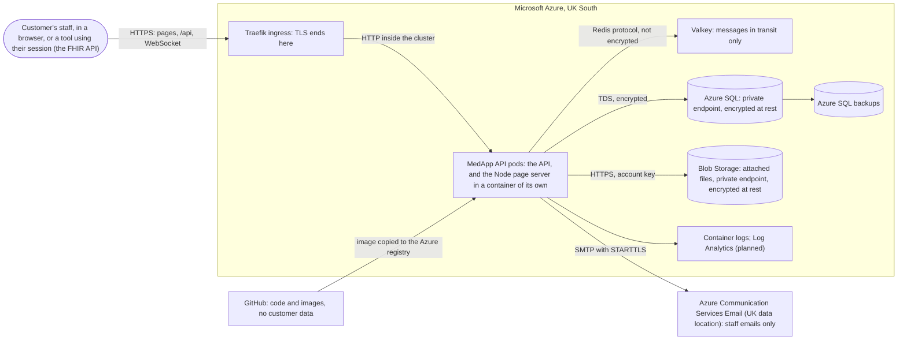

# Data inventory and data flows

**Draft prepared for review. It is not legal advice and must be reviewed and approved by a qualified data protection professional and the organisation's Data Protection Officer before use.**

| | |
|---|---|
| **Version** | 0.3 (draft), 16 November 2026: the NHS number, the FHIR API, SNOMED CT codes and the demographics lookup (roadmap step 9's first part); 0.4 (draft), the same day: admins' monitoring rules and each person's notification choices; 0.5 (draft), the same day: file attachments; 0.6 (draft), the same day: staff calendars and appointments, merged with staff email addresses and two-factor sign-in (#86, which added its rows without a version of its own); 0.7 (draft), the same day: meetings, the team view, suggested meeting times and personal calendar templates (`docs/calendar-plan.md`, decisions 50 on); 0.8 (draft), 17 November 2026: meeting notifications, and templates after their owner's account goes (review of #99); 0.9 (draft), the same day: deleting procedure notes, and staff's requests to delete them (branch `feature/note-deletion`); 0.10 (draft), 18 November 2026: two-factor codes by email (each account's method, and the emailed codes, kept only as hashes for minutes); 0.11 (draft), 18 November 2026: each attendee's reply to a meeting, and the organiser told of a decline (`docs/calendar-plan.md`, decision 71) |
| **Owner** | [DPO name], with the lead developer |
| **Checked against** | The code on `main` as of 16 November 2026, with branch `feature/privacy-features` (roadmap step 7), branch `feature/nhs-integrations` (step 9's first part), file attachments and branch `feature/staff-calendars` (staff calendars and appointments, `docs/calendar-plan.md`): `MedApp.Domain`, `MedApp.Infrastructure/Data`, `MedApp.Infrastructure/Attachments`, `MedApp.Application`, `MedApp.API/Attachments`, `MedApp.Web/src/app` and `deploy/` |
| **Next review** | With every change that adds or changes a stored field, and at least every 6 months |

Every place MedApp stores or sends personal data, field by field, from the code. The ROPA ([ropa.md](ropa.md)), the DPIA ([dpia.md](dpia.md)) and the retention schedule ([retention-schedule.md](retention-schedule.md)) refer to it.

**Who the data is about:**
- **Patients** of the customer.
- **Staff users:** the customer's staff with MedApp accounts, including their calendars: when they're booked with patients, and when they're away or busy (annual leave, training).
- **Supplier staff:** only in the supplier's own systems (Azure, GitHub), not in MedApp's database.

## 1. The database (SQL Server; Azure SQL in production)

| Entity (table) | Personal data | About | Special category? | Notes |
|---|---|---|---|---|
| `Patient` (`Patients`) | `FirstName`, `LastName`, `DateOfBirth`, `Email`, `NhsNumber` (optional), `CreatedAt`, `LastUpdated`; the privacy flags `RestrictedAtUtc` and `RestrictionReason` (Article 18), `DisputedAtUtc` and `DisputeReason` (Article 16), and `AnonymisedAtUtc`; the retention decision `RetentionKeptUntil` and `RetentionKeptReason` | Patients | No on its own; yes in combination with the procedures below. **The reasons are free text** an admin types, and can say what the patient disputes. | `MedApp.Domain/Patients/Patient.cs`. **The NHS number is a national unique identifier,** so it identifies the patient on its own, in MedApp and in every other NHS system: see the note below the table. No address, phone, sex or local hospital number today. An anonymised patient keeps the row with placeholders: the name "Anonymised Patient", a placeholder email, no NHS number, and only the year of birth (`PatientAnonymiser`). |
| `PatientProcedure` (`PatientProcedures`) | `Title`, `DueDateUtc`, `Priority`, `Status`, `TemplateName`, `PatientId`, timestamps; the old `Notes` column (Markdown free text), no longer used | Patients | **Yes:** what procedure a patient is having | `MedApp.Domain/Procedures/PatientProcedures/PatientProcedure.cs`. **The old `Notes` column** (`LegacyNotes` in code) still holds what the single notes field held before procedures had several notes: the migration copied it into each procedure's first note and left it, so API copies from before keep working during a rollout. Nothing reads it now; anonymising the patient replaces it with the placeholder; a later release drops it (`docs/todo.md`). |
| `PatientProcedureNote` (`PatientProcedureNotes`) | `PatientProcedureId`, `AuthorUserId`, `Text` (Markdown free text, 4,000 characters), `CreatedAtUtc`, `LastEditedAtUtc`, `Version`; once deleted, `DeletedAtUtc`, `DeletedByUserId`, `DeletionReason` (a fixed choice: wrong patient, written in error, duplicate, other) and `DeletionDetail` (free text, 500 characters, optional); `PendingDeletionRequestId` while a request to delete it waits | Patients; staff (who wrote it, and who deleted it) | **Yes** (clinical free text). **The deletion detail is free text** an admin types (or keeps from the request), and can say why the note was wrong, for example whose it really is. A note deleted as "wrong patient" is most likely another person's clinical text on this record | `PatientProcedureNote.cs`. A procedure's notes, several each, newest first. Staff add them; only the author edits one (admins can't edit anyone else's). **Only admins delete one, and deleting is soft:** the note is hidden from the procedure page for everyone, but its row and versions are kept, with who deleted it, when and why, so the record still accounts for it (the export lists it as deleted; admins see it on the timeline). Goes with its procedure (cascade); its versions stay. A note moved from the old field whose creator wasn't recorded has no author ("Unknown"). Anonymising replaces `Text` and `DeletionDetail` with the placeholder (the reason is a fixed choice and stays). The author is told when an admin deletes their note. |
| `PatientProcedureNoteVersion` (`PatientProcedureNoteVersions`) | `NoteId`, `Version`, `PatientProcedureId`, `PatientId`, `Text` (each version's free text), `UserId`, `Username` (as at the time), `AtUtc` | Patients; staff | **Yes** | `PatientProcedureNoteVersion.cs`. **Every version of every note:** the text as added, then after each edit, with who and when. This is where old note text lives now, instead of copies in the audit's `Details` (risk 4). No foreign keys, like the audit: versions outlive a deleted procedure, and the export and anonymisation find them by `PatientId`. Admins see the text on the patient timeline (from here); staff never do. Anonymising replaces every version's `Text` with the placeholder. |
| `ProcedureNoteDeletionRequest` (`ProcedureNoteDeletionRequests`) | `NoteId`, `PatientProcedureId`, `PatientId`, `RequestedByUserId`, `RequestedByUsername` (as at the time), `Reason` (a fixed choice), `Detail` (free text, 500 characters, optional), `RequestedAtUtc`, `Status` (pending, approved, declined, closed), `DecidedByUserId`, `DecidedByUsername`, `DecidedAtUtc` | Patients; staff (who asked, and the admin who decided) | **Possibly:** the detail is free text a member of staff writes about a note, and can name the patient or another one ("this is about the patient in bay 4") | `ProcedureNoteDeletionRequest.cs`. A member of staff's request that an admin delete a note. **Admins only** read it (the request's dialog, which shows the note's text and the patient); staff see only that a note has a request waiting ("Deletion requested"), never anyone's reason. No foreign keys, like the audit: a request outlives its note's procedure, and the export and anonymisation find it by `PatientId`. Kept with the record, like notes. Deleting the procedure closes a waiting request; anonymising replaces every `Detail` with the placeholder and closes a waiting request. |
| `PatientProcedureStage` (`PatientProcedureStages`) | `Notes` (clinical free text); `StartedByUserId`, `CompletedByUserId` and times; a copy of the stage's name, description, instructions and SNOMED CT code and term | Patients; staff (who did what) | **Yes** (notes) | `PatientProcedureStage.cs`. The name, description, instructions and code are copied from the stage definition and hold no personal data unless an admin wrote some into the definition. On a patient's stage, the SNOMED CT code says what kind of step it is, which is health data only as the stage's name already is. |
| `PatientProcedureAssignment` (`PatientProcedureAssignments`) | `UserId`, `AssignedByUserId`, `AssignedAtUtc` | Staff; links to a patient | Indirectly | `PatientProcedureAssignment.cs` |
| `PatientProcedureAuditEntry` (`PatientProcedureAuditEntries`) | `PatientId`, `ProcedureTitle`, `StageName`, `UserId`, `Username`, `AtUtc`, `Action`, and `Details` (JSON) | Patients; staff | **Yes** | `PatientProcedureAuditEntry.cs`. **`Details` holds copies of clinical text:** `StageNotesUpdated` stores the old and new stage notes (`ProcedureChange.UpdateStageNotes`), and `DetailsUpdated` stores the old and new title (`UpdatePatientProcedureHandler`), and, in entries written before procedures had several notes, the old and new procedure notes. **Procedure notes are no longer copied:** `NoteAdded` and `NoteEdited` store only the note's ID and version (`ProcedureChange.AddNote`, `EditNote`); the text is in `PatientProcedureNoteVersion`. `NoteDeleted` stores the note's ID and version, the request it approved, and **the admin's reason** (free text), never the note's text (`ProcedureChange.DeleteNote`); the timeline shows the reason to admins only. Status changes store the reason for a block or cancellation. **Attached files:** `AttachmentAdded`, `AttachmentDeleted` and `AttachmentDownloaded` store the file's ID, **name**, type, size and what it's attached to (`AttachmentAudit`); a patient's own file is recorded with no procedure (`PatientProcedureId` is all zeros). So the log is also a record of **who downloaded which patient's file**, each download on its own. A stage finished without a visit stores that, the visit requirement and, when an admin finished one whose visit was required, the admin's reason (free text). No foreign keys: entries outlive the procedure and the user. Anonymising the patient replaces the titles and every piece of free text in `Details` with placeholders, file names included. |
| `Attachment` (`Attachments`) | `PatientId`, `ProcedureId`, `StageId`; `FileName`; `ContentType`, `SizeBytes`, `Sha256`, `ScanStatus`, `HasThumbnail`; `UploadedByUserId`, `UploadedByUsername`, `UploadedAtUtc`; for a deleted file `DeletedAtUtc`, `DeletedByUserId`, `DeletedByUsername` | Patients; staff (who uploaded or deleted it) | **Yes:** that a patient has a scan, result or letter, and **`FileName` is free text**, which can hold a patient's name, a condition or a test (for example `ultrasound-report-2026-11.pdf`) | `MedApp.Domain/Attachments/Attachment.cs`. The metadata of each file; the file itself is in blob storage (section 2). No foreign keys, like the audit log, so a row outlives a deleted patient or procedure. Deleting is soft: the row stays, marked deleted, visible to admins only. On a restricted or anonymised record, files can't be added or deleted. Anonymising the patient renames each file "Anonymised file" with its type's usual extension and deletes every live one, with an `AttachmentDeleted` audit entry for each (the contents stay in storage until the purge job, section 2). In the subject access export, without the files themselves. |
| `Appointment` (`Appointments`) | `PatientId`, `ProcedureId`, `StageId`, `StaffUserId`, `StartUtc`, `EndUtc`, `Status` (requested, booked, attended, did not attend, cancelled, entered in error), `Notes` (free text, 2,000 characters), `CancelReason` (free text, 500 characters), `IsAutomatic`, `IsRecordedAfterEvent` (recorded after the event, a walk-in, rather than booked ahead: then `BookedByUserId` is who recorded it), `CreatedByUserId`, `BookedByUserId`, `OutcomeByUserId` and their times | Patients; staff (who the patient is booked with, and who booked or recorded it) | **Yes:** that a patient is being seen, for which procedure and stage, and whether they attended. Notes and cancellation reasons are free text about the patient, treated like procedure notes | `MedApp.Domain/Appointments`. Foreign keys to the patient, procedure and stage; none to staff. A patient with appointments can't be deleted; deleting a procedure detaches its appointments. Anonymising the patient replaces `Notes` and `CancelReason` with placeholders; a restricted patient's appointments can only be cancelled, and an anonymised patient's can't be changed. |
| `AppointmentEvent` (`AppointmentEvents`) | `AppointmentId`, `PatientId`, `ProcedureId`, `ProcedureTitle`, `StageName`, `Action`, `UserId`, `Username`, `AtUtc`, `StaffUserId`, `StaffUsername`, `StartUtc`, `EndUtc`, and `Details` (JSON) | Patients; staff | **Yes** | The appointment's history: requested, booked, rescheduled (with the old time and member of staff), attended, did not attend, cancelled (**with the reason**) and notes changed (**with the old and new notes**). **So it keeps copies of appointment notes and cancellation reasons,** like the procedure audit. No foreign keys: entries outlive the appointment, the procedure and the user. Anonymising the patient replaces the notes and reasons in `Details` with placeholders, and gives `ProcedureTitle` the procedure's new title, as in the procedure audit. |
| `ActivityEntry` (`ActivityEntries`) | `AtUtc`, `Action`, `UserId`, `Username`, `IpAddress`, `PatientId`, `ProcedureId`, `TargetUsername`, `Details` (JSON) | Staff (who did what, from which address); patients by ID | Indirectly: that a patient's record was opened. **No patient names, details or clinical text:** edits record the names of the fields changed, searches the names of the filters used and the number found (never the terms, so never an NHS number searched for), demographics lookups only whether anyone was found, and refused sign-ins the username tried (and the account's ID when it exists). Reasons for restricting, disputing, keeping or anonymising are the only free text, and anonymising replaces the earlier ones. | `MedApp.Domain/Activity/ActivityEntry.cs`, written through `IActivityLog`: patients viewed (once per person every 5 minutes), shown in search results, searched, created, edited, deleted, exported, anonymised, restricted and disputed, including reads and searches through the FHIR API (marked `via: "fhir"`); NHS number lookups in the demographics service (`DemographicsLookedUp`); procedures viewed; a patient's, procedure's or stage's files listed (`AttachmentsViewed`) and a file downloaded (`AttachmentDownloaded`), against the patient and, for a procedure's or stage's files, the procedure, in the same 5-minute window (thumbnails aren't recorded; they come with a list); appointments read (on the calendar, the Requires Appointment list or the booking dialog, or opened), as reads of the patients they show; sign-ins, refused sign-ins (a wrong two-factor code included, never the code) and sign-outs; a right password asked for a two-factor code; account, password and role changes; two-factor turned on, off or reset, recovery codes used or replaced, password reset requests (the account if one matched, never what was typed) and resets by email, and email address changes (never the address). Admins only. No foreign keys: entries outlive the patient and the account. Never deleted yet: a scheduled job to purge sign-in events at 12 months is to come (retention schedule, section 3). Not in the subject access export: the export gives the patient each access by username, action and time, without the staff's account IDs or addresses. |
| `CalendarBlock` (`CalendarBlocks`) | `StaffUserId`, `ActivityTypeId`, `StartUtc`, `EndUtc`, `Note` (free text, 200 characters), `CreatedByUserId`, `CreatedAtUtc`, `LastUpdated` | Staff | Not by design. But **a block reveals when someone is away** (annual leave) or busy, and a note could reveal a staff member's health (for example "hospital appointment"). The UI tells staff not to put patient details in a note | `MedApp.Domain/Calendar`. Time blocked off on a member of staff's calendar. |
| `StaffWeekTemplate`, `CalendarDayOverride`, `CalendarBlockException` | `StaffUserId`, a week or day template, dates | Staff | No | A person's default week, and one day's changes to it. |
| `Meeting` (`Meetings`), `MeetingAttendee` (`MeetingAttendees`) | `Title` (100 characters) and `Notes` (500), free text; `StartUtc`, `EndUtc`, `OrganiserUserId`, `CreatedAtUtc`, `LastUpdated`; each attendee's `StaffUserId`, their `Reply` (no reply, accepted or declined) and `RepliedAtUtc` | Staff | Not by design. Meetings are arranged by admins for staff, and every member of staff can see them on the calendars they open: who is going, each person's reply, and the title and notes. The UI says notes are about staff, never patients, but a title or note could still name a patient or reveal something private ("Return-to-work meeting"). | Staff data: when people are busy, and with whom, and whether each said they'd go. Only the attendee sets their own reply; moving the meeting clears everyone's. Deleted when cancelled; taken off a person's meetings to come when their account goes. |
| `Notification` (`Notifications`) | `UserId`, `Kind`, `Title`, `Message`, `ProcedureId`, `AppointmentId`, `CalendarDate`, `NoteDeletionRequestId`, `MeetingId` (a meeting notification's link to the meeting; none for a cancellation), `CreatedAtUtc`, `ReadAtUtc`. **Note deletion** notifications (`NoteDeletionNotifications`): to every admin but the requester when a member of staff asks for a note to be deleted ("Note deletion requested", "s.nurse asked to delete a note on a procedure.", linking to the request), to the requester when an admin decides ("Note deleted" or "Note kept", "admin deleted the note you asked to delete."), and to a deleted note's author ("Your note was deleted", "admin deleted a note you wrote on a procedure."), unless they deleted it, or asked for it, themselves. Fixed titles, and messages of usernames only: never the note, the reason or the patient. **Assignment** notifications: the procedure's title as `Title`, and "[username] assigned you to this procedure." **Appointment** notifications (to the member of staff when someone else books, moves or cancels their appointment): a fixed `Title` ("Appointment booked", "Appointment moved", "Appointment cancelled" or "Appointment recorded", for one recorded after the event), and who booked, moved, cancelled or recorded it, with its time (and, when recorded, whether the patient attended); never the patient's name or the appointment's notes (`docs/calendar-plan.md`, decision 20). **Stage visit withdrawn** notifications (to the procedure's assignees and every admin, never to whoever withdrew it, when a walk-in marked entered in error was the only attended visit of a finished stage that requires one): a fixed `Title` ("Stage visit withdrawn"), the procedure as `ProcedureId`, and a message of who withdrew it, the visit's time, the stage's admin-written name and when the stage was finished; never the patient, the procedure's title or the reason. **Monitoring** notifications (to an admin whose rule matched): a fixed title for the event ("Stage finished") and a message built only from usernames, the priority, the template's and stage's names and due dates, e.g. "sam finished the Bloods stage on a High priority Knee review procedure." Never the procedure's title, notes, reasons or the patient. **Meeting** notifications (to each attendee when an admin arranges, moves or cancels a meeting, or adds them to it or takes them off it; never of their own change): a fixed `Title` ("Meeting invitation", "Meeting moved" or "Meeting cancelled"), the meeting's day as `CalendarDate`, and a message of who did it, the meeting's title and its time, e.g. "admin invited you to 'Team huddle', Tuesday 17 November, 09:00 to 10:00." A decline tells the meeting's organiser the same way ("Meeting declined": "k.ashford declined 'Team huddle', ..."); an acceptance tells nobody. The meeting's title is free text an admin writes, treated like a template's name (the dialog says not to put patient details in it); its notes are never copied. These copies stay after the meeting is cancelled (deleted) | Staff (the admin told, and the staff member it's about); patients indirectly (through `ProcedureId`) | Assignment: possibly, as a procedure title can name a condition or treatment. Appointment and monitoring: no free text, though a template's name can say what kind of procedure it was. Meeting: not by design, but a meeting's title could name a patient or reveal something private despite the warning; such a title isn't linked to any patient, so a patient's export and anonymisation don't find it | `MedApp.Domain/Notifications/Notification.cs`; written by `AssignPatientProcedureHandler`, the appointment handlers (`AppointmentNotifications`) and `ProcedureMonitor` (`MonitoringNotifications`). Anonymising the patient gives assignment notifications about their procedures the procedure's new title; a fixed title (a monitoring event's or an appointment's) stays as it is, and no message holds free text other than a meeting's admin-written title. Written by the meeting handlers too (`MeetingNotifications`). No foreign keys. |
| `MonitoringRule` (`MonitoringRules`) | `OwnerUserId` (the admin), `SubjectUserId` (the staff member watched, or null for anyone), `Event`, `MinimumPriority`, `TemplateId`, `StageDefinitionId`, `IsEnabled`, `CreatedAtUtc`, `UpdatedAtUtc` | Staff: which admin watches which staff member, for what | No | `MedApp.Domain/Monitoring/MonitoringRule.cs`. Admins' rules for being told what staff do (Administration, Monitoring). An admin sees only their own. No foreign keys: a rule naming a deleted account stays until its admin deletes it. |
| `NotificationPreferences` (`NotificationPreferences`) | `UserId`, `ProcedureAssigned` (whether to be told of being assigned), `UpdatedAtUtc` | Staff | No | `MedApp.Domain/Notifications/NotificationPreferences.cs`. Each person's own choice (Account Settings); no row means every notification. |
| `UserSession` (`UserSessions`) | `UserId`, `CreatedAtUtc`, `ExpiresAtUtc`, `RevokedAtUtc`, `CreatedByIp` (IP address), `UserAgent` (browser) | Staff | No | `MedApp.Domain/Authentication/UserSession.cs`. The row's ID is the session cookie's value. Rows are never deleted today. |
| `Notepad` (`Notepads`) | `UserId` (the key: one each), `Text` (Markdown free text, up to 20,000 characters), `LastUpdatedUtc`, `Version` | Staff (whose notepad it is); **patients, possibly**: staff jot things down during a call or a clinic | **Possibly** (free text about patients) | `MedApp.Domain/Notepads/Notepad.cs`. A member of staff's own notepad, beside every page or in a half view (`/notepad`), kept on the server (never in the browser). **Not linked to any patient,** so a patient's export and anonymisation can't find what it says about them. The staff privacy notice says it's for jottings, and that anything about a patient belongs in their record (the notepad itself no longer says so, since 17 November 2026), through **Add note to procedure**, which adds its text (or the part selected) as a note on a procedure after a confirmation that shows the patient, and offers to take it out of the notepad. **The whole notepad is cleared once it has gone 30 days without any change** (`Notepad:KeepDays`), when it's next read or saved, so what's in it stays for as long as it's used (each change restarts the 30 days for all of it); deleted with the account (a foreign key's cascade); the owner can clear it. Nobody else can read it, admins included, and reading or saving it isn't in the activity log (it's the owner's own). DPIA risk 26. |
| `UserSettings` (`UserSettings`) | `UserId`, `Json`, `UpdatedAtUtc` | Staff; patients indirectly | Possibly | `UserSettings.cs`. The JSON includes **saved searches ("favourites")**, whose terms can be patient names and NHS numbers (the patient list's NHS number filter), and the IDs of the patients and procedures the user has pinned (`medapp.pins`). |
| ASP.NET Core Identity (`AspNetUsers`, `AspNetUserRoles`, `AspNetRoles` and the other Identity tables) | `UserName`, `NormalizedUserName`, `PasswordHash`, `SecurityStamp`, `AccessFailedCount`, `LockoutEnd`, `CreatedAt`, `MustChangePassword`; **optionally a work email address** (`Email`, `EmailConfirmed`, and `PendingEmail` while a new one waits for its link to be opened); `TwoFactorEnabled`, and `TwoFactorMethod` (none, an authenticator app, or codes by email). The `PhoneNumber` column exists but MedApp doesn't fill it | Staff | No | `MedApp.Infrastructure/Common/Identity/ApplicationUser.cs`. Passwords are stored only as Identity's salted hashes. The email address is given by the staff member (Account Settings) or by an admin creating the account, and is used only for password reset links, security notices and, for someone who chooses them, two-factor codes, once confirmed. Admins see it on the Users page. |
| Identity's user tokens (`AspNetUserTokens`) | For staff who turn on two-factor authentication: the authenticator key, the unused recovery codes, and the time step of the last code accepted | Staff | No | Stored as Identity stores them, in clear (the database is encrypted at rest on Azure). Removed when two-factor is turned off or an admin resets it (`TwoFactorService`). |
| `SignInChallenge` (`SignInChallenges`) | `UserId`, a SHA-256 hash of the challenge token, `CreatedAtUtc`, `ExpiresAtUtc`, `FailedAttempts` | Staff | No | The second step of a sign-in with two-factor; deleted when used, and expired ones are deleted at the next sign-in. Kept at most 5 minutes in practice (10 for someone who signs in with codes by email). |
| `EmailCode` (`EmailCodes`) | `UserId`, `Purpose` (signing in, turning codes by email on, or confirming a change), `ChallengeId` (for signing in), a SHA-256 hash of the 6-digit code (bound to the row), `SentAtUtc`, `ExpiresAtUtc`, `Resends`, `FailedAttempts` | Staff | No | `MedApp.Domain/Authentication/EmailCode.cs`. Two-factor codes by email: the code itself is only ever in the email; MedApp keeps a hash, which keeps it out of sight but, at six digits, could be worked out from a copy, so the short life is the protection. Valid 10 minutes; deleted when used, with its sign-in challenge or its account (cascading deletes), and expired ones are deleted whenever the next code is sent to anyone. Kept minutes in practice. |
| `SecuritySettings` (`SecuritySettings`) | Whether admins must use two-factor; when it was last changed and by whom (a user ID) | Staff (the admin) | No | One row. |
| ASP.NET Core data protection keys (`DataProtectionKeys`) | Cryptographic keys that seal reset and confirmation links | None | No | Wrapped with a Key Vault key on Azure. |
| `PatientProcedureStageDefinition`, `PatientProcedureStageTemplate` and its map | Names, descriptions, instructions; a definition's SNOMED CT code and term; whether a stage involves a visit | None, by design | No | Configuration. Admins should not write patient or staff details into them. A SNOMED CT code names a kind of procedure or finding, not a person, so it isn't personal data. |
| `CalendarActivityType` | Names, colours | None, by design | No | Calendar configuration, organisation-wide. |
| `ClosedDay` (`ClosedDays`) | `Date`, `Name` (100 characters, e.g. "Christmas Day"), `CreatedAtUtc`, `CreatedByUserId` | Staff (the admin who added it) | No: a day the clinic is closed, organisation-wide. The admin page doesn't ask for patient details, and a closed day isn't about anyone | `MedApp.Domain/Calendar/ClosedDay.cs`. Calendar configuration, kept until an admin removes it (past days can't be). No foreign keys. |
| `DayTemplate`, `DayTemplateBlock`, `WeekTemplate`, `WeekTemplateDay` | `OwnerUserId`, names, times, template block notes | Staff: each template is one person's own, so it says how their days usually go | No, by design. Template block notes are free text: they should not hold patient or private details. | A member of staff's usual working pattern. Any member of staff can read anyone's (the calendar names the template a day came from). Deleting an account doesn't delete its templates yet ([retention-schedule.md](retention-schedule.md)). |

**The NHS number** (branch `feature/nhs-integrations`) needs more care than the other details, because it's the same in every NHS system: anyone who gets it can match the patient across them.
- **Minimised:** it's optional, so a customer that doesn't need it leaves it empty.
- **Checked:** its Modulus 11 check digit, on the server and in the form, so most typing errors are caught. Placeholders that pass the check (ten of one digit, `0123456789`, `9876543210`) are refused. Nothing checks it belongs to the patient: there's no PDS tracing, so the FHIR API reports it as "02 Number present but not traced".
- **Unique:** two patients can't have the same number (a filtered unique index; a 409 otherwise), across the whole deployment until step 8 makes it per organisation.
- **Stored** as 10 digits in `varchar(10)`. **It isn't encrypted at field level:** Always Encrypted, which step 7 planned once the number existed, is still to do (`docs/todo.md`); TDE covers it at rest as it does the rest of the database.
- **Not in the logs:** EF Core logs a failed save or command at Debug, which the app doesn't write, because SQL Server's message for the unique index holds the duplicate number (`ServiceExtensions.LogFailedSavesAtDebug`). A failure that isn't handled still reaches the error log as an unhandled exception, with its message.
- **Not in the activity log:** it records the field name `nhsNumber` for an edit and the filter name for a search, never the number; a demographics lookup records only whether anyone was found. The demographics lookup takes it in its body (`POST api/demographics/lookup`), never its URL. **But it is in some URLs:** the patient list's filter (browser history, below) and the FHIR search's query string (`identifier=…|{number}`, as FHIR defines it), so request logs and traces that record URLs can hold it (below, and `docs/todo.md`).
- **In saved searches:** a search saved on the patient list keeps its filters, the NHS number among them, in the account's settings (`UserSettings.Json`) and in the browser (`medapp.favourites`) until the user deletes it. **Anonymising a patient doesn't remove it** (`docs/todo.md`), as it doesn't remove a saved name.
- **In the subject access export,** and **removed** by anonymisation from the patient's record (not from saved searches, above).
- **Through the FHIR API:** an anonymised record is sent as `active: false`, with an "anonymous" name, the year of birth only and no email, never as a patient's details; a restricted or disputed one carries a `meta.tag` saying so.
- **Test numbers:** tests, demo data and screenshots use only the 999 range, which is never issued to real people (`AGENTS.md`).

## 2. Outside the database

| Where | What | Personal data | Kept for |
|---|---|---|---|
| **The session cookie** `__Host-medapp.session` (`medapp.session` in development) | The session's ID | Pseudonymous identifier for a staff user | Until the session ends (8 hours, extendable to 24 at most from sign-in) |
| **Browser `localStorage`** (`medapp.*` keys, `MedApp.Web/src/app`) | The account's settings (colour mode, colours, text size, list settings, accessibility), saved searches (`medapp.favourites`), and pinned patients and procedures as IDs (`medapp.pins`, `MedApp.Web/src/components/navigation/pins.ts`) | Saved search terms can be patient names and NHS numbers; pinned items are IDs | **Until sign-out,** which clears every `medapp.` key but the four visual settings (colour mode, colours, text size, accessibility); the account keeps the rest for the next sign-in (`clearStorageAtSignOut`, `MedApp.Web/src/app/settingsStore.ts`). Pins kept under the old per-user keys (`medapp.pinnedPatients.<username>`) move to the account and are cleared too. A session that only expires leaves them until the next sign-out. Full list: [cookies-and-storage.md](cookies-and-storage.md). |
| **Browser `sessionStorage`** (`medapp.halfView`) | The page open in the half view | Can include a patient or procedure ID | Until the tab closes or the user signs out |
| **Browser history and address bar suggestions** | Every page URL visited. List pages keep their filters in the URL (`MedApp.Web/src/pages/listSearch.ts`), and the patient list's filters are first name, last name, email, NHS number and a date of birth range, so a search becomes a URL like `/patients?last=…&dobFrom=…` | Patient names, emails, NHS numbers and dates of birth searched for, and record IDs; on a shared computer, the next user can see who was searched for | Until the browser's history is cleared or expires. **Signing out doesn't clear it.** The filters stay in the URL by the product owner's decision (16 November 2026), because shareable list links are a feature; the mitigations are the customer's: separate browser profiles, or history cleared, on shared computers ([dpia.md](dpia.md), risk 10). |
| **The browser's memory** (TanStack Query cache) | Data of the pages viewed, including lists of attached files (names, sizes, who uploaded them) and the thumbnails shown | Patients, procedures, calendars and appointments | Until sign-out, which clears it, or the tab closes |
| **Blob storage** (Azure Blob Storage on Azure; Azurite, Microsoft's storage emulator, on the kind cluster and in development) | **The attached files themselves:** scans, photos, results, letters (PDF, PNG, JPEG, HEIC/HEIF, Word `.docx`, plain text; at most 20 MB each), stored exactly as uploaded; and, for PNG and JPEG, a small thumbnail (at most 320 pixels) re-encoded by the server | **Special category:** health data, and possibly images of the body. **Photos keep their original metadata** (EXIF: possibly where and when they were taken, and the camera or phone); the thumbnails don't, because re-encoding strips it (`SkiaThumbnailGenerator`). Letters and results can name **third parties** (relatives, other clinicians, other patients). | For as long as the clinical record ([retention-schedule.md](retention-schedule.md)). **Deleted files' bytes are kept too,** anonymised patients' included, until a purge job deletes them, and no purge job exists yet, so today they're kept indefinitely. On Azure, a purged file stays in soft delete for 7 more days. |
| **The API pod's temporary disk** (`/tmp`, an `emptyDir` on the node's disk) | Each upload, while the API checks its type, scans and hashes it | The file's contents | Seconds: created readable only by the API's user, and on Linux (where the image runs) unlinked from `/tmp` straight after it's opened, so only the open handle keeps the bytes, and nothing is left if the process dies; closed as soon as the file is checked. Stale `medapp-upload-*.tmp` files are swept when the API starts (`TempFileUploadStaging`) |
| **Staff computers' download folders** | Every file a member of staff downloads. The API sends every file as a download (`Content-Disposition: attachment`), never shown in the page | The file's contents, with its original metadata | **Outside MedApp's control:** until the user or the customer's device policy deletes it. Downloads are recorded in the audit and activity logs, so the customer can see who has a copy. |
| **Server-rendered pages** | HTML with the page's data | Patients, procedures | Not kept: sent with `Cache-Control: no-store` (`MedApp.API/ServerRendering/SsrPages.cs`) |
| **The Node page server** | Renders each page in memory, with a new router and cache per request | Transient | Not kept |
| **Valkey** (the SignalR backplane, in the cluster) | Notifications in transit between API copies | Assignment: the procedure title, the assigner's username. Appointment: a fixed title ("Appointment booked", "Appointment moved", "Appointment cancelled" or "Appointment recorded"), the username of whoever booked, moved, cancelled or recorded it, the appointment's time (and a recorded one's outcome). Day closed: a fixed title, the admin's username, the day, the closed day's name and how many appointments, blocks and meetings the person has then. Stage visit withdrawn: a fixed title, the username of whoever withdrew the visit, its time, the stage's name and when the stage was finished. Monitoring: usernames, the priority, template and stage names, dates. Meeting: a fixed title, the username of the admin who made the change (or of the attendee who declined), the meeting's title and time. Never a patient's name by design | Not kept: Valkey saves nothing to disk (`deploy/helm/medapp/templates/valkey.yaml`). Traffic inside the cluster isn't encrypted. |
| **Application logs** (container console; Log Analytics once step 5 is done) | The API's logs, at the levels in `MedApp.API/appsettings.json` (`Default: Information`, `Microsoft.AspNetCore: Warning`) | EF Core logs every SQL command at Information level **without parameter values** (sensitive data logging is off). Its failed-save and failed-command events go to Debug, which isn't written, as SQL Server's message can hold a value (a duplicate NHS number). An unhandled exception's message is logged, and can hold a record ID or, rarely, a value from the database's message. ASP.NET Core's own request logs are below the configured level. The Node page server's output is logged as `SSR: …` lines. An upload's file name travels in a request header (`X-File-Name`), which isn't logged at these levels; attachment code logs only a file's type when a thumbnail fails. | Console logs: as long as the node keeps them. Planned: 90 days ([retention-schedule.md](retention-schedule.md)) |
| **OpenTelemetry traces and metrics** | Request timings, paths and status codes | Paths include record IDs; list pages keep their filters in the URL, so a search term (which can be a patient's name or NHS number) can appear in a traced URL, and so can the NHS number in a FHIR search (the demographics lookup takes it in its body). [Check what the instrumentation records before exporting traces.] | Exported only where `OTEL_EXPORTER_OTLP_ENDPOINT` is set: in development, to the local Aspire dashboard. Not exported in Kubernetes today. |
| **Azure SQL backups** | The whole database, including the files' metadata, but **not the files**, which are in blob storage | Everything in section 1 | 7 days of point-in-time restore today (`deploy/azure/main.bicep`); planned 35 days plus long-term retention |
| **Blob storage soft delete** (Azure) | Deleted blobs and containers | Files' contents | 7 days (`deploy/azure/main.bicep`). There's no other backup of the files: no versioning, no vaulted backup (`deploy/azure/README.md`, "Not yet") |
| **The Azurite volume** (kind cluster) | The files, on a persistent volume in the cluster | Files' contents (synthetic only on kind) | Until the volume is deleted |
| **Kubernetes Secrets and Key Vault** | Connection strings (the database, the backplane, and the storage account's, which carries its account key) and the first admin's password | The first admin's credentials | While deployed |
| **GitHub** | Source code, CI logs, container images, documentation | **No customer personal data.** Commit author names and emails of the supplier's developers. Test data is synthetic only (`AGENTS.md`). | For the life of the repository |
| **Developers' machines** | The local development database | **Synthetic data only**, from `tools/seed-demo-data.sh` (invented names, `@example.com` addresses, NHS numbers from the 999 test range) | Until reset |

## 3. Data flows

| Flow | Data | Protection | Status |
|---|---|---|---|
| Browser to ingress | Everything a user sees or enters | TLS (Let's Encrypt certificate, http redirected to https); HSTS | Built; never deployed to Azure |
| Ingress to API | The same | Plain HTTP inside the cluster; network policy allows only the ingress namespace | Built |
| API to Azure SQL | All stored data | TLS (`Encrypt=True`), private endpoint, public access off | Built in Bicep; never deployed |
| API to blob storage | Attached files and thumbnails | TLS 1.2 or later, private endpoint, public network access off, no anonymous access; the API signs in with the account key from Key Vault (passwordless access planned, step 5). On kind: Azurite over plain HTTP inside the cluster, reachable only from the API by network policy | Built in Bicep; never deployed. Built on kind |
| API to browser: downloads | One file at a time, always as a download, only through the API (never a direct storage link), with `no-store`, `nosniff` and a sandboxing CSP; each download audited | As browser to ingress | Built |
| API to Valkey | Notifications (assignments, appointments, meetings and monitoring) | Password, not encrypted; network policy | Built |
| API to the email service, then to the staff member's mailbox | A staff member's email address and username; a password reset or email confirmation link; a notice that their password, email address or two-factor authentication changed; or, for someone who chose codes by email, a two-factor code (6 digits, valid 10 minutes, single use) with nothing else but what it's for, how long it lasts and what to do if they didn't ask for it (no username). **Never patient data, clinical text, a password, an authenticator key or recovery codes** (`EmailTemplates`) | SMTP with STARTTLS to Azure Communication Services (kind and development: Mailpit, which keeps mail in memory and sends nothing on) | Built; Azure part never deployed |
| API to logs | Logs | Inside Azure | Logging built; export planned (step 5) |
| GitHub to Azure | Container images | OIDC federation; an identity limited to the registry (`AcrPush`, which can push and pull images), with no access to the database or Key Vault | Built |
| Customer to supplier support | Support requests | Email (planned helpdesk); **no patient data in tickets** ([support-access-policy.md](support-access-policy.md)) | Policy only |
| Supplier to customer at exit | Full export | Planned: an encrypted export (roadmap steps 7 and 8) | Planned |
| The FHIR API to its caller | A patient's name, date of birth, email and NHS number, as UK Core Patient resources (`GET api/fhir/Patient/{id}`, or by NHS number) | The same as the browser: TLS, a signed-in staff session (no system clients or OAuth yet), `no-store`; each read and search recorded in the activity log (`via: "fhir"`) | Built (branch `feature/nhs-integrations`); read-only |
| Demographics lookup (PDS) to the form | Name and date of birth for an NHS number | The same as the browser; off by default (`Pds:Mode`); each lookup recorded without the number | Only an offline stub of four synthetic people exists. **The real PDS isn't connected:** it would make NHS England a source of patient data, and needs NHS England's onboarding and this inventory, the DPIA and the ROPA updated first |

**There are no other recipients.** Apart from the staff emails above, nothing goes outside MedApp: appointments go nowhere outside it, and patients aren't sent reminders or confirmations. MedApp has no integrations with other systems, SMS, analytics, advertising or third-party scripts today ([architecture handbook, 3.3](../architecture.md#33-scope-what-medapp-doesnt-do)). The FHIR API is a new way for data to leave MedApp, but only to a caller signed in as one of the customer's staff, and each use is logged; whatever that caller does with the data is the customer's processing.

## 4. Volumes (to fill per customer)

Article 35 asks whether processing is large scale. Fill these in for each customer:
- **Patients:** [number] a year, [number] in total.
- **Staff users:** [number].
- **Procedures:** [number] a year.
- **Attached files:** [number] a year, [size] in total, and what kinds (letters, results, photos).
- **Geography:** [area served].

A single clinic may not be large scale on its own, but the supplier's processing across all customers is, which is why the supplier treats it as large scale.

## 5. What will change

The roadmap adds data. Each addition needs this inventory and the DPIA updated first:
- **Step 4:** done on `feature/email-2fa`: an optional staff email address, authenticator keys and recovery codes (and, on `feature/email-2fa-codes`, two-factor codes by email, kept as hashes for minutes), and Azure Communication Services Email as the email provider. Still to come: display name, job title, professional registration number, passkeys, last sign-in time.
- **Step 7, built:** the activity log (who viewed, searched or changed which patient, with the filters used but not the search terms; sign-ins with IP addresses; account and role changes), restriction and dispute flags, the anonymised marker, and retention decisions (above). **Procedure note versions are built** (`PatientProcedureNoteVersion`, above), and so is **deleting a note** (soft, by admins, with a reason) with staff's requests to delete one (`ProcedureNoteDeletionRequest`, above). **Still to come:** versions for stage and appointment notes (their old text is still copied into the audit and the appointment history), contact preferences, a destruction log.
- **Step 8:** an organisation on every record.
- **Step 9, built** (branch `feature/nhs-integrations`): the NHS number, SNOMED CT codes on stage definitions (not personal data), the FHIR API and an offline demographics lookup (above). **Documents and images** have a first version (attached files, sections 1 and 2). **Still to come:** a local hospital number, sex and gender, address, phone, registered GP practice, a deceased flag, and the real PDS lookup; for documents, malware scan results from Defender for Storage, a customer-managed encryption key and FHIR `DocumentReference`s, which change no field listed here but add Microsoft's scanner as a processing operation ([sub-processors.md](sub-processors.md)).
- **Calendar follow-ups** (`docs/todo.md`): reminders to patients by email or SMS need their phone numbers and contact preferences, an SMS provider (a new sub-processor), and patient data through the email service, which today carries only staff emails (section 3); self-booking needs patients to sign in.

## 6. Appointments and the privacy features

Appointments (branch `feature/staff-calendars`) are covered by the privacy features of step 7 like procedures are:
- **Anonymising a patient** replaces their appointments' `Notes` and `CancelReason`, and the notes and reasons copied into their appointment history (`AppointmentEvent.Details`), with placeholders; the history's copies of the procedure title take its new title. Notifications about the appointments keep their fixed titles, as monitoring notifications do (above). Anonymising is refused while the patient has a requested or booked appointment: it must be cancelled, or its outcome recorded, first.
- **The subject access export** includes the patient's appointments and their appointment history.
- **Restriction:** a restricted patient's appointments can't be booked, rescheduled, given an outcome or have their notes changed (a 409), but can be cancelled with a reason, as their procedures can be blocked or cancelled, so care can be paused safely; an anonymised patient's can't be changed at all.
- **The activity log** records reading appointments (the calendar, the Requires Appointment list, the booking dialog, an appointment opened) as reads of the patients they show, as it records other reads.
