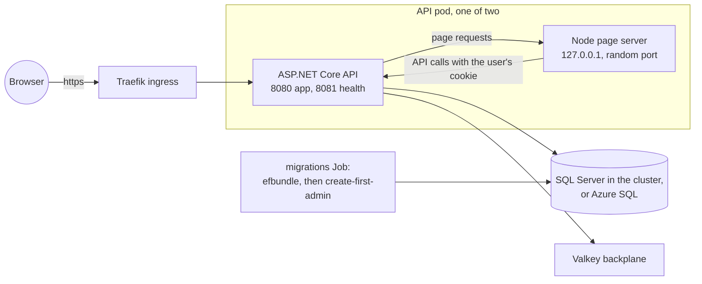
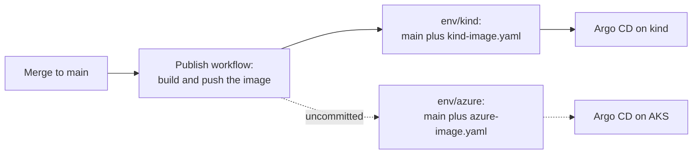

# Review notes: from server-side rendering to Azure

> **Start here:** [overview.md](overview.md) explains every technology, what it does and why it was chosen, in plain terms, and links back to these documents. Each merge also gets its own review (`pr-<number>-….md`, below).

These notes are for reviewing everything from server-side rendering onwards: from the base commit `d3df88b` (the merge of #41) to the working tree of `feature/azure` as it stood on 15 November 2026. That's:
- **Pull requests #42 to #50,** all merged to `main` on 15 November 2026: 224 files, 9,054 lines added and 285 removed (`git diff --stat d3df88b main`).
- **The Azure work on `feature/azure`,** uncommitted when these notes were written, and since merged via #52. It's written, but has never been deployed.

**Since then:** many of the risks these notes raise were fixed in two pull requests, each with its own review: #51 for server-side rendering ([pr-51-ssr-security-fixes.md](pr-51-ssr-security-fixes.md)), and #52 for Azure, the deploys and the chart ([pr-52-azure.md](pr-52-azure.md)). So some risks below, and in "Read these first", are already fixed; those reviews say which.

Each document says what changed and why, how it works, the decisions and their trade-offs, how it was checked and what wasn't, the risks, and where to look most closely. They don't replace reading the riskiest code; they point at it.

## The documents

| Document | Covers | Pull requests | Status | Highest risk |
|---|---|---|---|---|
| [server-side-rendering.md](server-side-rendering.md) | The Node page server the API hosts, hydration, route loaders, the dev server | #42, #43 (dev fix) | Merged | High |
| [container-image.md](container-image.md) | `MedApp.API/Dockerfile`, `.dockerignore`, the AppHost's publish | #45, #47 (the migrations bundle) | Merged | Medium |
| [kubernetes.md](kubernetes.md) | The kind cluster, the Helm chart, and locking it down | #46, #47, #48, and the chart parts of #49 and #50 | Merged; `deploy/versions.sh` merged via #52 | Medium |
| [gitops.md](gitops.md) | Argo CD, the Publish workflow, environment branches | #49, and `deploy-to-env.sh` in #52 | Merged (#49, #52) | High (then uncommitted, fixed in #52), Medium (merged) |
| [signalr-backplane.md](signalr-backplane.md) | Valkey as the SignalR backplane, WebSocket-only connections | #50 | Merged | Low to medium |
| [azure.md](azure.md) | Bicep, the cluster's set-up, Azure's values, the `azure` job | #52 | Merged via #52, never deployed | Medium, with many first-run unknowns |
| [app-changes.md](app-changes.md) | `create-first-admin`, health checks, HSTS, mappers, test coverage | #43, #44, #48 | Merged | Medium |
| [pr-51-ssr-security-fixes.md](pr-51-ssr-security-fixes.md) | The review of #51: the fixes to server-side rendering and password changes | #51 | Merged | Low (6 low findings) |
| [pr-52-azure.md](pr-52-azure.md) | The review of #52: the Azure setup and the deploy, chart and Azure fixes, with how each finding was resolved | #52 | Merged | High (deploys refused after a workflow change; fixed in #52) |
| [pr-53-generated-first-password.md](pr-53-generated-first-password.md) | The review of #53: the generated first password that replaced `DefaultPassword1` | #53 | Merged | Medium (accessibility, and accounts that still have the old password) |
| [pr-54-project-handbook.md](pr-54-project-handbook.md) | The review of #54: the architecture handbook, its roadmap, and the record of choices | #54 | Merged | High (fixed in the review pass) |
| [pr-55-my-tasks-favourite-tag.md](pr-55-my-tasks-favourite-tag.md) | The review of #55: no favourite name beside the star on My Tasks, and the plain-language format for review documents | #55 | Merged | Medium (a personal detail in the public `AGENTS.md`; fixed before merging) |
| [pr-56-standard-review-format.md](pr-56-standard-review-format.md) | The review of #56: a standard, neutral format for review documents | #56 | Merged | Medium (nothing committed git-ignores the local file the format points to; the #55 review keeps the framing this PR removes) |
| [pr-57-todo-features.md](pr-57-todo-features.md) | The review of #57: seven new features and a long-term platform goal in the to-do list | #57 | Merged | Medium (the items repeat the roadmap without its prerequisites; the email, timeline and attachment items leave out reset-link, access and upload safeguards) |
| [pr-58-duplicate-favourite-labels.md](pr-58-duplicate-favourite-labels.md) | The review of #58: no duplicate quick filter label beside the star on Stage definitions, Templates and the procedures lists | #58 | Merged | Low (the setup lists' "All" repeats no token; a saved search matching a quick filter is named differently on screen and to screen readers; the documented rule doesn't match which lists opt in) |
| [pr-59-force-password-change.md](pr-59-force-password-change.md) | The review of #59: a forced change of every password an admin generates, `SetRolesAsync`'s retries, and an all-or-nothing `create_user` in medapp-dev | #59 | Merged | Medium (a page already open when its user's password is reset isn't sent to change it, and keeps its live connection; signing in again from a browser holding such a session is refused as "Invalid credentials") |
| [pr-60-clinical-safety.md](pr-60-clinical-safety.md) | The review of #60: the draft clinical safety file (DCB0129 and DCB0160) and the medical device decision | #60 | Merged | Medium (the consequence scale isn't DCB0129's; My Tasks hides started work, and deleting a leaver orphans their procedures, weakening controls the hazard log relies on) |
| [pr-61-gdpr-pack.md](pr-61-gdpr-pack.md) | The review of #61: the draft data protection and information governance pack in `docs/governance/` | #61 | Merged | Medium (the DPIA's go-live gate leaves the wrong-patient risk high; the patient notice says data never leaves the UK; contract terms a small supplier can't keep; the breach procedure's shutdown is undone by Argo CD) |
| [pr-62-utc-times.md](pr-62-utc-times.md) | The review of #62: times sent and read as UTC, so they aren't shown an hour out in summer | #62 | Merged | Low (a local time written to the database would be stored unconverted; two new .NET tests can't fail for the reason they give; the docs don't say what `dueDateUtc` is) |
| [pr-63-accessibility-fixes.md](pr-63-accessibility-fixes.md) | The review of #63: a session timeout warning with session extension (to 24 hours at most), Ctrl+S to save, a warning on unreadable custom colours, and more screen reader announcements | #63 | Merged | Medium (the colour check measures only the main text, so grey secondary text can be unreadable without a warning; the docs, the cookie notice and hazard H-18 still say sessions last a fixed 8 hours) |
| [pr-64-patient-timeline.md](pr-64-patient-timeline.md) | The review of #64: a patient timeline built from the procedure audit log, trimmed on the server for staff, with what's due, filters and cursor paging | #64 | Merged | Medium (the governance pack still says only admins can see change history; cancelling a blocked procedure is filed under Blocks; entries from one action show in random order) |
| [pr-65-integration-e2e-tests.md](pr-65-integration-e2e-tests.md) | The review of #65: 182 integration tests (the real API against SQL Server in Docker), 11 Playwright journeys against the production image, and the `integration-tests` and `e2e` CI jobs | #65 | Merged | Medium (5 of the 6 "no roles" authorisation rows are passed by the forced password change, not the Staff policy; the end-to-end suite skips, green, without credentials, and the by-hand workflow's secrets don't exist; neither new job is a required check) |
| [pr-66-admin-insights.md](pr-66-admin-insights.md) | The review of #66: an admin Insights page (headline counts against last week, overdue work by assignee and priority, time at each stage, created against completed per UK week), a "nobody assigned" procedure filter, and Recharts chart composites | #66 | Open | Medium (the links ignore a list that starts on "Assigned to me"; "Completed this week" opens every completed procedure; last week's overdue count uses today's due dates; last week's statuses read the whole audit history on every load); all fixed on the branch |
| [pr-67-security-baseline.md](pr-67-security-baseline.md) | The review of #67: a security baseline (security headers and a nonce-based page CSP, the `__Host-` session cookie, sign-in throttling, sessions ended on password, reset and role changes and "Sign out everywhere", a common-password list, CI supply chain checks, a STRIDE threat model and an ASVS 5.0 Level 2 checklist) | #67 | Open | High (`dependency-review` fails on every pull request because the repository's dependency graph is off, so the gate the documents count on does nothing); medium: the per-username sign-in counter keeps names of any length, enough to run a pod out of memory; a role change now signs the user out, against the stated scope |
| [pr-68-privacy-features.md](pr-68-privacy-features.md) | The review of #68: an activity log of reads and changes with an access report per patient, a subject access export, Restricted and Disputed flags, anonymisation in place, a retention review list, and clearing browser storage at sign-out | #68 | Open | Medium (pinned patients and procedures are logged as viewed though nobody opened them; some reads, like the procedure lists, aren't logged although the DPIA says every read is; the retention review lists specialty records years early; restricting a record freezes treatment under way, with no hazard; the JSON export gives the patient staff network addresses); all fixed on the branch (sign-in rate limiting left to PR #67, and purging sign-in events to a scheduled job still to build) |
| [pr-69-nhs-integrations.md](pr-69-nhs-integrations.md) | The review of #69: an optional NHS number (Modulus 11, unique, searchable, exported and anonymised), the patient banner, a read-only FHIR R4 UK Core Patient API, SNOMED CT codes on stage definitions, and a demographics (PDS) lookup with an offline stub | #69 | Open | Medium (Edit Patient, where a patient's identity changes, has no banner; a race logs the NHS number; the lookup's details outlive a changed number; placeholder numbers pass the check); all fixed on the branch |
| [pr-84-admin-monitoring.md](pr-84-admin-monitoring.md) | The review of #84: admins' monitoring rules (a person or anyone, one of eight procedure events, optional priority, template and stage conditions, an on/off switch), notification kinds 10 to 17, the Monitoring page, and each person's switch for assignment notifications | #84 | Open | Medium (a rule naming a deleted account, template or stage can't be switched off or edited; switching off assignment notifications weakens hazard H-09's control, and the hazard log isn't updated; patients' exports now carry admins' monitoring notifications; the staff rights procedure and the customer's record of processing don't cover monitoring) |

## How the risks are graded

- **Critical:** loses or exposes data, or breaks `main` or a deploy, now. Stop and fix it first.
- **High:** breaks something on a normal path (a deploy, or the fallback the design relies on), or exposes data. Fix before relying on it.
- **Medium:** breaks or misleads in a plausible situation (an incident, a rollback, a first Azure run). Fix it, or accept it knowingly.
- **Low:** hardening, polish, or documentation that has drifted from the code.

## Read these first

1. **High: the SSR fallback fails when it's needed.** The `HttpClient` that forwards pages to Node inherits ServiceDefaults' standard resilience handler. Measured: a failing render is retried 3 times (11 s, then the 500 reaches the browser); a slow one is cut at 10 s and rendered again; and under concurrent failures the circuit breaker throws an exception `SsrPages` doesn't catch, so every page returns 500 instead of the client-rendered app. [SSR, risk 1](server-side-rendering.md#risks-and-open-questions)
2. **High, before committing: the new scripts would lose their executable bit.** This checkout has `core.fileMode=false`, so `.github/scripts/deploy-to-env.sh` would be committed non-executable, and the first Publish run after merging would fail at the kind deploy. Because the `azure` job depends on the job that deploys kind, any kind failure also stops Azure deploys. [GitOps, risks 1 and 4](gitops.md#risks-and-open-questions)
3. **Medium: a rollback by `git revert -m 1` doesn't stick.** The next deploy moves the image forward but keeps the reverted chart, silently. Simulated in a scratch repository. [GitOps, risk 2](gitops.md#risks-and-open-questions)
4. **Medium: CI isn't a merge gate, and every merge deploys.** `main`'s ruleset requires a pull request but no status checks. Once Azure is set up, every merge would also deploy there, with no approval step. [GitOps, risk 3](gitops.md#risks-and-open-questions); [Azure, risk 8](azure.md#security-and-operations)
5. **Medium: server-rendered pages carry patient data, with no `Cache-Control`; and the Node renderer inherits the API's secrets** (the database connection string among them). [SSR, risks 2 and 3](server-side-rendering.md#risks-and-open-questions)
6. **Medium: Azure has first-run unknowns.** AKS's identity gets its subnet role only after the cluster exists; Key Vault's name can't be reused for 90 days after a teardown; EF Core has no retries against a serverless database that pauses; the AKS API server is public; and a changed password breaks the app until pods restart. [Azure](azure.md#risks-and-open-questions)
7. **Medium: health checks see nothing but the process.** Readiness ignores the database and Valkey, and a dead Node renderer is neither visible nor restarted. [Kubernetes, risk 1](kubernetes.md#risks-and-open-questions); [SSR, risk 4](server-side-rendering.md#risks-and-open-questions)
8. **Medium: two API copies, with per-pod data-protection keys and nothing spreading them across nodes.** Harmless today, a trap for the next feature that protects data across requests, and a single-node failure risk on Azure. [Kubernetes, risks 2 and 3](kubernetes.md#risks-and-open-questions)
9. **Medium: CI builds neither the image nor the SSR bundle,** so a break in either shows up only after merge, in the Publish workflow. [Image, risk 1](container-image.md#risks-and-open-questions); [SSR, risk 8](server-side-rendering.md#risks-and-open-questions)
10. **Medium, local only: `up.sh --argocd --revision` leaves the image pinned** after switching back to `env/kind`. [GitOps, risk 5](gitops.md#risks-and-open-questions)
11. **Medium: the wiring excluded from coverage is where the worst bug sits.** No test runs the real pipeline. [App changes, risk 1](app-changes.md#risks-and-open-questions)

## The whole picture

At run time, in Kubernetes:

From a merge to a running cluster:

## What was checked, and where

| Area | Unit tests | CI | By hand on kind | On Azure |
|---|---|---|---|---|
| Server-side rendering | Yes, web and .NET | Tests only, not the SSR build | Yes (#42 in production mode, #45, #47) | No |
| Container image | No | No; Publish builds it after merge | Yes | No |
| Chart and lockdown | No (lint and render only) | `helm lint --strict`, render | Yes, including a network policy matrix (#48) | No |
| Argo CD and Publish | No | Publish ran green twice, after merge | Yes (#49) | No |
| Backplane | Yes | Yes | Yes, with a control (#50) | No |
| Azure | No | Bicep build and lint, once committed | Not applicable | Never deployed |
| App code | Yes | Yes | Yes | No |

## Checks run for these notes

On 15 November 2026, against the working tree:
- `dotnet test MedApp.UnitTests -c Release`: 708 passed. `npm test` in `MedApp.Web`: 666 passed.
- `helm lint --strict` with the chart's defaults, kind's values and Azure's: all pass. The chart rendered with Azure's values was read through.
- Bicep CLI 0.49.2: `main.bicep` builds and lints with no warnings; `main.bicepparam` builds with placeholder passwords.
- A scratch harness, outside the repository, called the real `SsrPages.Handle` with the API's real service registration, against a fake renderer. That's where the resilience findings come from.
- A scratch git repository simulated a deploy, a `git revert -m 1` rollback and the next deploy.
- A read-only look at the kind cluster: pods, ExternalSecrets, network policies, the API's logs, and a page's response headers.
- The GitHub API: `main`'s ruleset, the rules on `env/kind`, the Publish runs, and an anonymous pull of the published image.

Nothing in the repository was changed apart from these notes, and nothing was run against Azure.

## Docs that disagree with the code

- `deploy/argocd/README.md:19` and `deploy/argocd/medapp-kind.yaml:7`: rollback by revert "rolls back the chart and the image together". True for that deploy, not for the next one ([GitOps, risk 2](gitops.md#risks-and-open-questions)).
- `deploy/azure/traefik-values.yaml:1-2`: says Let's Encrypt's challenges are excepted from the https redirect; nothing configures that.
- `deploy/kind/up.sh:186`: "Back to one copy"; kind runs two.
- `deploy/kind/traefik-values.yaml:2-3`: "There's no TLS locally"; https://localhost:8443 has a certificate since #48.
- `deploy/helm/medapp/README.md:87-89`: Argo CD is still "Not yet". Line 76 leaves Valkey out of what the API reaches.
- `MedApp.Web/server/server.mjs:6, 15`: name `SsrHost`; the class is `SsrServer`.
- `MedApp.API/Common/Extensions/ApplicationBuilderExtensions.cs:37`: the AppHost no longer copies the app into `wwwroot`; the Dockerfile builds it.
- `MedApp.API/ServerRendering/SsrOptions.cs:21-22`: `RenderTimeout` reads as the time a render may take; the resilience handler cuts each attempt at 10 s and retries.
- #47 listed shared data-protection keys as a prerequisite for more than one API copy; #48 removed the line without a replacement, and #50 went to two copies.

## Not covered here

- A line-by-line hunt for bugs; a separate review does that. Problems noticed along the way are recorded in the relevant document.
- The React app's feature code, which this work touched only for loaders, settings and tests.
- `tools/ui-parity`, beyond the change SSR forced (a dedicated `dev-parity` account whose saved settings each screen sets).
