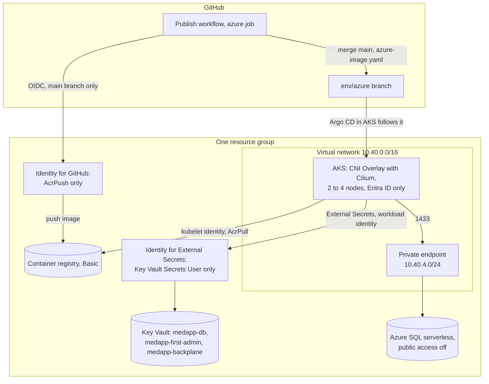

# Review: Azure

**Status: uncommitted on `feature/azure`, and never deployed.** It's written and has been compiled and linted, but it has never run against a subscription. No Azure resource exists, the `env/azure` branch doesn't exist, and the Publish workflow's `azure` job has never run.

Files: `deploy/azure/` (`README.md`, `main.bicep`, `main.bicepparam`, `deploy.sh`, `bootstrap.sh`, `cluster.yaml`, `values.yaml`, `traefik-values.yaml`, `argocd-values.yaml`), `deploy/argocd/medapp-azure.yaml`, `deploy/versions.sh`, `.github/scripts/deploy-to-env.sh`, the `azure` job in `.github/workflows/publish.yml`, two new steps in the `helm` job of `.github/workflows/main.yml`, and updates to `AGENTS.md` and `docs/todo.md`.

## Why

Step 5 of the Kubernetes plan in `docs/todo.md`: "Azure for hosting: AKS, Azure SQL, Key Vault for the secrets, and a container registry." The aim is to run the same chart, deployed the same way (Argo CD following an environment branch), with Azure's managed services in place of kind's stand-ins.

## What it makes

`main.bicep`, in one resource group:
- **Network** (lines 80-113): a `/16` with a subnet for AKS's nodes and one for private endpoints.
- **AKS** (lines 131-191): Azure CNI Overlay with Cilium as dataplane and network policy, workload identity and the OIDC issuer, Entra ID sign-in only (local accounts off, Azure RBAC, the admin group as cluster admins), the `patch` upgrade channel and automatic node images, autoscaling from 2 to 4 `Standard_D2s_v5` nodes, Free tier by default.
- **Container registry** (lines 117-127): Basic, no admin user. AKS pulls with its kubelet identity (`AcrPull`).
- **Azure SQL** (lines 228-317): serverless General Purpose, 1 vCore, pausing after 60 idle minutes; public network access off, reachable through a private endpoint with a private DNS zone; the admin group as Entra admin, with SQL authentication still on.
- **Key Vault** (lines 321-371): RBAC, soft delete and purge protection. Bicep writes the chart's three secrets as JSON, including the connection string built from the SQL admin login and password (line 344).
- **Identities** (lines 376-425): one for External Secrets, federated with its service account in AKS, which may only read secrets; one for GitHub Actions, federated with `repo:Aliator/MedApp:ref:refs/heads/main`, which may only push to the registry.

`bootstrap.sh` then sets up the cluster, with the same chart versions as kind (`deploy/versions.sh`): Traefik with a public IP and an http-to-https redirect, cert-manager with a Let's Encrypt issuer, External Secrets with workload identity and a ClusterSecretStore for Key Vault (`cluster.yaml`), and Argo CD following `env/azure`, with its UI reachable only by port-forward.

MedApp's values (`deploy/azure/values.yaml`): two API copies with Valkey in the cluster, no in-cluster SQL Server, every secret from Key Vault, Let's Encrypt TLS, and an egress rule letting the API and the migrations Job reach the private endpoint's subnet on 1433.

## How a deploy would go

1. Fill in `main.bicepparam` (the admin group's object ID and name; `environmentName` defaults to `prod`), and set `ingress.host` in `values.yaml`, merged to `main`.
2. Export the three passwords (`MEDAPP_SQL_ADMIN_PASSWORD`, `MEDAPP_FIRST_ADMIN_PASSWORD`, `MEDAPP_BACKPLANE_PASSWORD`). `main.bicepparam` reads them with `readEnvironmentVariable`, so they never touch a file.
3. `deploy/azure/deploy.sh <resource group> [location]`: runs `what-if`, asks, deploys, then prints the four repository variables.
4. `deploy/azure/bootstrap.sh <resource group> <email>`: gets Entra ID credentials through kubelogin, installs the cluster services, applies `cluster.yaml` (with `sed` filling in the email and the vault's address) and the Argo CD Application, and prints the ingress IP for DNS.
5. Set the repository variables. From then on, each merge runs the `azure` job (`publish.yml:57-86`): sign in with OIDC, copy the image from GHCR to the registry with `docker buildx imagetools create` (the same digest, not a rebuild), then `deploy-to-env.sh env/azure` with `deploy/argocd/azure-image.yaml`. Until the variables are set, the job is skipped.
6. Argo CD syncs: the ExternalSecrets fill the three Secrets from Key Vault, then Valkey, then the migrations Job (which creates the schema and the first admin), then the API.

## Design decisions

- **The same chart and the same delivery as kind.** Only values change. That's the point of building kind first, and it keeps the Azure-only surface to Bicep, two scripts and a values file.
- **Cilium for network policies.** The chart depends on NetworkPolicies being enforced. Microsoft's AKS docs say Azure's own Network Policy Manager can no longer be enabled on new subscriptions, so Cilium is the supported choice for Linux nodes.
- **No stored credentials.** GitHub signs in with OIDC to an identity that can only push images, from `main` only. External Secrets uses workload identity. Kubernetes access is Entra ID only, with no shared admin certificate.
- **Private SQL.** Public network access is off; only the virtual network reaches the database. Microsoft's docs say private endpoints on the Default connection policy use the Proxy policy on port 1433, which is exactly what the network policy allows. If someone switches to Redirect for latency, the egress rule needs ports 1433 to 65535.
- **Costs kept low:** AKS Free tier, serverless SQL that pauses, a Basic registry. The README's figures add up to roughly £150 to £190 a month on the Free tier (two nodes about £120, the database £5 to £40, the load balancer about £20, the rest a few pounds). They're its own estimates, not checked here.
- **Copy the image, don't rebuild it,** so the digest running on Azure is the one tested on kind.
- **What-if and a prompt before every deploy,** in `deploy.sh`.
- **Known gaps, listed in the README's "Not yet":** passwordless SQL with a contained user for the API's identity, a least-privilege database user, private endpoints for the registry and Key Vault, monitoring, and backups beyond Azure SQL's own.

## How it was checked

- **In CI (once committed):** `az bicep build`, `az bicep lint` and `az bicep build-params` with placeholder passwords, and `helm lint --strict` with Azure's values (`main.yml:76-90`). None of this has run in GitHub yet.
- **Locally, for this review:** Bicep CLI 0.49.2 builds and lints `main.bicep` with no warnings, and builds the parameters file. `helm lint --strict` passes with Azure's values. Rendered with them, the chart has no SQL Server, three ExternalSecrets against `azure-key-vault`, the egress rule to `10.40.4.0/24` on 1433 for both the API and the Job, two API copies and a PodDisruptionBudget.

Not checked: everything else. `what-if` has never run, the scripts have never run, the `azure` job has never run, and the costs are estimates.

## Risks and open questions

### Likely to come up on the first run

1. **Medium: AKS's identity gets its subnet role after the cluster exists.** The cluster uses a system-assigned identity, so `Network Contributor` on its subnet (`main.bicep:194-202`) can only be granted once the cluster has been made. Microsoft's AKS networking docs say the cluster identity needs that role on a subnet you manage. It may well work, since the grant comes in the same deployment, but a user-assigned identity granted before the cluster is the usual way to avoid the question. Watch this, and Traefik's load balancer, on the first run.
2. **Medium: a teardown and redeploy under the same names fails for 90 days.** Key Vault has purge protection, and its name comes from the resource group's ID (`take(uniqueString(resourceGroup().id), 6)`, line 64). After `az group delete`, redeploying to a resource group of the same name tries to create a vault whose name the soft-deleted one still holds. The README says the name can't be reused; it doesn't say the deploy fails. Use another resource group or `environmentName`, or recover the vault.
3. **Medium: no retries for transient SQL errors, against a database that pauses.** EF Core uses plain `UseSqlServer` (`MedApp.Infrastructure/Common/Extensions/ServiceExtensions.cs:37-39`), with no `EnableRetryOnFailure`. The serverless database pauses after an hour idle and takes about a minute to wake, and Azure SQL has short failovers too. The first requests after a quiet hour would fail, and the readiness probe wouldn't notice. The migrations Job's six retries probably cover a wake-up there. `EnableRetryOnFailure` needs an execution strategy around user-started transactions (`IdentityTransactions`), so it's not a one-line change.
4. **Low: names can break.** `environmentName` allows 8 characters (lines 13-14), but `kv-medapp-<environment>-<6 characters>` is then 25 characters, one over Key Vault's limit of 24. The registry's name must be letters and digits only (line 62), so a hyphen in `environmentName` breaks it. Nothing validates either; `prod` works.
5. **Low: the redirect comment promises an exception that isn't configured.** `deploy/azure/traefik-values.yaml:1-2` says http redirects to https "except Let's Encrypt's challenges". The values redirect the whole `web` entry point. It should still work, because Let's Encrypt follows a redirect to https and doesn't check the certificate there, but it's worth watching for the first certificate.
6. **Low: the ingress host is a placeholder** (`values.yaml:11`, `medapp.example.com`). The README says to change and merge it first; if not, cert-manager can't prove the domain.
7. **Low: the ingress IP isn't reserved.** It belongs to Traefik's Service, so reinstalling Traefik could change it and leave DNS pointing nowhere. A static public IP from Bicep, given to Traefik, would pin it.

### Security and operations

8. **Medium: every merge would deploy to Azure, with no approval.** Once the variables are set, the `azure` job runs on every push to `main`, with no GitHub environment or required reviewer, and `main` doesn't require CI to pass ([gitops.md](gitops.md), risk 3). For anything holding real patient data, a protected environment is the usual answer. Adding one changes the OIDC subject to `environment:<name>`, so the federated credential (`main.bicep:407-415`) has to change with it.
9. **Medium: Azure deploys depend on the kind deploy.** The `azure` job needs the `image` job, which ends with the kind deploy ([gitops.md](gitops.md), risk 4). The executable-bit problem ([gitops.md](gitops.md), risk 1) would block the first Azure deploy too.
10. **Medium: the AKS API server is public.** There's no `apiServerAccessProfile`, so the Kubernetes API is reachable from the internet, behind Entra ID. Authorised IP ranges or a private cluster aren't in the README's "Not yet".
11. **Medium: the app signs in as the SQL server's admin.** Documented in "Not yet". A compromised API pod (or the Node renderer, which inherits the connection string: [server-side-rendering.md](server-side-rendering.md), risk 3) has full control of the server.
12. **Medium: a changed password breaks the app until the pods restart.** Every `deploy.sh` run sets the SQL admin password and Key Vault's secrets from the environment variables. If one differs from last time, the SQL login changes at once; External Secrets updates the Kubernetes Secret within the hour (`refreshInterval`); and the API and Valkey only read their Secrets when they start. Nothing restarts them when a Secret changes. The README says to use the same passwords each time, but not what happens if you don't.
13. **Low to medium: client addresses are lost.** Traefik's Service keeps the default `externalTrafficPolicy: Cluster`, so traffic arrives from a node's address. Sign-in records `RemoteIpAddress` on the session (`MedApp.API/Controllers/AuthController.cs:51`), which would be the node's. `externalTrafficPolicy: Local` keeps the client's.
14. **Low to medium: backups.** Backup storage is locally redundant, with Azure SQL's default 7 days of point-in-time restore (README, "Not yet"). For medical records, retention is likely a compliance question as much as a technical one.
15. **Low: Key Vault and the registry have public endpoints,** behind Entra ID (README, "Not yet": private endpoints need the registry's Premium tier).
16. **Low: the next step needs network policy work.** Passwordless SQL means the API calling Entra ID for tokens, and a standard NetworkPolicy can't allow a host by name. It'll need a Cilium FQDN policy, or a broad egress rule on 443.
17. **Low: one Traefik pod.** The Traefik chart's default is one replica, and AKS patches itself with no maintenance window set, so node upgrades briefly take the ingress down.
18. **Low: release-name coupling.** Key Vault's backplane connection string hard-codes `medapp-valkey:6379` (line 368), which only holds while the Helm release is called `medapp`.
19. **Open question: the image copy needs GHCR to stay public.** The `azure` job reads the image from GHCR without signing in to it, and doesn't grant `packages: read`.
20. **Open question: MediatR's licence.** On kind, the API logs: "You do not have a valid license key for the Lucky Penny software MediatR ... If you are running in production you are required to have a licensed version." Azure would be production. This predates the work, but deploying makes it real.

## Where to look closely

- `deploy/azure/main.bicep:131-224` (AKS and its role assignments), `:228-317` (SQL and its private endpoint), `:321-371` (Key Vault and the secrets), `:376-425` (identities and federation).
- `deploy/azure/bootstrap.sh:27-58` and `deploy/azure/cluster.yaml:22-33`: credentials, the cluster services and the Key Vault store.
- `deploy/azure/values.yaml:31-41`: the egress rule for the private endpoint.
- `.github/workflows/publish.yml:57-86` and `.github/workflows/main.yml:76-90`.
- `deploy/azure/README.md`: the deploy steps and "Not yet", against the risks above.
