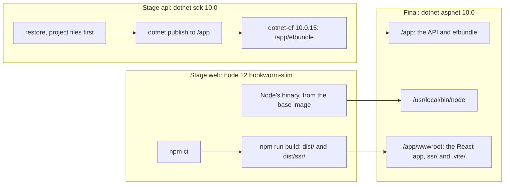

# Review: the container image

**Pull requests:** #45 (Node in the API's image), plus the migrations bundle added in #47. **Status:** merged to `main`.

`MedApp.API/Dockerfile` builds one image with the API, the built React app and its page server in `wwwroot`, Node's binary, and the EF migrations bundle. Everything downstream runs it: kind (`deploy/kind/up.sh`), the Helm chart's API and migrations Job, the Publish workflow and Argo CD.

## Why

Before #45, the AppHost published the API with `PublishWithContainerFiles`: a .NET-only image. Since #42 the API starts Node to render pages, so in that image SSR quietly fell back to client rendering (#42 noted it in `docs/todo.md`). Then #47 needed the migrations to run as a Kubernetes Job from the same build as the API, so the schema always matches the code.

## What changed

| Where | What |
|---|---|
| `MedApp.API/Dockerfile` | Three stages: build the React app and page server with Node, publish the API and build the migrations bundle with the .NET SDK, then copy both onto the `aspnet` runtime with Node's binary. |
| `.dockerignore` | Keeps Windows `node_modules`, build output, `.env` files, IDE state, `tools/`, `docs/`, `deploy/`, the tests and the deprecated client out of the build context. Excludes Dockerfiles too (#47), so editing a comment in one doesn't change the image. |
| `MedApp.AppHost/AppHost.cs:35-36` | On publish, the API is built from the Dockerfile with the repo root as context (`PublishAsDockerFile`), replacing `PublishWithContainerFiles`. The Vite dev server is left out of the manifest (`ExcludeFromManifest`). |
| `AGENTS.md`, `MedApp.Web/README.md` | Describe the image, including "if you change which projects the API references, update the Dockerfile's `COPY` lines too". |

## How it's built

- **Stage `web`** (`Dockerfile:16-21`): `npm ci` with a cache mount, then `npm run build`, which type-checks, builds the client, builds the server entry with every package bundled in, and copies `server.mjs` into `dist/ssr/`.
- **Stage `api`** (`Dockerfile:24-46`): restores from the six project files first, so the restore layer is cached until they change. Then it publishes for Release, installs `dotnet-ef` at a pinned version and builds the migrations bundle.
- **Final** (`Dockerfile:49-58`): the `aspnet` runtime, Node's binary from the `web` stage, the published API and `dist/` as `wwwroot`. It runs as the image's non-root user (`$APP_UID`, 1654) on port 8080, with TLS ended in front of it.
- **The migrations Job** overrides the command: `sh -c '/app/efbundle --connection ... && exec dotnet /app/MedApp.API.dll create-first-admin'` (`deploy/helm/medapp/templates/migrations-job.yaml:41-45`). The bundle unpacks into `/tmp`, because the root filesystem is read-only.

Who builds it:
- `deploy/kind/up.sh:162-167`: locally, tagged `local-<first 12 of the image ID>`, so an unchanged rebuild keeps its tag and Helm doesn't roll it out.
- `.github/workflows/publish.yml:40-50`: on each merge to `main`, pushed to `ghcr.io/aliator/medapp-api:<commit>`, with the GitHub Actions build cache.
- The AppHost, when publishing an Aspire manifest.

## Design decisions

- **Node's binary copied into the .NET runtime image,** rather than installing Node with a package manager or starting from a Node image and adding .NET. It keeps the image to the .NET runtime plus one file. The cost is an implicit dependency: the binary from a Debian bookworm image has to find the C and C++ libraries it needs in the `aspnet` image. It works today (the image was built and run), but nothing checks it.
- **One image for the API and its migrations.** The bundle is built from the same commit as the API, so the Job can't apply a different schema. The alternatives were migrating at start-up (`AGENTS.md`: migrations are not applied at start-up) or a separate migrations image, which could drift.
- **The repo root as build context,** because the image needs the API's projects and `MedApp.Web`. The `.dockerignore` keeps the context small and free of Windows build output and local secrets.
- **Never `latest`.** The chart fails without `image.tag` (`deploy/helm/medapp/templates/_helpers.tpl:26-31`), so each release names what it runs.

## How it was verified

- **PR #45:** built the image and ran it against the dev database. The API started Node, `/patients` came back server-rendered with its rows, signing out redirected to `/login`, an unknown `/api` path was a 404, and `/ssr/server.mjs` wasn't served. The Aspire manifest builds `api` from the Dockerfile with the repo root as context and port 8080. The AppHost still ran in development.
- **PR #47 onwards:** the image runs on kind, including the migrations bundle on an empty database and after a demo restore.
- **Publish:** the workflow built and pushed it on the merges of #49 and #50 (both runs green). For this review, an anonymous request for the manifest of `ghcr.io/aliator/medapp-api:6cd0aa3…` returned 200, so the package is public.

Not verified:
- PR CI never builds the image (see risk 1).
- No vulnerability scan, SBOM or signature.
- Only `linux/amd64` is built; the bundle is architecture-specific.

## Risks and open questions

1. **Medium: CI doesn't build the image.** `.github/workflows/main.yml` has no Docker build. A change that breaks it, such as a new project reference without a matching `COPY` line (the risk `AGENTS.md` warns about), passes PR checks and fails in the Publish workflow after merge, which blocks every deploy until it's fixed. A PR job that builds without pushing would catch it, and the GitHub Actions cache keeps it fast.
2. **Low: floating base images.** `node:22-bookworm-slim`, `dotnet/sdk:10.0` and `dotnet/aspnet:10.0` move. Two builds of one commit can differ, and security fixes only arrive when something merges. A quiet `main` keeps running old base layers. Pinning digests with Dependabot or Renovate, or a scheduled rebuild, would address both.
3. **Low: three Node versions.** The image uses Node 22 (`Dockerfile:12`), CI's web job Node 24 (`main.yml:21`), and developers whatever they have. The SSR bundle is tested on 24 and runs on 22.
4. **Low: the runtime image is load-bearing in two ways nothing tests.** Node's binary relies on the `aspnet` image's libraries, and the migrations Job relies on its shell (`sh -c`). Moving to a chiseled or Alpine runtime image would break the Job outright, and Node quietly: the API would log that it couldn't start Node and serve client-rendered pages.
5. **Low: `dotnet-ef` is pinned by hand** to 10.0.15 (`Dockerfile:43`), matching the EF Core packages. They need to move together.
6. **Low: the image is public.** Anyone can pull it, as anyone can read the repository. It holds no secrets: `appsettings*.json` have no connection strings, and `.env` files are excluded. But kind's Argo CD set-up, and the uncommitted Azure job's copy step, both rely on it staying public.
7. **Low: images pile up.** One per merge on GHCR, with no clean-up.

## Where to look closely

- `MedApp.API/Dockerfile:12-58`, especially the `COPY` list (lines 26-39) against the API's project references, and the bundle (lines 43-46).
- `.dockerignore`: what's in the build context, and so what could leak into an image.
- `MedApp.AppHost/AppHost.cs:35-36`.
