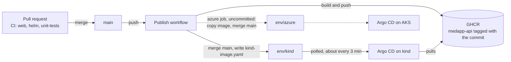

# Review: GitOps (Argo CD, the Publish workflow and environment branches)

**Pull requests:** #49 (Argo CD for kind, the Publish workflow, the `env/kind` branch), plus the chart's sync waves in the same PR. **Status:** merged to `main`. On `feature/azure`, uncommitted: `.github/scripts/deploy-to-env.sh` (the environment-branch step, moved out of the workflow so kind and Azure share it), the Publish workflow's `azure` job and `deploy/argocd/medapp-azure.yaml`. The Azure side is reviewed in [azure.md](azure.md).

## Why

Step 4 of the Kubernetes plan in `docs/todo.md`: "Argo CD for continuous delivery: the cluster follows the chart and its values in git." With it, the kind cluster runs exactly what git says, and nothing deploys from anyone's machine.

## How a merge deploys



1. **Merge to `main`.** `main` only changes through pull requests (its ruleset).
2. **Publish** (`.github/workflows/publish.yml`), on every push to `main` except Markdown-only and `docs/`-only changes. It builds the image and pushes `ghcr.io/aliator/medapp-api:<commit>`. Runs are one at a time (`concurrency: publish`, not cancelled), so the branch ends on the newest commit; GitHub drops a waiting run when a newer one queues.
3. **Record the deploy** (`deploy-to-env.sh`, on `main` still inline in the workflow). *Since changed on `feature/azure`: the script no longer merges. Each deploy commit's files are exactly `main`'s at that commit plus the image file, with the branch's previous tip and the commit of `main` as its parents; see `deploy/argocd/README.md`.* As reviewed: It fetches `env/kind`, merges the commit of `main` into it with `--no-commit --no-ff`, writes `deploy/argocd/kind-image.yaml` (repository, tag = the commit, `IfNotPresent`), and commits "Deployed medapp-api abc1234 to kind" (lines 18-41). A re-run for a commit already there changes nothing and exits.
4. **Sync.** Argo CD notices the new commit and syncs, in waves: the Secrets (-1), SQL Server, Valkey and the rest (0), the migrations Job as a `Sync` hook (1), then the API (2). A failed migration stops the sync before the API changes.

The Application (`deploy/argocd/medapp-kind.yaml`) takes the chart from `deploy/helm/medapp` at `env/kind`, with `../../kind/values.yaml` and `../../argocd/kind-image.yaml` (`ignoreMissingValueFiles`, for branches without the image file). Sync is automated, with `prune` and `selfHeal`. The namespace is created with the `restricted` Pod Security labels, and the finalizer deletes what the Application deployed when it's deleted (SQL Server's volume claim stays, as a StatefulSet's always does).

Argo CD itself (`deploy/argocd/argocd-values.yaml`, chart 10.17.2, Argo CD v3.6.1) is plain http behind Traefik at http://argocd.localhost:8080, without single sign-on or notifications. `up.sh --argocd` installs it and applies the Application. `--revision <branch>` follows another branch, with the image `env/kind` runs now.

## Design decisions

- **An environment branch.** The PR gives two reasons, and the second was tried:
  - `main`'s ruleset only takes pull requests, so the workflow can't commit the image tag there.
  - Argo CD refuses an Application that takes the chart from `main` and the tag from another branch of the same repository ("cannot reference multiple revisions for the same repository").

  So `env/kind` carries the whole deployed state: the chart, the values and the image, from one commit. Its history is the deploy log, and the chart and image move together. Not discussed: Argo CD Image Updater, or a separate configuration repository. Both are common answers to the same problem; the branch keeps everything in one repository with no extra component.
- **Merge, not reset.** The branch keeps `main`'s history plus one "Deployed" commit per deploy, so `git log env/kind` reads as a deploy history. The price is in risk 2. *Since replaced on `feature/azure` by a commit that takes `main`'s tree as it is (still with both parents), so the history stays and the price goes.*
- **The commit as the image tag,** so the running image traces back to one commit of `main`.
- **Two ways to run kind that don't mix.** Plain `up.sh` builds locally (for uncommitted code and demo data); `up.sh --argocd` follows git. Each refuses while the other is in charge, and says how to hand over.

## How it was verified

- **#49 on kind, following `env/kind`:** Synced and Healthy; the ExternalSecrets, then SQL Server, then the migrations hook, then the API ran in that order; the app ran the image named on `env/kind`; the existing database kept its accounts, and the first-admin step left them alone; scaling the API to 0 by hand was undone by self-heal. Traefik had to report an ingress address (`deploy/kind/traefik-values.yaml:15-22`), or Argo CD would never count the Ingress healthy.
- **Publish in GitHub:** green on the merges of #49 and #50. `env/kind` has their "Deployed" commits (`2e9a004`, `1d4c33f`) and now names `ghcr.io/aliator/medapp-api:6cd0aa3…`, which GHCR serves without credentials. An earlier hand-made commit (`362b6de`) deployed a local test image before the workflow's first run.
- **For this review:** the rollback was simulated in a scratch repository (risk 2), and the repository's rules were read through the GitHub API (risk 3).

Not verified: a rollback on the real branch, a sync with a failing migration, and the uncommitted `deploy-to-env.sh` in Actions (it has never run).

## Risks and open questions

1. **High, for the uncommitted work: the new scripts would be committed without the executable bit.** This checkout has `core.fileMode=false`, so `git add` records new files as `100644` whatever their mode on disk. The workflow runs `.github/scripts/deploy-to-env.sh` directly (`publish.yml:53, 86`), which on the runner fails with "Permission denied". The kind deploy step would fail on the first merge, and the `azure` job, which needs that job, would be skipped. #46 hit the same with the kind scripts ("Kept LF line endings and the executable bit on the kind scripts"). Commit them with `git add --chmod=+x` (also `deploy/azure/deploy.sh` and `bootstrap.sh`), or call the script with `bash`.
2. **Medium: a rollback by `git revert -m 1` doesn't stay rolled back.** `deploy/argocd/README.md:19` and `medapp-kind.yaml:7` say reverting a deploy commit rolls back the chart and the image together. It does, for that moment. But the next deploy merges `main` again, and since the reverted commit is already part of `env/kind`'s history, git doesn't bring its changes back. The image file is rewritten every time, so the image moves on. Simulated:

   | Step | Chart on the branch | Image |
   |---|---|---|
   | Deploy C, which changes the chart | C's | C |
   | `git revert -m 1` that deploy | B's | B |
   | The next merge, D, deploys | **still B's** (`main` has C's) | D |

   The cluster then runs D's image with a chart that lacks C's changes, with nothing to say so, until someone reverts the revert. If C's chart change was something D's image needs (a setting, a port, a network policy rule), the deploy misbehaves. Options: tell people to revert the revert before the next deploy; have `deploy-to-env.sh` reset the deployed folders to `main`'s after merging (for example `git checkout "$commit" -- deploy/helm deploy/kind deploy/azure`), and fail if anything else differs; or roll back by deploying an older image only.

   *Fixed on `feature/azure`:* each deploy now writes `main`'s whole tree, so nothing on the branch survives a deploy. Rolling back is now a revert on `main` through a pull request; a hand commit to the branch is for emergencies only, and the next deploy replaces it. The `git revert -m 1` advice is gone from `deploy/argocd/README.md` and `medapp-kind.yaml`.
3. **Medium: nothing makes CI a merge gate.** `main`'s ruleset has three rules: no deletion, no force-push, and changes through a pull request (with no approvals required). No status checks are required, and there's no classic branch protection. Every merge deploys to kind, and once it's set up, to Azure. A pull request with red CI could be merged and deployed; only the repository's merge flow (`AGENTS.md`) waits for CI. Requiring the `web`, `helm` and `unit-tests` checks would make it a rule.
4. **Medium, for the uncommitted work: Azure deploys depend on the kind deploy.** The `azure` job `needs: image`, and the `image` job ends with the kind deploy. A failed kind deploy (risk 1, or a conflict on `env/kind` from a hand edit, which the script expects to fail on) stops Azure deploys too. Moving the kind deploy into its own job, with both deploy jobs needing only the image, would decouple them.
5. **Medium, local only: `up.sh --argocd --revision` leaves the image pinned.** It patches `spec.source.helm.parameters` (the image's repository and tag) onto the Application (`deploy/kind/up.sh:127-140`). Running `up.sh --argocd` again re-applies `medapp-kind.yaml` with client-side `kubectl apply`, which only removes fields it applied itself. The patched parameters stay, override `kind-image.yaml`, and later deploys to `env/kind` don't change the running image. This follows from `kubectl apply`'s merge rules; it wasn't tried on the cluster. Removing the parameters (or deleting the Application) before applying would fix it. *Fixed on `feature/azure`: without `--revision`, `up.sh --argocd` removes them after applying.*
6. **Low: the environment branches have no rules.** Anyone who can push can push to `env/kind`, or later `env/azure`, and that deploys. The branch history records it, but there's no review. Worth weighing for `env/azure` at least.
7. **Low: a manual run from another branch deploys that branch to kind.** Publish doesn't check the ref, so `workflow_dispatch` on a feature branch pushes its image and merges it into `env/kind`. The Azure login would refuse it (its federated credential only trusts `main`). `if: github.ref == 'refs/heads/main'` would close it. *Fixed on `feature/azure`: the deploy step and the `azure` job only run from `main`.*
8. **Low: re-running an old Publish run rolls back the image only.** The merge is a no-op, then the image file is rewritten with the older tag.
9. **Low: Argo CD doesn't retry a failed sync.** The Applications have no `syncPolicy.retry`, and automated sync doesn't try the same commit twice. If a sync fails, for example when the migrations Job uses up its retries, the app stays out of sync until the next merge or a manual sync.
10. **Low: the Applications live outside Argo CD.** `medapp-kind.yaml` (and `medapp-azure.yaml`) are applied by the scripts from a local checkout. Changing them in git does nothing until someone re-runs the script.
11. **Low: the kind cluster isn't following `env/kind` at the moment.** When these notes were written it was deployed by plain Helm (release revision 2, a locally built image), and Argo CD had no `medapp` Application, so what lands on `env/kind` doesn't reach it. `helm uninstall`, then `up.sh --argocd`, hands it back.

## Where to look closely

- `.github/scripts/deploy-to-env.sh:18-41` (uncommitted): the merge, the values file, the no-change exit and the push.
- `.github/workflows/publish.yml:8-23` (trigger, permissions, concurrency), `:52-53` and `:57-86` (the uncommitted `azure` job).
- `deploy/argocd/medapp-kind.yaml:23-44`, and `deploy/argocd/README.md:17-19` for the rollback advice.
- `deploy/kind/up.sh:119-153`: installing Argo CD and the `--revision` patch.
- `deploy/helm/medapp/templates/migrations-job.yaml:13-20`, `api.yaml:26-28`, `secret.yaml` and `externalsecrets.yaml` annotations: the sync waves.

## Reproducing risk 2

In an empty scratch directory:

```bash
deploy() {  # what deploy-to-env.sh does with main's newest commit, without the push
  c=$(git rev-parse HEAD)
  git switch -q env 2>/dev/null || git switch -q -c env "$c"
  git merge -q --no-commit --no-ff "$c" 2>/dev/null || true
  echo "tag: $c" > image.yaml && git add -A && git commit -qm "Deployed $c" || true
  git switch -q main
}
git init -q -b main && mkdir chart
echo "replicas: 1" > chart/values.yaml && git add . && git commit -qm B && deploy
echo "replicas: 2" > chart/values.yaml && git commit -qam C && deploy
git switch -q env && git revert -m 1 --no-edit HEAD && git switch -q main   # the documented rollback
echo docs > README && git add README && git commit -qm D && deploy
git show env:chart/values.yaml   # "replicas: 1", while main has "replicas: 2"; env's image.yaml names D
```
