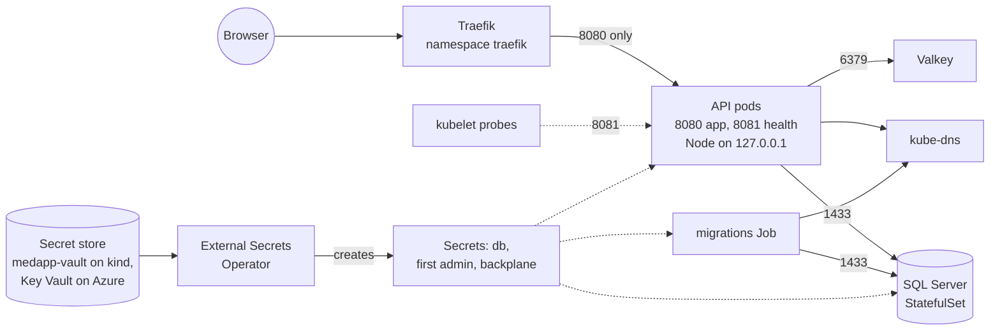

# Review: Kubernetes (kind, the Helm chart, and locking it down)

**Pull requests:** #46 (a local kind cluster), #47 (the Helm chart, with migrations as a Job), #48 (security, the chart's side), and the chart parts of #49 (Argo CD sync waves) and #50 (Valkey, several API copies). **Status:** merged to `main`. `deploy/versions.sh` (the cluster services' chart versions, shared with Azure), which `deploy/kind/up.sh` now sources, was uncommitted on `feature/azure` when these notes were written, and was merged via #52. The SSR fixes went in via #51.

The app-side half of #48 (health checks on their own port, HSTS, `create-first-admin`) is in [app-changes.md](app-changes.md). Argo CD and the Publish workflow are in [gitops.md](gitops.md), and the backplane in [signalr-backplane.md](signalr-backplane.md).

## Why

`docs/todo.md` at the base commit planned "Kubernetes, with Helm, Argo CD and Azure", in five steps: kind first, then a Helm chart (the API, config and secrets, the database or an external one, ingress, and the migrations as a job), then "proper security" (a secret store, TLS, network policies, non-root containers with read-only filesystems, resource limits, and the session cookie and health endpoints set up behind an ingress), then Argo CD, then Azure. This document covers the first three.

## What's in it

| Where | What |
|---|---|
| `deploy/helm/medapp/templates/api.yaml` | The API: Service (8080 only), Deployment, and a PodDisruptionBudget when there's more than one copy. |
| `templates/sql.yaml` | SQL Server 2022 as a one-pod StatefulSet on a 5 GiB volume (`sql.enabled`, on by default). |
| `templates/valkey.yaml` | Valkey, the SignalR backplane (see the backplane review). |
| `templates/migrations-job.yaml` | The EF migrations bundle, then `create-first-admin`, as a Helm hook and an Argo CD sync hook. |
| `templates/secret.yaml`, `templates/externalsecrets.yaml` | The three Secrets (database, first admin, backplane): from an existing Secret, from External Secrets, or made by the chart. |
| `templates/ingress.yaml` | One Ingress for everything, with an optional cert-manager issuer. |
| `templates/networkpolicy.yaml` | Default-deny policies for every MedApp pod. |
| `templates/_helpers.tpl` | Names, labels, and the shared pod and container security settings. |
| `values.yaml`, `README.md` | Every setting with what it does; how to install, the secrets, migrations, several copies, and the lockdown. |
| `deploy/kind/cluster.yaml` | One node; Traefik's node ports mapped to `127.0.0.1:8080` and `:8443`. |
| `deploy/kind/up.sh`, `down.sh` | Create, deploy or redeploy, with `--demo-data` and `--argocd`; delete. |
| `deploy/kind/local-cluster.yaml` | Local stand-ins: a self-signed ClusterIssuer, and a ClusterSecretStore over plain Secrets in a `medapp-vault` namespace. |
| `deploy/kind/values.yaml`, `traefik-values.yaml` | MedApp's values for kind (two copies, TLS, External Secrets), and Traefik's. |
| `.github/workflows/main.yml:51-93` | The `helm` job: `helm lint --strict` in several configurations, and a render. |

## How it fits together

Everything else to or from MedApp's pods is refused by the network policies. Node's calls to the API stay inside the pod, on loopback, which no policy sees.

### The API

`templates/api.yaml`:
- **Environment** (lines 52-76): the connection string and backplane connection string from Secrets; `ASPNETCORE_HTTP_PORTS=8080;8081` and `HealthChecks__Port=8081`; and `ASPNETCORE_FORWARDEDHEADERS_ENABLED=true`, so the API takes the scheme and client address from Traefik's `X-Forwarded-*` headers. HSTS (sent only on https) and the address recorded at sign-in depend on that. The session cookie's `Secure` flag doesn't: it's set outside Development whatever the scheme.
- **Probes** (lines 88-103), all on port 8081: start-up on `/alive` (every 2 s, 30 tries), readiness on `/health`, liveness on `/alive`.
- **Shutdown** (lines 82-87): a 5 s `preStop` sleep, so the ingress stops sending requests before the pod stops serving. #47 measured 180 requests over three rollouts, all 200.
- **Resources:** requests 250m CPU and 256 MiB, a 1 GiB memory limit, no CPU limit. .NET and Node share it.
- **Several copies** (lines 114-132): more than one adds a PodDisruptionBudget (`minAvailable: 1`), and the chart fails unless the backplane is on.

### Secrets

The chart needs three Secrets. Each comes from, in order:
1. an existing Secret (`database.existingSecret`, and so on);
2. External Secrets (`externalSecrets.enabled`), which makes `ExternalSecret`s that the operator fills from a SecretStore or ClusterSecretStore;
3. the chart itself (`templates/secret.yaml`): random passwords, kept across upgrades by `lookup`, and kept on uninstall (`helm.sh/resource-policy: keep`, line 29), because SQL Server's volume only opens with the password it was created with.

`lookup` sees nothing under `helm template` or Argo CD, so the third way would generate new passwords on every render there. kind's values and Azure's use External Secrets. On kind, the store is a namespace of plain Secrets that `up.sh` fills once with random values (`up.sh:87-106`), read through External Secrets' Kubernetes provider, so the chart sees the same kind of store as on Azure.

### Migrations and rollout order

The migrations Job runs `/app/efbundle`, then `create-first-admin` (`migrations-job.yaml:41-45`). Its hooks (lines 13-20):
- **Plain Helm:** `post-install` (the in-chart SQL Server has to exist first), and `pre-upgrade` (the schema is migrated before the new API rolls out, and a failure fails the upgrade, so the old API keeps running). On a first install the API starts before the schema exists, briefly.
- **Argo CD:** Argo CD would treat `post-install,pre-upgrade` as both a PreSync and a PostSync hook, and the first sync would fail before SQL Server existed. So the Job is an Argo CD `Sync` hook in wave 1, after the Secrets (wave -1) and SQL Server (wave 0), and before the API (wave 2).

Because migrations run before the new API is up, the old API runs on the new schema for a while. The chart README says to make removals and renames in two releases. Nothing enforces it, so it rests on reviewers spotting a destructive migration.

### Locking it down (#48)

- **Pod Security:** every pod meets the `restricted` standard (`_helpers.tpl:60-75`): non-root users (1654 for the API and Job, 10001 for SQL Server, 999 for Valkey), the `RuntimeDefault` seccomp profile, no privilege escalation, all capabilities dropped (SQL Server adds back `NET_BIND_SERVICE`, which `sqlservr` carries as a file capability), and no service account token. The `medapp` namespace enforces it: `up.sh:170-173` labels it, and the Argo CD Application sets it through `managedNamespaceMetadata`.
- **Read-only root filesystems,** with a 256 MiB `emptyDir` at `/tmp` (the bundle unpacks there, through `DOTNET_BUNDLE_EXTRACT_BASE_DIR`), and SQL Server's data on its volume.
- **Network policies** (`templates/networkpolicy.yaml`): the API accepts only the ingress controller's namespace on port `http`, and reaches only DNS, SQL Server, Valkey and `networkPolicy.extraEgress`. SQL Server accepts only the API and the Job, Valkey only the API, and neither reaches anything. The Job accepts nothing.
- **Health checks** on port 8081, which neither the Service nor the policy exposes.
- **TLS:** `ingress.tls.clusterIssuer` adds the cert-manager annotation. kind uses a self-signed issuer.

### kind

`up.sh` creates the cluster if it's missing, installs Traefik, cert-manager and External Secrets at the versions in `deploy/versions.sh`, applies the local stand-ins, fills the store once, builds the image and loads it into the node (tagged by image ID), then runs `helm upgrade --install` with `--wait`. `--demo-data <snapshot>` scales the API to zero, restores a `medapp-dev` snapshot into the pod's SQL Server, and upgrades again so the migrations Job brings it up to date. `--argocd` hands deploying to Argo CD (see [gitops.md](gitops.md)); each mode refuses to start while the other is in charge (`up.sh:108-117, 156-160`). Every `kubectl` and `helm` call names the `kind-medapp` context.

## Design decisions

- **A Helm chart, not kustomize.** #46 started with kustomize manifests; #47 replaced them. The chart has real options (in-cluster SQL Server or an external database, three sources of secrets, ingress and TLS, a backplane) that one set of templates serves for kind and Azure.
- **Migrations as a Job from the API's own image,** not at start-up, so a failed migration stops a rollout instead of crash-looping every copy, and the schema always matches the code.
- **A deliberate first admin** (`create-first-admin`), not a seeded account: the app seeds no users, and the Job makes one only while there are none.
- **External Secrets with a local stand-in.** kind exercises the same `ExternalSecret` path as Azure, without a cloud.
- **Default-deny network policies for MedApp's own pods only.** Other namespaces (Traefik, cert-manager, the operators) are left alone.
- **Two copies on kind, "as production would run"** (#50), so the backplane is exercised locally.

## How it was verified

- **#46:** on a fresh cluster with the demo snapshot (both pods ready, Node started, `admin` signed in, `/patients` server-rendered with 60 patients); on an empty database (the migrations made the schema); beside a running AppHost.
- **#47:** both migrations Jobs completed on a fresh cluster; SSR, sign-in and the SignalR WebSocket (101 through Traefik) worked; a redeploy kept the data; an unchanged re-run kept the tag; 180 requests across three rollouts all returned 200.
- **#48:** both ExternalSecrets synced; on an empty database the first admin signed in over https and used admin-only endpoints, and a redeploy left it alone; cert-manager issued the certificate; HSTS was sent for a real host name and not for `localhost`; port 8081 answered `Healthy` while `/health` through the ingress was the app's page; the network policy matrix below; the namespace refused a privileged pod; root filesystems refused writes except `/tmp` and SQL Server's volume; the API ran as uid 1654 with no token.

  | From | SQL Server | API |
  |---|---|---|
  | Another namespace | blocked | blocked |
  | Traefik's namespace | blocked | allowed |
  | A non-API pod in `medapp` | blocked | n/a |

- **CI:** the `helm` job lints four configurations (five with the uncommitted Azure step) and renders kind's.
- **For this review:** `helm lint --strict` passes with the defaults, kind's values and Azure's. Read-only look at the kind cluster (Kubernetes v1.37.0): two API pods, SQL Server and Valkey running, all three ExternalSecrets `SecretSynced`, the PDB and four NetworkPolicies in place. The cluster is currently deployed by plain Helm with a locally built image (`medapp-api:local-70224af86d9e`), not by Argo CD: Argo CD is installed, but there's no `medapp` Application.

Not verified: any cluster but kind (policy enforcement and DNS labels on AKS with Cilium, a multi-node drain with the PDB), SQL Server restarts and volume recovery, and the resource limits under load.

## Risks and open questions

1. **Medium: readiness says nothing about dependencies.** `/health` and `/alive` both run only the built-in "self" check (`MedApp.ServiceDefaults/Extensions.cs:100-104`). A pod stays ready with the database or Valkey unreachable, or with Node dead. Under plain Helm's first install, the API is ready before the migrations Job has made the schema. Not checking the database in the probes avoids every pod going unready during a short database blip, which may be the intent, but the PRs don't discuss it.
2. **Medium: data-protection keys are in memory, per pod, and there are now two pods.** The API logs `EphemeralXmlRepository` warnings on kind. Nothing depends on the keys today: sessions are database rows, and the admin password reset uses its token within one request (`MedApp.Infrastructure/Common/Identity/IdentityUserService.cs:61-65`). But anything that protects a value in one request and reads it in another (an emailed reset link, ASP.NET's own cookie authentication, antiforgery tokens) would fail at random with two pods. #47 listed shared keys as a prerequisite for more than one copy; #48 removed that line without saying why. At least the chart README should say it.
3. **Medium: nothing spreads the API's copies across nodes.** There's no `topologySpreadConstraints` or anti-affinity in `api.yaml`. On Azure (2 to 4 nodes), both copies can land on one node, and a PodDisruptionBudget doesn't protect against a node failing. kind has one node, so this only shows up on Azure.
4. **Low: the app connects as `sa`** to the in-cluster SQL Server (`secret.yaml:34`, `up.sh:95`). Fine for kind; on Azure it's the server admin instead (see [azure.md](azure.md)).
5. **Low: floating third-party images.** SQL Server is `2022-latest` and Valkey `8.1-alpine`, pulled `IfNotPresent`, while the chart insists the app's own tag is exact.
6. **Low: the health port isn't health-only.** `UseHealthChecks(path, port)` adds the two health paths on 8081, but every other path on 8081 is the whole app. What keeps 8081 private is the Service and the network policy, not the port. Fine as long as both stay as they are.
7. **Low: the `preStop` sleep action needs Kubernetes 1.30 or later.** kind runs 1.37, and current AKS versions are newer than 1.30.
8. **Low: DNS egress assumes CoreDNS pods labelled `k8s-app: kube-dns` in `kube-system`.** True on kind and AKS. Elsewhere, DNS would quietly fail.
9. **Low: Valkey's password is on its command line** (`valkey.yaml:46`), so it's visible in the process list inside that pod.
10. **Low: demo data brings the `admin`/`admin` test login** into the cluster (`--demo-data`). Local only, and documented.
11. **Docs that disagree with the code:**
    - `deploy/kind/up.sh:186` says "Back to one copy"; kind runs two.
    - `deploy/kind/traefik-values.yaml:2-3` says there's no TLS locally; https://localhost:8443 has had a cert-manager certificate since #48.
    - `deploy/helm/medapp/README.md:87-89` still lists Argo CD as "Not yet".
    - `deploy/helm/medapp/README.md:76` says the API reaches only DNS and the database (plus `extraEgress`); it also reaches Valkey, as the line before says.

## Where to look closely

- `deploy/helm/medapp/templates/networkpolicy.yaml`, all of it: it's the main control between the pods.
- `templates/secret.yaml:6-35`: `lookup`, the generated password and `keep`.
- `templates/migrations-job.yaml:13-20, 41-45`: the two hook systems and the command.
- `templates/api.yaml:52-113`: environment, ports, probes and shutdown.
- `deploy/kind/up.sh:87-106` (the local store), `:108-160` (switching between Helm and Argo CD), `:178-188` (the demo restore).
