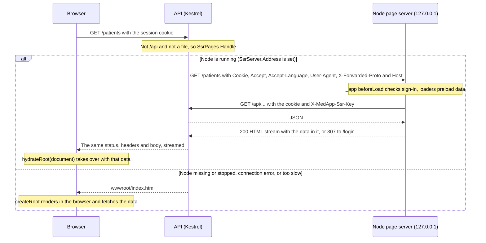

# Review: server-side rendering

**Pull requests:** #42 (server-side rendering), and the dev server's WebSocket fix in #43. **Status:** merged to `main`.

Pages are now rendered on the server by a Node process that the API starts, then taken over (hydrated) in the browser. The API stays the front door: it forwards page requests to Node on loopback, and serves the plain `index.html` (client rendering, as before) when Node isn't running.

The most important finding is that the forwarding `HttpClient` picks up ServiceDefaults' standard resilience handler. That changes how the fallback behaves exactly when it's needed: see [risk 1](#risks-and-open-questions).

## Why

`docs/todo.md` at the base commit (d3df88b) had the item: "Consider rendering pages on the server ... for a faster first paint." It named what made it hard: every page sits behind sign-in, its data comes from the API per user, and the app was static files in the API's `wwwroot`. So SSR needed a Node server (or the API to host one) and the session cookie passed through.

What it buys: the first paint is the page itself, with its data, in the account's light or dark mode and text size, rather than an empty page that fills in once the scripts have loaded and fetched the data.

## What changed

| Where | What |
|---|---|
| `MedApp.API/ServerRendering/SsrServer.cs` | A hosted service that starts `node wwwroot/ssr/server.mjs` once the API is listening, on a free loopback port, with the API's address and a random key. Implements `ISsrServer`. |
| `MedApp.API/ServerRendering/SsrPages.cs` | The fallback endpoint for page paths: forwards GET and HEAD to Node, or serves `index.html`. |
| `MedApp.API/ServerRendering/SsrOptions.cs` | The `Ssr` settings: `Enabled`, `NodePath`, `ScriptPath`, `RenderTimeout` (15 s). |
| `MedApp.API/Common/Extensions/ApplicationBuilderExtensions.cs:22-35, 52-54` | Skips the https redirect for Node's own calls, blocks `/ssr` and `/.vite`, maps the fallback. |
| `MedApp.API/Common/Extensions/ServiceExtensions.cs:23-30` | Registers `SsrServer` and the named `ssr` HttpClient (no redirects, no cookie container). |
| `MedApp.Web/server/server.mjs` | The Node page server. `--dev` hosts Vite as middleware on :5173; otherwise it renders from the built `dist/ssr/entry-server.js`. |
| `MedApp.Web/src/entry-server.tsx`, `src/entry-client.tsx` | Render a request on the server; hydrate in the browser (or `createRoot` on the plain `index.html`). Replace `src/main.tsx`. |
| `MedApp.Web/src/ssr/document.tsx`, `src/ssr/requestContext.ts` | The whole `<html>` document when rendering one; the per-request API address, cookie and key. |
| `MedApp.Web/src/api/client.ts:25-41` | An openapi-fetch middleware that sends server-side API calls straight to the API with the cookie and key. |
| `MedApp.Web/src/api/preload.ts`, the route files under `src/routes/_app/` | Route `loader`s that preload the same queries the pages read. |
| `MedApp.Web/src/router.tsx:26-38`, `src/app/queryClient.ts` | `createSsrRouter`: a new query cache per request, dehydrated into the page; 30 s `staleTime` after hydration. |
| `MedApp.Web/src/app/settingsStore.ts:99-116` | `ServerSettingsContext`: the account's saved settings as the server snapshot of `useAppSetting`. |
| `MedApp.Web/package.json:7-9`, `vite.config.ts:16-22`, `tsconfig.ssr.json` | `npm run dev` runs the page server; `npm run build` adds the SSR bundle (`ssr.noExternal`) and copies `server.mjs` into `dist/ssr/`. |
| `tools/ui-parity/` | Signs in as a dedicated synthetic `dev-parity` admin and sets its saved settings through the API, because the server now renders with the account's settings, which a browser-side mock can't intercept. |

## How a page request flows



1. **Starting Node** (`SsrServer.ExecuteAsync`, `SsrServer.cs:54-130`). If SSR is enabled and `wwwroot/ssr/server.mjs` exists, it waits for `ApplicationStarted`, then works out the API's own address (`ApiAddressFor`, lines 136-145: http preferred, a wildcard host becomes 127.0.0.1). It starts Node on a free loopback port with `PORT`, `HOST=127.0.0.1`, `MEDAPP_API_URL`, `MEDAPP_SSR_KEY` (32 random bytes per API start), `NODE_ENV=production` and `NODE_OPTIONS=--use-system-ca` (lines 74-90). It counts Node as ready when Node prints `MedApp pages:` (lines 102-108). If Node exits, it logs a warning, clears the address and returns; Node isn't started again (lines 116-129).
2. **Forwarding** (`SsrPages.Handle`, `SsrPages.cs:24-46`). Only GET and HEAD are forwarded, with four request headers and `X-Forwarded-Proto`/`X-Forwarded-Host` (lines 15, 53-60). `RenderTimeout` covers getting the response headers; the body then streams with no timeout (lines 62-73). Redirects come back as they are, because the client doesn't follow them. On `HttpRequestException` or a timeout it serves `index.html` (line 39).
3. **Rendering** (`server.mjs:92-125`, `src/entry-server.tsx`). Production mode loads the bundled server entry and the client build's manifest, for the page's stylesheets, module preloads and entry script. `render()` runs TanStack Router's `createRequestHandler` with `defaultStreamHandler`, inside an `AsyncLocalStorage` that holds this request's API address, cookie and key (`entry-server.tsx:14-26`).
4. **API calls while rendering** (`src/api/client.ts:25-41`). The `api` client is a module singleton. On the server its middleware reads the current request's context and rewrites each call to `MEDAPP_API_URL`, adding the cookie and the key. In the browser it does nothing.
5. **Data.** `_app`'s `beforeLoad` (`src/routes/_app.tsx:10-15`) ensures `whoami` (signed out: redirect to `/login`) and preloads settings and notifications. Each page's `loader` calls `preload()` (`src/api/preload.ts:12-18`): on the server it waits, and swallows errors so the page shows its own error state; in the browser it only starts the fetch, so client navigation is unchanged. `setupRouterSsrQueryIntegration` puts the query cache into the HTML, and the browser starts from it.
6. **Settings.** The server can't read the browser's `localStorage`, so it renders with the account's saved settings. `RootDocument` sets `data-theme` and the font size on `<html>` (`src/ssr/document.tsx:32-58`), and `useAppSetting` uses the same settings for its server snapshot, so hydration matches. After hydration, this browser's settings take over.
7. **The browser entry** (`src/entry-client.tsx`). If the page has a `#root` (the plain `index.html`), it renders as before. Otherwise it hydrates the whole document.
8. **The https redirect and the key** (`ApplicationBuilderExtensions.cs:22-35`). Requests from loopback that carry the key skip `UseHttpsRedirection`. Requests under `/ssr` and `/.vite` get a 404 before static files are served, so the server bundle and the manifest never reach a browser.
9. **Development** (`server.mjs:38-89, 188-222`). `npm run dev` (and the AppHost) runs the page server with Vite as middleware on :5173. Its server-side API calls go through Vite's own `/api` proxy. #43 added `proxyWebSocket`: Vite's proxy doesn't pass WebSocket upgrades on in middleware mode, so the notifications hub's socket opened but never connected. It accepts the development certificate (`rejectUnauthorized: false`), in development only.

## Design decisions

- **The API hosts Node, rather than Node in front or in a sidecar.** One origin and one front door stay as they were (cookies, `/api`, static files and SignalR all on the API, plan Q4), with one image and Node reachable only on loopback. The cost: Node shares the API container's memory limit and environment, isn't health-checked or restarted, and a crash degrades quietly to client rendering (risks 3 and 4).
- **TanStack Router's SSR primitives and a small hand-written server, not TanStack Start.** The to-do item suggested Start. The PR doesn't say why it wasn't used. A likely reason is that Start expects to own the server and the build, while here the API stays in charge and serves the files.
- **Fall back rather than fail.** No Node, a stopped Node, connection errors and timeouts all give the client-rendered app. So the published image kept working before #45 put Node in it, and an SSR fault shouldn't take pages down.
- **Render as the user.** Node forwards the browser's cookie, so the API applies the same authorisation as for the browser. There's no service identity to secure.
- **The key only skips the https redirect.** It isn't an authorisation mechanism: requests that carry it still need a valid session. It matters when the published app runs with both http and https on one machine (as #42 tested it), because Node calls the API's http address. In the container the API has no https port, so the redirect does nothing anyway, and in the Vite dev server Node's calls go through Vite's proxy instead.
- **A new query cache per request** (`createSsrRouter`). This is what stops one user's data reaching another's page. The `api` client is shared, but the cookie comes from `AsyncLocalStorage` per request.
- **The server bundle carries its packages** (`ssr.noExternal`), so `wwwroot/ssr` needs no `node_modules`.

## How it was verified

- **Tests:** `src/entry-server.test.tsx` renders whole pages in Node (the document and assets, the signed-out redirect, a signed-in page with data, cookie and key, account settings, failed data, text size). .NET: `SsrServerTests` (address choice, the key check, off paths), `SsrServerProcessTests` (starts a real Node process; skipped without Node, which CI's runner has), `SsrPagesTests` (forwarding, redirects, fallbacks).
- **By hand (PR #42):** dev on the AppHost (rendered with data, no hydration errors, hot reload, the notifications socket); production mode on a scratch copy (Node started, signed-in pages rendered, client navigation, signed-out redirect, `/ssr` and `/.vite` 404, fallback with Node killed); full UI parity run (47 pass). #43 checked the hub's handshake and a live notification on the dev server. #45 and #47 checked SSR in the image and on kind.
- **Re-run for this review (15 November 2026):** `dotnet test MedApp.UnitTests -c Release` 708 pass; `npm test` in `MedApp.Web` 666 pass. On the kind cluster, the API's log shows Node started: `SSR: MedApp pages: http://127.0.0.1:33023/ (production, API at http://127.0.0.1:8080)`.
- **A scratch experiment** (outside the repo) called the real `SsrPages.Handle` with the API's real service registration (`AddServiceDefaults` + `AddApi`) against a fake renderer. Results are under risk 1.

Not verified:
- The forwarding client as the app actually composes it. `SsrPagesTests` builds `new HttpClient(handler)` directly, and ServiceDefaults and `ServiceExtensions` are excluded from coverage as wiring. That's how risk 1 went unnoticed.
- Load: no test of .NET and Node together under the API's 1 GiB memory limit, or of the extra API calls each page load now makes (`whoami`, settings, notifications and the page's data, each checked against the session table).
- A Node crash in a long-running pod, and what operators would see.

## Risks and open questions

1. **High: the page-forwarding client inherits the standard resilience handler.** `MedApp.ServiceDefaults/Extensions.cs:29-36` calls `ConfigureHttpClientDefaults(http => http.AddStandardResilienceHandler())`, which applies to every client from `IHttpClientFactory`, including `ssr` (`ServiceExtensions.cs:29-30`). Its defaults: a 10 s timeout per attempt, 3 retries with exponential back-off on 5xx, 408, 429, connection errors and timeouts, and a circuit breaker that opens for 5 s when at least 10% of at least 100 requests in 30 s fail. Measured with the scratch experiment:

   | Renderer | What happened |
   |---|---|
   | Answers 500 | 4 render attempts over 11.1 s, then the 500 went to the browser |
   | Takes 12 s | Cut off at 10 s and rendered again, then the 15 s `RenderTimeout` gave the fallback after 15.1 s |
   | Answers 500 to 150 concurrent requests | The circuit opened. All 150 threw `BrokenCircuitException` out of `SsrPages.Handle` |

   `SsrPages.Handle` only catches `HttpRequestException` and `TaskCanceledException` (`SsrPages.cs:39`), so a broken circuit becomes a 500 instead of the client-rendered fallback, for every page, while the circuit is open. The same goes for the handler's rate limiter (above 1,000 concurrent page requests) and its total timeout (if `RenderTimeout` is ever raised above 30 s). A render fault also renders each page up to 4 times, which adds load during an incident. A fix could be `.RemoveAllResilienceHandlers()` on the `ssr` client (it exists in Microsoft.Extensions.Http.Resilience 10.10.0, which ServiceDefaults uses), and catching every exception except the browser's own cancellation in `Handle`. A test should build the client the way the app does.
2. **Medium: server-rendered pages carry personal data and no `Cache-Control`.** The page's dehydrated query cache (patients, procedures, the user's notifications) is in the HTML. Before SSR, `index.html` held no data. On kind, the login page's response carries only `Content-Type`, `Date`, `Server` and `Transfer-Encoding`, and nothing in `server.mjs`, the router or `SsrPages` sets caching headers for signed-in pages either. A shared cache, or the browser's back button after signing out, could show a page with patient data. `Cache-Control: no-store` (or `private, no-cache`) on pages rendered for a signed-in user would close this. There are no security headers either (no CSP, `X-Content-Type-Options` or `frame-ancestors`); that predates this work, but matters more now.
3. **Medium: Node gets the API's whole environment.** `ProcessStartInfo.Environment` starts as a copy of the parent's, and `SsrServer.cs:80-89` only adds to it. So the renderer can read `ConnectionStrings__DefaultConnection` (the database password) and `ConnectionStrings__SignalRBackplane`. Node needs only the variables it's given, plus `PATH` and `HOME`. The renderer runs third-party npm code over user-entered data (patient names, notes as Markdown), so clearing the environment is cheap defence in depth.
4. **Medium: Node is never restarted, and nothing reports it.** If Node exits, `SsrServer` logs one warning and pages fall back to client rendering for the rest of the pod's life. The health checks don't cover Node, so Kubernetes won't restart the pod, and only the logs show it.
5. **Low: a 5xx from Node goes to the browser.** `Forward` copies Node's status, so a render error shows the text "The page could not be rendered." with a 500, rather than the client-rendered app. Worth deciding whether any 5xx from Node should fall back too.
6. **Low: a failure after the page has started streaming can't fall back.** The catch then calls `SendIndex` on a response whose headers have gone, which throws. The browser gets a cut-off page, and the log an unhandled exception.
7. **Low: signed-out pages render dark.** The login page has no account settings, so a browser set to light mode sees dark first, then switches after hydration.
8. **Low: CI doesn't run the SSR build.** The `web` job runs `npx vite build` (`.github/workflows/main.yml:46-47`), the client build only, not `npm run build`. A break in the server bundle (`vite build --ssr`) shows up first in the Docker build, after merge.
9. **Low: port race.** `FreePort` releases the port before Node binds it, so another process could take it first. Node would then fail to start, and pages would fall back.
10. **Docs that disagree with the code:**
    - `MedApp.Web/server/server.mjs:6, 15` name `SsrHost`; the class is `SsrServer`.
    - `ApplicationBuilderExtensions.cs:37` says the AppHost copies the app into `wwwroot` on publish; since #45 the Dockerfile builds it.
    - `SsrOptions.RenderTimeout` (`SsrOptions.cs:21-22`) reads as the time a render may take. In practice the resilience handler cuts each attempt at 10 s and retries (risk 1).

## Where to look closely

- `MedApp.API/ServerRendering/SsrPages.cs:31-46`, with `MedApp.ServiceDefaults/Extensions.cs:29-36` and `MedApp.API/Common/Extensions/ServiceExtensions.cs:29-30`: the fallback, and what the client really does.
- `MedApp.API/ServerRendering/SsrServer.cs:74-90` (Node's environment) and `:116-129` (no restart).
- `MedApp.API/Common/Extensions/ApplicationBuilderExtensions.cs:22-35`: the redirect bypass and the blocked paths.
- `MedApp.Web/src/api/client.ts:25-41` with `src/entry-server.tsx:14-26`: per-request isolation depends on `AsyncLocalStorage` reaching every API call made while rendering.
- `MedApp.Web/src/router.tsx:26-38`: the per-request query cache.
- `MedApp.Web/server/server.mjs:136-165` (forwarded headers and streaming) and `:195-222` (the development WebSocket proxy).

## Reproducing risk 1

The experiment was a console project outside the repository (`Microsoft.NET.Sdk.Web`, `net10.0`, with a project reference to `MedApp.API/MedApp.API.csproj`), built and run in Release. Its core:

```csharp
// A fake renderer on loopback (an HttpListener) that counts requests and answers 500, or answers 200 after 12 s.
var builder = WebApplication.CreateBuilder();
builder.AddServiceDefaults();                     // as MedApp.API's Program.cs does
builder.Services.AddApi(builder.Configuration);   // registers the "ssr" client as production does
var app = builder.Build();

var context = new DefaultHttpContext { RequestServices = app.Services };
context.Request.Method = "GET";
context.Request.Path = "/patients";
context.Response.Body = new MemoryStream();

// FakeSsr implements ISsrServer, with Address pointing at the fake renderer.
await SsrPages.Handle(context, new FakeSsr(rendererAddress), app.Services.GetRequiredService<IHttpClientFactory>(),
    app.Services.GetRequiredService<IOptions<SsrOptions>>(), app.Services.GetRequiredService<ILogger<SsrServer>>());
```

Count the renderer's requests and time the call. For the circuit breaker, run 150 of these at once against the renderer that answers 500, and catch what `Handle` throws. The scratch project has no `wwwroot`, so its fallback is a 404 where the real app would send `index.html`.
