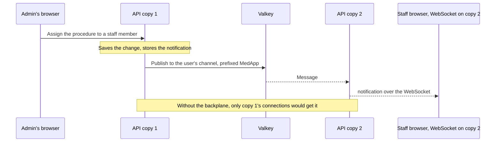

# Review: the SignalR backplane

**Pull request:** #50. **Status:** merged to `main`.

With more than one copy of the API, a live notification only reached browsers connected to the copy that sent it. #50 adds a Redis-compatible backplane (Valkey in the cluster), so every copy passes its SignalR messages to the others. The chart can now run several copies, and kind runs two.

## Why

Notifications (being assigned a procedure) are stored, then pushed live through `NotificationsHub` to the user's open pages. A browser's WebSocket is held by one copy of the API, but the request that creates the notification can land on any copy. #47 named this as one reason the chart had to stay at one copy.

## What changed

| Where | What |
|---|---|
| `MedApp.API/Notifications/SignalRBackplane.cs` | `AddBackplane()`: with `ConnectionStrings:SignalRBackplane` set, StackExchange.Redis with channel prefix `MedApp` and `AbortOnConnectFail = false`. Without it (development, the AppHost), nothing changes. |
| `MedApp.API/Common/Extensions/ServiceExtensions.cs:20` | `services.AddSignalR().AddBackplane(configuration)`. |
| `MedApp.API/MedApp.API.csproj` | `Microsoft.AspNetCore.SignalR.StackExchangeRedis` 10.0.15. |
| `MedApp.Web/src/app/LiveNotifications.tsx:11, 29-34` | Connects with `skipNegotiation: true` over WebSockets only. |
| `deploy/helm/medapp/templates/valkey.yaml` | Valkey (`valkey/valkey:8.1-alpine`): a Deployment with no volume, `--requirepass`, no saving to disk, restricted pod settings, a read-only root filesystem. |
| `templates/networkpolicy.yaml:38-46, 50-71` | The API may reach Valkey on 6379; only the API may connect to Valkey, and Valkey reaches nothing. |
| `templates/api.yaml:58-65, 114-132` | The backplane connection string from a Secret; a PodDisruptionBudget above one copy; the chart fails with more than one copy and no backplane. |
| `templates/secret.yaml:62-87`, `externalsecrets.yaml`, `values.yaml:50-67` | The backplane Secret from the same three places as the others. |
| `deploy/kind/values.yaml:8-9`, `deploy/kind/up.sh:101-106` | Two copies on kind, and the backplane Secret in the local store. |

## How it works

- `SignalRNotificationPublisher` sends to `Clients.User(userId)`. With the backplane, every copy subscribes to the Redis channels and delivers to its own connections for that user.
- If Valkey is down, the API still starts and keeps reconnecting (`AbortOnConnectFail = false`, `SignalRBackplane.cs:31`). Meanwhile a notification reaches pages on the copy that sent it, and everyone sees it on the next page load, because it's stored first.
- **No negotiate request.** SignalR normally sends `POST /negotiate`, then opens the WebSocket with the connection ID it got back. With two copies and no sticky sessions, those two requests can reach different copies, and the second rejects the unknown connection. Skipping negotiation means one request, the WebSocket, to whichever copy. So no sticky sessions are needed, and nothing ties the app to one ingress controller's affinity settings.

## Design decisions

- **Valkey, not Redis,** because it's the BSD-licensed fork; any Redis works through `backplane.existingSecret` or `externalSecrets.backplane` (Azure Cache for Redis, for example).
- **Nothing persisted.** The backplane only passes messages on; notifications live in SQL Server. So Valkey needs no volume, and a restart loses nothing that matters.
- **WebSockets only, rather than sticky sessions.** Sticky sessions would depend on the ingress controller (Traefik cookies here, something else elsewhere). The cost is the loss of SignalR's fallbacks (risk 1).
- **The chart refuses the unsafe configuration** (more than one copy without a backplane) at render time, rather than documenting it.
- **A password as well as the network policy,** as defence in depth.

## How it was verified

- **#50 on kind,** with two copies behind Traefik: a test user connected to the hub, and an admin assigned them to 8 procedures, then unassigned them.

  | Backplane | Arrived live |
  |---|---|
  | On | 8 of 8 |
  | Removed from the deployment (control) | 4 of 8 |
  | Restored | 8 of 8 |

  The control is the useful part: it shows the test would have caught a missing backplane.
- In development, a negotiation-free WebSocket connects through the Vite dev server.
- **Tests:** `SignalRBackplaneTests` (5 cases: three blank connection strings keep SignalR's in-process delivery; a connection string sends through Redis, with the prefix, and starts without the server). `LiveNotifications.test.tsx` asserts the connection options through the SignalR stand-in.
- **For this review:** on kind, the Valkey pod, its NetworkPolicy and the `medapp-backplane` ExternalSecret (`SecretSynced`) are in place.

Not verified: a Valkey restart while notifications are sent, networks that block WebSockets, and an outage longer than the client's reconnect schedule.

## Risks and open questions

1. **Low to medium: no fallback when WebSockets are blocked.** With `skipNegotiation` and WebSockets only, SignalR can't fall back to server-sent events or long polling. Behind a proxy that blocks WebSockets (some hospital and corporate networks do), live notifications quietly don't arrive. They still show on the next page load. Worth knowing who the users are.
2. **Low: the client gives up after about 42 seconds.** `withAutomaticReconnect()` with no arguments tries at 0, 2, 10 and 30 s, then stops, and nothing restarts it (`LiveNotifications.tsx:33, 43-49`). A rolling update is fine (the other copy answers at once), but an outage of both copies longer than that ends live updates until the page is reloaded. This predates #50, but running in a cluster makes outages and restarts more routine.
3. **Low: one channel prefix for every environment.** The prefix is the constant `MedApp` (`SignalRBackplane.cs:18`). Two environments sharing one Redis (say, a staging and a production on one Azure Cache) would receive each other's messages. User IDs are GUIDs, so nobody would see the wrong notification, but the comment's "so it can share a server with anything else" doesn't cover another MedApp.
4. **Low: traffic to Valkey isn't encrypted.** Inside the cluster, the API talks to Valkey in plain text, and notification messages carry the procedure's title and who assigned it (`AssignPatientProcedureHandler.cs:41-50`). The network policy limits who can connect, not who can see the traffic on the node network. For an external Redis, the connection string can set `ssl=true`, as `values.yaml:55` suggests.
5. **Low: one Valkey pod.** A restart or a node drain interrupts cross-copy delivery for a few seconds. That's within the design (stored notifications catch up), but there's no PodDisruptionBudget for it.

## Where to look closely

- `MedApp.API/Notifications/SignalRBackplane.cs:20-33`.
- `MedApp.Web/src/app/LiveNotifications.tsx:29-49`.
- `deploy/helm/medapp/templates/valkey.yaml` and `networkpolicy.yaml:38-71`.
- `deploy/helm/medapp/templates/api.yaml:114-117`: the guard against several copies without a backplane.
